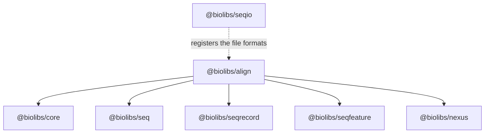
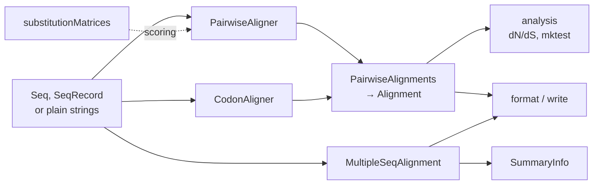

# @biolibs/align

Sequence alignment in TypeScript, ported from Biopython's `Bio.Align` and checked against it case by case.

- **Pairwise alignment** — `PairwiseAligner`, same scoring and same traceback order
- **Containers** — `Alignment`, `PairwiseAlignments`, `MultipleSeqAlignment`
- **Substitution matrices** — 30 bundled, with Biopython's arithmetic on them
- **Codon-aware alignment** — `CodonAligner`
- **dN/dS** — NG86, LWL85, YN00 and ML, plus the McDonald-Kreitman test
- **File formats** — every alignment format Biopython reads or writes, `big*` containers included

## Verified against Biopython

| | |
|---|---|
| API items at parity | **175 / 175** across the nine `Bio.Align` modules |
| Recorded cases replayed | **9,450** |
| Checked against | Biopython 1.88 |

Biopython 1.88 is run to record what it does with each case; the tests replay those recordings. A case
passes only on all of:

- the same result
- the same exception type **and** message
- the same warnings
- the same order of evaluation

Five things sit outside that claim, each bounded rather than hand-waved:

- **`analysis.calculateDnDs` with `"ML"`** — fits Goldman and Yang's model with L-BFGS-B. Matches SciPy
  through the first function value and gradient, then diverges in the rounding inside compiled dot
  products, norms and Cholesky factorizations. Tests require an identical iteration count and stopping
  reason, the objective to 1e-5, and dN/dS to ~5e-5 relative. The matrix exponential underneath matches
  SciPy to ~1e-13.
- **`log` and `exp` on a substitution matrix** — can differ from NumPy's in the last bit.
- **Two cases where Biopython reads uninitialised memory** — a zero-width column selection of three or
  more rows re-parsed from text, and `exonerate` vulgar lines whose operations have a zero step. There is
  no defined behaviour to copy; those cells read as zero here and are excluded from the cases.
- **`"fogsaa"` mode with inconsistent scores** — a match score below the mismatch score, or a gap score
  above it. Biopython warns that results may be incorrect and sometimes crashes the interpreter outright,
  so there is nothing to record. This port emits the same warning; its behaviour there is unverified.
- **The `F1x4` and `F61` codon frequency models** — not ported, because they raise `TypeError` in
  Biopython itself on any Python 3. Only `F3x4` works there, so only `F3x4` works here.

Item-by-item checklist: [`docs/parity/`](../../docs/parity/README.md).

## Install

```bash
npm install @biolibs/align
```

- ESM only — no CommonJS build
- Node 20 or later
- TypeScript types included



The five packages below are pulled in automatically. `@biolibs/seqio` is the odd one: it is **not** a
dependency — it depends on this package, and registers the file-format writers into it when it loads. That
is why reading or writing a format needs a separate import, and why it cannot be done for you.

## API

Every block below was executed to produce the output shown beside it.



### `PairwiseAligner`

Holds the scoring settings and runs the alignment. The algorithm is chosen from the settings, as in
Biopython: Needleman-Wunsch or Smith-Waterman for linear gaps, Gotoh for affine gaps, Waterman-Smith-Beyer
when a gap function is set.

```ts
import { PairwiseAligner } from "@biolibs/align";

const aligner = new PairwiseAligner();
aligner.match = 1;
aligner.mismatch = -1;
aligner.openGapScore = -2;
aligner.extendGapScore = -1;

aligner.mode;         // "global"
aligner.algorithm;    // "Gotoh global alignment algorithm"
```

#### `.score(target, query)`

The best score, without building the alignments. Cheaper than `align` when the score is all you need.

```ts
aligner.score("GAATTC", "GATTC");    // 3
```

#### `.align(target, query)`

Every optimal alignment, as a lazy `PairwiseAlignments`. Accepts strings, `Seq`, `MutableSeq` or
`SeqRecord`.

```ts
const alignments = aligner.align("GAATTC", "GATTC");

alignments.length;              // 2n   — a bigint; there can be astronomically many
const [best] = alignments;      // iterable, and lazy
best.score;                     // 3
```

#### `.mode`

`"global"` by default, or `"local"` for the best-scoring subsequence rather than end-to-end.

```ts
const local = new PairwiseAligner();
local.mode = "local";
local.match = 1;
local.mismatch = -1;
local.openGapScore = -2;
local.extendGapScore = -1;

local.score("AAGAATTCAA", "GAATTC");    // 6
```

### `Alignment`

One alignment: the sequences plus the coordinates that line them up.

```ts
const [best] = aligner.align("GAATTC", "GATTC");

best.toString();
// target            0 GAATTC 6
//                   0 |-|||| 6
// query             0 G-ATTC 5

best.shape;      // [2, 6]        — rows, columns
best.aligned;    // [[[0, 1], [2, 6]], [[0, 1], [1, 5]]]   — the gap-free blocks
best.indices;    // [[0, 1, 2, 3, 4, 5], [0, -1, 1, 2, 3, 4]]   — -1 is a gap
```

#### `.format(fmt)`

The alignment as file text. Needs `@biolibs/seqio` imported (see [Things to know](#things-to-know)).

```ts
import "@biolibs/seqio";
import { SeqRecord } from "@biolibs/seqrecord";
import { Seq } from "@biolibs/seq";

const [named] = aligner.align(
  new SeqRecord(new Seq("GAATTC"), "target"),
  new SeqRecord(new Seq("GATTC"), "query"),
);

named.format("fasta");
// >target <unknown description>
// GAATTC
// >query <unknown description>
// G-ATTC
```

### `MultipleSeqAlignment`

The row-and-column container, indexed as Biopython indexes it.

```ts
import { MultipleSeqAlignment } from "@biolibs/align";
import { Seq } from "@biolibs/seq";
import { SeqRecord } from "@biolibs/seqrecord";

const msa = new MultipleSeqAlignment([
  new SeqRecord(new Seq("ACGT"), "a"),
  new SeqRecord(new Seq("AC-T"), "b"),
  new SeqRecord(new Seq("ACGA"), "c"),
]);

msa.length;                  // 3     rows
msa.getAlignmentLength();    // 4     columns
msa.get(0, 2);               // "G"   (Python: msa[0, 2])
msa.get({ start: 1 }, 3);    // "TA"  (Python: msa[1:, 3] — rows b and c)
```

#### `.format(fmt)`

```ts
import "@biolibs/seqio";

msa.format("clustal");
// CLUSTAL X (1.81) multiple sequence alignment
//
//
// a                                   ACGT
// b                                   AC-T
// c                                   ACGA
```

### `substitutionMatrices`

30 matrices are bundled. A matrix is indexed by a pair, so `getOr` takes an array where Python takes a
tuple.

```ts
import { substitutionMatrices } from "@biolibs/align";

const blosum62 = substitutionMatrices.loadMatrix("BLOSUM62");

blosum62.getOr(["W", "W"], null);          // 11    (Python: blosum62["W", "W"])
blosum62.alphabet;                         // "ARNDCQEGHILKMFPSTWYVBZX*"
substitutionMatrices.loadNames().length;   // 30
```

`readMatrix(text)` parses one from text, and `SubstitutionArray` is the class itself. Arithmetic on a
matrix goes through `arrayUfunc` — see [Things to know](#things-to-know) for the `number`/`bigint` rule.

### `CodonAligner`

Aligns a **protein to a nucleotide sequence**, searching all three reading frames and allowing frame
shifts. Note the argument order: the protein comes first.

```ts
import { CodonAligner } from "@biolibs/align";
import { Seq } from "@biolibs/seq";

const codon = new CodonAligner();

codon.score(new Seq("MAF"), new Seq("ATGGCCTTT"));    // 3

const [aligned] = codon.align(new Seq("MAF"), new Seq("ATGGCCTTT"));
aligned.toString();
// target            0 M  A  F   3
// query             0 ATGGCCTTT 9
```

### `parse`, `read`, `write`

`parse` is lazy and yields every alignment; `read` insists on exactly one; `write` returns how many it
wrote. All need `@biolibs/seqio` imported.

```ts
import "@biolibs/seqio";
import { parse, read, write } from "@biolibs/align";

const text = ">a\nACGT\n>b\nAC-T\n";

[...parse(text, "fasta")].length;    // 1
read(text, "fasta").shape;           // [2, 4]

const out: string[] = [];
write(read(text, "fasta"), { write: (s: string) => out.push(s) }, "phylip");   // 1
out.join("");
// 2 4
// a         ACGT
// b         AC-T
```

### `analysis`

dN/dS by four methods, and the McDonald-Kreitman test. Takes an `Alignment` of coding sequences, read three
letters at a time.

```ts
import "@biolibs/seqio";
import { analysis, read } from "@biolibs/align";

const coding = read(
  ">a\nAGGTGCTCAGTGATATATCACTTTTCAGCGGAGGCCTGGTCCATCAAAGGCATCAAGCGC\n" +
  ">b\nAGGTGCTCAGTGCTCTATCACTTTGGGGCGGCCCAGTGGTCCGCAAAACTCATCAAGCGC\n",
  "fasta",
);

analysis.calculateDnDs(coding, "NG86");     // [0.288197175343171, 0.36256998718340716]
analysis.calculateDnDs(coding, "LWL85");    // [0.3335876036212768, 0.16176814573678225]
```

`"YN00"` and `"ML"` are also available; `analysis.mktest(alignment, species)` returns the test's p-value.
See the [parity section](#verified-against-biopython) for ML's tolerance.

Short or barely-diverged sequences do not give a usable answer, and the port fails the way Biopython does
rather than papering over it:

- a saturated estimate comes back as `-1` — `calculateDnDs(thin, "NG86")` is `[0, -1]`
- `LWL85` on the same data raises `ZeroDivisionError: division by zero`, and on a `-1` estimate
  `ValueError: expected a positive input, got -1.0` from taking its logarithm
- a stop codon raises `KeyError` naming the codon
- `YN00` on too little data raises `RuntimeError: dictionary changed size during iteration`, from a bug
  inside Biopython itself that this port reproduces

### `SummaryInfo`

```ts
import { SummaryInfo } from "@biolibs/align";

new SummaryInfo(msa).getColumn(2);    // "G-G"
```

Biopython deprecated this class and emits a `BiopythonDeprecationWarning` when it is constructed; this port
emits the same warning. Prefer indexing an `Alignment` directly.

## Testing

Parity is not an aspiration here — it is the test suite. There are no hand-written expectations to drift
out of date.

**How a case is made.** A generator in `reference/` drives real Biopython 1.88 and records what it does —
the return value, the exception type and message, the warnings — into a JSON file. The TypeScript tests
read that file and require the port to do the same thing. Regenerating is one command, and a regeneration
that does not reproduce the committed files byte for byte is treated as a bug in the generator.

```bash
npm test            # replay every recorded case
npm run golden      # re-record them from Biopython, SciPy, pydna and seguid
```

**What this package's suite holds.**

| | |
|---|---|
| Tests | **9,463** |
| Recorded cases on disk | **54 MB** across 10 golden files |
| Largest | `alignment.json` (24 MB), `alignfmt.json` (20 MB), `aligner.json` (6.7 MB) |
| Statement coverage | **97.22%** |
| Branch coverage | **91.44%** |

**What a case compares.** Not just the answer:

- the return value, structurally
- the exception **type and message**, character for character
- every warning raised, with its category
- the order of evaluation, where it is observable — which argument is read before which, so an error
  arrives from the same place Biopython's does

**What the uncovered 3% is.** Mostly unreachable guards against states the types already forbid, plus the
two branches that would reproduce Biopython's reads of uninitialised memory — there is no defined behaviour
to assert, so there is no case for them. Coverage is reported per file by:

```bash
npm run coverage
```

**The examples in this README are tested too.** `test/readme.test.ts` runs every code block above and
asserts the outputs they print as comments, so an example cannot quietly stop working. Writing this file
caught four claims that were wrong — an invented function name, a figure copied from a two-row example
into a three-row one, and two exception messages I had guessed rather than run.

**The numerical work is pinned, not trusted.** The L-BFGS-B optimiser, the matrix exponential and the
substitution-matrix arithmetic are checked against SciPy and NumPy at stated tolerances rather than assumed
to agree — the figures are in the [parity section](#verified-against-biopython). Where a tolerance is
quoted, a test enforces it.

## Things to know

- **File formats need `@biolibs/seqio` imported.** The writers register themselves when that package
  loads, so on its own `aln.format("clustal")` throws `ValueError: Unknown format 'clustal'` — and the
  message does not hint at why. One import anywhere in your program fixes it:

  ```ts
  import "@biolibs/seqio";     // registers clustal, phylip, fasta, a2m and the rest
  ```

- **`alignments.length` is a `bigint`.** The number of optimal alignments can exceed what a JavaScript
  number holds exactly, so it is counted as a `bigint` — `2n`, not `2`.
- **A `number` is a Python float; a `bigint` is a Python int.** NumPy takes its result type from an
  operand's *type*, not its value, and JavaScript cannot tell `2` from `2.0`. This matters only for
  arithmetic on a `SubstitutionArray`.
- **NumPy itself is not ported** — only the operators and ufuncs Biopython's own `Array` relies on.
- **`repr` and pickling of a substitution matrix** are not ported.

## License

MIT
