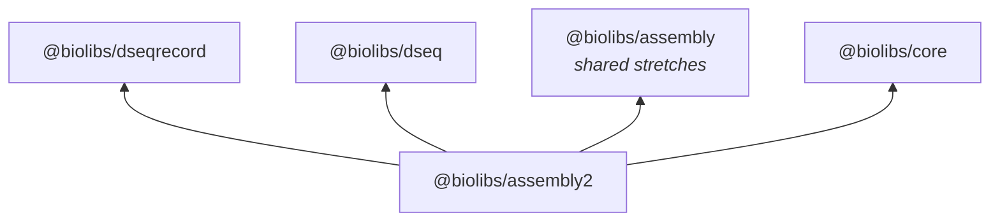

# @biolibs/assembly2

The assembly engine of [pydna](https://github.com/pydna-group/pydna): give it fragments of DNA and a rule
for where two of them may join, and it tells you every molecule they can make — and records how each one
was made.

- **Seven cloning methods** — Gibson, In-Fusion, fusion PCR, in-vivo assembly, ligation, Golden Gate and
  PCR, with pydna's arguments and pydna's answers
- **Linear, circular and insertion products**, found by walking a graph of the fragments rather than by
  trying the orders you thought of
- **Every product carries its provenance** — which fragments, which way round, and the stretch of each
  that was shared with its neighbours
- **The same order as pydna**, which took reproducing CPython's `set` and networkx's graph searches; see
  [Why the order matters](#why-the-order-matters)
- **No network, no file system, no dependencies outside `@biolibs`**

Recombination — Gateway, Cre-lox, the recombinases and CRISPR — is **not ported**.

## What is verified

A generator drives the real pydna and records what it answers: every overlap found, every walk through
the graph, every molecule built, the provenance on it, and the exception type *and* message where it
raises. The tests replay those recordings, in order.

| Upstream module | Items at parity | Checklist |
|---|---|---|
| `pydna.assembly2` | **69 / 85** | [pydna.assembly2.md](../../docs/parity-pydna/pydna.assembly2.md) |
| `pydna.primer` | **7 / 7** | [pydna.primer.md](../../docs/parity-pydna/pydna.primer.md) |
| `pydna.utils` | **13 / 13** | [pydna.utils.md](../../docs/parity-pydna/pydna.utils.md) |

**1,197 recorded cases** against pydna 5.5.16:

| Cases | What they record |
|---|---|
| 502 | the helpers: locations on a circle, sticky ends, cuts, lists, and the printing of an assembly |
| 283 | the seven cloning methods, over fragment sets that make circles, lines, insertions and nothing |
| 198 | `Assembly` itself: the graph, the walks, the products, and what is refused |
| 110 | the overlap finders, each on an ordered pair of fragments |
| 46 | PCR, including mismatched primers, tails, circular templates and a template read the other way |
| 39 | one fragment on its own: circularising, splicing and inverting |
| 19 | `Primer`: footprint and tail through slicing, joining and reverse complementing |

Where the claim stops:

- **Recombination is not ported.** The sixteen unverified items are `gateway_assembly`, the three
  `cre_lox_*`, the four `recombinase_*`, `crispr_integration`, the three `homologous_recombination_*`,
  the three `common_*` helpers they share, and `assembly_is_multi_site`. Joining fragments *by homology*
  is ported, and is what `inVivoAssembly` does.
- **The provenance is the engine's half.** pydna's `source` also maps onto the
  [OpenCloning](https://opencloning.org) data model, which records where each input itself came from and
  serialises a whole project to JSON. That layer is not ported yet.
- **`assembly_has_mismatches` is pydna's check on itself**, kept and recorded, but the finders never
  report a join that fails it.

Oddities that are pydna's and are kept:

- **The order of the products is not sorted**; it falls out of the graph search, and so does this port's.
- `restrictionLigationOverlap` with partial overlaps warns that it can return wrong products, and still
  returns them.
- A partially digested product is dropped from `restrictionLigationAssembly` with a warning naming the
  inputs it came from.
- `circularPermutationMinAbs([])` raises `ValueError("min() iterable argument is empty")`, because pydna
  asks `min` for the smallest of nothing.

## Install

```bash
npm install @biolibs/assembly2
```

- ESM only, Node 20 or later, TypeScript declarations included



## Gibson assembly

Fragments whose ends share a stretch are chewed back and joined. Three fragments that overlap head to
tail in a ring give a plasmid.

```ts
import { Dseqrecord } from "@biolibs/dseqrecord";
import { gibsonAssembly } from "@biolibs/assembly2";

// Three 50-base windows of one 75-base circle, each sharing its last 25 bases with the next.
const first = new Dseqrecord("GGATCACAGTCTACACTGCTCACTCCAACCCCGGCCCCTGAGTCCGAGGA");
const second = new Dseqrecord("CAACCCCGGCCCCTGAGTCCGAGGAGAGGGTGCTTCAGAGTATGTATACC");
const third = new Dseqrecord("GAGGGTGCTTCAGAGTATGTATACCGGATCACAGTCTACACTGCTCACTC");

const [plasmid] = gibsonAssembly([first, second, third], 25, true);

console.log(plasmid.circular, plasmid.length);        // true 75
console.log(plasmid.source?.kind);                    // "GibsonAssemblySource"
console.log(plasmid.source?.input.length);            // 3
```

Leave `circularOnly` off and the linear products come back too — minus any that are merely part of a
circle, which is what you would actually get in the tube.

## The provenance

Every product knows how it was made. That is what makes a cloning plan something you can send to
somebody else and have them check.

```ts
import { Dseqrecord } from "@biolibs/dseqrecord";
import { gibsonAssembly } from "@biolibs/assembly2";

const left = new Dseqrecord("GGATCACAGTCTACACTGCTCACTCCAACCCCGGCCCCTGAGTCCGAGGA");
const right = new Dseqrecord("CAACCCCGGCCCCTGAGTCCGAGGAGAGGGTGCTTCAGAGTATGTATACC");

const [product] = gibsonAssembly([left, right], 25);

for (const input of product.source!.input) {
  console.log(input.sequence === left ? "left" : "right",
              input.reverseComplemented, String(input.leftLocation), String(input.rightLocation));
}
// left  false null      [25:50]
// right false [0:25]    null
```

## Ligation and Golden Gate

A ligation joins fragments whose ends already fit; cut the molecules first.

```ts
import { Dseqrecord } from "@biolibs/dseqrecord";
import { enzymes } from "@biolibs/restriction";
import { ligationAssembly } from "@biolibs/assembly2";

const plasmid = new Dseqrecord("ttGAATTCaaaaaaaaaaGGATCCttttttttttGAATTCgg", true);
const pieces = plasmid.cut(enzymes.EcoRI!);

console.log(pieces.length);                                  // 2
const closed = ligationAssembly(pieces, false, false, true);
console.log(closed.length);                                  // 2 — both ways round fit
console.log(closed[0]?.circular, closed[0]?.length);         // true 42
```

Golden Gate cuts and ligates in one pot, with an enzyme that cuts outside its own site so that the
overhangs are yours to choose and the site does not end up in the product:

```ts
import { Dseqrecord } from "@biolibs/dseqrecord";
import { enzymes } from "@biolibs/restriction";
import { goldenGateAssembly } from "@biolibs/assembly2";

const acceptor = new Dseqrecord("gtcaagctagcatcgatCGAATGAGACCaaccgtaacGGTCTCAAATGcatgcatgcatgc", true);
const part = new Dseqrecord("acgtacGGTCTCAAATGgcatcgatcgtagctagctagcGCTTTGAGACCgtacgt");
const second = new Dseqrecord("acgtacGGTCTCAGCTTgcatcgatcgtagctagctagcCGAATGAGACCgtacgt");

const products = goldenGateAssembly([acceptor, part, second], [enzymes.BsaI!], true, true);
console.log(products.length, products[0]?.circular, products[0]?.length);   // 1 true 79
```

## PCR

A template and two primers. The product carries the primers' own ends, tails and all.

```ts
import { Dseqrecord } from "@biolibs/dseqrecord";
import { Primer, pcrAssembly } from "@biolibs/assembly2";

const template = new Dseqrecord("ccacgtGGATCCattacggtcagcatgcaatgcTTAAGCCGTAACGTTTGCCAT");
const forward = new Primer("gaattcGGATCCattacggtcagc");     // a tail, then the template
const reverse = new Primer("ATGGCAAACGTTACGGCTTAA");

const [product] = pcrAssembly(template, forward, reverse, true);

console.log(product.length);                                 // 54
console.log(product.toString().startsWith("Dseqrecord"));    // true, a record prints as a summary
console.log(product.seq!.toString().slice(0, 6));            // "gaattc", the forward primer's tail
console.log(product.features.map((f) => f.type));            // ["primer_bind", "primer_bind"]
```

`limit` is how many bases at a primer's 3' end have to be found, and `mismatches` how many of those may
differ.

## One fragment on its own

A fragment whose two ends share a stretch can close into a circle. The same class finds the molecules
made by splicing a piece out (`assembleInsertion`) or turning one round (`assembleInversion`), where the
fragment's own repeats allow it.

```ts
import { Dseqrecord } from "@biolibs/dseqrecord";
import { SingleFragmentAssembly, commonSubStrings } from "@biolibs/assembly2";

const repeated = new Dseqrecord("GCTTAAGCCGTAACGTTTGCCtttttttttttttttGCTTAAGCCGTAACGTTTGCC");
const assembly = new SingleFragmentAssembly([repeated], 20, commonSubStrings);

const [circle] = assembly.assembleCircular();
console.log(circle.circular, circle.length);       // true 36 — one copy of the repeat is left
console.log(assembly.assembleInsertion().length);  // 0 — a repeat at both ends splices out nothing
```

## The engine underneath

Each method is the same `Assembly` with a different overlap finder. You can drive it yourself:

```ts
import { Dseqrecord } from "@biolibs/dseqrecord";
import { Assembly, assemblyToString, gibsonOverlap } from "@biolibs/assembly2";

const left = new Dseqrecord("GGATCACAGTCTACACTGCTCACTCCAACCCCGGCCCCTGAGTCCGAGGA");
const right = new Dseqrecord("CAACCCCGGCCCCTGAGTCCGAGGAGAGGGTGCTTCAGAGTATGTATACC");

const assembly = new Assembly([left, right], 25, gibsonOverlap, false, true);

console.log(assembly.getLinearAssemblies().length);              // 1
console.log(assemblyToString(assembly.getLinearAssemblies()[0]!));
// "('1[25:50]:2[0:25]',)"
console.log(assembly.toString().split("\n")[0]);                 // "Assembly"
```

A negative fragment number means the fragment is used the other way round, and `1[25:50]` is the stretch
of fragment 1 that the join sits on.

## Why the order matters

pydna returns the products in the order the graph search finds them, and people take `products[0]`. So
the order is part of the answer, and this port has to produce it.

Underneath, networkx picks the node to start each cycle search from with `next(iter(component))`, where
the component is a Python `set`. For a set of small integers, CPython's iteration order is the order the
values land in its hash table — which depends on the values and on the order they were added, and is
nothing like insertion order once negative numbers are involved:

```ts
import { PyIntSet } from "@biolibs/assembly2";

console.log([...new PyIntSet([3, 1, 2])]);         // [1, 2, 3], not the order they went in
console.log([...new PyIntSet([1, -1, 2, -2])]);    // [1, 2, -1, -2]
```

So this package carries a small port of CPython's set (checked against it over 40,000 random insertion
sequences) and of the networkx searches that use it. A JavaScript `Set` would have reordered every list
of products here.

## From Python

| Python | TypeScript | Notes |
|---|---|---|
| `gibson_assembly(frags, limit, circular_only)` | `gibsonAssembly(fragments, limit?, circularOnly?)` | |
| `in_fusion_assembly`, `fusion_pcr_assembly`, `in_vivo_assembly` | `inFusionAssembly`, `fusionPcrAssembly`, `inVivoAssembly` | |
| `ligation_assembly(frags, allow_blunt, allow_partial_overlap, circular_only)` | `ligationAssembly(fragments, allowBlunt?, allowPartialOverlap?, circularOnly?)` | |
| `restriction_ligation_assembly(frags, enzymes, ...)`, `golden_gate_assembly` | `restrictionLigationAssembly(fragments, enzymes, ...)`, `goldenGateAssembly` | |
| `pcr_assembly(template, fwd, rvs, add_primer_features, limit, mismatches)` | `pcrAssembly(template, forward, reverse, addPrimerFeatures?, limit?, mismatches?)` | |
| `Assembly(frags, limit, algorithm, use_fragment_order, use_all_fragments)` | `new Assembly(fragments, limit, algorithm, useFragmentOrder, useAllFragments)` | |
| `asm.G` | `assembly.graph` | a multigraph with networkx's ordering |
| `product.source` | `product.source` | the engine's half of pydna's provenance |
| `Primer(seq, footprint=12)` | `new Primer(seq, { footprint: 12 })` | |
| `gateway_assembly`, `cre_lox_*`, `recombinase_*`, `crispr_integration`, `homologous_recombination_*` | not ported | |

## Testing

```bash
npm test                 # the whole workspace
npx vitest run packages/assembly2/test
```

| File | What it checks |
|---|---|
| `test/assembly2.test.ts` | the 1,197 recorded cases from pydna 5.5.16 |
| `test/readme.test.ts` | every code block in this file |

## Things to know

- **Fragments are not copied.** A product's provenance points at the very objects you passed in.
- **A limit of `null`** is for the finders that do not take one — the sticky-end and blunt joins, and
  restriction-ligation, where the enzymes decide.
- **`useAllFragments`** makes every fragment appear in the product; **`useFragmentOrder`** keeps them in
  the order you gave. The cloning methods set both as pydna sets them.
- **Searching is bounded.** More than 50 assemblies before validation, or 10,000 paths, raises rather
  than running away. Both limits are pydna's.

## License

MIT — see [LICENSE](LICENSE).
