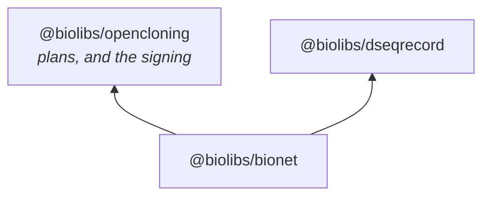

# @biolibs/bionet

Labs publishing what they hold, so that a cloning plan can be **acted on** and not just believed.

[`@biolibs/opencloning`](../opencloning) lets a lab send a plan that the receiving end can replay, and
sign it so the plan is attached to a key. Both of those are about the document. Neither of them gets
anybody a plasmid. This package is the other half: a lab writes down what it has, signs the list, and
publishes it at a fixed path on its own web address. Then a plan's starting parts can be looked up.

It is also what a lab is kept with inside: every member's device signs its own changes into its own
log, and the lab is worked out from all of them together. Parts and tubes, where each tube is, and
what was done at the bench are all changes of that kind. See "Inside a lab" below.

- **Write an inventory** from the molecules a lab holds
- **Sign it**, and let another lab countersign
- **Publish it** at `/.well-known/bionet.json`
- **Fetch one** and find out three separate things: that it is an inventory, that its signatures hold,
  and that it came from the address it claims
- **Remember** which key answered last time, so a key that changes gets noticed
- **Find labs you were never told about**, by walking the pointers from ones you were
- **Ask who has** the parts a plan starts from, matched by checksum

> **This is not a port.** Every other package in biolibs is measured against a Python library case by
> case, and says so. This one has no upstream: there is nothing to be at parity with. It is a small,
> deliberate design, and the paragraphs below are as careful about what it does not establish as about
> what it does.

## What a fetched inventory actually establishes

Three things, kept apart on purpose, because flattening them into one "verified" badge would be a lie
of exactly the kind this is meant to avoid:

| | What it means |
|---|---|
| it parsed | Somebody published a document of the right shape at that address |
| its signatures hold | Whoever holds those keys published **this** list — not a word of it has changed since |
| it came from its own address | The document names the origin it was served from, so those keys belong to **that address** |

`settled()` is all three at once. What none of them is: *this lab is who it says it is.* The address
does that work, and only as far as you already trusted the address. If you know `wrenlab.example` is
the Wren lab — from a paper, a colleague, a sign on the door — then a signed inventory served from
there ties that key to that lab. If you do not know that, nothing here will tell you.

Two edges worth stating plainly:

- **https or nothing**, apart from a machine talking to itself. Over plain http anything in the middle
  can swap the document, and the signature on the substitute will verify perfectly.
- **First sight is a leap of faith.** You cannot tell a lab's real key from a convincing stand-in on
  the first visit. What you can tell is a key *changing* — which is what `trust.ts` is for, and why it
  is worth writing down the first one.

## Install

```bash
npm install @biolibs/bionet
```



## Publishing what a lab holds

```ts
import { inventoryFrom, signInventory } from "@biolibs/bionet";
import { generateSigningKey } from "@biolibs/opencloning";

const key = await generateSigningKey();

const inventory = inventoryFrom([f1, f2, f3], {
  name: "Wren lab",
  origin: "https://wrenlab.example",
  contact: null,
  note: null,
});

console.log(inventory.parts[0].name);        // "f1" — what this lab calls it
console.log(inventory.parts[0].checksum);    // ldseguid=... — what everyone else matches on

const published = await signInventory(inventory, key, { signer: "Wren lab" });
// write JSON.stringify(published) to /.well-known/bionet.json
```

A part is listed by its SEGUID, which is the same whichever strand the molecule was written from and,
for a circle, wherever it was cut open. Two labs that have never spoken publish the same checksum for
the same molecule. Their names for it agree with nothing.

## Reading somebody else's

```ts
import { fetchInventory, settled, signingKeys } from "@biolibs/bionet";

const found = await fetchInventory("wrenlab.example");

console.log(found.checks[0].ok);           // true — the signature holds
console.log(found.fromItsOwnAddress);      // true — and it was served from the address it names
console.log(settled(found));               // true — both of those
console.log(signingKeys(found));           // [ "2f3f-fe1a-3d7d-c3b4" ]
```

What comes back is the document **exactly as it arrived**, never a tidied copy: the signature covers
the bytes the lab wrote, so trimming a long note or filling in a missing field would leave a document
that no longer matches its own signature. Anything out of bounds is refused instead of repaired.

## Noticing when a key changes

```ts
import { labMemory, remember } from "@biolibs/bionet";

const memory = labMemory();   // a browser would keep this in local storage

console.log(remember(memory, found.origin, signingKeys(found)).how);   // "new" — first visit, a leap
console.log(remember(memory, found.origin, signingKeys(found)).how);   // "known"

// a month later, a different key answers for the same address
console.log(remember(memory, found.origin, ["9999-aaaa-bbbb-cccc"]).how);   // "changed"
```

`"changed"` is the only one of the three that is evidence of anything. It may be a lab that rotated its
key, or it may be somebody standing where the lab used to be; only the lab can tell you which. The
point is that the question gets asked rather than passed over.

## How labs find each other

There is no index of labs, and this does not build one. A lab is found the way a page was found on
the early web: somebody you already know points at it. An inventory can therefore carry pointers to
other labs, and `discover` walks them.

```ts
import { discover, peer, settledLabs } from "@biolibs/bionet";

// pointing at somebody, in your own inventory
const inventory = inventoryFrom(parts, lab, {
  peers: [peer("otherlab.example", { name: "Other lab", key: "2f3f-fe1a-3d7d-c3b4" })],
});

// walking from a lab you were told about
const walk = await discover(["wrenlab.example"], { maxDepth: 2 });

console.log(walk.reached.map((one) => one.path.join(" → ")));
// [ "https://wrenlab.example",
//   "https://wrenlab.example → https://otherlab.example" ]
console.log(walk.unreachable[0]?.why);      // why an address did not answer, and who pointed at it
```

So the answer to "how does a new lab get found" is: **publish, and tell one person.** Put a signed
inventory at `/.well-known/bionet.json`, give the address to a lab that already has one, and when
they add you to their `peers` everyone who walks through them reaches you. Nothing can automate that
first introduction, and a design that claimed to would be inventing an authority.

Three consequences, stated rather than glossed:

- **What you find is what your seeds could reach.** There is no view of the whole network and no way
  to know what you are missing. Two people starting from different labs find different sets, and
  neither is "the network" — which is why `Discovery` records the `path` by which each lab was
  reached, so a person can see how they came to be looking at it.
- **A pointer is not an endorsement.** It says this address exists and publishes an inventory. It
  says nothing about what that lab holds or who they are.
- **Only a lab that checks out can introduce anyone.** If a document's signature fails, or it was
  served from an address it does not claim, it is reported and then its pointers are discarded —
  otherwise whoever could answer for one address could fill your walk with addresses of their
  choosing.

A pointer may record the key the referring lab saw. A walk compares it with the key actually
answering and reports `agrees`, `differs` or `unsaid`:

```ts
import { introducedDifferently } from "@biolibs/bionet";

for (const one of introducedDifferently(walk)) {
  console.log(one.found.origin, "is not answering with the key", one.introducedBy, "recorded");
}
```

Nothing is concluded from a disagreement. It is surfaced because it is the one contradiction a walk
can notice without anybody being in charge: two parties describing the same address differently. One
of them is looking at something the other is not, and only they can say which.

Walks are bounded — 50 labs and 2 hops by default, `stoppedEarly` when it ran into that — and an
address is visited once however many labs point at it, so a cycle is walked but not gone round.

## Asking who has the parts

```ts
import { partsNeeded, unsourced, whoHas } from "@biolibs/bionet";

const needed = partsNeeded(plan.document);
console.log(needed.map((part) => part.name));          // [ "f1", "f2", "f3" ]

const sourcing = whoHas(needed, [found]);
console.log(sourcing[0].holders[0].lab);               // "Wren lab"
console.log(unsourced(sourcing).map((p) => p.name));   // [ "f3" ] — nobody asked has this one
```

`partsNeeded` is the plan's leaves: the molecules no step in it makes, which is exactly what somebody
has to already have. Matching is by checksum, so a lab that calls the same molecule `pWren-402` is
found anyway. `heldButNotOffered` separates "nobody has it" from "somebody has it but is not sending
it", which are different problems for the person reading the plan.

Inventories whose signatures do not hold are yours to filter out before you call `whoHas` — it matches
what it is given and claims nothing about whether the labs are to be believed.

## Inside a lab

An inventory is what a lab shows the world. Inside it, a freezer changes every day and the people
changing it are not always online, so what a lab holds is not a file anybody edits. It is worked out
from **signed logs**: each device has a key, every change made on it is one signed entry in that
key's own log, and nobody writes to anybody else's.

```ts
import { addItem, addPart, addToRoster, adjustItem, entryId, foundLab, mergeLog, newItemId,
         nextEntry, publicInventory, recountItem, signInventory } from "@biolibs/bionet";

// Ada founds the lab. Its ID is the ID of that entry, not a name or an address.
const founding = await foundLab(adasKey, { name: "The Wren Lab", person: "Ada" });
const ada = [founding];
const write = async (held, key, op) => held.push(await nextEntry(await mergeLog(held), key, op));

await write(ada, adasKey, addToRoster(bobsKey.publicKey, "Bob"));
await write(ada, adasKey, addPart({ sequence: "GGATCACAGTCTACACTGCTCACTCCAACCCCGGCCCCTGAGTCCGAGGA", name: "f1" }));
const part = (await mergeLog(ada)).parts[0].checksum;
const tube = newItemId();
await write(ada, adasKey, addItem({ item: tube, part, amount: 10, unit: "µL" }));

// Bob takes a copy and both go offline. Each uses some of the tube.
const bob = [...ada];
await write(ada, adasKey, adjustItem(tube, -1));
await write(bob, bobsKey, adjustItem(tube, -2));

// They meet. Either order, either machine: the same lab, and both uses counted.
const everything = [...new Set([...ada, ...bob])];
(await mergeLog(everything)).items[0].amount;             // 7
(await mergeLog(everything.reverse())).items[0].amount;   // 7
```

`mergeLog` takes every entry held, in any order, and returns the lab: its roster, its parts, its
items and how much of each, the places they are kept in, the strains it grows and the specimens it
has not read yet, what was done at the bench and what is proposed — and for every entry whether it
counted and why not if not.

| Rule | Why |
|---|---|
| Order comes from what an entry had seen, never from a clock | Offline laptops agree about nothing, least of all the time |
| Amounts are whole-number differences | Two people using a tube are two uses. Whole numbers have one spelling to sign and add up exactly |
| A recount replaces only the adjustments its author had seen | The count was true when it was made; what happened unseen still happened |
| An item below zero, or counted twice at once, is flagged `needsRecount` | The freezer is the truth, and the log should say when it has lost track |
| Overlapping edits: the lower entry ID stands, and `overlaps` reports the other | The same choice on every machine, and nobody can arrange it in advance |
| Only a keeper changes the roster; the longer-standing keeper is heard first | Two keepers removing each other must come out one way |
| A removal names a cutoff in the removed key's log | Somebody removed cannot add to the lab later by claiming not to have heard. What they wrote past it is kept and marked `set aside` |

An entry that is not allowed is still placed, with `status` and `reason`, because the people in the
lab need to see what was turned away. An entry whose kind this version does not know is kept in the
chain and not applied, so an older app survives a newer one.

What leaves the lab is a reduction of all that:

```ts
const lab = await mergeLog(everything);
const inventory = publicInventory(lab, {
  name: "The Wren Lab", origin: "https://lab-wren.onrender.com", contact: null, note: null,
});
inventory.parts.map((one) => [one.name, one.available]);   // [ [ "f1", false ] ]

const published = await signInventory(inventory, adasKey, { signer: "Ada" });
```

A part is listed if some item of it has anything left, and is on offer only once a member has said
so with `offerPart`. Amounts, items and who did what stay inside.

### Where things are

A lab's places are a tree, and a tube is put in one. Both are signed changes, merged like the rest.

```ts
import { addPlace, movePlace, newPlaceId, putItem } from "@biolibs/bionet";

const freezer = newPlaceId();
const box = newPlaceId();
await write(ada, adasKey, addPlace({ place: freezer, kind: "freezer", name: "−80" }));
await write(ada, adasKey, addPlace({ place: box, kind: "box", name: "Box 1", parent: freezer, grid: { rows: 9, columns: 9 } }));
await write(ada, adasKey, putItem(tube, box, { row: 2, column: 3 }));

const lab = await mergeLog(ada);
lab.places.map((one) => one.name);    // [ "−80", "Box 1" ]
lab.items[0].where;                   // { place: box, slot: { row: 2, column: 3 } }
lab.crowded;                          // []
```

A place has a kind, a name and the place it is in; only a box has positions, fixed when it is added.
`standPlace` says where a place stands and how big it is, in whole millimetres, and is optional.

Two things people working apart can do are shown, never refused, because neither person did
anything wrong. If each moves a place into the other, both come out `adrift`: in nothing, until
somebody moves one. If each stands a tube in the same position, it is listed in `crowded` until
somebody goes and looks.

### What is marked on a part

```ts
import { annotatePart } from "@biolibs/bionet";

await write(ada, adasKey, annotatePart(part, [{ type: "CDS", label: "demo", strand: 1, parts: [{ start: 5, end: 35 }] }]));
(await mergeLog(ada)).parts[0]!.features.length;    // 1
```

A part can carry features: a type, a label, a strand, and one or more stretches of the sequence,
which is what a GenBank or SnapGene file marks. They are said whole, like any field: the later
saying wins, and two said apart are an overlap with the lower entry ID kept. Features that run past
the end of the part are refused.

### A part with sticky ends

```ts
import { addPart } from "@biolibs/bionet";

await write(ada, adasKey, addPart({ sequence: "AATTCGGGGTTTTGGGGCCCCAAAAGGATC", name: "piece", ends: { left: 4, right: 4 } }));
(await mergeLog(ada)).parts.at(-1)!.ends;    // { left: 4, right: 4 }
```

A piece cut out by a restriction enzyme has a few unpaired bases at each end, and they decide what it
can be joined to. A linear part may say so: its sequence is every base either strand has, read along
the top strand, and `ends` says how many at each end are on one strand only. Positive is a 5′
overhang, negative a 3′ one, 0 blunt. The checksum takes the ends in, so the same bases with
different ends are different parts, and a piece is the same part whichever strand it was written
from. A part with blunt ends is recorded and named exactly as it always was.

### What a part is made of, and the name every device arrives at

```ts
import { partChecksum } from "@biolibs/bionet";

// A lab keeps protein as well as DNA, and which has to be said, because the two cannot be told apart
// by looking: ACGT is a perfectly good peptide as well as a perfectly good piece of DNA.
await write(ada, adasKey, addPart({ sequence: "ACGTACGTACGT", name: "as DNA" }));
await write(ada, adasKey, addPart({ sequence: "ACGTACGTACGT", name: "as protein", kind: "protein" }));
const kept = (await mergeLog(ada)).parts.filter((one) => one.sequence === "ACGTACGTACGT");
kept.map((one) => one.kind);                              // [ "dna", "protein" ]
kept[0]!.checksum === kept[1]!.checksum;                  // false — two parts, as they must be

// The same rule, before anything is written: what a molecule's name will be.
partChecksum({ sequence: "ACGTACGTACGT" }) === kept[0]!.checksum;                    // true
partChecksum({ sequence: "ACGTACGTACGT", kind: "protein" }) === kept[1]!.checksum;   // true
```

`partChecksum` is there because a tool sometimes has to name a molecule before the lab holds one: to
say in a run's settings which protein the run is expected to make, or to look for a part the lab may
already have. The alternative is each tool counting a checksum its own way, and a part named by a
checksum nobody else arrives at is a part nobody else will ever match. It refuses exactly what an
entry refuses — a protein said to be a circle, a chain with a stop codon in the middle of it — rather
than returning a name no other device would agree with.

## Publishing the method, not just the molecules

An inventory says what a lab *holds*. A method says what it *did* — and that was the half a lab
could not give away. You could publish that you had a molecule; you could not publish how to make
one.

```ts
import { publicMethod, readMethod, signMethod, verifyMethod } from "@biolibs/bionet";

const method = publicMethod(lab, { name: "The Wren Lab", origin: "https://wrenlab.example", contact: null, note: null },
                            { project: "Real Vegan Cheese" });
const published = await signMethod(method, adasKey, { signer: "Ada" });

method.steps.map((one) => [one.step, one.kind, one.after]);
// [[1, "pcr", []], [2, "pcr", []], [3, "assembly", [1, 2]]]
method.needs.map((one) => one.name);     // ["pGene", "pBackbone"] — what you must have to start
method.makes.map((one) => one.name);     // ["pWren-CSN2"] — what following it leaves you with
```

The whole of the difficulty is one translation. **Inside a lab a plan points at tubes**, which is
what a person at that bench needs, and a tube's ID means nothing anywhere else. Published, every
tube is replaced by the checksum of what is in it — the one name two labs that have never spoken
already agree on. So a method says "use the molecule whose checksum is this", and a lab reading it
looks in its own freezer, or asks the network with `whoHas`.

Two things cannot make that crossing, and the document says so rather than pretending:

- **Anything alive.** A strain is the lab's own, deliberately — the same plasmid in the same
  published host twice is two strains — so a culture has no checksum to travel under. A step that
  uses one says what it would have to be a culture *of*, and whoever follows it makes their own.
- **A starting molecule's sequence, unless the publisher gives it.** What the steps *make* is always
  written out, because a later step has to name it. What the method *starts from* carries its
  sequence only if the lab said to share it. Without them it still tells somebody holding the same
  molecules exactly what to do; it will not tell somebody holding none what to order.

The other half is `takeMethod` in [`@biolibs/bionet-client`](../bionet-client), which proposes the
steps in a second lab, matching every molecule by checksum against what that lab has, and saying
plainly what it would have to get first.

### Filing work under a project

A lab does not have one pile of work. BioCurious has a vegan cheese project and a bioprinting
project and others, and a proposal that does not say which it belongs to lands in a heap with
everybody else's.

```ts
import { setField } from "@biolibs/bionet";

await write(ada, adasKey, setField("plan", plan, "project", "Real Vegan Cheese"));
(await mergeLog(ada)).plans[0]?.fields["project"];    // "Real Vegan Cheese"
```

A plan carries fields as a part, an item, a place and a strain already do — it was the only one of
them that could not, which looked more like a gap than a decision. A field says what a plan is
*about*; it cannot rewrite what carrying it out would do, so `kind`, `inputs`, `expects` and the
rest are refused.

Which work belongs together is a thing people decide, not something the molecules say, so it is
filed rather than worked out. Two chains of proposals that make four different proteins are four
chains and one project; two unrelated projects are also chains. Nothing can tell them apart by
looking at what they make.

An **adviser may file a proposal of its own and nothing else** — the same line `plan.settle` draws.
It proposes the work, so leaving it unable to say what the work is for would have somebody filing
every step by hand; letting it set any field at all would let it rename the lab's parts. A person's
filing stands over an adviser's, as everything of a person's does.

A device that does not know a plan can be filed **refuses the label and reads the plan itself** —
its kind, what it would use, what it expects — exactly as before. It loses a word and nothing else.

### A change this version cannot read

```ts
import { strayField } from "@biolibs/bionet";

strayField(addPart({ sequence: "GGATCC", name: "f1" }));                              // null
strayField({ type: "part.add", sequence: "GGATCC", circular: false, name: "f1", nicked: true });   // "nicked"
```

Every kind of change lists the fields it may carry, and so does everything inside them. A change
carrying anything else is set aside as `not understood`, with the field named, exactly as a kind of
change this version has never heard of is.

This is deliberately strict, and it is strict because of what happened when parts learned to have
ends. A version that did not know `ends` took such an entry, ignored them, and worked the part's
checksum out from the bases alone — so two machines read one entry differently, which is the one
thing the merge must never do. A new *kind* of change was always safe, because an old reader refused
it and said so. A new *field* was not. Now it is: adding one is a breaking change for older readers,
and they will say which field they could not read instead of quietly disagreeing about the lab.

### What was done at the bench

A run is one change that does three things: takes what was used from each tube that went in, adds
each tube that came out, and keeps the run so a tube can say where it came from.

```ts
import { newRunId, recordRun } from "@biolibs/bionet";

const product = newItemId();
await write(ada, adasKey, recordRun({
  run: newRunId(), kind: "pcr", instrument: null,
  inputs: [{ item: tube, amount: 1, role: "template" }],
  outputs: [{ item: product, sequence: F1.slice(0, 40), circular: false, name: "amplicon", amount: 50, unit: "µL" }],
  settings: { anneal_at_least: 18 }, outcome: "worked", note: null,
}));

const after = await mergeLog(ada);
after.items.find((one) => one.item === tube)?.amount;      // one less than before
after.items.find((one) => one.item === product)?.from;     // the run's ID
after.runs.length;                                         // 1
```

A run is recorded whole or refused whole. One that did not work is recorded with nothing coming
out, and still takes what was used. The merge does not work the run out again: what came out is what
its signer said came out.

### What the lab keeps alive

A part is known by its sequence, so two labs that made the same molecule call it the same thing
without ever having spoken. A strain is deliberately not like that. The same plasmid put into the
same published host twice is two strains, which may behave differently and did not come from each
other, so a strain is known by an ID and says what it came from.

```ts
import { addStrain, newStrainId } from "@biolibs/bionet";

const host = newStrainId();
await write(ada, adasKey, addStrain({ strain: host, name: "W303", host: "Saccharomyces cerevisiae W303",
                                      carries: [], parent: null, from: null }));

// Putting a construct into it is an ordinary run that makes no molecule: what it makes is alive.
const run = newRunId();
await write(ada, adasKey, recordRun({ run, kind: "transformation", instrument: null,
                                      inputs: [{ item: tube, amount: 1, role: "construct" }],
                                      outputs: [], settings: {}, outcome: "worked", note: null }));

const made = newStrainId();
await write(ada, adasKey, addStrain({ strain: made, name: "W303 pWren1-1", host: "Saccharomyces cerevisiae W303",
                                      carries: [part], parent: host, from: run }));

// A culture is a lot of a strain, and counts, moves and retires like a tube of a part.
await write(ada, adasKey, addItem({ item: newItemId(), strain: made, amount: 50, unit: "mL" }));
(await mergeLog(ada)).items.at(-1)?.part;      // null: it is a culture, not a tube of a molecule
```

An item is of a part or a culture of a strain, never both and never neither, so `part` is `null` on
a culture and `strain` is `null` on a tube. A transformation is a plain `run.record` that happens to
make no molecule, which is why a device too old to know of strains still reads the run and takes
what it used; only the strain and the culture are turned away, as changes it does not understand.

Whether a transformation worked is whether anything grew. Nothing in the log can work that out from
what came out, because nothing came out, so a person says it.

### A tube nobody has sequenced

Every freezer has them: something handed over at a meeting, something from the back of the −80 with a
name on the lid and nothing behind it. A part is known by its sequence, so a tube whose sequence
nobody has read cannot be a tube of a part — and writing down a guess would make the lab's own record
the place the guess became a fact. So it is a specimen: a tube that is held, counted and moved like
any other, and says only what is written on the lid.

```ts
import { addSpecimen, identifySpecimen, newSpecimenId } from "@biolibs/bionet";

const unknown = newSpecimenId();
await write(ada, adasKey, addSpecimen({ specimen: unknown, name: "pET from the back of the -80",
                                        note: "handed over at a meetup, no map" }));
await write(ada, adasKey, addItem({ item: newItemId(), specimen: unknown, amount: 15, unit: "µL" }));
(await mergeLog(ada)).items.at(-1)?.part;          // null: nobody knows what is in it
(await mergeLog(ada)).specimens[0]?.is;            // null: and the lab does not pretend to

// Sequencing it says what it is. The sequence is added as a part, and the specimen points at it.
await write(ada, adasKey, addPart({ sequence: F2, name: "pET-wrenA" }));
const read = (await mergeLog(ada)).parts.find((one) => one.name === "pET-wrenA")!.checksum;
await write(ada, adasKey, identifySpecimen(unknown, read));
(await mergeLog(ada)).items.at(-1)?.part;          // the checksum: the tube now reads as a tube of it
```

The tube does not move and does not change. It keeps its place, its amount and its history, because
the tube never changed — only what is known about it did. An item is of a part, a strain **or** a
specimen, never more than one.

A specimen has no checksum, because a checksum is of a sequence and there is no sequence yet. Two
things follow, and both are the point rather than a limitation. It cannot satisfy a plan: a plan
names what it needs by checksum, and an unread tube matches nothing. And it cannot travel in a
method, for the same reason a culture cannot — a step that used one says there was something
unidentified there, and not what the lid said, because what a lab writes on a tube it cannot name is
a private note to itself and says nothing another lab could use.

Two people may sequence the same tube at once and get the same answer, which is the ordinary case and
settles itself. Where they disagree, the lower entry ID stands, as everywhere else.

### What somebody proposes doing

A plan is a run nobody has done. It has a run's shape with everything that says something happened
taken out, and it changes nothing the lab holds: no amount moves, and no tube or part is made.

```ts
import { newPlanId, planRun, settlePlan } from "@biolibs/bionet";

const proposed = newPlanId();
await write(ada, adasKey, planRun({
  plan: proposed, kind: "pcr", instrument: null,
  inputs: [{ item: tube, amount: 1, role: "template" }],
  expects: [{ sequence: F1.slice(0, 40), circular: false, name: "amplicon" }],
  settings: { anneal_at_least: 18 }, note: "to check the insert is there",
}));

const planned = await mergeLog(ada);
planned.plans[0]?.settled;                // null: it is open
planned.plans[0]?.expects[0]?.checksum;   // what the product would be known by

// Somebody does it and records the run as usual. Closing the plan is a change of its own.
const done = planned.runs[0]!.run;
await write(ada, adasKey, settlePlan(proposed, done));     // or settlePlan(proposed, null) to set it aside
(await mergeLog(ada)).plans[0]?.settled?.run;              // the run that carried it out
```

An input may name a `part` in place of an `item`, for something there is no tube of yet. A plan
carries what it expects and not how that was worked out: each reader's own tools work it out again
and can say whether they agree.

A plan is kept whatever happens around it, and says what has gone wrong rather than being refused for
it. Two of those are worked out from the lab as a whole, which is the only place either is visible:

- **`wanting`** — the tubes it counts on that have since been retired or run short.
- **`orphaned`** — the molecules it would use that only a plan the lab has **set aside** would have
  made. Refiling a plan leaves the ones downstream of it naming what the old plan would have made;
  no entry is wrong for saying so, and no reader of one entry can see it. Something still to be
  ordered is not listed: nothing here was ever going to make it.

```ts
// The molecule is designed, so the lab can name it; whether anything is going to make it is a
// separate question, and the answer is whichever plans are open.
await write(ada, adasKey, addPart({ sequence: F3, name: "ligated" }));
const built = (await mergeLog(ada)).parts.find((one) => one.name === "ligated")!.checksum;

const makes = newPlanId();
await write(ada, adasKey, planRun({ plan: makes, kind: "ligation", instrument: null,
                                    inputs: [{ item: tube, amount: 1, role: "backbone" }],
                                    expects: [{ sequence: F3, circular: false, name: "ligated" }],
                                    settings: {}, note: "join the pieces" }));
const next = newPlanId();
await write(ada, adasKey, planRun({ plan: next, kind: "transformation", instrument: null,
                                    inputs: [{ part: built, amount: 0, role: "plasmid" }],
                                    expects: [], settings: {}, note: "into BL21" }));
(await mergeLog(ada)).plans.find((one) => one.plan === next)?.orphaned;   // []: the ligation makes it

// She thinks better of the ligation and sets it aside. The transformation is still asking for what
// it would have made, and now says so.
await write(ada, adasKey, settlePlan(makes, null));
(await mergeLog(ada)).plans.find((one) => one.plan === next)?.orphaned;   // [built]
```

The link from a run to its plan is the settling entry's alone. A recorded run is, field for field,
what it always was, so a device too old to know of plans still reads the run and holds the same
inventory.

A plan is what a key with the role `adviser` is for. An adviser may add parts, say what is marked on
a part that nothing is marked on, propose runs, and set aside a plan of its own. Everything else it
writes is refused where the logs are merged, on every device, so something with no hands at the
bench can be let into a lab without being able to say that anything was done, used or moved.

Where an adviser and a person mark the same part without having heard of each other, the person's
reading stands, whichever entry has the lower ID. Between two people it is the lower ID as usual.

```ts
// An adviser may describe a part nobody has described.
await write(claude, claudesKey, annotatePart(checksum, [{ type: "CDS", label: "wrenA", strand: 1, parts: [{ start: 0, end: 30 }] }]));

// It may not change what somebody has marked: this one is refused, and what Ada marked stands.
await write(ada, adasKey, annotatePart(checksum, [{ type: "CDS", label: "as Ada reads it", strand: 1, parts: [{ start: 0, end: 30 }] }]));
await write(claude, claudesKey, annotatePart(checksum, [{ type: "CDS", label: "and again", strand: 1, parts: [{ start: 0, end: 30 }] }]));
(await mergeLog(ada)).parts.find((one) => one.checksum === checksum)?.features[0]?.label;   // "as Ada reads it"
```

### Moving entries between machines

`mergeLog` works on whatever it is given. `sync.ts` is how entries are given, without opening a
connection itself: each side says how far into every log it holds (`haveOf`), sends what the other
lacks (`entriesBeyond`), and keeps what belongs of what arrives (`takeEntries`, which drops anything
from a key the roster has never heard of).

A lab's web peer relays entries between members and must not hand them to anybody who asks. So it
sends a `challenge`, the other side answers with `signHello`, and the peer sends entries only if
`verifyHello` names a key that `isMember`. Writing needs no proof: entries are signed by their
authors. `inventoryProblem` is the peer's rule for publishing an inventory a member sends it, and
`readMessage` reads one message off the wire.

## Testing

```bash
npm test                 # the whole workspace
npx vitest run packages/bionet/test
```

| File | What it checks |
|---|---|
| `test/bionet.test.ts` | inventories, signing, addresses, fetching, remembering, matching |
| `test/discover.test.ts` | walking the network, and everything a walk refuses to do |
| `test/log.test.ts` | signed logs: offline work, recounts, overlaps, forgery, removal |
| `test/sync.test.ts` | exchanging entries, who may read them, what a peer keeps and publishes |
| `test/readme.test.ts` | every code block in this file |

## Things to know

- **A signature over an inventory cannot be mistaken for a signature over a plan.** Each is made under
  its own domain string, and the test for it signs one document under both domains to prove the
  crossover fails.
- **`whoHas` matches by checksum only.** A lab that lists a molecule under a different name is still
  found; a lab that lists the right name with the wrong molecule is not.
- **An unsigned inventory is not a broken one**, it is one that claims nothing. It parses, it may be
  perfectly accurate, and `settled()` is false.
- **An inventory written before there were peers is still valid.** A missing list of pointers reads
  as an empty one, and nothing adds the field to a document it did not write — the signature covers
  the document as the lab wrote it.
- **A log entry is signed under its own domain**, `biolibs/bionet log entry v1`, and must be signed by
  the key whose log it is in. A good signature from the wrong key is refused.
- **Nothing here opens a connection.** `sync.ts` says what two machines send each other; carrying
  the messages is for whatever uses this.
- **Nothing here fetches a part.** Finding out who has a plasmid is as far as software goes; the rest
  is an email and a padded envelope.
- **Two things a lab holds cannot leave it in a method**: a culture, because it is alive, and a
  specimen, because nobody has read it. A step that used a specimen says there was something
  unidentified there — not what the lid said, which is a private note and no use to anybody else.
- **A plan is never refused for what happened around it.** It is kept, and says what is wrong:
  `wanting` for tubes retired or run short, `orphaned` for a molecule only a plan now set aside would
  have made. Both are worked out from the whole lab, because neither is visible in any one entry.

## License

MIT — see [LICENSE](LICENSE).
