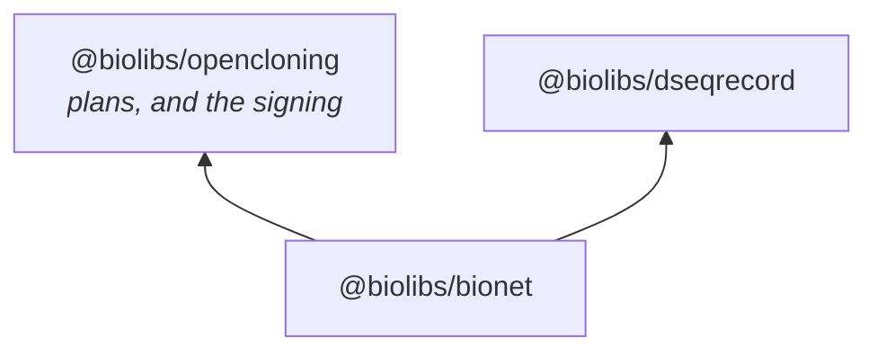

# @biolibs/bionet

Labs publishing what they hold, so that a cloning plan can be **acted on** and not just believed.

[`@biolibs/opencloning`](../opencloning) lets a lab send a plan that the receiving end can replay, and
sign it so the plan is attached to a key. Both of those are about the document. Neither of them gets
anybody a plasmid. This package is the other half: a lab writes down what it has, signs the list, and
publishes it at a fixed path on its own web address. Then a plan's starting parts can be looked up.

- **Write an inventory** from the molecules a lab holds
- **Sign it**, and let another lab countersign
- **Publish it** at `/.well-known/bionet.json`
- **Fetch one** and find out three separate things: that it is an inventory, that its signatures hold,
  and that it came from the address it claims
- **Remember** which key answered last time, so a key that changes gets noticed
- **Find labs you were never told about**, by walking the pointers from ones you were
- **Ask who has** the parts a plan starts from, matched by checksum

> **This is not a port.** Every other package in biolibs is measured against a Python library case by
> case, and says so. This one has no upstream: there is nothing to be at parity with. It is a small,
> deliberate design, and the paragraphs below are as careful about what it does not establish as about
> what it does.

## What a fetched inventory actually establishes

Three things, kept apart on purpose, because flattening them into one "verified" badge would be a lie
of exactly the kind this is meant to avoid:

| | What it means |
|---|---|
| it parsed | Somebody published a document of the right shape at that address |
| its signatures hold | Whoever holds those keys published **this** list — not a word of it has changed since |
| it came from its own address | The document names the origin it was served from, so those keys belong to **that address** |

`settled()` is all three at once. What none of them is: *this lab is who it says it is.* The address
does that work, and only as far as you already trusted the address. If you know `endylab.example` is
the Endy lab — from a paper, a colleague, a sign on the door — then a signed inventory served from
there ties that key to that lab. If you do not know that, nothing here will tell you.

Two edges worth stating plainly:

- **https or nothing**, apart from a machine talking to itself. Over plain http anything in the middle
  can swap the document, and the signature on the substitute will verify perfectly.
- **First sight is a leap of faith.** You cannot tell a lab's real key from a convincing stand-in on
  the first visit. What you can tell is a key *changing* — which is what `trust.ts` is for, and why it
  is worth writing down the first one.

## Install

```bash
npm install @biolibs/bionet
```



## Publishing what a lab holds

```ts
import { inventoryFrom, signInventory } from "@biolibs/bionet";
import { generateSigningKey } from "@biolibs/opencloning";

const key = await generateSigningKey();

const inventory = inventoryFrom([f1, f2, f3], {
  name: "Endy lab",
  origin: "https://endylab.example",
  contact: null,
  note: null,
});

console.log(inventory.parts[0].name);        // "f1" — what this lab calls it
console.log(inventory.parts[0].checksum);    // ldseguid=... — what everyone else matches on

const published = await signInventory(inventory, key, { signer: "Endy lab" });
// write JSON.stringify(published) to /.well-known/bionet.json
```

A part is listed by its SEGUID, which is the same whichever strand the molecule was written from and,
for a circle, wherever it was cut open. Two labs that have never spoken publish the same checksum for
the same molecule. Their names for it agree with nothing.

## Reading somebody else's

```ts
import { fetchInventory, settled, signingKeys } from "@biolibs/bionet";

const found = await fetchInventory("endylab.example");

console.log(found.checks[0].ok);           // true — the signature holds
console.log(found.fromItsOwnAddress);      // true — and it was served from the address it names
console.log(settled(found));               // true — both of those
console.log(signingKeys(found));           // [ "2f3f-fe1a-3d7d-c3b4" ]
```

What comes back is the document **exactly as it arrived**, never a tidied copy: the signature covers
the bytes the lab wrote, so trimming a long note or filling in a missing field would leave a document
that no longer matches its own signature. Anything out of bounds is refused instead of repaired.

## Noticing when a key changes

```ts
import { labMemory, remember } from "@biolibs/bionet";

const memory = labMemory();   // a browser would keep this in local storage

console.log(remember(memory, found.origin, signingKeys(found)).how);   // "new" — first visit, a leap
console.log(remember(memory, found.origin, signingKeys(found)).how);   // "known"

// a month later, a different key answers for the same address
console.log(remember(memory, found.origin, ["9999-aaaa-bbbb-cccc"]).how);   // "changed"
```

`"changed"` is the only one of the three that is evidence of anything. It may be a lab that rotated its
key, or it may be somebody standing where the lab used to be; only the lab can tell you which. The
point is that the question gets asked rather than passed over.

## How labs find each other

There is no index of labs, and this does not build one. A lab is found the way a page was found on
the early web: somebody you already know points at it. An inventory can therefore carry pointers to
other labs, and `discover` walks them.

```ts
import { discover, peer, settledLabs } from "@biolibs/bionet";

// pointing at somebody, in your own inventory
const inventory = inventoryFrom(parts, lab, {
  peers: [peer("otherlab.example", { name: "Other lab", key: "2f3f-fe1a-3d7d-c3b4" })],
});

// walking from a lab you were told about
const walk = await discover(["endylab.example"], { maxDepth: 2 });

console.log(walk.reached.map((one) => one.path.join(" → ")));
// [ "https://endylab.example",
//   "https://endylab.example → https://otherlab.example" ]
console.log(walk.unreachable[0]?.why);      // why an address did not answer, and who pointed at it
```

So the answer to "how does a new lab get found" is: **publish, and tell one person.** Put a signed
inventory at `/.well-known/bionet.json`, give the address to a lab that already has one, and when
they add you to their `peers` everyone who walks through them reaches you. Nothing can automate that
first introduction, and a design that claimed to would be inventing an authority.

Three consequences, stated rather than glossed:

- **What you find is what your seeds could reach.** There is no view of the whole network and no way
  to know what you are missing. Two people starting from different labs find different sets, and
  neither is "the network" — which is why `Discovery` records the `path` by which each lab was
  reached, so a person can see how they came to be looking at it.
- **A pointer is not an endorsement.** It says this address exists and publishes an inventory. It
  says nothing about what that lab holds or who they are.
- **Only a lab that checks out can introduce anyone.** If a document's signature fails, or it was
  served from an address it does not claim, it is reported and then its pointers are discarded —
  otherwise whoever could answer for one address could fill your walk with addresses of their
  choosing.

A pointer may record the key the referring lab saw. A walk compares it with the key actually
answering and reports `agrees`, `differs` or `unsaid`:

```ts
import { introducedDifferently } from "@biolibs/bionet";

for (const one of introducedDifferently(walk)) {
  console.log(one.found.origin, "is not answering with the key", one.introducedBy, "recorded");
}
```

Nothing is concluded from a disagreement. It is surfaced because it is the one contradiction a walk
can notice without anybody being in charge: two parties describing the same address differently. One
of them is looking at something the other is not, and only they can say which.

Walks are bounded — 50 labs and 2 hops by default, `stoppedEarly` when it ran into that — and an
address is visited once however many labs point at it, so a cycle is walked but not gone round.

## Asking who has the parts

```ts
import { partsNeeded, unsourced, whoHas } from "@biolibs/bionet";

const needed = partsNeeded(plan.document);
console.log(needed.map((part) => part.name));          // [ "f1", "f2", "f3" ]

const sourcing = whoHas(needed, [found]);
console.log(sourcing[0].holders[0].lab);               // "Endy lab"
console.log(unsourced(sourcing).map((p) => p.name));   // [ "f3" ] — nobody asked has this one
```

`partsNeeded` is the plan's leaves: the molecules no step in it makes, which is exactly what somebody
has to already have. Matching is by checksum, so a lab that calls the same molecule `pEndy-402` is
found anyway. `heldButNotOffered` separates "nobody has it" from "somebody has it but is not sending
it", which are different problems for the person reading the plan.

Inventories whose signatures do not hold are yours to filter out before you call `whoHas` — it matches
what it is given and claims nothing about whether the labs are to be believed.

## Testing

```bash
npm test                 # the whole workspace
npx vitest run packages/bionet/test
```

| File | What it checks |
|---|---|
| `test/bionet.test.ts` | inventories, signing, addresses, fetching, remembering, matching |
| `test/discover.test.ts` | walking the network, and everything a walk refuses to do |
| `test/readme.test.ts` | every code block in this file |

## Things to know

- **A signature over an inventory cannot be mistaken for a signature over a plan.** Each is made under
  its own domain string, and the test for it signs one document under both domains to prove the
  crossover fails.
- **`whoHas` matches by checksum only.** A lab that lists a molecule under a different name is still
  found; a lab that lists the right name with the wrong molecule is not.
- **An unsigned inventory is not a broken one**, it is one that claims nothing. It parses, it may be
  perfectly accurate, and `settled()` is false.
- **An inventory written before there were peers is still valid.** A missing list of pointers reads
  as an empty one, and nothing adds the field to a document it did not write — the signature covers
  the document as the lab wrote it.
- **Nothing here fetches a part.** Finding out who has a plasmid is as far as software goes; the rest
  is an email and a padded envelope.

## License

MIT — see [LICENSE](LICENSE).
