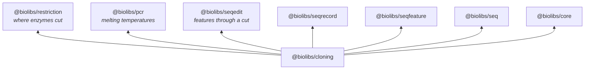

# @biolibs/cloning

Molecular cloning in silico: restriction digests and ligation, and Gibson assembly with overlap primer
design.

Biopython has no counterpart. `Bio.Restriction` says where enzymes cut and will hand back the fragments,
but it has nothing about what the fragments' **ends** are, which of them will ligate, or what the product
would be. This builds on it and supplies the rest.

- **`piecesOf`** — cut a record into fragments, each with its own sequence, features and two typed ends
- **`compatible`** — the end algebra: BamHI and BglII ligate, EcoRI and BamHI do not
- **`cloneProducts`** — cut a vector and an insert, get every circle where both junctions pair, in both
  insert orientations
- **`religate`** — put a digest back together; the round trip is a test
- **`assembleGibson`** — find the rings a set of overlapping fragments can make, one product per molecule
- **`designGibson`** — the other direction: the PCR primers whose 5' tails *create* the overlaps
- **All 1,088 REBASE enzymes** are reachable, not a hand-written table of sixty
- **Nothing is reimplemented**: cuts come from `@biolibs/restriction`, melting temperatures from
  `@biolibs/pcr`, feature bookkeeping from `@biolibs/seqedit`

## What is verified

This is not a port of anything, so there is no parity checklist. What there is instead:

- **The cut coordinates are Biopython's.** `cutsIn` calls `@biolibs/restriction`, a verified port of
  `Bio.Restriction`, and converts its 1-based cut positions to 0-based boundaries in one place. The real
  coordinates and overhangs of EcoRI, PstI, SmaI, BamHI, BglII and HindIII are checked against the REBASE
  data rather than written out by hand.
- **The melting temperatures are Biopython's**, through `@biolibs/pcr` and so `Bio.SeqUtils.MeltingTemp`.
- **The digest round trip is a test**: cutting a plasmid and re-ligating its pieces gives the plasmid
  back, compared as a circle.
- **102 unit tests** over the rest — the end algebra, every piece boundary, both orientations, the ring
  search and its deduplication, and every refusal with its message.

Where the claim stops:

- **754 of the 1,088 enzymes can be simulated.** For the other 334, REBASE does not say where the enzyme
  cuts, so `cutsIn` raises a `ValueError` naming it rather than guessing. That is a third of the set, and
  it is a property of the data, not of this package.
- **Ligation is geometry, not chemistry.** `compatible` asks whether two overhangs match. It says nothing
  about efficiency, about blunt ligation being slow, about whether a single-enzyme digest will mostly
  self-ligate, or about phosphatase treatment. Every circle that *could* form is reported.
- **Gibson assembly is an overlap search, not a model of the reaction.** Each junction reports its
  overlap's melting temperature and that is all: there is no exonuclease chew-back length, no secondary
  structure, no concentration.
- **`designGibson` takes the fragment order as given.** It creates overlaps for the ring you specify; it
  does not search for a better order, and it does not check the designed primers against the rest of the
  construct.

## Install

```bash
npm install @biolibs/cloning
```

- ESM only, Node 20 or later, TypeScript declarations included



A record is taken to be **circular when its `topology` annotation is `"circular"`**, which is where
GenBank and EMBL put it. Positions are 0-based half-open spans.

## Ends

A double-stranded end is described by the single-stranded overhang it leaves, read along the top strand.
The two strands are cut at different places, and which sticks out decides the kind:

```
  5' overhang (EcoRI, G^AATTC)     3' overhang (PstI, CTGCA^G)     blunt (SmaI, CCC^GGG)
    5'-G      AATTC-3'               5'-CTGCA      G-3'             5'-CCC   GGG-3'
    3'-CTTAA      G-5'               3'-G      ACGTC-5'             3'-GGG   CCC-5'
```

```ts
import { describeEnd, endAt } from "@biolibs/cloning";

// EcoRI in G^AATTC cuts the top strand at 1 and the bottom at 5.
endAt(1, 5, "GAATTC", "EcoRI");    // { kind: "5'", overhang: "AATT", enzyme: "EcoRI" }
endAt(5, 1, "CTGCAG", "PstI");     // { kind: "3'", overhang: "TGCA", enzyme: "PstI" }
endAt(3, 3, "CCCGGG", "SmaI");     // { kind: "blunt", overhang: "", enzyme: "SmaI" }

describeEnd(endAt(1, 5, "GAATTC", "EcoRI"));   // "EcoRI (5' AATT)"
describeEnd(endAt(3, 3, "CCCGGG", "SmaI"));    // "SmaI (blunt)"
describeEnd({ kind: "blunt", overhang: "", enzyme: null });   // "blunt" — an end no enzyme made
```

Two ends ligate when their overhangs are the **same kind and the same sequence**, read along the top
strand. The enzyme that made them is irrelevant:

```ts
import { compatible } from "@biolibs/cloning";

const bamHI = { kind: "5'", overhang: "GATC", enzyme: "BamHI" } as const;
const bglII = { kind: "5'", overhang: "GATC", enzyme: "BglII" } as const;
const ecoRI = { kind: "5'", overhang: "AATT", enzyme: "EcoRI" } as const;

compatible(bamHI, bglII);   // true — different enzymes, same overhang
compatible(bamHI, ecoRI);   // false
compatible({ kind: "blunt", overhang: "", enzyme: "SmaI" },
           { kind: "blunt", overhang: "", enzyme: null });   // true — any two blunt ends
```

Turning a fragment over exchanges its ends and reverse-complements each overhang. The **kind does not
change** — it is a property of the molecule, not of how you wrote it down:

```ts
import { flipEnd } from "@biolibs/cloning";

flipEnd({ kind: "5'", overhang: "GATG", enzyme: "X" });   // { kind: "5'", overhang: "CATC", enzyme: "X" }
```

Biopython's `ovhg` is the overhang length, negative for a 5' overhang, so `bottomCut = topCut - ovhg`:
EcoRI, with `ovhg = -4`, cuts the bottom strand four bases past the top.

## The plasmid used below

Every example from here on uses one small synthetic plasmid and one insert, so the numbers follow from
section to section.

```ts
export const BACKBONE_A = "ACGTTAGCCATGGCTAGCTAGGCATCGATCGTGAGCAATCGGTGAGTACGCCTTTAGGTCTGAT";
export const BACKBONE_B = "AAAATCGACACATTAATGCTCTTCAAGCAACAACCGGCGATTAACCCGTAACCTTAAGACACAT";

/** 140 bp, circular: an EcoRI site, a stretch of backbone, a BamHI site, the rest. */
export const VECTOR = `GAATTC${BACKBONE_A}GGATCC${BACKBONE_B}`;
/** 88 bp, linear: a gene flanked by an EcoRI and a BamHI site. */
export const GENE = "ATGAGTAAAGGAGAAGAACTTTTCACTGGAGTTGTCCCAATTCTTGTTGAATTAGATGGTGATGTTAATGGG";
export const INSERT = `CCGAATTC${GENE}GGATCCCC`;
```

## Finding the cuts

```ts
import { cutCounts, cutsIn, cuttersUpTo, lookupEnzymes, parseEnzymeNames } from "@biolibs/cloning";
import { VECTOR } from "./plasmid.js";

lookupEnzymes(["EcoRI", "NotAnEnzyme"]).unknown;        // ["NotAnEnzyme"]
parseEnzymeNames("EcoRI, BamHI + HindIII");             // ["EcoRI", "BamHI", "HindIII"]

const { enzymes } = lookupEnzymes(["EcoRI", "BamHI"]);
cutsIn(VECTOR, "circular", enzymes);
// [{ topCut: 1, bottomCut: 5, enzyme: "EcoRI" }, { topCut: 71, bottomCut: 75, enzyme: "BamHI" }]

const withHindIII = lookupEnzymes(["EcoRI", "BamHI", "HindIII"]).enzymes;
[...cutCounts(cutsIn(VECTOR, "circular", withHindIII))];   // [["EcoRI", 1], ["BamHI", 1]]
cuttersUpTo(cutsIn(VECTOR, "circular", withHindIII));      // ["BamHI", "EcoRI"] — the unique cutters
```

`cuttersUpTo` is how you find an enzyme to open a construct with: it lists the enzymes cutting no more
than `max` times, defaulting to once.

An enzyme REBASE has no cut position for cannot be simulated, and says so rather than guessing:

```ts
import { cutsIn, lookupEnzymes } from "@biolibs/cloning";

cutsIn("AAAGAATTCAAA", "linear", lookupEnzymes(["Aba6411II"]).enzymes);
// ValueError: where Aba6411II cuts is not known, so it cannot be simulated
```

## Cutting a record into pieces

A piece's top strand runs from one cut to the next, with the ends recorded separately. That is the whole
trick: a piece beginning at a cut has its top strand starting just after it, and one ending at a cut has
its top strand ending at it, *whatever the overhangs* — so **the top strand of a ligation is simply the
left piece's top strand followed by the right piece's**.

```ts
import { describeEnd, describePiece, lookupEnzymes, piecesOf } from "@biolibs/cloning";
import { Seq } from "@biolibs/seq";
import { SeqFeature, SimpleLocation } from "@biolibs/seqfeature";
import { SeqRecord } from "@biolibs/seqrecord";
import { VECTOR } from "./plasmid.js";

const vector = new SeqRecord(new Seq(VECTOR), "pVEC", "pVEC", "", [],
  [new SeqFeature(new SimpleLocation(10, 40, 1), "gene", "m", new Map([["gene", ["marker"]]]))],
  new Map<string, unknown>([["molecule_type", "DNA"], ["topology", "circular"]]));

const { enzymes } = lookupEnzymes(["EcoRI", "BamHI"]);
const pieces = piecesOf(vector, enzymes);

pieces.map(describePiece);        // ["70 bp (EcoRI to BamHI)", "70 bp (BamHI to EcoRI)"]
pieces.map((p) => p.start);       // [1, 71]
pieces.map((p) => p.wraps);       // [false, true] — the second runs through the origin
describeEnd(pieces[0]!.left);     // "EcoRI (5' AATT)"

// Features come with the piece they fall in, re-based onto it by @biolibs/seqedit.
pieces[0]!.record.features.map((f) => String(f.location));   // ["[9:39](+)"]
pieces[1]!.record.features.length;                           // 0
```

How many pieces you get depends on the topology:

```ts
import { lookupEnzymes, piecesOf } from "@biolibs/cloning";
import { Seq } from "@biolibs/seq";
import { SeqRecord } from "@biolibs/seqrecord";
import { INSERT } from "./plasmid.js";

const insert = new SeqRecord(new Seq(INSERT), "myGene", "myGene", "", [], [],
  new Map<string, unknown>([["molecule_type", "DNA"], ["topology", "linear"]]));

const { enzymes } = lookupEnzymes(["EcoRI", "BamHI"]);
// A line with n cuts gives n + 1 pieces; the outer two keep the ends the line already had.
piecesOf(insert, enzymes).map((p) => p.length);                      // [3, 78, 7]
piecesOf(insert, enzymes).map((p) => p.left.enzyme);                 // [null, "EcoRI", "BamHI"]

// An uncut circle gives no pieces at all, since nothing has been cut.
piecesOf(circularUncut, lookupEnzymes(["HindIII"]).enzymes).length;   // 0
// An uncut line gives itself, with its natural ends.
piecesOf(insert, lookupEnzymes(["HindIII"]).enzymes).map((p) => p.length);   // [88]
```

`flipPiece` turns a piece over: the sequence reverse-complemented, the features flipped, and the two ends
exchanged *and* reverse-complemented.

## Ligating

```ts
import { canSelfClose, closeCircle, joinPieces, lookupEnzymes, piecesOf, religate } from "@biolibs/cloning";
import { canonicalCircular } from "@biolibs/cloning";
import { residuesOf } from "@biolibs/seqedit";
import { VECTOR } from "./plasmid.js";

const pieces = piecesOf(vector, lookupEnzymes(["EcoRI", "BamHI"]).enzymes);

// Neither half of a two-enzyme digest can close on itself: its ends do not match.
pieces.map(canSelfClose);            // [false, false]

// Putting the digest back together gives the plasmid, compared as a circle.
canonicalCircular(residuesOf(religate(pieces, "pVEC"))) === canonicalCircular(VECTOR);   // true
```

A junction that does not pair raises, naming both ends:

```ts
import { joinPieces, lookupEnzymes, piecesOf } from "@biolibs/cloning";

const pieces = piecesOf(vector, lookupEnzymes(["EcoRI", "BamHI"]).enzymes);
joinPieces(pieces[0]!, pieces[0]!);
// ValueError: a BamHI (5' GATC) end does not pair with a EcoRI (5' AATT) end
```

## Restriction cloning

`cloneProducts` cuts a vector — which must be circular — and an insert, then reports every circle where
**both** junctions pair. The insert is tried as written and turned over, since a fragment in a tube has
no preferred orientation.

```ts
import { cloneProducts } from "@biolibs/cloning";

const result = cloneProducts(vector, insert, ["EcoRI", "BamHI"]);

result.ok;                                    // true
result.ok && result.products.length;          // 2 — the same circle, insert either way round
result.ok && result.products[0]!.description;
// "148 bp: vector 70 bp (BamHI to EcoRI) + myGene 78 bp (EcoRI to BamHI), as written"
result.ok && result.products.map((p) => p.orientation);
// ["as written", "turned over"]
result.ok && result.products[0]!.record.annotations.get("topology");   // "circular"
result.ok && result.products[0]!.length;      // 148 = 70 + 78
```

With two different enzymes the two orientations give different molecules, and both are offered because
both can form. Products come back **largest vector fragment first**, which is the construct a cloner is
almost always after.

Only insert fragments with an enzyme-made end at **both** sides are offered: a piece with a natural end
came from the uncut end of a line and cannot be ligated in a planned way. Every failure explains itself:

```ts
import { cloneProducts } from "@biolibs/cloning";

cloneProducts(vector, insert, ["NopeI"]);
// { ok: false, error: "these are not known enzymes: NopeI" }
cloneProducts(linearVector, insert, ["EcoRI", "BamHI"]);
// { ok: false, error: "the vector must be circular" }
cloneProducts(vector, insert, ["HindIII"]);
// { ok: false, error: "HindIII do not cut the vector" }
cloneProducts(vector, insert, ["EcoRI"], ["BamHI"]);
// { ok: false, error: "the insert is cut, but no fragment has an enzyme-made end at both sides" }
```

## Gibson assembly

Gibson needs no enzymes and no cut sites. An exonuclease chews back each fragment's 5' ends, the overlaps
anneal, and a polymerase and ligase fill and seal. In simulation the whole method rests on one question:
which fragment ends share a long enough identical stretch.

```ts
import { overlapLength } from "@biolibs/cloning";

overlapLength("AAAGGTACC", "GGTACCTTT", 6, 60);   // 6
overlapLength("CCCGGG", "AAACCC", 3, 60);         // 0 — it is not symmetric
overlapLength("ACGT", "ACGT", 4, 60);             // 0 — never the whole of either sequence
overlapLength("ACGTACGT", "ACGTACGT", 3, 60);     // 4, not 8 — a tandem repeat does overlap itself
```

That last line matters: an overlap that consumed a whole fragment would leave it contributing nothing to
the ring, and would make every sequence overlap itself end to end.

```ts
import { assembleGibson, canonicalCircular } from "@biolibs/cloning";
import { residuesOf } from "@biolibs/seqedit";
import { BACKBONE_A, BACKBONE_B } from "./plasmid.js";

// Two fragments of one 128 bp circle, overlapping by 20 bases at each junction.
const CIRCLE = BACKBONE_A + BACKBONE_B;
const a = CIRCLE.slice(0, 80);
const b = CIRCLE.slice(60) + CIRCLE.slice(0, 20);

const result = assembleGibson([{ name: "a", residues: a }, { name: "b", residues: b }]);

result.ok && result.products.length;                 // 1 — one product per molecule, not per order
result.ok && result.products[0]!.length;             // 128
result.ok && result.products[0]!.description;        // "128 bp: a + b"
result.ok && result.products[0]!.junctions.map((j) => j.length);              // [20, 20]
result.ok && result.products[0]!.junctions.map((j) => j.tm.toFixed(2));       // ["45.42", "55.93"]

// It is the circle the fragments came from.
result.ok && canonicalCircular(residuesOf(result.products[0]!.record)) === canonicalCircular(CIRCLE);
// true
```

**One product per molecule.** A ring is the same ring whichever fragment you write it from and whichever
strand you read, so `canonicalCircular` — the alphabetically first rotation of the sequence or its
reverse complement — collapses them. A two-fragment ring appears once, not twice.

```ts
import { canonicalCircular } from "@biolibs/cloning";

canonicalCircular("GCA");                            // "AGC"
canonicalCircular("GCA") === canonicalCircular("AGC");   // true — the same circle
```

A ring of two fragments needs an overlap at **both** junctions, not just one. Failures say which fragment
is the problem:

```ts
import { assembleGibson } from "@biolibs/cloning";
import { GENE } from "./plasmid.js";

assembleGibson([{ name: "a", residues: a }, { name: "z", residues: GENE }]);
// { ok: false, error: "no overlap of at least 15 bases joins 'a', 'z' to any other fragment" }

assembleGibson([{ name: "solo", residues: a }]);
// { ok: false, error: "the ends of 'solo' do not overlap by at least 15 bases, so it cannot close into a circle" }

assembleGibson([{ name: "a", residues: "ACGTACGTACGT" }, { name: "b", residues: b }]);
// { ok: false, error: "fragment 'a' is 12 bases, too short to carry an overlap of 15" }
```

A single fragment whose own two ends overlap *does* assemble, into a circle one overlap shorter than
itself.

## Designing a Gibson assembly

Where `assembleGibson` searches for an arrangement that already works, `designGibson` **creates** the
overlaps: for fragments in the order they are to go round, it designs the PCR primers whose 5' tails
supply them.

```ts
import { designGibson } from "@biolibs/cloning";
import { BACKBONE_A, BACKBONE_B, GENE } from "./plasmid.js";

const CIRCLE = BACKBONE_A + BACKBONE_B;
const result = designGibson([
  { name: "backbone", residues: CIRCLE, amplify: false },   // a vector opened with an enzyme
  { name: "insert", residues: GENE },
]);

result.ok && result.design.length;                      // 150 = 128 + 72 − 2 × 25
result.ok && result.design.primers.map((p) => p.name);  // ["insert-F", "insert-R"]
result.ok && result.design.primers[0]!.tail;            // "ATTAACCCGTAACCTTAAGACACAT" — the backbone's end
result.ok && result.design.primers[0]!.binding;         // "ATGAGTAAAGGAGAAGAACTTTTCACTGG"
result.ok && result.design.primers[0]!.sequence.length; // 54 = 25 + 29
```

The forward primer carries the end of the fragment **before** it; the reverse primer carries the start of
the fragment **after** it, reverse-complemented, since a reverse primer reads the bottom strand.

A fragment used as it is cannot be given a tail, so its neighbour's primer carries the whole overlap.
Between two amplified fragments the overlap is shared half on each primer, which keeps both short:

```ts
import { designGibson } from "@biolibs/cloning";
import { BACKBONE_A, BACKBONE_B, GENE } from "./plasmid.js";

const CIRCLE = BACKBONE_A + BACKBONE_B;

// backbone fixed: the insert's primers carry all 25 bases.
const fixed = designGibson([
  { name: "backbone", residues: CIRCLE, amplify: false }, { name: "insert", residues: GENE }]);
fixed.ok && fixed.design.junctions.map((j) => j.carried);
// [{ fromReverse: 0, toForward: 25 }, { fromReverse: 25, toForward: 0 }]

// both amplified: 12 bases on one primer, 13 on the other.
const shared = designGibson([
  { name: "backbone", residues: CIRCLE }, { name: "insert", residues: GENE }]);
shared.ok && shared.design.junctions.map((j) => j.carried);
// [{ fromReverse: 13, toForward: 12 }, { fromReverse: 13, toForward: 12 }]
shared.ok && shared.design.primers.map((p) => p.tail.length);   // [12, 13, 12, 13]
```

Two unamplified neighbours are refused, since there is nowhere to put the overlap:

```ts
import { designGibson } from "@biolibs/cloning";

designGibson([{ name: "a", residues: CIRCLE, amplify: false },
              { name: "b", residues: GENE, amplify: false }]);
// { ok: false, error: "at least one fragment must be amplified, or there is nowhere to put an overlap" }
designGibson([{ name: "a", residues: CIRCLE }, { name: "b", residues: GENE }], { overlap: 5 });
// { ok: false, error: "the overlap must be between 15 and 60 bases, not 5" }
```

`warnings` carries anything worth saying — a low-melting junction, or a warning from either primer's
binding part, prefixed with the primer's name:

```ts
import { designGibson } from "@biolibs/cloning";

const result = designGibson([
  { name: "backbone", residues: CIRCLE, amplify: false }, { name: "insert", residues: GENE }]);
result.ok && result.design.warnings;
// ["insert-F: the GC content is 38%, below 40%", "insert-R: the GC content is 37%, below 40%"]
```

### Judging a tailed primer

An assembly primer is long by design, so judging it as a whole is misleading. `checkTailedPrimer` reports
on both parts, because the **binding part** is what sets the annealing temperature while the whole primer
is what you order and what might form a hairpin:

```ts
import { checkTailedPrimer } from "@biolibs/cloning";

const { whole, bindingPart } = checkTailedPrimer(
  "ATTAACCCGTAACCTTAAGACACAT", "ATGAGTAAAGGAGAAGAACTTTTCACTGG");

bindingPart.length;              // 29 — use this Tm for the annealing step
bindingPart.tm.toFixed(2);       // "57.72"
whole.length;                    // 54
whole.tm > bindingPart.tm;       // true, and not the temperature to anneal at
```

## Testing

```bash
npm test                 # the whole workspace
npx vitest run packages/cloning/test
```

| File | What it checks |
|---|---|
| `test/cloning.test.ts` | the 102 behaviour tests, including the digest round trip |
| `test/readme.test.ts` | every code block in this file |

Coverage from this package's own tests — `npx vitest run --coverage packages/cloning/test`:

| | |
|---|---|
| Statements | **98.74%** (469 / 475) |
| Functions | **100.00%** (33 / 33) |
| Branches | **91.64%** (252 / 275) |

## Things to know

- **Topology lives in the `topology` annotation.** A vector that is not marked circular is refused by
  `cloneProducts`, and an uncut circle gives no pieces at all.
- **A third of REBASE cannot be simulated.** 334 of 1,088 enzymes have no known cut position, and
  `cutsIn` raises rather than guessing.
- **Both insert orientations are reported.** With two different enzymes they are different molecules;
  picking one is the caller's job, and `orientation` says which is which.
- **Every circle that could form is reported, not the one that will dominate.** Nothing here models
  ligation efficiency or self-ligation.
- **An overlap is never the whole of a fragment.** A junction that swallowed one would contribute nothing
  to the ring.
- **Gibson products are deduplicated by molecule**, so the count is smaller than the number of fragment
  orders — that is deliberate.
- **`designGibson` uses the order you give.** It builds the ring you asked for; it does not look for a
  better one.
- **`DesignedPrimer.binding_report` is the one field in the repo that is not camel case.** It is the
  report on the binding part alone.
- **`DesignOptions` and `DEFAULT_DESIGN` exist in both this package and `@biolibs/pcr`**, with different
  shapes. Importing both into one module needs an alias.

## License

MIT — see [LICENSE](LICENSE).
