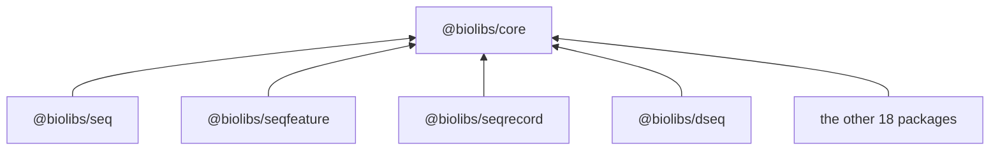
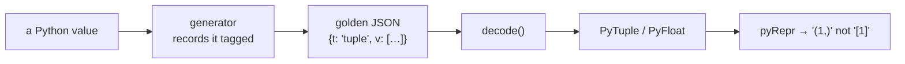

# @biolibs/core

The layer every other `@biolibs` package sits on: Python's answers, in TypeScript.

- **Python-style errors** — thirteen classes under one `BioError`, each reporting Python's own name
- **Python's `warnings`** — a swappable handler, and `captureWarnings` for collecting them
- **`py/`: CPython's own results** — `int()`, `float()`, `round()`, `repr()`, `str()`, `%` formatting,
  `==`, truthiness, `in`, the string predicates, `textwrap.fill`, and `random.Random`
- **`PyTuple` and `PyFloat`** — the two distinctions JavaScript cannot draw but Python's output depends on
- **zlib** — inflate *and* deflate, byte for byte what `zlib.compress` produces at every level
- **SHA-1 and base64** — what the sequence checksums and SEGUID rest on
- **No dependencies**, no I/O, no global state except the warning handler

Why it exists: a port is only a port if it gives the same answer *and* the same error message. Most of
that comes down to a handful of Python behaviours that JavaScript gets differently — `round(2.5)` is `2`,
`repr(1e16)` is `1e+16`, `'%d' % 'x'` has two different messages depending on whether a tuple was
applied. This package is those behaviours, measured rather than recalled.

## What is verified

Core is not a port of a Biopython module, so it is not on the Biopython checklist. It is checked against
**CPython itself**: a generator runs the interpreter, records what each function did — the value, or the
exception type *and* message — and the tests replay those recordings.

| Checked against | Cases | How |
|---|---|---|
| CPython 3.15 | **656** over 32 functions | `reference/golden/gen_pycompat_cases.py` → `test/golden/pycompat.json` |
| CPython's `random.Random` | **227** | every method, seeded, compared value by value |
| CPython's `zlib` | **370** | 37 inputs × 10 levels, compared **byte for byte** both ways |

A case passes only if the value matches, and where Python raised, the exception type and the exact message
match too.

Where that claim stops:

- **`PyTuple`, `PyFloat`, `pyIter`, `registerPythonClasses`, `assert`, the warnings module and the error
  classes have no Python function to record.** They are the scaffolding the ports use. They are asserted
  directly (`test/errors.test.ts`, `test/py-objects.test.ts`, `test/core.test.ts`) rather than measured.
- **`deflate` at level 0 on input over 64 KiB** is only checked for decompressing to itself. Where zlib
  splits its stored blocks there is a property of the output buffer Python handed it, not of the format.
- **`int()` is whole-number only.** Python's integers are arbitrary precision; these are JavaScript
  numbers, so `int("99999999999999999999")` is recorded as refused rather than silently rounded.
- **`ZlibError`'s messages are zlib's**, as Python surfaces them (`Error -3 while decompressing data: …`).
  They are reproduced for the cases a corrupt file reaches, not for every internal zlib code.

## Install

```bash
npm install @biolibs/core
```

- ESM only, Node 20 or later, TypeScript declarations included
- Nothing is pulled in with it — the dependency list is empty

Every other package depends on it, and it depends on none of them:



## API

### Errors

Thirteen classes, all extending `BioError`, which extends `Error`. The `name` is Python's, because that
is what a parity case compares. Two are prefixed: `PySystemError` reports `"SystemError"`, and
`PyIndexError` reports `"IndexError"` for the one place it is needed — `random.choice` on an empty
sequence.

```ts
import { BioError, KeyError, ValueError } from "@biolibs/core";

try {
  throw new KeyError("TGA");
} catch (e) {
  console.log((e as Error).name);        // "KeyError"
  console.log((e as Error).message);     // "TGA"  — Python's KeyError message is the key itself
  console.log(e instanceof BioError);    // true  — one check catches any of them
}
```

The full set: `BioError`, `ValueError`, `IndexError`, `KeyError`, `AttributeError`, `OverflowError`,
`RuntimeError`, `AssertionError`, `NotImplementedError`, `ZeroDivisionError`, `PySystemError`,
`UnboundLocalError`, `MemoryError` — plus `ZlibError` (a `ValueError`, carrying zlib's own wording) and
`PyIndexError`. A bare Python `assert` carries no message, so an empty one survives rather than being
replaced by a class name.

### `warn`, `captureWarnings`, `setWarningHandler`

Python's `warnings.warn` and `catch_warnings(record=True)`. The default handler prints to `console.warn`.

```ts
import { captureWarnings, warn } from "@biolibs/core";

const { result, warnings } = captureWarnings(() => {
  warn("Partial codon", "BiopythonWarning");
  return 42;
});

console.log(result);    // 42
console.log(warnings);  // [{ category: "BiopythonWarning", message: "Partial codon" }]
```

`captureWarnings` returns `{ result, warnings }` on success and `{ error, warnings }` when the function
throws — so warnings emitted before a failure are not lost — and restores the previous handler either way.

### `assert`

Python's `assert`, as a TypeScript assertion function: it narrows the type of its condition.

```ts
import { assert } from "@biolibs/core";

try {
  assert(false, "must be positive");
} catch (e) {
  console.log((e as Error).name);     // "BioError"
  console.log((e as Error).message);  // "must be positive"
}
```

### Numbers: `pyInt`, `pyFloat`, `pyRound`, `pyRoundTo`

```ts
import { pyFloat, pyFloatRepr, pyInt, pyRound, pyRoundTo } from "@biolibs/core";

// Python's int() accepts underscores, surrounding whitespace, and any Unicode decimal digit.
console.log(pyInt(" 1_000 "), pyInt("٣"));        // 1000 3
pyInt("1.5");  // ValueError: invalid literal for int() with base 10: '1.5'

console.log(pyFloatRepr(pyFloat("1e3")));         // "1000.0"
console.log(pyFloatRepr(pyFloat("inf")));         // "inf"

// round() breaks ties towards the even digit, and decides from the exact decimal value.
console.log(pyRound(2.5), pyRound(3.5));          // 2 4
console.log(pyRoundTo(0.0625, 3));                // 0.062
console.log(pyRoundTo(0.4165, 3));                // 0.416
```

That last pair is the one that bites: scale `0.4165` by 1000 and the nearest double is above the tie, so
`Math.round` gives `0.417`. Python looks at the exact value of the double, which is just below.

### Formatting: `pyFormatG`, `pyFormatFixed`, `pyFloatRepr`, `pySum`, `pyChr`

```ts
import { pyChr, pyFloatRepr, pyFormatFixed, pyFormatG, pySum } from "@biolibs/core";

console.log(pyFormatG(1234.5));          // "1234.5"
console.log(pyFormatG(1234.5, 3));       // "1.23e+03"
console.log(pyFormatG(1.0, 6, true));    // "1.00000"   — the # flag keeps the zeros %g drops

console.log(pyFormatFixed(2.675, 2));    // "2.67"      — not 2.68: the double is below the tie
console.log(pyFormatFixed(1.5, 0));      // "2"

console.log(pyFloatRepr(0.1));           // "0.1"       — shortest round-trip, as Python prints it
console.log(pyFloatRepr(1e16));          // "1e+16"
console.log(pyFloatRepr(1e17));          // "1e+17"

console.log(pySum([0.1, 0.2]));          // 0.30000000000000004
console.log(pyChr(65));                  // "A"
```

### `pyPercent`

Python's `%` operator on a format string. Both forms, because Biopython uses both and they *complain
differently*: applying a tuple names the argument's index, applying a single value does not.

```ts
import { pyFloat, PyFloat, pyPercent, PyTuple } from "@biolibs/core";

console.log(pyPercent("%5.2f|", 1.5));            // " 1.50|"
console.log(pyPercent("%-6s|%s", "ab", "cd"));    // "ab    |cd"
console.log(pyPercent("%#g", new PyFloat(1)));    // "1.00000"

pyPercent("%d", "x");
// TypeError: format argument: %d requires a real number, not str
pyPercent("%d", PyTuple.from(["x"]));
// TypeError: format argument 1: %d requires a real number, not str
```

Supported: `d i u f F e E g G s r a c %`, the `- + 0 #` and space flags, widths and precisions.

### Strings: `pyStrip`, `pySplit`, `pyFirstWord`, `pyTextwrapFill`, the predicates

Python's whitespace is wider than JavaScript's `trim()`, and its `split()` with no argument collapses
runs and drops the empties.

```ts
import { pyFirstWord, pyIsPrintable, pySplit, pyStrip, pyTextwrapFill } from "@biolibs/core";

console.log(pyStrip("\t a \n"));            // "a"
console.log(pySplit(" a  b "));             // ["a", "b"]
console.log(pyFirstWord("LOCUS  xyz"));     // "LOCUS"   — throws IndexError on text with no words
console.log(pyIsPrintable("a\x00b"));       // false

console.log(pyTextwrapFill("the quick brown fox jumps over the lazy dog", { width: 20 }));
// the quick brown fox
// jumps over the lazy
// dog
```

Also `pyLstrip`, `pyRstrip`, `pyIsAscii`, `pyIsLower`.

### Values: `pyRepr`, `pyStr`, `pyTypeName`, `pyEquals`, `pyTruthy`, `pyContains`

The functions that build Python's output and Python's error messages out of whatever a port is holding.

```ts
import {
  PyFloat, pyClassRepr, pyContains, pyEquals, pyIter, pyRepr, pyStr, pyTruthy, PyTuple, pyTypeName,
} from "@biolibs/core";

console.log(pyRepr(null));                        // "None"
console.log(pyRepr([1, "a"]));                    // "[1, 'a']"
console.log(pyRepr(new Map([["k", 1]])));         // "{'k': 1}"
console.log(pyRepr(PyTuple.from([1])));           // "(1,)"   — Python's one-element tuple

console.log(pyStr(null), pyStr(new PyFloat(1)));  // "None" "1.0"
console.log(pyTypeName(1), pyTypeName(1.5));      // "int" "float"
console.log(pyClassRepr("a"));                    // "<class 'str'>"

console.log(pyEquals(1, true));                   // true   — a bool is an int in Python
console.log(pyEquals([], PyTuple.from([])));      // false  — a list is never a tuple
console.log(pyTruthy(new PyFloat(0)));            // false
console.log(pyContains(3, [1, 2]));               // false

console.log([...pyIter("ab")]);                   // ["a", "b"]
console.log([...pyIter(new Map([["a", 1]]))]);     // ["a"]  — iterating a dict gives its keys
```

### `PyTuple` and `PyFloat`

JavaScript has one array type and one number type; Python's output depends on two distinctions it cannot
make. `PyTuple` is a list that prints as a tuple and never equals one. `PyFloat` is a whole number that
still prints as `1.0` and formats as a float.



### `PyRandom`

Python's Mersenne Twister, not JavaScript's `Math.random`. Same seed, same stream, same values — which is
what lets a port reproduce a bootstrap or a shuffle exactly.

```ts
import { PyRandom, pyRandom } from "@biolibs/core";

const r = new PyRandom(42);
console.log(r.random());        // 0.6394267984578837  — what Python gives for seed 42
console.log(r.randint(1, 6));   // 1
console.log(r.getrandbits(8));  // 189

// A shared instance, for ports whose upstream uses the module-level functions.
pyRandom.seed(7);
console.log(pyRandom.random()); // 0.32383276483316237
```

Also `randrange`, `randbelow`, `choice`, `shuffle`, `gauss`.

### zlib: `deflate`, `inflate`, `deflateRaw`, `inflateRaw`, `inflateRawPrefix`, `adler32`

A full deflate implementation, because the file formats need to *write* what zlib writes — not merely
produce something zlib can read.

```ts
import { adler32, deflate, inflate } from "@biolibs/core";

const data = new TextEncoder().encode("GATTACA".repeat(20));
const z = deflate(data);              // level 6 by default; 1–9, or 0 for stored blocks

console.log(data.length, z.length);   // 140 18
console.log(inflate(z).length);       // 140
console.log(adler32(data));           // 3407882021
```

### Hashes: `sha1`, `base64`, `pyBytesRepr`

```ts
import { base64, pyBytesRepr, sha1 } from "@biolibs/core";

console.log(base64(sha1(new TextEncoder().encode("GATTACA"))));
// "tp2jzeCM2e3W4yxtrrx09CMKa/8="
console.log(base64(Uint8Array.of(77, 97, 110)));   // "TWFu"
console.log(pyBytesRepr(Uint8Array.of(65, 0, 255)));
// b'A\x00\xff'   — Python's own escaping, quote choice included
```

### Decoding: `pyDecodeUtf8`, `pyDecodeAscii`

Strict decoding with Python's own complaint, which is what a reader reports when a file is not the
encoding it claimed.

```ts
import { pyDecodeUtf8 } from "@biolibs/core";

pyDecodeUtf8(Uint8Array.of(0x41, 0xff));
// ValueError: 'utf-8' codec can't decode byte 0xff in position 1: invalid start byte
```

Python's `UnicodeDecodeError` is a subclass of `ValueError`, so that is what is thrown. `utf8Fault` and
`utf8ErrorMessage` are available separately for a reader that wants to decide what to do before raising.

## Testing

```bash
npm test                   # the whole workspace
npx vitest run packages/core
```

**378 tests in 11 files**, one of which runs every code block in this README. How each part is checked:

| Area | Method | Source of truth |
|---|---|---|
| `py/`, `hash/` | 656 recorded cases, value *and* error message | CPython 3.15 |
| `PyRandom` | 227 recorded streams, every method, seeded | CPython's `random` |
| zlib | 370 cases, byte for byte, both directions | CPython's `zlib` |
| errors, warnings, `assert`, `PyTuple`, `PyFloat` | direct assertions | no Python counterpart to record |
| every package's docs | a doc comment on every top-level export | `test/docs-coverage.test.ts` |
| every package's `dist/` | no output left from a deleted source | `test/dist-freshness.test.ts` |

The last two gates live here because they run across the whole workspace, not only this package.

Coverage from core's own tests alone — `npx vitest run --coverage packages/core`:

| | |
|---|---|
| Statements | **97.40%** (1,497 / 1,537) |
| Functions | **98.58%** (139 / 141) |
| Branches | **93.06%** (791 / 850) |

The figure deliberately excludes the rest of the suite. Running everything reports more, but the
difference is coverage borrowed from the callers: it disappears the moment a caller changes, and while it
stood at 96.9% most of `py/` had never actually been compared with CPython. Recording these cases found
nine behaviours that were wrong.

What the uncovered part is, in full:

- the Huffman tree-overflow fix-up in `deflate-trees.ts`, reached only by input with more than 15 bits of
  code depth, and the 16-bit path of its bit flusher
- two corrupt-stream errors in `inflate.ts` (an invalid code-length set, an invalid block type) — data no
  encoder produces
- two lines of `pyRepr` for an object that is neither a list, dict, nor anything with a `repr()`

## Things to know

- **`assert` throws `BioError`, not `AssertionError`.** It is a programming-error guard, not a ported
  Python `assert` statement; the ports raise `AssertionError` explicitly where Biopython does.
- **`pyInt` returns a `number`.** Beyond 2^53 it refuses rather than rounding. Nothing in these ports
  needs Python's arbitrary precision, and silently losing digits would be worse than refusing.
- **`pyFloat` returns a plain `number`**, and `PyFloat` only exists to mark one as *having been* a float
  for printing. Arithmetic on a `PyFloat` is not defined — unwrap it first.
- **The warning handler is global.** `captureWarnings` swaps and restores it, but it is not async-safe:
  warnings emitted by other work running concurrently will be collected too.
- **`deflate` is not streaming.** It takes and returns whole `Uint8Array`s, which is all the file formats
  need, and keeps the output byte-identical to `zlib.compress`.
- **`sha1` is here, not from `node:crypto`**, so the same code runs unchanged in a browser bundle.

## License

MIT — see [LICENSE](LICENSE).
