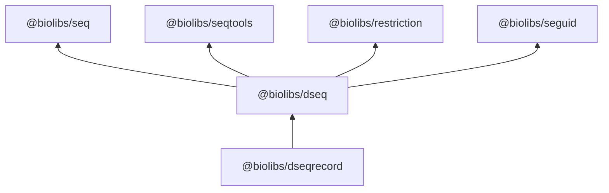

# @biolibs/dseq

Double-stranded DNA whose **ends are part of the molecule**: a port of
[pydna](https://github.com/BjornFJohansson/pydna)'s `Dseq`.

Where a `Seq` is one strand of letters, a `Dseq` knows what is opposite every base. A restriction
fragment's sticky ends, a blunt end, a nick and a single-stranded stretch are states the molecule
*carries* — so ligating two fragments can refuse ends that do not pair, rather than quietly joining two
strings.

- **`Dseq`** — construction from one strand, two strands, or a drawn representation; both strands, the
  overhangs, the parts, the figure pydna prints
- **Geometry** — slicing (wrapping the origin on a circle), `looped`, `shifted`, reverse complement,
  molecular weight
- **Cutting** — the sites, which are possible, how they pair, every fragment, the ends written as cut
  sites
- **End chemistry** — fill in, blunt, chew back, tail, excise uracils: `fillIn`, `klenow`, `t4`, `mung`,
  the `nibble*` family, `terminalTransferase`, `user`
- **Melting** — where a duplex comes apart when heated, and what is left when it does
- **`PydnaSeq` and `ProteinSeq`** — pydna's own single strand, with `cai`, `orfs`, `rarecodons`,
  `express`
- Depends on `@biolibs/core`, `@biolibs/seq`, `@biolibs/seqtools`, `@biolibs/restriction` and
  `@biolibs/seguid`

## What is verified

pydna is the second upstream library this repository ports, and it is measured the same way as
Biopython: a generator drives real pydna and records what it does, and the tests replay those
recordings.

| Upstream module | Items at parity | Checklist |
|---|---|---|
| `pydna.dseq` | **77 / 77** | [pydna.dseq.md](../../docs/parity-pydna/pydna.dseq.md) |
| `pydna.seq` | **26 / 26** | [pydna.seq.md](../../docs/parity-pydna/pydna.seq.md) |
| `pydna.alphabet` | **25 / 25** | [pydna.alphabet.md](../../docs/parity-pydna/pydna.alphabet.md) |

**128 of 128 items**, verified against pydna 5.5.16 by **208 recorded sessions** holding 1,717
operations: each session builds a molecule, runs a series of operations on it, and compares the whole
molecule after every one — because a `Dseq` is a state, and an operation that gets the right answer
while corrupting an overhang is still wrong.

Where the claim stops:

- **`__hash__` on both classes is marked not applicable.** Python sets it to `None` wherever `__eq__` is
  defined without it, and JavaScript has no hashing protocol to port.
- **The codon adaptation index is a port of a *third* library.** pydna does not compute it — it calls the
  `cai2` package, which asks SciPy for a mean — so `cai.ts` ports that, including the behaviour under
  *Things to know* below.
- **`pydna.assembly2` is not ported.** It needs `pydna.contig` and a provenance model built on pydantic.
  Its `common_sub_strings` matcher is, in [`@biolibs/assembly`](../assembly).

## Install

```bash
npm install @biolibs/dseq
```

- ESM only, Node 20 or later, TypeScript declarations included



## The encoding

pydna holds a molecule as **one letter per base pair** — its "dscode" alphabet. `G` is a G over a C, `P`
is a G on the upper strand with nothing opposite it, `Q` is a lone C on the lower strand, `0`–`9` are
loops and `!`–`;` mismatches. Reading a strand off is then one translation table, and finding the
overhangs is reading from each end until a paired letter appears.

That is why the ends cannot drift out of step with the sequence: there is only one string, and it already
says what is paired.

## API

### A blunt molecule

```ts
import { Dseq } from "@biolibs/dseq";

const d = new Dseq("GGATCCAAA");

console.log(d.length);        // 9
console.log(d.watson);        // "GGATCCAAA"
console.log(d.crick);         // "TTTGGATCC"   — the other strand, 5' to 3'
console.log(d.ovhg);          // 0
console.log(d.circular);      // false
console.log(d.isblunt());     // true
console.log(d.fivePrimeEnd()); // ["blunt", ""]

console.log(d.figure());
// Dseq(-9)
// GGATCCAAA
// CCTAGGTTT
```

`figure()` is what pydna prints: the length with its topology, then the two strands stacked. Long runs
are shortened exactly where pydna shortens them.

```ts
console.log(Number(d.mw().toFixed(4)));   // 5596.5802
console.log(String(d.rc()));              // "TTTGGATCC"
console.log(String(d.slice(2, 6)));       // "ATCC"
console.log(Array.from(d.toBytes()).slice(0, 4));   // [71, 71, 65, 84]
```

A `Dseq` translates like a sequence, from the watson strand, and takes a genetic code:

```ts
const coding = new Dseq("ATGGCCTTTTGA");

console.log(String(coding.translate()));    // "MAF*"
console.log(String(coding.translate(2)));   // "MAFW"   — code 2 reads TGA as tryptophan
console.log(coding.repr().split("\n")[0]);  // "Dseq(-12)"   — repr() is figure()
```

### Circles

`looped()` closes a molecule; a circle's slice may wrap past the origin, which is the whole reason a
plasmid needs its own type.

```ts
const circle = d.looped();

console.log(circle.circular);              // true
console.log(circle.length);                // 9
console.log(String(circle.shifted(3)));    // "TCCAAAGGA"   — the same molecule, read from base 3
console.log(String(circle.slice(7, 2)));   // "AAGG"        — across the origin
```

### Cutting

```ts
import { Dseq, cut } from "@biolibs/dseq";
import { enzymes } from "@biolibs/restriction";

const fragments = cut(new Dseq("AAAGGATCCAAAGGATCCTTT"), [enzymes.BamHI!]);

console.log(fragments.map((f) => [f.watson, f.crick, f.ovhg]));
// [["AAAG", "GATCCTTT", 0],
//  ["GATCCAAAG", "GATCCTTTG", -4],
//  ["GATCCTTT", "AAAG", -4]]
```

The middle fragment has a four-base 5' overhang at each end, and says so:

```ts
const middle = fragments[1]!;

console.log(middle.ovhg);             // -4
console.log(middle.isblunt());        // false
console.log(middle.fivePrimeEnd());   // ["5'", "gatc"]
console.log(middle.threePrimeEnd());  // ["5'", "gatc"]
```

### Ligation

Adding two molecules ligates them — and **refuses ends that do not pair**:

```ts
console.log(String(fragments[0]!.add(fragments[1]!)));
// "AAAGGATCCAAAGGATC"

fragments[0]!.add(new Dseq("GGATCCAAA"));
// TypeError: sticky ends not compatible!
```

That refusal is the point of the type. Two strings would have concatenated happily and given you a
molecule that cannot exist.

### End chemistry

```ts
import { fillIn, mung, t4, terminalTransferase } from "@biolibs/dseq";

console.log(String(fillIn(middle)));   // "GATCCAAAGgatc"   — recessed 3' end filled in
console.log(String(t4(middle)));       // "GATCCAAAGgatc"   — both ends brought to blunt
console.log(String(mung(middle)));     // "CAAAG"           — single-stranded ends thrown away
console.log(terminalTransferase(d).watson);   // "GGATCCAAAa"   — one A added, ready for TA cloning
```

The lower-case letters in a filled-in molecule are pydna's: they mark the bases the polymerase added
rather than the ones that were sequenced. `upper()` and `lower()` flatten the distinction either way:

```ts
const filled = fillIn(middle);

console.log(String(filled));            // "GATCCAAAGgatc"
console.log(String(filled.upper()));    // "GATCCAAAGGATC"
console.log(String(filled.lower()));    // "gatccaaaggatc"
```

Also `klenow`, the four `nibble*` functions (with `exo1Front` and `exo1End` under pydna's older names),
and `user` for excising uracils.

### Melting

A short double-stranded stretch held between single-stranded ones lets go before a long one does, so
`melt(d, length)` finds every stretch of up to `length` base pairs that would come apart, sheds the
single strands, and breaks what is left at each site. `getSsMeltsites`, `getDsMeltsites`, `meltSsDna`,
`shedSsDna`, `shiftMeltCutsite` and `shiftMeltCutsitePairs` are the steps, available on their own.

### Identity

```ts
import { seguidOf } from "@biolibs/dseq";

console.log(seguidOf(d));            // "ldseguid=N1zzL5Ylgjf8Uw5-bTu3Irw4ezA"
console.log(seguidOf(d.looped()));   // "cdseguid=eLi_jYOyGlHgx82i9xfaliGA_Dk"
```

`cdseguid` for a circle, so the origin does not matter; `ldseguid` for a linear molecule with the
overhangs written out as gaps, so **a sticky end is part of what is identified**. The checksums
themselves are [`@biolibs/seguid`](../seguid).

### `PydnaSeq` and `ProteinSeq`

pydna's own single strand — a Biopython `Seq` with extra questions about a coding sequence. It is
exported as `PydnaSeq` because `@biolibs/seq` already has a `Seq`; it is the same class under a name that
can sit beside it.

```ts
import { ProteinSeq, PydnaSeq } from "@biolibs/dseq";

const s = new PydnaSeq("ATGGCCTTTAAATTTGGGTGCTGA");

console.log(s.gc());              // 0.417   — to three decimals, as pydna gives it
console.log(s.cai());             // 0.664
console.log(String(s.translate())); // "MAFKFGC*"
console.log(s.startcodon());      // 1       — how strong the first codon is
console.log(s.stopcodon());       // 0.3
console.log(s.orfs(3).map(String));  // ["0,24"]
console.log(s.rarecodons("sce"));    // []

const protein = new ProteinSeq("MKVLAAGIVG");
console.log(Number(protein.molecularWeight().toFixed(4)));   // 958.2192
console.log(Number(protein.pI().toFixed(6)));                // 8.500108
console.log(protein.instabilityIndex());                     // -24.96
```

`express()` is the one-row summary built on all of it: the codons, the length, the index, the GC, the
start and stop strengths, the rare codons.

## Testing

```bash
npm test                 # the whole workspace
npx vitest run packages/dseq/test
```

**276 tests in 7 files**, replaying 208 sessions and 1,717 operations:

| File | What it checks |
|---|---|
| `test/dseq.test.ts` | 70 sessions: construction, geometry, printing, ligation, circularity |
| `test/rest.test.ts` | 30 sessions of restriction cutting |
| `test/pydna-seq.test.ts` | 36 sessions on `PydnaSeq` and `ProteinSeq` |
| `test/ends.test.ts` | 38 sessions of end chemistry, 1,064 operations between them |
| `test/melt.test.ts` | 32 melting sessions |
| `test/cut.test.ts` | the cut-site machinery on its own |
| `test/readme.test.ts` | every code block in this file |

Coverage from this package's own tests — `npx vitest run --coverage packages/dseq/test`:

| | |
|---|---|
| Statements | **99.02%** (1,015 / 1,025) |
| Functions | **98.78%** (162 / 164) |
| Branches | **94.00%** (595 / 633) |

## Things to know

- **`crick` reads 5' to 3' on its own strand**, so it is the reverse complement of what sits under
  `watson`, not a parallel string. `ovhg` is how far the crick strand starts *before* watson: negative
  for a 5' overhang.
- **Ligation raises on incompatible ends.** `add` is not concatenation; catch the `TypeError` or check
  the ends first.
- **A filled-in molecule carries lower-case letters**, marking what was added rather than sequenced.
  `upper()` flattens them if you do not want the distinction.
- **`cai("ATG")` is `NaN`, not 1.** `ATG` and `TGG` have no synonyms, so `cai2` drops them rather than
  scoring them — a sequence of nothing but those codons leaves an empty list to average, and SciPy
  answers `NaN` with a `SmallSampleWarning`.
- **Only `sce` has codon weights.** `cai("eco")` raises `KeyError: 'eco'`, even though `rarecodons`,
  `startcodon`, `stopcodon` and `nEnd` all accept `"eco"` happily. pydna's own asymmetry.
- **A stop codon missing from the weights is skipped; any other missing codon raises**
  `KeyError: Bad weights dictionary passed: missing weight for codon X.`
- **`gc()` is rounded to three decimals**, because pydna rounds it. `@biolibs/seqtools`' `gcFraction`
  gives the full value.

## License

MIT — see [LICENSE](LICENSE).
