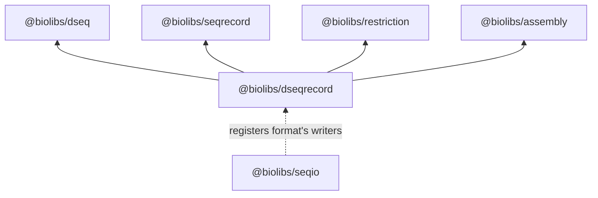

# @biolibs/dseqrecord

A molecule with a name, features and annotations — and the methods pydna adds to it: a port of
[pydna](https://github.com/BjornFJohansson/pydna)'s `Dseqrecord` and `pydna.seqrecord`.

Biopython's `SeqRecord` already holds a sequence with features. What pydna adds is the working
vocabulary of someone with a construct in front of them: GenBank's fields under the names a GenBank file
uses, marking a region by position *or* by its sequence, a table of what is annotated, and a checksum
stamped into the comment.

- **`Dseqrecord`** — a `Dseq` with features: cut it, close it, rotate it, and the features move with it
- **Features by position or by sequence** — `addFeature(3, 9)` or `addFeature(null, null, "GGATCC")`
- **`listFeatures`** — the table pydna prints, as data
- **Cutting** — with every fragment's features reassigned, origin-spanning ones included
- **`synced`** — line a sequencing read up with the molecule it came from
- **`stamp`** — a SEGUID in the comment, with a warning if it overwrites a different one
- **`format` and `figure`** — GenBank, FASTA, pydna's own two, the raw dscode encoding, and the drawing
- **`PydnaSeqRecord` and `ProteinSeqRecord`** — the layer under it, with `cai`, `orfs`, `express`
- Depends on `@biolibs/core`, `@biolibs/seq`, `@biolibs/seqfeature`, `@biolibs/seqrecord`,
  `@biolibs/dseq`, `@biolibs/restriction` and `@biolibs/assembly`

## What is verified

A generator drives real pydna and records what it does. Each case builds a record **carrying features**,
because that is where the difficulty is: closing a molecule shortens it by its overhangs, moving the
origin renumbers everything, and a feature that no longer fits has to go.

| Upstream module | Items at parity | Checklist |
|---|---|---|
| `pydna.seqrecord` | **45 / 45** | [pydna.seqrecord.md](../../docs/parity-pydna/pydna.seqrecord.md) |
| `pydna.dseqrecord` | **44 / 45** | [pydna.dseqrecord.md](../../docs/parity-pydna/pydna.dseqrecord.md) |
| `pydna.utils` | **5 / 5** | [pydna.utils.md](../../docs/parity-pydna/pydna.utils.md) |

**94 of 95 items**, verified against pydna 5.5.16 by **1,198 recorded cases**: 26 record sessions, 18
cutting sessions, 14 on the layer below, and 1,140 on moving a feature around a circle alone — because
that is the operation with the most ways to be subtly wrong.

The one item not ported:

- **`write` takes a file name.** Nothing in this repository touches a file system, and what it would have
  written is exactly what `format` returns. It is left unported rather than given a different signature.

Marked not applicable, with reasons:

- **`__hash__`** hashes a string built from the instance dictionary, so it moves with Python's hash seed.
  There is nothing reproducible to agree with.
- **`history`, `source`, `validate_history`, `normalize_history`, `is_amplicon`** need
  `pydna.opencloning_models` — 1,421 lines of pydantic describing a provenance interchange format, which
  is a port of its own rather than part of the molecule. `__eq__` deletes `source` from both sides before
  comparing, so carrying it unset changes nothing observable.
- **`dump`** writes a Python pickle; **`copy_gb_to_clipboard`** and **`copy_fasta_to_clipboard`** need a
  clipboard; **`map_trace_files`** reads ABI files off disk; **`display_html`** is for Jupyter.
- **`datefunction`** is here, because `stamp` reads it by default, but its answer is whenever it was
  called.

## Install

```bash
npm install @biolibs/dseqrecord
```

- ESM only, Node 20 or later, TypeScript declarations included



`@biolibs/seqio` is **not** a dependency: this package does not pull the IO layer in. A program that
wants `format("gb")` imports seqio itself, which registers the writers. pydna's own two formats need
nothing.

## API

### A record

```ts
import { Dseqrecord } from "@biolibs/dseqrecord";

const r = new Dseqrecord("AAAGGATCCAAAGGATCCTTT");

console.log(r.length);          // 21
console.log(String(r.seq));     // "AAAGGATCCAAAGGATCCTTT"
console.log(r.circular);        // false
console.log(r.name, r.id);      // "name" "id"
console.log(r.seguid());        // "ldseguid=OrOJIU0P7tAJBZMPpHCfsPY2ar0"
```

`n` is how much of the molecule there is, in moles, and `m()` the mass in grams — pydna's defaults, for
when you are about to pipette something.

### Features, by position or by sequence

```ts
const r = new Dseqrecord("AAAGGATCCAAA");

r.addFeature(3, 9, null, "misc");                  // by position
console.log(String(r.features[0]!.location));      // "[3:9](+)"

const q = new Dseqrecord("AAAGGATCCAAA");
q.addFeature(null, null, "GGATCC", "misc");        // by what it says
console.log(String(q.features[0]!.location));      // "[3:9](+)"

q.addFeature(null, null, "xyz");
// TypeError: Could not find xyz
```

A span that runs backwards is refused by the location, not by pydna:

```ts
r.addFeature(9, 3);
// ValueError: End location (3) must be greater than or equal to start location (9)
```

`listFeatures()` is the table pydna prints, as data you can use:

```ts
const table = r.listFeatures();
console.log(table.fieldNames);
// ["Ft#", "Label or Note", "Dir", "Sta", "End", "Len", "type", "orf?"]
console.log(table.rows[0]);
// [0, "L:ft6", "-->", 3, 9, 6, "misc", "no"]
```

`extractFeature(n)` gives the feature's own sequence, and `sortedFeatures()` orders them by position.

### Circles

```ts
const r = new Dseqrecord("AAAGGATCCAAAGGATCCTTT");
const circle = r.looped();

console.log(circle.circular);                       // true
console.log(String(circle.shifted(3).seq));         // "GGATCCAAAGGATCCTTTAAA"
```

`shifted` moves the origin — and **every feature moves with it**, including one that ends up spanning the
join, which becomes a compound location. That is what the 1,140 location cases are about.

### Cutting

```ts
import { Dseqrecord } from "@biolibs/dseqrecord";
import { enzymes } from "@biolibs/restriction";

const r = new Dseqrecord("AAAGGATCCAAAGGATCCTTT");

console.log(r.cut(enzymes.BamHI!).map((f) => String(f.seq)));
// ["AAAGGATC", "GATCCAAAGGATC", "GATCCTTT"]
console.log(r.numberOfCuts(enzymes.BamHI!));   // 2
```

`linearize` opens a circle with a single cut, and refuses three ways — a linear molecule, enzymes that do
not cut, and enzymes that cut more than once:

```ts
r.looped().linearize(enzymes.BamHI!);
// TypeError: More than one fragment is formed!
```

`noCutters`, `uniqueCutters`, `onceCutters`, `twiceCutters`, `nCutters` and `cutters` answer the question
from the other direction, each giving a `RestrictionBatch`.

### `synced`

Line a read up with the molecule it came from: `synced` rotates a circular record so that it starts where
the reference does.

```ts
const circle = new Dseqrecord("AAAGGATCCAAAGGATCCTTT").looped();
console.log(String(circle.synced("GGATCCAAAGGATCCTTTAAA").seq));
// "GGATCCAAAGGATCCTTTAAA"
```

It tries the reverse complement too, and complements the answer if that matches better. A reference with
nothing in common raises `TypeError: There is no overlap between sequences!`.

### `stamp`

```ts
const r = new Dseqrecord("AAAGGATCC");

console.log(r.stamp(() => "2026-01-01"));
// "ldseguid=eLi_jYOyGlHgx82i9xfaliGA_Dk"
console.log(r.comment());
// "pydna ldseguid=eLi_jYOyGlHgx82i9xfaliGA_Dk 2026-01-01"
```

The checksum goes into the record's comment, so it travels with the GenBank file. **Stamping a record
whose sequence has changed warns**, because a different checksum in the comment means the file and the
sequence have parted company.

### `format`

`format` is pydna's own override, and it does four things its parent does not:

```ts
import { Dseqrecord } from "@biolibs/dseqrecord";
import "@biolibs/seqio";        // registers the file-format writers

const r = new Dseqrecord("aaa", true);   // circular
r.annotations.set("date", "02-FEB-2013");

console.log(r.format("gb").split("\n")[0]);
// "LOCUS       name                       3 bp    DNA     circular UNK 02-FEB-2013"
console.log(r.format("fasta").split("\n")[0]);
// ">id description"
```

- **`topology` is set** for GenBank — `circular` above — and `linear` for everything else, including a
  circular molecule written as FASTA, which has nowhere to say so. It goes on a *copy*, so the record you
  called it on is untouched.
- **The format name is stripped** of spaces and hyphens, so `" gb "` works.
- **The result is trimmed**: Biopython's writers end with a newline and pydna takes it off.
- **`dscode` anywhere in the name** writes the raw encoding — one letter per base *pair* — instead of the
  watson strand:

```ts
const odd = new Dseqrecord("PEXIGATCQFZJ");

console.log(odd.format("fasta-2line dscode"));
// >id description
// PEXIGATCQFZJ
console.log(odd.format("fasta-2line"));
// >id description
// GATCGATCGATC
```

pydna's own two formats need no writers at all:

```ts
console.log(new Dseqrecord("atgtaa").format("pydnafasta"));
// >id 6 bp linear
// atgtaa
```

### `figure`

The molecule drawn, with one feature highlighted:

```ts
const r = new Dseqrecord("AAAGGATCCAAA");
r.addFeature(3, 9, null, "misc");

console.log(r.figure(0, "<", ">"));
// Dseqrecord(-12)
// AAA<GGATCC>AAA
// TTTCCTAGGTTT
```

The default highlight is the ANSI code for a yellow background, so it draws in a terminal. **Each
*part* of the feature's location is highlighted separately**, which a feature spanning the origin of a
circle needs — `join{[5:6], [0:1]}` marks both ends rather than the whole molecule. A feature on the
minus strand is highlighted on the lower line, and the two lines swap.

### `PydnaSeqRecord`

The layer under `Dseqrecord`, over a plain sequence rather than a double-stranded one. It carries the
coding-sequence questions:

```ts
import { PydnaSeqRecord } from "@biolibs/dseqrecord";

const p = new PydnaSeqRecord("ATGGCCTTTAAATTTGGGTGCTGA");

console.log(p.gc());          // 0.417
console.log(p.cai());         // 0.664
console.log(p.isorf());       // true
```

`gc`, `cai`, `rarecodons`, `startcodon`, `stopcodon` and `express` all delegate to the sequence, so they
need a `PydnaSeq` under them — on a `Dseqrecord`, whose sequence is a `Dseq`, they are not available.

## Testing

```bash
npm test                 # the whole workspace
npx vitest run packages/dseqrecord/test
```

| File | What it checks |
|---|---|
| `test/pydna-locations.test.ts` | 1,140 cases of moving a feature around a circle |
| `test/dseqrecord-cut.test.ts` | 18 cutting sessions, with features across the sites and the origin |
| `test/dseqrecord.test.ts` | 26 record sessions: geometry, features, formats, the figure |
| `test/pydna-seqrecord.test.ts` | 14 sessions on the layer below |
| `test/readme.test.ts` | every code block in this file |

Coverage from this package's own tests — `npx vitest run --coverage packages/dseqrecord/test`:

| | |
|---|---|
| Statements | **97.92%** (847 / 865) |
| Functions | **98.23%** (111 / 113) |
| Branches | **84.06%** (422 / 502) |

The branch figure is where a feature can fail to survive an operation: every combination of a span, an
origin and a cut site has its own answer, and the cases cover the ones a molecule can actually be in.
The two uncovered functions are `featureLol`, which flattens the feature table for a caller that wants
pydna's `PrettyTable.lol()` shape, and `datefunction`, whose answer is whenever it was called.

## Things to know

- **`format` needs `@biolibs/seqio` imported** for GenBank, FASTA and the rest; without it an unknown
  format raises `KeyError`. pydna's own `"pydnafasta"` and `"primer"` work regardless.
- **`format` returns no trailing newline.** pydna trims it, which matters if you are concatenating
  records into one file.
- **`copy()` shares the annotations map and the feature list**, exactly as pydna's does — mutating the
  copy's annotations changes the original's. `format` is the exception: it deep-copies, so setting
  `topology` cannot leak.
- **`figure` raises for a molecule with loops or mismatches.** Such a molecule has no single overhang to
  name, and pydna's arithmetic on `None` raises `TypeError: unsupported operand type(s) for +: 'NoneType'
  and 'int'` before it draws anything.
- **A record with no features still gets an empty highlight pair** at the start of its figure. pydna
  stands an empty location in for the missing feature.
- **`gc`, `cai` and the codon questions are on `PydnaSeqRecord`**, not on `Dseqrecord`: they ask the
  *sequence*, and a `Dseq` does not answer them.
- **`tolinear()` warns.** It is obsolete in pydna; slice the record instead.

## License

MIT — see [LICENSE](LICENSE).
