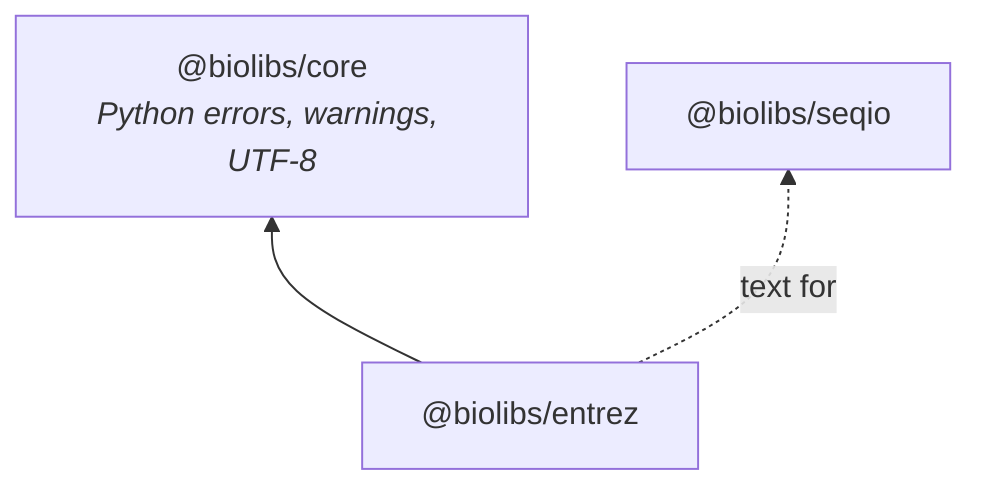

# @biolibs/entrez

A client for NCBI's E-utilities — GenBank, PubMed, Protein, Taxonomy and the rest of Entrez — that sends
the requests Biopython's `Bio.Entrez` sends. It is the one `@biolibs` package that touches the network,
and it brings back text that the others parse.

- **The eight E-utilities** — `efetch`, `esearch`, `esummary`, `elink`, `epost`, `einfo`, `espell`,
  `ecitmatch`, with Biopython's names and arguments
- **The same request, byte for byte** — the same parameter order, the same URL encoding, the same
  switch from GET to POST for long queries and long identifier lists
- **The same manners** — at most three requests a second, ten with an API key; retries for server
  errors and dropped connections, none for a plain "not found"
- **Runs in a browser** — NCBI's servers answer with `Access-Control-Allow-Origin: *`, so a page can
  fetch a record with no server of its own
- **One replaceable function touches the network** — swap `settings.transport` to route requests
  through a proxy, add caching, or test without a connection
- **One dependency**, `@biolibs/core`

`Entrez.read` and `Entrez.parse`, which turn NCBI's XML replies into objects, are **not ported yet**.
Sequence records come back as text for [`@biolibs/seqio`](../seqio); XML comes back as bytes.

## What is verified

A generator drives the real Biopython with its network call replaced, and records what it would have
sent: the method, the full URL, the POST body, the warning it gives when no email address is set, and
the exception type *and* message where it raises. The tests replay those recordings.

| Upstream module | Items at parity | Checklist |
|---|---|---|
| `Bio.Entrez` | **8 / 10** | [Bio.Entrez.md](../../docs/parity/Bio.Entrez.md) |

**1,092 tests over 1,092 recorded cases** against Biopython 1.88:

| Cases | What they record |
|---|---|
| 210 | the eight public functions, each under five combinations of email, tool and API key |
| 240 | `_build_request`: every class of character in a query, lists, numbers, bytes, the GET/POST switch either side of both its limits |
| 160 | `_construct_params`: what is added, what is dropped, and when it warns |
| 237 | `_has_api_key` |
| 206 | `_open`: the pause between requests, which errors are retried and how often, and the reply |
| 24 | `_format_ids` |
| 15 | `_update_ecitmatch_variables` |

Where the claim stops:

- **`read` and `parse` are not ported.** They are the two unverified items. Both depend on
  `Bio.Entrez.Parser`, which interprets NCBI's DTD files.
- **The network itself is not recorded.** `fetchTransport`, the default way of sending a request, is
  tested against a stand-in for `fetch`, not against Biopython: there is nothing reproducible to record.
  Everything up to the moment of sending, and everything done with the reply, is.
- **A reply is read in full before it is returned.** Biopython hands back an open connection to read
  from; this hands back the bytes. For the size of reply the E-utilities give, the difference is memory,
  not behaviour.
- **Whole numbers and other numbers are one type here.** `5` is written as Python writes the `int` 5.
  There is no way to pass the `float` 5.0, which Python would write as `5.0`; pass the text `"5.0"`.

Oddities that are Biopython's and are kept:

- `elink` with a number for `id` raises `AttributeError: 'int' object has no attribute 'count'`. It
  does not join its identifiers, and then asks the number how many commas it has.
- With `maxTries` set to 0 nothing is sent, and the result is `UnboundLocalError`.
- A server error is retried at once; only a connection that got no answer waits `sleepBetweenTries`.

## Install

```bash
npm install @biolibs/entrez
```

- ESM only, Node 20 or later, TypeScript declarations included
- Uses the platform's `fetch`: every current browser, and Node 20 or later



## Say who you are

NCBI asks every client to give an email address, so that it can get in touch before blocking heavy use.
Set it once. Biopython warns on every request made without one, and so does this.

```ts
import { settings } from "@biolibs/entrez";

settings.email = "a.n.other@example.com";   // Python: Entrez.email = "a.n.other@example.com"
settings.tool;                              // "biopython" — sent as-is unless you change it
settings.apiKey = "0123456789abcdef";       // optional: raises the limit from 3 requests a second to 10
```

Your email address is sent to NCBI with every request, in the URL. That is what NCBI asks for, and what
Biopython does; it is worth knowing before using this in a page other people will open.

## Fetching a record

`efetch` takes the database and then the rest of the parameters as an object, where Python takes
keyword arguments.

```ts
import { efetch } from "@biolibs/entrez";
import { read } from "@biolibs/seqio";

const handle = await efetch("nucleotide", { id: "EU490707", rettype: "gb", retmode: "text" });

handle.url;        // the address the reply came from
handle.text;       // true — NCBI declared it plain text
const record = read(handle.readText(), "genbank");
record.id;         // "EU490707.1"
```

`handle.read()` does what Python's does: text for a plain-text reply, bytes for anything else, which is
how XML arrives. `handle.readText()` always gives text, and `handle.bytes` always gives the bytes.

## Searching

```ts
import { esearch } from "@biolibs/entrez";

const handle = await esearch("nucleotide", "Opuntia[orgn] AND rpl16", { retmax: 5, idtype: "acc" });
handle.readText();   // XML listing the matching identifiers
```

The reply is XML. Until `Entrez.read` is ported, ask for JSON with `retmode: "json"` and use
`JSON.parse`, or parse the XML yourself.

## The request, without sending it

`buildRequest` is Biopython's `_build_request`: it returns what would be sent.

```ts
import { EUTILS, buildRequest, settings } from "@biolibs/entrez";

settings.email = "a.n.other@example.com";

const request = buildRequest(`${EUTILS}esearch.fcgi`, { db: "pubmed", term: "biopython[title]", retmax: 20 });
request.method;    // "GET"
request.fullUrl;
// "https://eutils.ncbi.nlm.nih.gov/entrez/eutils/esearch.fcgi?db=pubmed&term=biopython%5Btitle%5D&retmax=20&tool=biopython&email=a.n.other%40example.com"
```

It switches to POST by itself when the encoded parameters come to more than 1,000 characters, or when
there are 200 or more identifiers, whichever happens first:

```ts
const ids = Array.from({ length: 200 }, (_, i) => 1000 + i);
const big = buildRequest(`${EUTILS}efetch.fcgi`, { db: "nucleotide", id: ids });

big.method;                                             // "POST"
big.fullUrl;                                            // ".../efetch.fcgi" — the parameters are in the body
new TextDecoder().decode(big.data!).slice(0, 30);       // "db=nucleotide&id=1000%2C1001%2"

buildRequest(`${EUTILS}efetch.fcgi`, { db: "nucleotide", id: ids.slice(0, 50) }).method;    // "GET"
```

## Identifiers

A list of identifiers is joined with commas, and text is tidied, by `formatIds`:

```ts
import { formatIds } from "@biolibs/entrez";

formatIds(19304878);                 // "19304878"
formatIds(" 1 , 2 ,3 ");             // "1,2,3"
formatIds(["EU490707", 19304878]);   // "EU490707,19304878"
```

`elink` is the exception. It repeats `id` once per identifier, which asks NCBI for each one's links
separately:

```ts
import { EUTILS, buildRequest } from "@biolibs/entrez";

// What elink sends for a list: joinIds is false.
buildRequest(`${EUTILS}elink.fcgi`, { dbfrom: "protein", db: "gene", id: ["15718680", "157427902"] }, null, false, false).fullUrl;
// ".../elink.fcgi?dbfrom=protein&db=gene&id=15718680&id=157427902&tool=biopython&email=a.n.other%40example.com"
```

## URL encoding

Python's `urlencode` is not `encodeURIComponent`, and the differences change the bytes sent.
`quotePlus` and `urlencode` are exported for anything else that has to match it.

```ts
import { quotePlus, urlencode } from "@biolibs/entrez";

quotePlus("Opuntia[orgn] AND rpl16");   // "Opuntia%5Borgn%5D+AND+rpl16" — a space is +
quotePlus("it's (here)!*~");            // "it%27s+%28here%29%21%2A~"   — only ~ survives
quotePlus("日本");                       // "%E6%97%A5%E6%9C%AC"

urlencode(new Map<string, unknown>([["id", [1, 2]], ["usehistory", true], ["retmax", null]]));
// "id=1&id=2&usehistory=True&retmax=None"
```

## Pacing and retries

Requests are kept at least 0.37 seconds apart, or 0.1 with an API key. A reply that is a server error
or "too many requests" is asked for again at once; a connection that gets no answer is retried after
`sleepBetweenTries` seconds; any other 4xx is final.

```ts
import { HTTPError, settings } from "@biolibs/entrez";

settings.maxTries;            // 3
settings.sleepBetweenTries;   // 15  — seconds

try {
  await efetch("nucleotide", { id: "EU490707", rettype: "gb", retmode: "text" });
} catch (error) {
  if (error instanceof HTTPError) {
    error.code;      // the HTTP status, such as 429
    error.message;   // "HTTP Error 429: Too Many Requests"
  }
}
```

An identifier NCBI does not know is **not** an HTTP error: the reply has status 200 and says what was
wrong in its body. Check what came back.

## Replacing the network

Everything is sent through `settings.transport`. Replace it to add a cache, go through your own server,
or run with no connection at all. It is given the request and returns the reply, or throws `HTTPError`
or `URLError`.

```ts
import { efetch, settings, type Transport } from "@biolibs/entrez";

const canned: Transport = async (request) => ({
  url: request.fullUrl,
  contentType: "text/plain",
  body: new TextEncoder().encode(">made-up record\nACGT\n"),
});
settings.transport = canned;

const handle = await efetch("nucleotide", { id: "anything", rettype: "fasta", retmode: "text" });
handle.readText();   // ">made-up record\nACGT\n"
```

`settings.now` and `settings.sleep` are the clock and the wait, replaceable the same way, which is how
the tests run 206 cases of pacing and retrying in a few milliseconds.

## The other E-utilities

| Python | TypeScript | Notes |
|---|---|---|
| `Entrez.efetch(db, **kw)` | `efetch(db, kw?)` | records, in the format `rettype` and `retmode` ask for |
| `Entrez.esearch(db, term, **kw)` | `esearch(db, term, kw?)` | identifiers matching a query |
| `Entrez.esummary(**kw)` | `esummary(kw?)` | document summaries |
| `Entrez.elink(**kw)` | `elink(kw?)` | related records; repeats `id` instead of joining it |
| `Entrez.epost(db, **kw)` | `epost(db, kw?)` | upload identifiers to the history server; always a POST |
| `Entrez.einfo(**kw)` | `einfo(kw?)` | the databases, or one database's fields |
| `Entrez.espell(**kw)` | `espell(kw?)` | spelling suggestions |
| `Entrez.ecitmatch(**kw)` | `ecitmatch(kw?)` | PubMed identifiers for citations |
| `Entrez.email`, `tool`, `api_key` | `settings.email`, `tool`, `apiKey` | |
| `Entrez.max_tries`, `sleep_between_tries` | `settings.maxTries`, `sleepBetweenTries` | |
| `Entrez.read`, `Entrez.parse` | not ported | |

Each returns a promise. The request is built before the function returns, so a bad argument throws
straight away, not when the promise is awaited.

## Testing

```bash
npm test                 # the whole workspace
npx vitest run packages/entrez/test
```

| File | What it checks |
|---|---|
| `test/entrez.test.ts` | the 1,092 recorded cases from Biopython 1.88 |
| `test/transport.test.ts` | `fetchTransport`, against a stand-in for `fetch` |
| `test/readme.test.ts` | every code block in this file |

No test touches the network.

## Things to know

- **A browser cannot set a `User-Agent`**, and does not need to: NCBI identifies clients by the `tool`
  and `email` parameters, which is what is sent.
- **Key order is the order sent.** Parameters go out in the order you wrote them, then `tool`, `email`
  and `api_key`. JavaScript moves object keys that look like whole numbers to the front; if you have
  one, pass a `Map` or an array of pairs instead of an object.
- **`null` and `undefined` mean "leave it out"**, as `None` does in Python. Passing `email: null` drops
  the email for that request, and brings the warning back.
- **Rate limiting is per page or process.** Two tabs, or two programs, each keep their own count.

## License

MIT — see [LICENSE](LICENSE).
