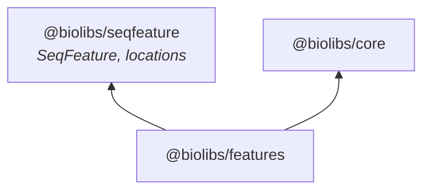

# @biolibs/features

Find known elements in a DNA sequence by comparing it with a library of reference pieces. This is the
"find features" button of a plasmid editor: given a sequence and a collection of known parts, say which
of them are in it and where.

Biopython has nothing equivalent. `Bio.Align` will align two sequences and `Bio.motifs` will score a
position matrix, but neither answers *"which of these 400 standard parts is in my plasmid"*.

- **`detectFeatures`** — every place a library's pieces occur, on **both strands**, across a **circular
  origin**, tolerating substitutions
- **Short pieces are held to a stricter standard than long ones**, because a 20-base promoter with one
  base different is a different promoter
- **`bestHits`** — keeps the best where several overlap, measured against the longer hit, so a promoter
  inside a gene survives but a worse variant of that gene does not
- **`asFeature`** — a hit as a `SeqFeature`, with the name in the qualifiers GenBank readers look at,
  and a wrapping hit as a two-part join
- **`newHits`** — which hits a record does not already annotate, by name *or* by coverage
- **Nothing here changes a record.** The caller decides what to add
- **No library ships with this package** — see below, it is a licensing matter

## No library ships with this package

That is deliberate, and it is the first thing to know about using it. The collections of annotated parts
that would fill a library carry their own terms, and several of the obvious sources are unsuitable for
bundling inside an MIT package: Addgene's site content is limited to non-commercial use, and the iGEM
Registry's terms would need confirming and would carry ShareAlike obligations onto whatever bundled them.

So the library is an **argument**. You supply pieces under whatever terms apply to them — cut out of
records you already hold, read from a file, or published as a separate package with its own notice.

```ts
import { libraryProblems, requireLibrary, type ReferencePiece } from "@biolibs/features";

const library: ReferencePiece[] = [
  { name: "T7 promoter", type: "promoter", sequence: "TAATACGACTCACTATAG" },
  { name: "GFP", type: "CDS", sequence: gfpSequence, note: "from pGFP" },
];

libraryProblems(library);     // [] — nothing wrong with it

libraryProblems([{ name: "x", type: "CDS", sequence: "ACGN" }]);
// ["piece 'x': the sequence may only contain A, C, G and T"]
libraryProblems([{ name: "", type: "CDS", sequence: "ACGT" }]);
// ["a piece has no name"]
libraryProblems([{ name: "a", type: "CDS", sequence: "ACGT" },
                 { name: "a", type: "CDS", sequence: "TTTT" }]);
// ["piece 'a': two pieces share this name"]

requireLibrary([{ name: "x", type: "CDS", sequence: "ACGN" }]);
// ValueError: the reference library is not usable: piece 'x': the sequence may only contain A, C, G and T
```

`detectFeatures` calls `requireLibrary` itself, so a bad library fails at the search rather than quietly
returning nothing.

## What is verified

This is not a port of anything, so there is no parity checklist. What there is instead:

- **58 unit tests** over every claim below: the mismatch arithmetic at its boundaries, both strands, the
  wrap across an origin, the two cases `bestHits` exists to distinguish, the qualifiers a built feature
  carries, and every refusal with its message.
- **The feature classes are the verified ones.** `asFeature` returns a `SeqFeature` with a
  `SimpleLocation` or `CompoundLocation` from `@biolibs/seqfeature`, which is `Bio.SeqFeature` ported and
  measured against Biopython — so a feature built here writes out through `@biolibs/seqio` the way
  Biopython would write it.

Where the claim stops, and it is the whole character of the package:

- **This is not alignment.** Matching is base for base over the piece's whole length, allowing
  substitutions and **no indels**. A part with bases inserted into it is a different part and will not be
  found. That is a deliberate model, not a limitation to be worked around: the variants of a standard
  part that turn up in real plasmids differ by scattered substitutions.
- **There is no statistical model.** No E-value, no score, no significance. A hit is "the bases agreed
  within the budget", and the budget is a fraction you chose.
- **`identity` is only over the piece's length.** It is not a global identity and says nothing about what
  surrounds the hit.
- **`bestHits` is a greedy pass, not an optimum.** It takes hits in order of quality and keeps what does
  not clash with something already kept. A different order could in principle keep a different set.
- **The thresholds are conventions.** 5% mismatches, exact matching at 30 bases and under, half-overlap
  for crowding: these are defaults that behave sensibly on real plasmids, not derived quantities.

## Install

```bash
npm install @biolibs/features
```

- ESM only, Node 20 or later, TypeScript declarations included



Positions are 0-based half-open spans, as elsewhere in biolibs.

## The sequence used below

```ts
export const T7 = "TAATACGACTCACTATAG";                 // the T7 promoter, 18 bases
export const GENE =                                      // 126 bases of a GFP-like CDS
  "ATGAGTAAAGGAGAAGAACTTTTCACTGGAGTTGTCCCAATTCTTGTTGAATTAGATGGTGATGTT" +
  "AATGGGCACAAATTTTCTGTCAGTGGAGAGGGTGAAGGTGATGCAACATACGGAAAACTT";
export const FILLER_A = "CGATCGATCGTAGCTAGCTAACCGGTTAACCGGTTAAGCTT";
export const FILLER_B = "GGCCTTAAGGCCTTAAGGCCAATTCCAATTCCAAGGTTCCA";

/** 229 bases: filler, the T7 promoter at 41, three bases, the gene at 62, filler. */
export const PLASMID = `${FILLER_A}${T7}GGG${GENE}${FILLER_B}`;
```

## Finding the pieces

```ts
import { detectFeatures } from "@biolibs/features";
import { GENE, PLASMID, T7 } from "./sequence.js";

const library = [
  { name: "T7 promoter", type: "promoter", sequence: T7 },
  { name: "GFP", type: "CDS", sequence: GENE, note: "from pGFP" },
];

const hits = detectFeatures(PLASMID, "linear", library);

hits.map((h) => [h.piece.name, h.start, h.end, h.strand]);
// [["T7 promoter", 41, 59, 1], ["GFP", 62, 188, 1]]
hits[0]!.mismatches;   // 0
hits[0]!.identity;     // 1
hits[0]!.wraps;        // false
```

Hits come back ordered by `start`, then **longer piece first**, then by name — so a gene is listed before
a short element that begins at the same base.

### How tolerant the match is

A piece of 30 bases or fewer must match **exactly**; a longer one tolerates 5% mismatches. `mismatchBudget`
is that arithmetic, and it is worth reading before tuning anything:

```ts
import { DEFAULT_DETECT, mismatchBudget } from "@biolibs/features";
import { GENE, T7 } from "./sequence.js";

DEFAULT_DETECT;    // { tolerance: 0.05, exactBelow: 30, maxHits: 1000 }

mismatchBudget({ name: "T7", type: "promoter", sequence: T7 }, DEFAULT_DETECT);      // 0 — 18 bases
mismatchBudget({ name: "GFP", type: "CDS", sequence: GENE }, DEFAULT_DETECT);        // 6 — 126 × 0.05
mismatchBudget({ name: "a", type: "CDS", sequence: "A".repeat(30) }, DEFAULT_DETECT);   // 0
mismatchBudget({ name: "a", type: "CDS", sequence: "A".repeat(31) }, DEFAULT_DETECT);   // 1

// A piece may be more tolerant than the default...
mismatchBudget({ name: "GFP", type: "CDS", sequence: GENE, tolerance: 0.1 }, DEFAULT_DETECT);   // 12
// ...but it cannot buy its way out of the exact-match rule for short pieces.
mismatchBudget({ name: "T7", type: "promoter", sequence: T7, tolerance: 0.5 }, DEFAULT_DETECT); // 0
```

So a gene variant with scattered substitutions is found, and the identity records how far off it was:

```ts
import { detectFeatures } from "@biolibs/features";
import { GENE, PLASMID } from "./sequence.js";

// The same gene with four bases changed.
const variant = [...GENE];
for (const i of [10, 40, 70, 100]) variant[i] = variant[i] === "A" ? "G" : "A";
const VARIANT = variant.join("");

const found = detectFeatures(PLASMID, "linear", [{ name: "GFP variant", type: "CDS", sequence: VARIANT }]);
found[0]!.mismatches;                   // 4
found[0]!.identity.toFixed(4);          // "0.9683" — 122 of 126

// Ask for 2% and four mismatches in 126 bases is too many.
detectFeatures(PLASMID, "linear",
  [{ name: "GFP variant", type: "CDS", sequence: VARIANT, tolerance: 0.02 }]).length;   // 0
```

To find a short element that is one base off, lower `exactBelow` deliberately:

```ts
import { detectFeatures } from "@biolibs/features";
import { T7 } from "./sequence.js";

const oneOff = `CCCC${T7.slice(0, 5)}G${T7.slice(6)}CCCC`;

detectFeatures(oneOff, "linear", [{ name: "T7", type: "promoter", sequence: T7 }]).length;   // 0
detectFeatures(oneOff, "linear", [{ name: "T7", type: "promoter", sequence: T7 }],
  { exactBelow: 0, tolerance: 0.1 }).map((h) => [h.start, h.mismatches]);                   // [[4, 1]]
```

### Both strands, and across an origin

```ts
import { detectFeatures } from "@biolibs/features";
import { FILLER_A, FILLER_B, T7 } from "./sequence.js";

// The promoter written on the bottom strand: the reverse complement of T7.
const flipped = `${FILLER_A}CTATAGTGAGTCGTATTA${FILLER_B}`;
detectFeatures(flipped, "linear", [{ name: "T7 promoter", type: "promoter", sequence: T7 }])
  .map((h) => [h.start, h.end, h.strand]);        // [[41, 59, -1]] — found, on strand -1

// A piece that is its own reverse complement is found on both strands, at the same place.
detectFeatures("AAAGAATTCAAA", "linear", [{ name: "EcoRI site", type: "misc_feature", sequence: "GAATTC" }])
  .map((h) => [h.start, h.strand]);               // [[3, -1], [3, 1]]
```

A circular sequence is searched across its origin, and a straddling piece is found **exactly once**:

```ts
import { detectFeatures } from "@biolibs/features";
import { FILLER_A, FILLER_B, T7 } from "./sequence.js";

// A 100-base circle whose origin falls nine bases into the promoter.
const CIRCLE = T7.slice(9) + FILLER_A + FILLER_B + T7.slice(0, 9);

detectFeatures(CIRCLE, "circular", [{ name: "T7 promoter", type: "promoter", sequence: T7 }])
  .map((h) => [h.start, h.end, h.wraps]);         // [[91, 109, true]]

// Called linear, the same sequence has no promoter in it at all.
detectFeatures(CIRCLE, "linear", [{ name: "T7 promoter", type: "promoter", sequence: T7 }]).length;   // 0
```

`end` runs past the length for a wrapping hit, which is how you can tell. Anything that is not an
unambiguous base never matches, so one N in the window is enough to lose the hit however tolerant the
piece is:

```ts
import { detectFeatures } from "@biolibs/features";
import { T7 } from "./sequence.js";

const broken = `CGATCGATCG${T7.slice(0, 9)}N${T7.slice(10)}CGATCGATCG`;
detectFeatures(broken, "linear", [{ name: "T7 promoter", type: "promoter", sequence: T7 }]).length;   // 0
```

## Picking the best hits

A real library finds the same part several times over — the gene, a variant of the gene, and a tag inside
it. `bestHits` keeps the best where they clash, and the measurement is the point: overlap as a fraction
of the **longer** of the two hits.

```ts
import { bestHits, detectFeatures } from "@biolibs/features";
import { GENE, PLASMID, T7 } from "./sequence.js";

const variant = [...GENE];
for (const i of [10, 40, 70, 100]) variant[i] = variant[i] === "A" ? "G" : "A";

const library = [
  { name: "T7 promoter", type: "promoter", sequence: T7 },
  { name: "GFP", type: "CDS", sequence: GENE },
  { name: "GFP variant", type: "CDS", sequence: variant.join("") },
  { name: "GFP N-term", type: "misc_feature", sequence: GENE.slice(0, 20) },
];

const all = detectFeatures(PLASMID, "linear", library);
all.map((h) => [h.piece.name, h.start, h.end, h.mismatches]);
// [["T7 promoter", 41, 59, 0], ["GFP", 62, 188, 0],
//  ["GFP variant", 62, 188, 4], ["GFP N-term", 62, 82, 0]]

bestHits(all).map((h) => h.piece.name);
// ["T7 promoter", "GFP", "GFP N-term"]
```

Three things happened there, and they are the three cases that matter:

- **The variant was dropped.** It covers the whole of the gene and the gene covers the whole of it, so
  the overlap is 1.0 of the longer — above the 0.5 default — and only the better of the two survives.
- **The 20-base N-terminal tag was kept.** It sits inside the gene, but 20 bases of 126 is 0.16 of the
  longer hit, well under the threshold. A short element inside a long one is information, not a clash.
- **The promoter was kept**, overlapping nothing.

The threshold is an argument:

```ts
import { bestHits, detectFeatures } from "@biolibs/features";

bestHits(all, 1).map((h) => h.piece.name);
// ["T7 promoter", "GFP", "GFP variant", "GFP N-term"] — nothing clashes when anything is allowed
bestHits(all, 0).map((h) => h.piece.name);
// ["T7 promoter", "GFP"] — any overlap at all is a clash
```

Hits come back in the order `detectFeatures` gave them, not in quality order, so a caller's display order
is unchanged.

## Turning hits into features

```ts
import { asFeature, bestHits, detectFeatures } from "@biolibs/features";
import { GENE, PLASMID, T7 } from "./sequence.js";

const hits = detectFeatures(PLASMID, "linear",
  [{ name: "T7 promoter", type: "promoter", sequence: T7 },
   { name: "GFP", type: "CDS", sequence: GENE, note: "from pGFP" }]);

const feature = asFeature(hits[1]!, { length: PLASMID.length });

feature.type;                           // "CDS"
String(feature.location);               // "[62:188](+)"
feature.qualifiers.get("label");        // ["GFP"]
feature.qualifiers.get("gene");         // ["GFP"] — for a gene or CDS, so GenBank keeps the name
feature.qualifiers.get("note");
// ["from pGFP", "found by comparison with a reference sequence, 100% identical"]
```

The name goes in `/label`, and in `/gene` as well for a gene or CDS, because a name that survives a round
trip through GenBank has to be in a qualifier the reader looks at. The piece's own `note` is kept
alongside the note recording the identity:

```ts
import { asFeature, detectFeatures } from "@biolibs/features";
import { GENE, PLASMID } from "./sequence.js";

const geneHit = detectFeatures(PLASMID, "linear",
  [{ name: "GFP", type: "CDS", sequence: GENE, note: "from pGFP" }])[0]!;

asFeature(geneHit, { note: "" }).qualifiers.get("note");          // ["from pGFP"] — only the piece's own
asFeature(geneHit, { note: "hand checked" }).qualifiers.get("note");
// ["from pGFP", "hand checked"]

// An inexact hit records how far off it was, to one decimal place.
const variant = [...GENE];
for (const i of [10, 40, 70, 100]) variant[i] = variant[i] === "A" ? "G" : "A";
const variantHit = detectFeatures(PLASMID, "linear",
  [{ name: "GFP variant", type: "CDS", sequence: variant.join("") }])[0]!;

asFeature(variantHit).qualifiers.get("note");
// ["found by comparison with a reference sequence, 96.8% identical"]
```

A hit that wraps the origin becomes a two-part join, which is how GenBank writes such a feature — and it
needs the sequence length to be written at all:

```ts
import { asFeature, detectFeatures } from "@biolibs/features";
import { FILLER_A, FILLER_B, T7 } from "./sequence.js";

const CIRCLE = T7.slice(9) + FILLER_A + FILLER_B + T7.slice(0, 9);
const wrapping = detectFeatures(CIRCLE, "circular",
  [{ name: "T7 promoter", type: "promoter", sequence: T7 }])[0]!;

String(asFeature(wrapping, { length: CIRCLE.length }).location);
// "join{[91:100](+), [0:9](+)}"

asFeature(wrapping);
// ValueError: a hit that wraps the origin needs the sequence length, so it can be written as a join
```

## Not annotating twice

`newHits` is what stands between a detector and a curated record. A hit counts as already annotated when
an existing feature carries the same name — in `/gene`, `/label`, `/product`, `/standard_name` or the
feature's id — **or** when a feature of the same type covers at least half of it. The second test is what
catches a curated annotation under a different name.

```ts
import { alreadyAnnotated, bestHits, detectFeatures, newHits } from "@biolibs/features";
import { SeqFeature, SimpleLocation } from "@biolibs/seqfeature";
import { GENE, PLASMID, T7 } from "./sequence.js";

const hits = bestHits(detectFeatures(PLASMID, "linear",
  [{ name: "T7 promoter", type: "promoter", sequence: T7 },
   { name: "GFP", type: "CDS", sequence: GENE, note: "from pGFP" }]));

// The record already calls it GFP.
const byName = [new SeqFeature(new SimpleLocation(62, 188, 1), "CDS", "", new Map([["gene", ["GFP"]]]))];
alreadyAnnotated(hits[1]!, byName);        // true

// Or calls it something else, but annotates the same bases as the same type.
const byCoverage = [new SeqFeature(new SimpleLocation(62, 188, 1), "CDS", "",
  new Map([["product", ["green fluorescent protein"]]]))];
alreadyAnnotated(hits[1]!, byCoverage);    // true

// A different type over the same bases is not the same annotation.
const wrongType = [new SeqFeature(new SimpleLocation(62, 188, 1), "misc_feature", "", new Map())];
alreadyAnnotated(hits[1]!, wrongType);     // false

newHits(hits, byName).map((h) => h.piece.name);   // ["T7 promoter"] — the gene is already there
```

Putting it together — and note that the record is changed by the **caller**, never by this package:

```ts
import { asFeature, bestHits, detectFeatures, newHits } from "@biolibs/features";
import { GENE, PLASMID, T7 } from "./sequence.js";
import { Seq } from "@biolibs/seq";
import { SeqRecord } from "@biolibs/seqrecord";

const record = new SeqRecord(new Seq(PLASMID), "pTest");
const library = [
  { name: "T7 promoter", type: "promoter", sequence: T7 },
  { name: "GFP", type: "CDS", sequence: GENE, note: "from pGFP" },
];

for (const hit of newHits(bestHits(detectFeatures(PLASMID, "linear", library)), record.features)) {
  record.features.push(asFeature(hit, { length: PLASMID.length }));
}

record.features.map((f) => [f.type, String(f.location)]);
// [["promoter", "[41:59](+)"], ["CDS", "[62:188](+)"]]
```

## Testing

```bash
npm test                 # the whole workspace
npx vitest run packages/features/test
```

| File | What it checks |
|---|---|
| `test/features.test.ts` | the 58 behaviour tests, including every mismatch boundary |
| `test/readme.test.ts` | every code block in this file |

Coverage from this package's own tests — `npx vitest run --coverage packages/features/test`:

| | |
|---|---|
| Statements | **100.00%** (143 / 143) |
| Functions | **100.00%** (10 / 10) |
| Branches | **96.23%** (102 / 106) |

## Things to know

- **You bring the library.** Nothing is bundled, for licensing reasons, and `requireLibrary` will tell
  you what is wrong with what you brought.
- **Short pieces must match exactly** unless you lower `exactBelow`, and a piece's own `tolerance` cannot
  override that.
- **Topology is an argument.** A circular plasmid called linear loses every feature across its origin,
  silently — there is no way for the search to know.
- **One ambiguous base loses the hit**, however tolerant the piece. Mismatches are for substitutions, not
  for unknowns.
- **A palindromic piece is found twice**, once per strand, at the same coordinates.
- **`bestHits` measures overlap against the longer hit.** That is what keeps a tag inside a gene while
  dropping a redundant variant of the gene.
- **Nothing is written to a record here.** `asFeature` and `newHits` hand you the pieces; pushing them is
  your decision, which is the only safe default for an automatic detector.

## License

MIT — see [LICENSE](LICENSE).
