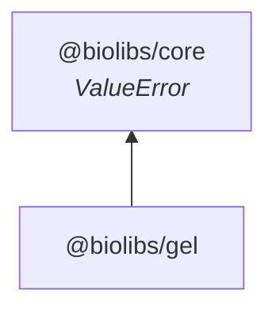

# @biolibs/gel

A virtual agarose gel: where DNA fragments of a given size would run, and which of them a gel would tell
apart. This is the data behind the gel photograph that a tool such as SnapGene or Benchling draws beside
a digest.

- **`bandPosition`** — log-linear migration over the range a gel resolves, 0 at the wells and 1 at the
  front
- **`bandsOf`** — fragment sizes to visible bands, merging what the eye could not separate, with an
  intensity from the DNA in each band
- **`GELS`** — four agarose concentrations (0.8, 1.0, 1.5, 2.0%) and the range each one resolves
- **`LADDERS`** — the generic 1 kb and 100 bp size markers, and `ladderBands` to run them
- **`fragmentSizes`** — cut positions to fragment lengths, linear or circular, with no enzyme library
  needed
- **One dependency**, `@biolibs/core`, for the error class

## What is verified

This is not a port of anything, and there is nothing to be a port *of* — Biopython has no gel. So there
is no parity checklist, and no reference implementation to compare with. What there is instead:

- **41 unit tests** against the model's own invariants, which is what can honestly be checked here: that
  every fragment loaded appears in exactly one band, that a larger fragment never runs further than a
  smaller one, that the band positions of a ladder increase monotonically, that merging is anchored so a
  run of near-neighbours cannot chain into one band, and that both ends of the resolving range behave
  the same way.
- **The arithmetic is checked at its fixed points**: the gel's `largest` is at 0, its `smallest` at 1,
  and their geometric mean at 0.5.

Where the claim stops — and here it is the whole package, so it is worth being blunt:

- **The figures are conventional working values, not measurements.** The four concentrations and their
  ranges are what supplier guides print for agarose in TAE. A real gel depends on buffer, voltage, run
  time, comb and dye, none of which appear here.
- **Log-linear is a first approximation.** Migration is very nearly linear in `log10(size)` over the
  range a gel separates, which is why gel photographs are read against a log scale — but it is an
  approximation, and it is applied only inside that range. Outside it, sizes clamp.
- **`position` is a fraction of the lane, not a distance.** There is no mm, no run time and no voltage.
  Two gels' positions are comparable only as fractions.
- **`intensity` is a share of the lane's base pairs**, scaled so the heaviest band is 1. That is mass,
  not fluorescence: no dye binding, no saturation, no background.
- **Nothing here is drawn.** This is the numbers; rendering a lane is the caller's.

If you need to predict where a band will actually be on a particular rig, this is the wrong tool. If you
need to know whether your digest will be readable before you pour the gel, it is the right one.

## Install

```bash
npm install @biolibs/gel
```

- ESM only, Node 20 or later, TypeScript declarations included



## Gels and ladders

```ts
import { GELS, LADDERS, gelById, ladderById } from "@biolibs/gel";

GELS.map((g) => [g.percent, g.largest, g.smallest]);
// [[0.8, 15000, 500], [1, 10000, 250], [1.5, 4000, 100], [2, 2000, 50]]

gelById("1.0");    // { id: "1.0", percent: 1, largest: 10000, smallest: 250 }
gelById("2.0").smallest;   // 50 — a stiffer gel resolves smaller fragments

LADDERS.map((l) => [l.id, l.sizes.length]);   // [["1kb", 10], ["100bp", 11]]
ladderById("1kb").sizes[0];                   // 10000

gelById("3.0");
// ValueError: unknown gel '3.0'; known gels are 0.8, 1.0, 1.5, 2.0
```

A low-percentage gel spreads large fragments out and runs small ones off the bottom together; a
high-percentage gel does the reverse. `largest` and `smallest` bracket the range over which the gel
actually separates things, and are the two numbers everything else is built on.

## Where a fragment runs

```ts
import { bandPosition, gelById, resolves } from "@biolibs/gel";

const gel = gelById("1.0");    // resolves 250–10,000 bp

bandPosition(10000, gel);      // 0 — at the wells
bandPosition(250, gel);        // 1 — at the running front
bandPosition(1581, gel);       // 0.5 — the geometric mean of the two ends, by definition of a log scale

bandPosition(2000, gel).toFixed(4);   // "0.4363"
bandPosition(1000, gel).toFixed(4);   // "0.6242"
bandPosition(500, gel).toFixed(4);    // "0.8121"
```

That the midpoint is the *geometric* mean rather than the arithmetic one is the whole model in one line:
`√(10000 × 250) = 1581`, and a 1581 bp fragment sits halfway down the lane.

Outside the range the gel does not separate, so sizes clamp rather than extrapolate:

```ts
import { bandPosition, gelById, resolves } from "@biolibs/gel";

const gel = gelById("1.0");

bandPosition(50000, gel);      // 0 — bunched at the wells with everything else that big
bandPosition(10, gel);         // 1 — run off the bottom

resolves(1000, gel);           // true
resolves(10000, gel);          // true — the range is inclusive at both ends
resolves(20000, gel);          // false
resolves(100, gel);            // false
```

## Fragment sizes from cut positions

`fragmentSizes` turns cut positions into fragment lengths without pulling in an enzyme library, so a
digest from any source can be loaded.

```ts
import { fragmentSizes } from "@biolibs/gel";

// pUC19 is 2686 bp; cutting a circle at two places gives two pieces.
fragmentSizes(2686, "circular", [395, 1230]);   // [1851, 835]
fragmentSizes(2686, "circular", [395]);         // [2686] — one cut on a circle opens it, nothing more
fragmentSizes(2686, "circular", []);            // [2686] — an uncut circle stays whole

// A line with n cuts falls into n + 1 pieces, counting the two uncut ends.
fragmentSizes(1000, "linear", [100, 400]);      // [600, 300, 100]
fragmentSizes(1000, "circular", [100, 400]);    // [700, 300]
```

Cuts are **0-based boundaries**: a cut at `n` separates the base at index `n - 1` from the base at index
`n`. `@biolibs/restriction` reports cuts 1-based, as Biopython does, so subtract one from each —
`@biolibs/cloning`'s `cutsIn` does that conversion for you.

```ts
import { fragmentSizes } from "@biolibs/gel";

// Cuts at the ends of a line are the ends it already had, and add no piece.
fragmentSizes(1000, "linear", [0, 400, 1000]);   // [600, 400]
// Two enzymes cutting the same bond make one break.
fragmentSizes(1000, "linear", [400, 400]);       // [600, 400]
// Order does not matter.
fragmentSizes(1000, "linear", [400, 100]);       // [600, 300, 100]

fragmentSizes(1000, "linear", [1001]);
// ValueError: cut position 1001 is outside a sequence of 1000 bases
```

## Reading a lane

```ts
import { bandsOf, fragmentSizes, gelById } from "@biolibs/gel";

const gel = gelById("1.0");
const bands = bandsOf(fragmentSizes(2686, "circular", [395, 1230]), gel);

bands.map((b) => [b.size, b.position.toFixed(4), b.totalBases, b.intensity.toFixed(4)]);
// [[1851, "0.4573", 1851, "1.0000"],
//  [ 835, "0.6731",  835, "0.4511"]]
bands.every((b) => !b.unresolved);   // true — a readable digest on this gel
```

`intensity` is the band's share of the lane's DNA, scaled so the heaviest is 1: the 835 bp band holds
835/1851 of the base pairs of the 1851 bp one, so it stains less brightly. Merged fragments add up:

```ts
import { bandsOf, gelById } from "@biolibs/gel";

const gel = gelById("1.0");

// Two 1000 bp fragments carry as much DNA as one 2000 bp fragment.
bandsOf([1000, 1000, 2000], gel).map((b) => [b.size, b.totalBases, b.intensity]);
// [[2000, 2000, 1], [1000, 2000, 1]] — equally bright
```

### Merging

Two fragments of nearly the same size cannot be told apart by eye, so they are reported as one band —
3% apart by default.

```ts
import { bandsOf, DEFAULT_TOLERANCE, gelById } from "@biolibs/gel";

const gel = gelById("1.0");
DEFAULT_TOLERANCE;   // 0.03

bandsOf([2000, 2010, 500], gel).map((b) => [b.size, [...b.sizes]]);
// [[2010, [2010, 2000]], [500, [500]]] — the band's size is its largest fragment
bandsOf([2000, 2010, 500], gel, 0).map((b) => b.size);
// [2010, 2000, 500] — nothing merges at zero tolerance
```

Merging is anchored on the band's **representative** — its largest fragment — not on the previous
fragment, so a run of near-neighbours cannot chain into one unbounded band:

```ts
import { bandsOf, gelById } from "@biolibs/gel";

const gel = gelById("1.0");

bandsOf([1000, 980, 960, 940], gel).map((b) => [...b.sizes]);
// [[1000, 980], [960, 940]]
// 980 is within 3% of 1000; 960 is not, so a second band starts there and takes 940 with it.
```

### Outside the range

Fragments the gel does not separate are merged whatever the tolerance, because they genuinely do run
together — small ones at the front, large ones at the wells. Both ends behave the same way:

```ts
import { bandsOf, gelById } from "@biolibs/gel";

const gel = gelById("1.0");    // resolves 250–10,000 bp

// Below the range: one band at the front, however far apart the sizes.
bandsOf([3000, 200, 100, 60], gel).map((b) => [b.size, [...b.sizes], b.position, b.unresolved]);
// [[3000, [3000], 0.3264…, false], [200, [200, 100, 60], 1, true]]

// Above it: one band at the wells.
bandsOf([30000, 20000, 5000], gel).map((b) => [b.size, [...b.sizes], b.position, b.unresolved]);
// [[30000, [30000, 20000], 0, true], [5000, [5000], 0.1879…, false]]
```

`unresolved` is the flag to show the user: it means the gel put those fragments in one place and cannot
tell you how many there were or how big they are. Every fragment loaded still appears in exactly one
band, which is one of the invariants the tests check.

## Running a ladder

```ts
import { gelById, ladderBands, ladderById } from "@biolibs/gel";

const gel = gelById("1.0");
const markers = ladderBands(ladderById("1kb").sizes, gel);

markers.map((b) => [b.size, b.position.toFixed(4)]);
// [[10000, "0.0000"], [8000, "0.0605"], [6000, "0.1385"], [5000, "0.1879"], [4000, "0.2484"],
//  [3000, "0.3264"], [2000, "0.4363"], [1500, "0.5143"], [1000, "0.6242"], [500, "0.8121"]]
markers.every((b) => b.intensity === 1);   // true — a ladder is drawn evenly, unlike a real one
```

A ladder's bands are **never merged**, even where the gel would not separate them: they are known sizes
and worth showing individually. They are still flagged:

```ts
import { gelById, ladderBands } from "@biolibs/gel";

ladderBands([1000, 200, 100], gelById("1.0")).map((b) => [b.size, b.unresolved]);
// [[1000, false], [200, true], [100, true]]
```

## Choosing a gel

The reason to have four concentrations is that the same digest is readable on one and not another.

```ts
import { bandsOf, gelById } from "@biolibs/gel";

// Two small fragments: a 1% gel runs them off the bottom together...
bandsOf([150, 120], gelById("1.0")).map((b) => [b.size, [...b.sizes], b.unresolved]);
// [[150, [150, 120], true]]

// ...while a 2% gel separates them.
bandsOf([150, 120], gelById("2.0")).map((b) => [b.size, b.position.toFixed(4), b.unresolved]);
// [[150, "0.7022", false], [120, "0.7627", false]]
```

And the other way round — a 2% gel squeezes two large fragments together near the wells, where a 1% gel
spreads them out:

```ts
import { bandPosition, gelById } from "@biolibs/gel";

const apart = Math.abs(bandPosition(1851, gelById("1.0")) - bandPosition(835, gelById("1.0")));
const squeezed = Math.abs(bandPosition(1851, gelById("2.0")) - bandPosition(835, gelById("2.0")));

apart.toFixed(4);      // "0.2158"
squeezed.toFixed(4);   // "0.2158" — the same, because a log scale is a log scale
```

That last line is worth knowing: within the resolving range, the *separation* of two sizes depends only
on their ratio and the width of the gel's range in logs — which for the 1.0% and 2.0% gels happens to be
the same (both span a factor of 40). Picking a gel is about which fragments fall **inside** the range,
not about stretching the ones that already do.

## Testing

```bash
npm test                 # the whole workspace
npx vitest run packages/gel/test
```

| File | What it checks |
|---|---|
| `test/gel.test.ts` | the 41 behaviour tests, including the model's invariants |
| `test/readme.test.ts` | every code block in this file |

Coverage from this package's own tests — `npx vitest run --coverage packages/gel/test`:

| | |
|---|---|
| Statements | **100.00%** (102 / 102) |
| Functions | **100.00%** (7 / 7) |
| Branches | **98.55%** (68 / 69) |

## Things to know

- **These are conventional figures, not measurements.** Use them to judge whether a digest is readable,
  not to predict a photograph.
- **`position` is a fraction of the lane**, 0 at the wells and 1 at the front. There is no distance,
  voltage or run time in the model.
- **The midpoint is the geometric mean.** On a 1% gel, 1581 bp runs halfway, not 5125.
- **Both ends of the range clamp and merge.** Fragments the gel cannot separate are reported as one band
  with `unresolved: true`, at the front or at the wells.
- **Merging anchors on the band's largest fragment**, so near-neighbours cannot chain.
- **A band's `size` is its largest fragment**, and `sizes` holds them all — read `sizes.length` before
  telling a user how many fragments a band is.
- **`intensity` is mass, not brightness.** It is the band's share of the lane's base pairs.
- **Cuts are 0-based boundaries**, one less than Biopython reports. `@biolibs/cloning`'s `cutsIn`
  converts for you.
- **A ladder is drawn evenly.** Every marker gets `intensity: 1`, which no real ladder does.

## License

MIT — see [LICENSE](LICENSE).
