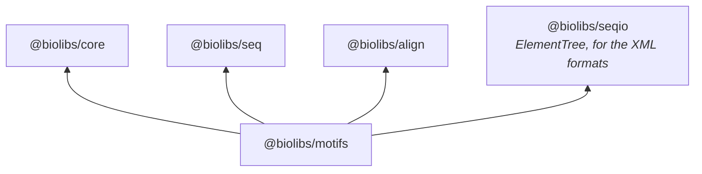

# @biolibs/motifs

Sequence motifs, as Biopython's `Bio.motifs` has them: build one from aligned instances, turn its counts
into a log-odds matrix, scan a sequence, and read or write the eleven formats the field uses.

- **`Motif`** — from aligned instances or from counts, with consensus, degenerate consensus and reverse
  complement
- **Four position matrices** — counts, frequencies, weights and log-odds scores, each a dict-like of rows
- **Scanning** — `calculate` for every window's score, `search` for the hits above a threshold on both
  strands
- **Thresholds** — `ScoreDistribution` with the false-positive, Patser and balanced thresholds
- **Eleven formats in**: JASPAR (`pfm`, `sites`, `jaspar`), TRANSFAC, Cluster-Buster, AlignACE, MEME (XML
  and its minimal text), MAST, XMS, `pfm-four-columns` and `pfm-four-rows`
- **Four formats out**: `pfm`, `jaspar`, `transfac`, `clusterbuster`
- Depends on `@biolibs/core`, `@biolibs/seq` and `@biolibs/align`

## What is verified

A generator drives real Biopython and records what it does — the return value, the exception type *and*
message, the text written. The tests replay those recordings.

| Upstream module | Items | | Upstream module | Items |
|---|---|---|---|---|
| `Bio.motifs.matrix` | **67 / 67** | | `Bio.motifs.meme` | **19 / 19** |
| `Bio.motifs.jaspar` | **22 / 22** | | `Bio.motifs.transfac` | **18 / 18** |
| `Bio.motifs` | **19 / 19** | | `Bio.motifs.thresholds` | **5 / 5** |
| `Bio.motifs.pfm` | **5 / 5** | | the five other readers | **18 / 18** |

**173 of 173 items**, verified by **3,154 recorded cases**: 2,099 on the readers and writers, 503 on the
matrices, 452 on `Motif` itself, 93 on matrix comparison and 7 on JASPAR id splitting.

The 377 items the checklists mark non-applicable are `dict` and `object` machinery that Biopython's
matrix and record classes inherit without overriding.

Where the claim stops:

- **`motifs.jaspar.db` is not ported** — it is a MySQL client.
- **`Motif.weblogo` is not ported** — it posts the motif to a web service.
- **`Bio.motifs.matlab` and `universal`** are not ported.
- **The motif-based `ScoreDistribution` path is not ported.** Biopython's own version calls methods
  `Motif` no longer has, so that branch cannot run there either; the matrix-based path, which is the one
  that works, is ported and verified.
- **Scores are single precision.** `calculate` returns a `Float32Array`, as Biopython returns a
  `float32` NumPy array, so comparisons want a tolerance.
- **Malformed XML in an XMS file** raises an error named `ExpatError`, as Python's minidom does, but the
  exact expat wording is not reproduced.

## Install

```bash
npm install @biolibs/motifs
```

- ESM only, Node 20 or later, TypeScript declarations included



`@biolibs/align` is a dependency because a motif's instances are an `Alignment`.

### Naming: Python to TypeScript

| Python | TypeScript |
|---|---|
| `motif.counts["A"]` | `motif.counts.row("A")` |
| `matrix[a, b]`, `matrix[a:b]` | `matrix.get(a, b)`, `matrix.getTuple(...)`, `{ start, stop, step }` slices |
| `motif[1:4]` | `motif.slice({ start: 1, stop: 4 })` |
| `motifs.parse(handle, fmt)` | `motifs.parse(text, fmt)` — the file's *contents*, as everywhere here |
| `format(motif, "jaspar")` | `motif.format("jaspar")` |
| counts as a `dict` of lists | rows in a `Map`, read with `row(letter)` |

## API

### `create` and `Motif`

```ts
import { Seq } from "@biolibs/seq";
import * as motifs from "@biolibs/motifs";

const instances = ["TACAA", "TACGC", "TACAC", "TACCC", "AACCC", "AATGC", "AATGC"]
  .map((s) => new Seq(s));
const m = motifs.create(instances);

console.log(m.length);                        // 5
console.log(m.alphabet);                      // "ACGT"
console.log(String(m.consensus));             // "TACGC"
console.log(String(m.degenerateConsensus));   // "WACVC"
console.log(String(m.anticonsensus));         // "CCATG"
console.log(String(m.reverseComplement().consensus));   // "GCGTA"
```

`degenerateConsensus` is the IUPAC-ambiguity reading: `W` where A and T are both common, `V` for A, C or
G. It is what you want for a published motif; `consensus` is just the commonest letter at each position.

A slice of a motif is a motif, and only a slice will do:

```ts
console.log(String(m.slice({ start: 1, stop: 4 }).consensus));   // "ACG"

m.slice(1);   // TypeError: motif indices must be slices
```

### The counts

```ts
console.log([...m.counts.values]);
// [["A", [3, 7, 0, 2, 1]], ["C", [0, 0, 5, 2, 6]], ["G", [0, 0, 0, 3, 0]], ["T", [4, 0, 2, 0, 0]]]
console.log(m.counts.row("A"));         // [3, 7, 0, 2, 1]
console.log(m.counts.get("A", 0));      // 3
console.log(m.counts.length);           // 5
console.log(String(m.counts.consensus)); // "TACGC"
console.log(m.counts.gcContent);        // 0.45714285714285713
```

### Pseudocounts, background and the matrices

A count of zero would make a log-odds score of −∞, so a motif gets pseudocounts before it is scored; the
background is the composition you are scoring *against*.

```ts
const m = motifs.create(instances);
m.pseudocounts = 0.5;     // one number spreads over every letter
m.background = 0.4;       // a GC content spreads into the four letters

console.log([...m.pseudocounts]);   // [["A", 0.5], ["C", 0.5], ["G", 0.5], ["T", 0.5]]
console.log([...m.background]);     // [["A", 0.3], ["C", 0.2], ["G", 0.2], ["T", 0.3]]

// Frequencies, then log-odds against the background:
console.log(m.pwm.row("A")!.map((x) => Number(Number(x).toFixed(4))));
// [0.3889, 0.8333, 0.0556, 0.2778, 0.1667]
console.log(m.pssm.row("A")!.map((x) => Number(Number(x).toFixed(4))));
// [0.3744, 1.4739, -2.433, -0.111, -0.848]
console.log(Number(m.pssm.max.toFixed(4)), Number(m.pssm.min.toFixed(4)));   // 6.6341 -11.5798
```

### Scanning a sequence

`calculate` scores every window; `search` gives the windows above a threshold, on **both** strands — a
negative position is a hit on the reverse strand, counted from the end.

```ts
import { Seq } from "@biolibs/seq";

const target = new Seq("TACGCAAATACGC");
const pssm = m.pssm;

console.log(Array.from(pssm.calculate(target)).map((x) => Number(x.toFixed(4))));
// [6.6341, -3.6957, -3.0436, -7.088, -5.351, -3.8656, 3.4787, -5.8656, 6.6341]

console.log([...pssm.search(target, 2.0)].map(([at, score]) => [at, Number(score.toFixed(4))]));
// [[0, 6.6341], [6, 3.4787], [8, 6.6341]]

// Lower the threshold and the reverse strand appears:
console.log([...pssm.search(target, 0.0)].map(([at, score]) => [at, Number(score.toFixed(4))]));
// [[0, 6.6341], [-10, 1.0048], [6, 3.4787], [8, 6.6341]]

console.log(Number(pssm.mean(m.background).toFixed(4)));   // 3.2101
console.log(Number(pssm.std(m.background).toFixed(4)));    // 2.6024
```

`mean` and `std` are the expected score and its spread under the background, which is what makes a score
comparable between motifs.

### `ScoreDistribution` and thresholds

```ts
const dist = new motifs.ScoreDistribution(1000, m.pssm, m.background);

console.log(Number(dist.thresholdFpr(0.001).toFixed(4)));        // 6.2698
console.log(Number(dist.thresholdPatser().toFixed(4)));          // 0.4729
console.log(Number(dist.thresholdBalanced(1000).toFixed(4)));    // 6.2698
```

- `thresholdFpr(p)` — the score at which the false-positive rate falls to `p`
- `thresholdPatser()` — Hertz and Stormo's, which equalises the information content
- `thresholdBalanced(rate)` — where the false-positive rate is `rate` times the false-negative rate

The first argument is the precision: the number of bins the distribution is approximated with.

### Reading

`parse` returns every motif in the text; `read` insists on exactly one.

```ts
import * as motifs from "@biolibs/motifs";

const jaspar = ">MA0001.1 AGL3\nA [ 0 3 79 40 66 48 65 11 65 0 ]\nC [94 75  4  3  1  2  5  2  3  3 ]\n"
  + "G [ 1  0  3  4  1  0  5  3 28 88 ]\nT [ 2 19 11 50 29 47 22 81  1  6 ]\n";

const [motif] = motifs.parse(jaspar, "jaspar");
console.log(motif!.length);                        // 10
console.log(String(motif!.consensus));             // "CCATAAATAG"
console.log(String(motif!.degenerateConsensus));   // "CCAWAWATAG"

motifs.parse(jaspar, "nope");   // ValueError: Unknown format nope
```

The eleven readable formats are `pfm`, `sites`, `jaspar`, `transfac`, `clusterbuster`, `alignace`, `meme`,
`minimal`, `mast`, `xms`, `pfm-four-columns` and `pfm-four-rows`.

Each format's module is exported under its own name — `motifs.meme`, `motifs.minimal`, `motifs.transfac`
and so on — and its `read` gives a **record**: a list of motifs that also carries what the file said
about the run, with each motif carrying that format's extra fields.

```ts
import * as motifs from "@biolibs/motifs";

const record = motifs.minimal.read(memeMinimalText);

console.log(record.length);                      // 2
console.log(record.version);                     // "4"
console.log(record.alphabet);                    // "ACGT"
console.log([...record].map((m) => m.name));     // ["TTGA0", "GCTA1"]
console.log([...record.background]);
// [["A", 0.25], ["C", 0.25], ["G", 0.25], ["T", 0.25]]

// The motifs carry MEME's own numbers:
console.log(record[0]!.numOccurrences);          // 28
console.log(record[0]!.evalue);                  // 340
console.log(String(record[0]!.degenerateConsensus));   // "NWN"

// And a record can be indexed by motif name, as Biopython's can:
console.log(record.byName("GCTA1")!.evalue);     // 12
```

### Writing

```ts
console.log(motifs.write([m], "jaspar"));
// >None
// A [  3.00   7.00   0.00   2.00   1.00]
// C [  0.00   0.00   5.00   2.00   6.00]
// G [  0.00   0.00   0.00   3.00   0.00]
// T [  4.00   0.00   2.00   0.00   0.00]

console.log(motifs.write([m], "transfac").split("\n").slice(0, 3));
// ["P0      A      C      G      T",
//  "01      3      0      0      4      W",
//  "02      7      0      0      0      A"]

motifs.write([m], "nope");   // ValueError: Unknown format type nope
```

`pfm` writes the four count rows and nothing else; `clusterbuster` is the fourth. `motif.format(fmt)` is
the same for one motif.

## Testing

```bash
npm test                 # the whole workspace
npx vitest run packages/motifs/test
```

**14 tests in 2 files**, the first of which is one `it` per case kind:

| File | What it checks |
|---|---|
| `test/motifs.test.ts` | 3,154 recorded cases: 2,099 reader and writer, 503 matrix, 452 `Motif`, 93 matrix comparison, 7 id splitting |
| `test/readme.test.ts` | every code block in this file |

Coverage from this package's own tests — `npx vitest run --coverage packages/motifs/test`:

| | |
|---|---|
| Statements | **98.33%** (1,585 / 1,612) |
| Functions | **95.41%** (187 / 196) |
| Branches | **85.14%** (968 / 1,137) |

The branch figure is the lowest in the repository, and it is where the readers refuse malformed input:
eleven formats, each with its own ways of being wrong, and a golden corpus that covers the ones real
files exhibit rather than every combination. `matrix.ts` holds the next largest share, in the index and
slice paths that Python's `dict` and tuple semantics make branch so widely.

## Things to know

- **`calculate` returns a single number, not an array, for a sequence exactly as long as the motif.**
  That is Biopython's behaviour, and it means `search` on such a sequence raises NumPy's `nonzero` error.
  Reproduced rather than smoothed over.
- **`search` orders its hits with NumPy's `argsort`, which is not stable.** The port reproduces that
  quicksort so that equal positions on the two strands come out in the same order as Biopython's.
- **A failed assignment leaves its partial effect.** A bad `pseudocounts` dictionary leaves the
  pseudocounts *empty*; a bad `mask` string keeps the characters before the bad one, which then makes
  `toString(true)` raise `IndexError` rather than padding. Assigning a valid value recovers. All
  Biopython's.
- **The matrices are `dict` subclasses, so `equals` compares the rows and nothing else.** The alphabet
  plays no part, and a plain `Map` of the same rows is equal — but a weight matrix stores *tuples* where
  the others store lists, and `[1.0] == (1.0,)` is false in Python, so `pwm.equals(counts)` is false
  however close the numbers. `lt`, `le`, `gt` and `ge` always raise `TypeError`, since `dict` has no
  ordering.
- **`calculateConsensus` keeps the previous position's letter** where a position has no counts at all,
  because Python's loop variable survives the iteration.
- **`ScoreDistribution` raises `ValueError` for a matrix containing −∞** (a zero probability), because
  Python converts `nan` to `int` there.
- **A TRANSFAC `VV` line is stored twice**, as the record's version and as an annotation; a line with
  only a key reuses the previous value; and a matrix stops at the first non-numeric line, which is then
  read as an ordinary field.

## License

MIT — see [LICENSE](LICENSE).
