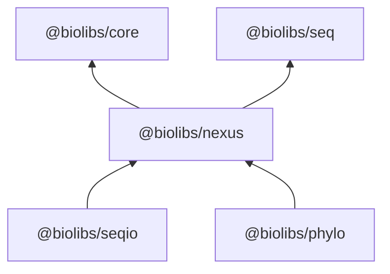

# @biolibs/nexus

NEXUS files, as Biopython's `Bio.Nexus` reads and writes them — the format PAUP and MrBayes use, with its
blocks, its character sets and its trees.

- **`Nexus`** — read a NEXUS file into taxa, a character matrix, sets, trees and codons; unknown blocks
  are kept rather than dropped
- **Editing** — crop, invert, add a sequence, insert a gap, find the constant or gap-only columns
- **Writing** — NEXUS back out, interleaved or by partition, plus FASTA and PHYLIP
- **`Tree`** — the Newick trees a NEXUS `trees` block holds, with a linked `Chain` of `Node`s under them
- **`consensus`** — a majority-rule tree from several
- **`StandardData`, `StepMatrix`, `CharBuffer`, `Commandline`** — the supporting pieces
- Depends on `@biolibs/core` and `@biolibs/seq`

## What is verified

A generator drives real Biopython and records what it does — the return value, the exception type *and*
message, the text written. The tests replay those recordings.

| Upstream module | Items at parity | Checklist |
|---|---|---|
| `Bio.Nexus.Trees` | **39 / 39** | [Bio.Nexus.Trees.md](../../docs/parity/Bio.Nexus.Trees.md) |
| `Bio.Nexus.Nexus` | **21 / 21** | [Bio.Nexus.Nexus.md](../../docs/parity/Bio.Nexus.Nexus.md) |
| `Bio.Nexus.Nodes` | **18 / 18** | [Bio.Nexus.Nodes.md](../../docs/parity/Bio.Nexus.Nodes.md) |
| `Bio.Nexus.StandardData` | **6 / 6** | [Bio.Nexus.StandardData.md](../../docs/parity/Bio.Nexus.StandardData.md) |

**425 recorded sessions** against Biopython 1.88 — 140 on trees, 119 on `Nexus`, 95 on the module
functions, 28 on `combine`, 25 on `consensus` and 18 on `StandardData` — and a further **706 cases**
reaching this package through `@biolibs/seqio`'s `nexus` format.

Where the port deliberately differs:

- **No file names.** `writeNexusData`'s `filename` must be an object with `write(text)`; a string throws
  `TypeError` where Python would open a file. `exportFasta` and `exportPhylip` take the same kind of
  target and **return the name Biopython would have derived**, so the naming logic is still there to see.
- **`Tree.randomize` and `bootstrap` work**, because `@biolibs/core` ports Python's Mersenne Twister:
  seed with `pyRandom.seed(n)` and the same trees come out. A branch length from `random.gauss` goes
  through `sin` and `cos`, so those are compared to twelve significant digits where everything else is
  exact.
- **A JavaScript stack overflow stands in for Python's `RecursionError`** on a cyclic tree.
- **`constant()` is only checked against Biopython for deterministic cases**: with ambiguity codes Python
  builds sets whose iteration order is not stable.

## Install

```bash
npm install @biolibs/nexus
```

- ESM only, Node 20 or later, TypeScript declarations included



`@biolibs/seqio` and `@biolibs/phylo` both read NEXUS through this package.

## API

### Reading

The constructor takes the file's *text*, or anything with a `read()` method.

```ts
import { Nexus } from "@biolibs/nexus";

const text = `#NEXUS
begin data;
dimensions ntax=3 nchar=6;
format datatype=dna missing=? gap=-;
matrix
a ACGTAC
b AC-TAC
c ACGTTT
;
end;
begin trees;
tree one = ((a:0.1,b:0.2):0.3,c:0.4);
end;
`;

const n = new Nexus(text);

console.log(n.taxlabels);                 // ["a", "b", "c"]
console.log(n.ntax, n.nchar);             // 3 6
console.log(n.datatype, n.missing, n.gap); // "dna" "?" "-"
console.log([...n.matrix!].map(([k, v]) => [k, String(v)]));
// [["a", "ACGTAC"], ["b", "AC-TAC"], ["c", "ACGTTT"]]
console.log(n.trees.length, n.trees[0]!.name);   // 1 "one"
```

### The blocks that catch people out

A `trees` block usually carries a **translate** table, because PAUP and MrBayes write the taxa as numbers.
It is applied as the trees are parsed, so the tree you get back has names in it:

```ts
import { Nexus } from "@biolibs/nexus";

const n = new Nexus(`#NEXUS
begin taxa;
dimensions ntax=3;
taxlabels alpha beta gamma;
end;
begin trees;
translate
  1 alpha,
  2 beta,
  3 gamma
;
tree one = ((1:0.1,2:0.2):0.3,3:0.4);
end;
`);

console.log(n.trees[0]!.toString());   // "tree one = ((alpha,beta),gamma);"
console.log([...n.translate!]);        // [[1, "alpha"], [2, "beta"], [3, "gamma"]]
console.log(n.taxlabels);              // []   — see below
```

That empty `taxlabels` is not a bug here: Biopython gives `[]` for this file too. The labels are recorded
only when a matrix or a `dimensions ntax=` in the *same* block gives it somewhere to put them.

`charstatelabels` names the characters and their states:

```ts
const c = new Nexus(`#NEXUS
begin characters;
dimensions ntax=2 nchar=2;
format datatype=standard symbols="012";
charstatelabels 1 colour / red blue, 2 size / big small;
matrix
a 01
b 10
;
end;
`);

console.log([...c.charlabels!]);    // [[0, "colour"], [1, "size"]]
console.log([...c.statelabels!]);   // [[0, ["red", "blue"]], [1, ["big", "small"]]]
```

And a block nobody knows is kept rather than dropped, so a round trip does not lose it:

```ts
const m = new Nexus(`#NEXUS
begin mrbayes;
  set autoclose=yes;
end;
begin data;
dimensions ntax=2 nchar=2;
format datatype=dna;
matrix
a AC
b AG
;
end;
`);

console.log(m.unknownBlocks.map((b) => b.title));   // ["mrbayes"]
```

`taxa`, `characters`, `data`, `sets`, `trees`, `codons` and `unaligned` blocks are all handled, and
anything else is kept in `unknownBlocks` rather than discarded. A character matrix becomes `Seq` objects,
or `StandardData` for `datatype=standard`. Errors are `NexusError`s with Biopython's messages.

Comments are stripped the way Biopython's C scanner (`cnexus`) does it, which is the path Biopython takes
whenever that extension is built.

### Looking at the columns

```ts
console.log(n.constant());      // [0, 1, 2, 3]   — columns that never vary
console.log(n.cstatus(0));      // ["A"]          — what appears in column 0
console.log(n.cstatus(2));      // ["G"]
console.log(n.gaponly());       // []             — columns that are nothing but gaps
console.log(n.invert([0, 1]));  // [2, 3, 4, 5]   — the columns you did not name
```

`cropMatrix`, `appendSets`, `weightedStepmatrix`, `addSequence`, `insertGap`, `adjustCharlabels` and
`terminalGapToMissing` are the rest, each following its Python namesake.

### Writing

```ts
let out = "";
const target = { write: (t: string) => { out += t; return t.length; } };

n.writeNexusData({ filename: target });
console.log(out.split("\n").slice(0, 6));
// ["#NEXUS", "begin data;", "dimensions ntax=3 nchar=6;",
//  "format datatype=dna missing=? gap=-;", "matrix", "a ACGTAC"]
```

The options are Biopython's keyword arguments: `exclude`, `delete`, `blocksize`, `interleave`,
`interleaveByPartition`, `comment`, `omitNEXUS`, `appendSets`, `mrbayes` and `codonsBlock`.

FASTA and PHYLIP come out the same way, and both **return the filename Biopython would have used** —
a known NEXUS extension is replaced, anything else appended to:

```ts
let fasta = "";
const name = n.exportFasta({ filename: { write: (t: string) => { fasta += t; return t.length; } } });

console.log(name);                            // "input_string.fas"
console.log(fasta.split("\n").slice(0, 4));   // [">a", "ACGTAC", ">b", "AC-TAC"]
```

Leaving the target out is an error rather than a guess:

```ts
n.writeNexusData({});
// TypeError: Writing to a file by name is not supported; pass an object with a write(text)
// method as filename
```

### `Tree`

A NEXUS tree is a `Chain` of numbered `Node`s, and **most methods take node ids rather than taxon
names** — `searchTaxon` is how you get from one to the other.

```ts
import { Tree } from "@biolibs/nexus";

const t = new Tree("((a:0.1,b:0.2):0.3,c:0.4);");

console.log(t.getTaxa());             // ["a", "b", "c"]
console.log(t.countTerminals());      // 3
console.log(t.isBifurcating());       // true
console.log(t.allIds());              // [0, 1, 2, 3, 4]
console.log(t.root);                  // 0
console.log(t.getTerminals());        // [2, 3, 4]

const a = t.searchTaxon("a")!;        // 2
const b = t.searchTaxon("b")!;        // 3

console.log(t.commonAncestor(a, b));                   // 1
console.log(Number(t.distance(a, b).toFixed(4)));      // 0.3
console.log(Number(t.sumBranchlength(t.root, a).toFixed(4)));   // 0.4
```

A node carries its own data:

```ts
const node = t.node(a);
console.log(node.data.taxon, node.data.branchlength, node.prev);   // "a" 0.1 1
```

`isMonophyletic` returns the **node id** of the clade, or −1 — not a boolean, because Biopython returns
the id so you can go on to use it:

```ts
console.log(t.isMonophyletic(["a", "b"]));   // 1
console.log(t.isMonophyletic(["a", "c"]));   // -1
```

`isPreterminal` reproduces Biopython's inverted test — true for a leaf, false for any internal node:

```ts
console.log(t.isPreterminal(t.root));   // false
console.log(t.isPreterminal(a));        // true
```

Editing and writing:

```ts
const p = new Tree("((a:0.1,b:0.2):0.3,c:0.4);");
p.prune("a");
console.log(p.toString());   // "tree a_tree = (c,b);"

console.log(t.toString());                    // "tree a_tree = ((a,b),c);"
console.log(t.toString({ plain: false }));
// "tree a_tree = ((a:0.10000,b:0.20000)0.00000:0.30000,c:0.40000);"

console.log(t.isIdentical(new Tree("((a,b),c);")));   // true
```

`display()` prints the table Biopython prints, and returns it:

```ts
console.log(t.display().split("\n")[0]);
// "  #                            taxon            prev            succ    brlen blen (sum)  support                    comment"
```

Also `walk`, `split`, `collapseGenera`, `setSubtree`, `isCompatible`, `branchlength2support`,
`convertAbsoluteSupport`, `hasSupport`, `unroot`, `rootWithOutgroup` and `mergeWithSupport`.

### `consensus`

```ts
import { Tree, consensus } from "@biolibs/nexus";

const forest = ["((a,b),c);", "((a,b),c);", "((a,c),b);"].map((s) => new Tree(s));

console.log(consensus(forest)!.toString());
// "tree consensus_0.5 = (c,(a,b));"

// Raise the threshold past the 2-in-3 support for (a,b) and the clade goes:
console.log(consensus(forest, 0.9)!.toString());
// "tree consensus_0.9 = (a,b,c);"
```

The threshold defaults to 0.5 — a majority-rule tree — and goes into the tree's *name*, which is how you
can tell afterwards what it was built with. An outgroup can be named as the third argument.

### The supporting pieces

```ts
import { StepMatrix, safename } from "@biolibs/nexus";

// NEXUS names cannot hold spaces or quotes, so they are quoted or substituted:
console.log(safename("a b"));     // "'a b'"
console.log(safename("it's"));    // "'it''s'"
console.log(safename("plain"));   // "plain"

const sm = new StepMatrix(["A", "C"]);
sm.add("A", "C", 1);
console.log(sm.sum());            // 1
```

`CharBuffer`, `Commandline`, `Block`, `StandardData`, `quotestrip`, `getStartEnd`, `getCommandLines` and
`scanfile` (the cnexus scanner) are the rest, with `NexusError`, `TreeError`, `ChainException` and
`NodeException` for the errors.

## Testing

```bash
npm test                 # the whole workspace
npx vitest run packages/nexus/test
```

| File | What it checks |
|---|---|
| `test/golden.test.ts` | the 425 recorded sessions, by kind: trees, `Nexus`, the module functions, `combine`, `consensus`, `StandardData` |
| `test/api.test.ts` | the TypeScript-only surface: the write targets, the options objects |
| `test/readme.test.ts` | every code block in this file |

Coverage from this package's own tests — `npx vitest run --coverage packages/nexus/test`:

| | |
|---|---|
| Statements | **91.23%** (1,956 / 2,144) |
| Functions | **94.05%** (174 / 185) |
| Branches | **84.74%** (1,066 / 1,258) |

Most of the shortfall is in `nexus-parser.ts`, which has a handler per NEXUS command: the corpus covers
the commands real files use, and a NEXUS file can legally carry many that nothing writes.

## Things to know

- **Most `Tree` methods take node ids.** `commonAncestor(2, 3)`, not `commonAncestor("a", "b")`. Use
  `searchTaxon(name)` to get an id. The exceptions are `isMonophyletic` and `prune`, which take names.
- **`isMonophyletic` returns a node id or −1**, not a boolean, so `if (t.isMonophyletic(…))` is true for
  the id *and* for −1. Compare with `!== -1`.
- **`sumBranchlength()` needs a root.** With no argument it raises; pass `t.root`, and a second argument
  to measure to a particular node.
- **`writeNexusDataPartitions` takes the partition itself**, a `Map` from `charpartitions`, not its name:
  Biopython iterates the argument and subscripts it with what it yields, so a name there raises
  `TypeError: string indices must be integers, not 'str'`.
- **`combine` raises `RuntimeError`** ("dictionary keys changed during iteration") when the first matrix
  has character or taxon sets, because Biopython renames them while iterating the dictionary.
- **`exclude` distinguishes "not given" from an empty list** in `cropMatrix`, as Python's `()` and `[]`
  do.
- **`Tree.randomize` resets the tree first** — Biopython calls its own `__init__` — and shuffles the
  taxon list it is handed **in place**.
- **A `taxa` block alone may leave `taxlabels` empty**, as it does in Biopython: the labels are kept only
  when a matrix or a `dimensions ntax=` in the same block gives them somewhere to go. Read the names off
  the matrix or the translate table instead.

## License

MIT — see [LICENSE](LICENSE).
