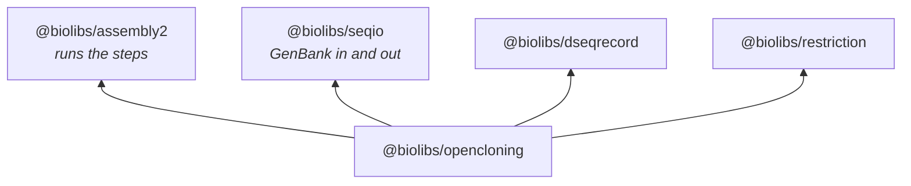

# @biolibs/opencloning

A cloning plan you can send to another lab — and that the other lab can **check** by running it again.

A plan is the molecules, the primers, and for each molecule the step that made it and what went into
it: the [OpenCloning](https://opencloning.org) data model, which is what pydna's `CloningStrategy`
serialises to. Give it a plasmid you built with [`@biolibs/assembly2`](../assembly2) and it writes the
whole history down; hand that document to someone else and `validate()` replays every step from the
parts and fails if the molecule the plan claims does not come out.

- **Write a plan** from the molecules at the end of it, history and all
- **Read one back**, whether it came from here or from pydna — and whatever order a writer put the fields in
- **Replay it** — every step, from the inputs, with the products matched to the claims
- **Normalise it**, so that two labs' plans for the same construct can be compared
- **Draw it**, as the tree pydna prints
- **Sign it** — not pydna's: a plan signed with an Ed25519 key, checkable beside the replay
- Molecules travel as **GenBank files**, with the overhangs GenBank cannot express kept beside them

Steps that join DNA by recombination — Gateway, Cre-lox, the recombinases, CRISPR — cannot be replayed,
because [`@biolibs/assembly2`](../assembly2) does not do them yet.

## What is verified

A generator drives the real pydna and records the whole of each plan: the document it serialises to, the
molecules read back out of it, the printed history, the renumbering, and the verdict when every step is
replayed — for a product that really follows from its inputs and for one that does not.

| Upstream module | Items at parity | Checklist |
|---|---|---|
| `pydna.opencloning_models` | **41 / 44** | [pydna.opencloning_models.md](../../docs/parity-pydna/pydna.opencloning_models.md) |

**14 whole plans, 16 locations and 4 documents handed through the data model itself** against pydna
5.5.16 and `opencloning_linkml` 1.0.0: Gibson with two and three fragments, In-Fusion,
fusion PCR, in-vivo assembly, ligation, restriction-ligation, Golden Gate, PCR with and without the
primers marked, two multi-step plans, a renumbering, and a plan whose product does not follow from its
steps. Each plan is compared as a document, as records read back, as a history, as a normalised
document, and as a verdict.

The interoperation is tested, not assumed. Four plans are handed to `opencloning_linkml` — the library
the OpenCloning data model is defined by — and written back out by it; what that library emits is
byte-identical to what this port writes, and replaying its output here gives the same molecules. Each
is replayed again with its fields in a different order, since another writer will not use this one's.

What that does **not** show is that the OpenCloning web application opens these documents. The data
model agrees; the application has not been tried.

Where the claim stops:

- **Only the steps `@biolibs/assembly2` can run are replayable.** A plan may hold other kinds of step —
  a sequence fetched from Addgene, a Gateway reaction — and this reads and writes them as data, but
  `validate()` refuses to pretend it checked one.
- **Identifiers are the records' own.** pydna numbers sequences by `id()`, the memory address of the
  Python object, and renumbers them on the way out; a port has no such thing, so a record's `id` must
  be a number, or `assignIds` must be set. This is what pydna's
  `id_mode(use_python_internal_id=False)` does.
- **`figure()` is not ported**, nor `get_ncbi_format_coordinates`.

## Install

```bash
npm install @biolibs/opencloning
```



## Writing a plan down

```ts
import { Dseqrecord } from "@biolibs/dseqrecord";
import { gibsonAssembly } from "@biolibs/assembly2";
import { CloningStrategy } from "@biolibs/opencloning";

// Three 50-base windows of one 75-base circle, each sharing its last 25 bases with the next.
const first = new Dseqrecord("GGATCACAGTCTACACTGCTCACTCCAACCCCGGCCCCTGAGTCCGAGGA", false, undefined, "1", "f1");
const second = new Dseqrecord("CAACCCCGGCCCCTGAGTCCGAGGAGAGGGTGCTTCAGAGTATGTATACC", false, undefined, "2", "f2");
const third = new Dseqrecord("GAGGGTGCTTCAGAGTATGTATACCGGATCACAGTCTACACTGCTCACTC", false, undefined, "3", "f3");

const [plasmid] = gibsonAssembly([first, second, third], 25, true);
plasmid.id = "100";

const plan = CloningStrategy.fromRecords([plasmid], { description: "a 75 bp circle" });

console.log(plan.sequences.length, plan.sources.length);        // 4 4 — the plasmid and its three parts
console.log(plan.sources[0]?.type);                             // "GibsonAssemblySource"
console.log(plan.sources[1]?.type);                             // "ManuallyTypedSource" — a part nobody made
console.log(plan.idsOfSequencesThatAreNotInputs());             // [100], what the plan ends with
```

The document is plain data, ready to be sent:

```ts
const sent = JSON.stringify(plan.document);
console.log(JSON.parse(sent).schema_version);                   // "1.0.0"
```

## Checking one that arrives

This is the part that matters. Nothing here trusts the document: every step is run again from its
inputs, through the same engine that would have made it in the first place.

```ts
import { CloningStrategy } from "@biolibs/opencloning";

const received = CloningStrategy.fromDocument(JSON.parse(sent));

received.validate();                            // throws if any step does not make what it claims
const [rebuilt] = received.toRecords();
console.log(rebuilt.circular, rebuilt.length);  // true 75
console.log(rebuilt.seguid());                  // cdseguid=sYESdtpVMj71Meubth63wObHHwE
```

A plan whose product does not follow from its parts is refused, and the error names the step:

```ts
import { ValueError } from "@biolibs/core";

const tampered = JSON.parse(sent) as { sequences: { id: number; file_content: string }[] };
const product = tampered.sequences.find((one) => one.id === 100)!;
product.file_content = product.file_content.replace("ggatcacagt", "ggatcacagc");

try {
  CloningStrategy.fromDocument(tampered as never).validate();
} catch (error) {
  console.log(error instanceof ValueError);     // true
  console.log((error as Error).message);
  // Result sequence does not match any of the 1 product(s) from GibsonAssemblySource
}
```

## Signing one

Replaying a plan tells you the molecules follow from the parts. It does not tell you who sent it. These
four functions are **not** pydna's and not the data model's — they sign a plan and check a signature on
one, with Ed25519 through Web Crypto, which works the same in Node and in a browser.

The data model forbids fields it does not define, so a signature cannot go inside a plan. A signed plan
wraps it: `signed.plan` is byte-for-byte the document `opencloning_linkml` accepts, and the signatures
sit outside it, so signing costs nothing in interoperation.

```ts
import { generateSigningKey, keyFingerprint, signPlan, verifyPlan } from "@biolibs/opencloning";

const key = await generateSigningKey();
console.log(await keyFingerprint(key.publicKey));   // 1c99-04a7-... — how a person compares two keys

const signed = await signPlan(plan.document, key, { signer: "Bench 4" });

const [check] = await verifyPlan(signed);
console.log(check.ok, check.signer);                // true "Bench 4"
```

Alter the plan afterwards — a base, or a claim about which step made what — and the signature fails
along with the replay. `verifyPlan` reports rather than throws, so a bad signature is a verdict:

```ts
const altered = structuredClone(signed);
altered.plan.sequences[0]!.file_content =
  altered.plan.sequences[0]!.file_content.replace("ggatcacagt", "ggatcacagc");

const [spoiled] = await verifyPlan(altered);
console.log(spoiled.ok, spoiled.problem);           // false "This document is not what that key signed."
```

A second key can countersign the same plan, which is how a lab that has run someone else's plan says so:

```ts
const countersigned = await signPlan(signed, await generateSigningKey(), { signer: "the lab down the hall" });
console.log((await verifyPlan(countersigned)).map((one) => one.ok));   // [ true, true ]
```

Signing is also available on its own, under a domain of your choosing, for documents that are not
cloning plans — `signUnder` and `verifyUnder`. [`@biolibs/bionet`](../bionet) signs lab inventories
with them.

> **Version 2.0.0 changed the bytes a plan signature covers**, so signatures made by 1.1.0 do not
> verify here. The domain string went from `v1` to `v2` with them, so an old signature fails plainly
> instead of looking like a claim about something it is not. Nothing else about the package changed.

**What a signature means, exactly:** whoever holds this key put their name to this plan. That is all. It
does not say the key belongs to a lab, or that the lab did the work, or that the plan is any good — and
`signer` is a label the holder chose, not a verified name. Tying a key to a lab means getting that key
from somewhere you already trust the lab to speak from. Run both checks together: a signature without a
replay is an accountable claim that may be wrong, and a replay without a signature is a sound plan from
nobody.

## Drawing one

```ts
import { history } from "@biolibs/opencloning";

console.log(history(plasmid));
// ╙── name (Dseqrecord(o75))
//     └─╼ GibsonAssemblySource
//         ├─╼ f1 (Dseqrecord(-50))
//         ├─╼ f2 (Dseqrecord(-50))
//         └─╼ f3 (Dseqrecord(-50))
```

## Normalising one

A circle has no beginning, and a fragment can be written down from either strand. Two labs can describe
the same construct differently, so `normalize()` replaces every molecule with the one its own step
makes, matched by checksum — which is invariant to both.

```ts
const normalised = received.normalize();
console.log(normalised.sequences.length);                          // 4
console.log(normalised.idsOfSequencesThatAreNotInputs().length);   // 1
```

## A plan with more than one step

The history is followed all the way back, so a product made from another product carries both steps, and
replaying it replays both.

```ts
import { Primer, pcrAssembly } from "@biolibs/assembly2";

const amplified = pcrAssembly(template, forwardPrimer, reversePrimer, false, 20);
amplified[0]!.id = "50";

const [construct] = gibsonAssembly([backbone, amplified[0]!], 20, true);
construct.id = "101";

const twoStep = CloningStrategy.fromRecords([construct], { description: "amplify, then assemble" });
console.log(twoStep.sources.map((one) => one.type));
// [ "GibsonAssemblySource", "ManuallyTypedSource", "PCRSource", "ManuallyTypedSource" ]
console.log(twoStep.primers.length);    // 2
twoStep.validate();                     // replays the PCR, then the assembly
```

## From Python

| Python | TypeScript |
|---|---|
| `CloningStrategy.from_dseqrecords(records, description)` | `CloningStrategy.fromRecords(records, { description })` |
| `strategy.model_dump_json()` | `JSON.stringify(strategy.document)` |
| `CloningStrategy(**json.loads(text))` | `CloningStrategy.fromDocument(JSON.parse(text))` |
| `strategy.to_dseqrecords()` | `strategy.toRecords()` |
| `strategy.validate()` | `strategy.validate()` |
| `strategy.normalize()` | `strategy.normalize()` |
| `strategy.reassign_ids()` | `strategy.reassignIds()` |
| `record.history()` | `history(record)` |
| `record.validate_history()` | `validateHistory(record)` |
| `record.normalize_history()` | `normalizeHistory(record)` |
| `SequenceLocationStr.from_biopython_location(loc)` | `locationText(location)` |
| `id_mode(use_python_internal_id=False)` | always, since a port has no `id()` |
| `source.figure()` | not ported |
| — | `signPlan` / `verifyPlan` / `generateSigningKey`, which pydna has no equivalent of |

## Testing

```bash
npm test                 # the whole workspace
npx vitest run packages/opencloning/test
```

| File | What it checks |
|---|---|
| `test/opencloning.test.ts` | the recorded plans from pydna 5.5.16 |
| `test/signature.test.ts` | signing and verification, which are not pydna's |
| `test/readme.test.ts` | every code block in this file |

## Things to know

- **A molecule travels as a GenBank file**, so its bases come back in lower case. Molecules are compared
  without regard to case, as pydna compares them.
- **Overhangs travel beside the file**, in `overhang_crick_3prime` and `overhang_watson_3prime`, because
  GenBank has no way to write a sticky end.
- **`validate()` is not a safety check.** It says the molecules follow from the parts as described. It
  says nothing about whether the parts are what they claim to be, or whether the work was done.
- **`normalize()` rebuilds the molecules**, so a plan that has been normalised carries its products as
  its own steps leave them, not as they were written down.

## License

MIT — see [LICENSE](LICENSE).
