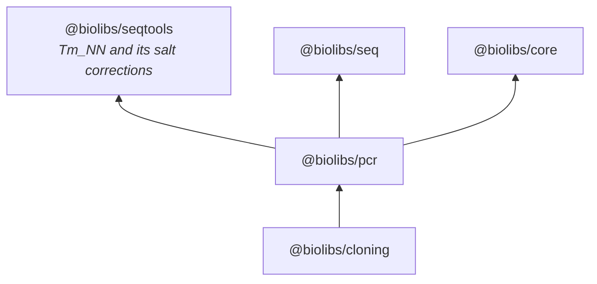

# @biolibs/pcr

PCR in silico: is this primer any good, where does it bind, what would this pair amplify, and what pair
should I order. Biopython has no counterpart — the usual Python answer is `primer3-py`, a wrapper round a
C library.

- **`checkPrimer`** — length, GC, melting temperature, longest run, self-complementarity, GC clamp, and
  advisory warnings against limits you can change
- **`findBindingSites`** — base-for-base matching on both strands, with mismatches near the 3' end
  counted separately, and across a circular origin
- **`predictProducts`** — every product a set of primers would make, each primer tried as both forward
  and reverse, measured from 5' end to 5' end
- **`productWithTails`** — the product an assembly or cloning primer actually makes, tail included
- **`designPrimers`** — a pair that amplifies exactly the stretch you asked for
- **Melting temperatures are not reimplemented**: they come from `@biolibs/seqtools`, Biopython's
  `MeltingTemp` ported in full, so every nearest-neighbour table and salt correction is reachable
- **A primer is unambiguous DNA**, 8 to 200 bases; an N is refused, not guessed at

## What is verified

This is not a port of anything, so there is no parity checklist. What there is instead:

- **The melting temperatures are measured, not approximated.** `primerTm` is `tmNN` from
  `@biolibs/seqtools`, which is Biopython's `Bio.SeqUtils.MeltingTemp.Tm_NN` ported and verified against
  it on recorded cases. The M13 primers' values are pinned to Biopython's answers in the tests
  (`52.77 °C` and `47.18 °C` at 50 mM Na, 250 nM primer), so a change in the thermodynamics would fail
  here.
- **94 unit tests** over everything else: what counts as a primer, every warning, binding on both
  strands and across an origin, mismatch tolerance at either end, product geometry, tails, and the
  design search.

Where the claim stops — and this matters more here than in most packages:

- **The quality limits are advisory, not predictive.** 18–30 bases, 40–60% GC, 55–65 °C, no run over 4:
  these are what every primer-design guide repeats. A primer that trips a warning often works, and one
  that trips none can still fail. Nothing here is a model of whether a reaction will succeed.
- **`selfComplementarity` is not a folding prediction.** It slides the primer against its own reverse
  complement and returns the longest run of paired bases. That is a count of complementary bases, not
  the free energy of a hairpin — a real prediction needs a folding algorithm, and this package does not
  have one.
- **Binding allows substitutions and no indels.** Matching is base for base over the primer's whole
  length. That is a deliberate simplification: indels in a primer–template duplex are not what limits
  PCR specificity, so there is no gapped alignment here.
- **There is no thermodynamic model of binding at all.** A site is accepted on mismatch counts, not on
  whether it would anneal at your annealing temperature.
- **`designPrimers` is a search over lengths, not a primer3 replacement.** Both ends are anchored so the
  product is exactly the stretch asked for, which leaves length as the only freedom. It does not move
  the product window, check the pair against the rest of the template, or model dimers between the two
  primers.

## Install

```bash
npm install @biolibs/pcr
```

- ESM only, Node 20 or later, TypeScript declarations included



## The template used below

Every example in this file runs against one 200-base template, so the numbers can be followed from one
section to the next.

```ts
export const TEMPLATE =
  "AAAGCTATCGGCGGAGAACAAGATATGACCGATGCTGAGCGTTAGATACCTCAATGCGATCCGTGAGCAATCGG" +
  "TGAGTACGCCTTTAGGTCTGATAAAATCGACACATTAATGCTCTTCAAGCAACAACCGGCGATTAACCCGGGTA" +
  "ACCTTAAGACACATGAGTCCTGATTCATGCCTCAATACAACACGAGTTTAAT";
// TEMPLATE.length === 200
```

## Checking a primer

`checkPrimer` measures a primer and lists what is worth warning about. Here is the M13 forward primer,
which is real, widely used, and trips three of the limits:

```ts
import { checkPrimer } from "@biolibs/pcr";

const report = checkPrimer("GTAAAACGACGGCCAGT");

report.length;              // 17
report.tm;                  // 52.765… °C — Biopython's Tm_NN at 50 mM Na, 250 nM primer
report.gc;                  // 0.529…
report.longestRun;          // 4 — the AAAA
report.selfComplement;      // 4
report.endSelfComplement;   // 2
report.gcClamp;             // false — it ends in T

report.warnings;
// [ "the primer is 17 bases, shorter than 18",
//   "the melting temperature is 52.8 °C, below 55 °C",
//   "the 3' end is not G or C, so the polymerase has less to grip" ]
```

That is the point of the warnings being advisory: this primer has been sequencing plasmids for decades.

The limits are an argument, so they can be relaxed or tightened without reimplementing the checks:

```ts
import { checkPrimer, PRIMER_LIMITS } from "@biolibs/pcr";

PRIMER_LIMITS.minLength;    // 18
PRIMER_LIMITS.maxRun;       // 4

const relaxed = checkPrimer("GTAAAACGACGGCCAGT", {}, { ...PRIMER_LIMITS, minLength: 10, minTm: 45 });
relaxed.warnings;           // ["the 3' end is not G or C, so the polymerase has less to grip"]
```

### Melting temperature

`primerTm` is the thin wrapper over `@biolibs/seqtools`, spelled in the terms a PCR caller thinks in. Any
condition Biopython's `MeltingTemp` takes goes through `Conditions`:

```ts
import { DEFAULT_CONDITIONS, primerTm, tmDifference } from "@biolibs/pcr";

DEFAULT_CONDITIONS.sodium;                                  // 50 mM
DEFAULT_CONDITIONS.primer;                                  // 250 nM
DEFAULT_CONDITIONS.saltCorrection;                          // 5 — Owczarzy 2004

primerTm("GTAAAACGACGGCCAGT").toFixed(1);                   // "52.8"
primerTm("GTAAAACGACGGCCAGT", { sodium: 100 }).toFixed(1);  // "56.0" — more salt, higher Tm
primerTm("GTAAAACGACGGCCAGT", { magnesium: 2, dntps: 0.8 }).toFixed(1);  // "58.9"

tmDifference(60, 55);                                       // 5 — a pair within ~5 °C anneals together
```

### What counts as a primer

Unambiguous DNA, 8 to 200 bases. An ambiguity code is refused rather than guessed at, because a primer
with an N in it has no single melting temperature and no single binding site.

```ts
import { cleanPrimer, isPrimer, primerProblem } from "@biolibs/pcr";

cleanPrimer("  1 gtaaa acgac ggccagt  ");   // "GTAAAACGACGGCCAGT" — pasted with line numbers
cleanPrimer("acguacgu");                    // "ACGTACGT" — U is read as T

isPrimer("GTAAAACGACGGCCAGT");              // true
primerProblem("ACGTNACGTN");                // "a primer may only contain A, C, G and T; found N"
primerProblem("ACGT");                      // "a primer must be at least 8 bases long, and this one is 4"
primerProblem("GTAAAACGACGGCCAGT");         // null — nothing wrong with it
```

`requirePrimer(sequence, label)` throws a `ValueError` carrying that reason, for a caller that wants to
fail rather than report.

## Where a primer binds

`findBindingSites` returns every place the primer matches, on **both** strands. A forward site's span is
where the primer lies along the top strand; a reverse site's span is the stretch of top strand it covers,
with the primer matching the bottom strand there.

```ts
import { designPrimers, findBindingSites } from "@biolibs/pcr";
import { TEMPLATE } from "./template.js";

const pair = designPrimers(TEMPLATE, 20, 180)!;
const forward = pair.forward.sequence;      // "AGATATGACCGATGCTGAGCGTTAGATAC"
const reverse = pair.reverse.sequence;      // "AGGCATGAATCAGGACTCATGTGTC"

findBindingSites(TEMPLATE, "linear", forward);
// [{ start: 20, end: 49, strand: "forward", mismatches: 0, endMismatches: 0, extendsFrom: 49 }]
findBindingSites(TEMPLATE, "linear", reverse);
// [{ start: 155, end: 180, strand: "reverse", mismatches: 0, endMismatches: 0, extendsFrom: 154 }]
```

`extendsFrom` is the base the polymerase would add first: just past the 3' end, which is to the **right**
for a forward site and to the **left** for a reverse one.

### Mismatches, and why the 3' end is counted separately

By default the match must be exact. `maxMismatches` loosens that, but a mismatch inside the last few
bases of the 3' end is counted separately and still refused — that is where the polymerase extends from,
so a mismatch there costs far more than one at the 5' end.

```ts
import { findBindingSites } from "@biolibs/pcr";
import { TEMPLATE } from "./template.js";

const primer = "AGATATGACCGATGCTGAGCGTTAGATAC";
const changedAt5 = "C" + primer.slice(1);
const changedAt3 = primer.slice(0, -1) + "A";

findBindingSites(TEMPLATE, "linear", changedAt5).length;                        // 0 — exact by default
findBindingSites(TEMPLATE, "linear", changedAt5, { maxMismatches: 1 }).length;  // 1 — 5' end, allowed
findBindingSites(TEMPLATE, "linear", changedAt3, { maxMismatches: 1 }).length;  // 0 — 3' end, still refused
findBindingSites(TEMPLATE, "linear", changedAt3, { maxMismatches: 1, maxEndMismatches: 1 }).length;  // 1
```

`endWindow` sets how many bases count as the 3' end (5 by default). Anything in the template that is not
A, C, G or T never pairs, so a run of Ns is not a binding site.

## What a pair would amplify

`predictProducts` tries every primer as both forward and reverse, pairs every forward site with every
reverse site it faces — a primer with itself included — and measures the product from the forward
primer's 5' end to the reverse primer's 5' end. Both primers are in the product in full, because each is
copied into it whole.

```ts
import { predictProducts, productSequence } from "@biolibs/pcr";
import { TEMPLATE } from "./template.js";

const products = predictProducts(TEMPLATE, "linear", [
  { name: "F", sequence: "AGATATGACCGATGCTGAGCGTTAGATAC" },
  { name: "R", sequence: "AGGCATGAATCAGGACTCATGTGTC" },
]);

products.length;                  // 1
products[0]!.start;               // 20  — the forward primer's 5' end
products[0]!.end;                 // 180 — the reverse primer's 5' end
products[0]!.length;              // 160
products[0]!.wraps;               // false
productSequence(TEMPLATE, products[0]!).slice(0, 29);   // "AGATATGACCGATGCTGAGCGTTAGATAC"
```

Products come back shortest first, at most 50 of them, and nothing longer than 20 kb. A duplicate primer
name is a `ValueError`, since a product names the primers that made it.

### 5' tails

`productSequence` reads the product off the **template**, so a primer's non-matching 5' tail does not
appear in it. `productWithTails` is the product the primers actually make — which is the whole point of a
cloning or assembly primer.

```ts
import { predictProducts, productSequence, productWithTails, withTail } from "@biolibs/pcr";
import { TEMPLATE } from "./template.js";

const forward = "AGATATGACCGATGCTGAGCGTTAGATAC";
const reverse = "AGGCATGAATCAGGACTCATGTGTC";
const product = predictProducts(TEMPLATE, "linear", [
  { name: "F", sequence: forward }, { name: "R", sequence: reverse },
])[0]!;

const withSites = productWithTails(
  TEMPLATE, product,
  withTail("GGAATTC", forward),      // an EcoRI site on the forward primer
  withTail("GGGGATCC", reverse),     // a BamHI site on the reverse primer
);

productSequence(TEMPLATE, product).length;   // 160 — what the template says
withSites.length;                            // 175 — what the primers make
withSites.startsWith("GGAATTC");             // true
withSites.endsWith("GGATCCCC");              // true — the reverse primer, reverse-complemented
```

`withTail` refuses anything but A, C, G and T, but does **not** check the tail against the template: it
is there precisely because it does not match.

### Circular templates

A circular template is searched across its origin, and a site is found exactly once. One forward site and
one reverse site give exactly **one** product, on a circle as on a line — a primer extends in one
direction only. The product wraps when the reverse site lies before the forward one.

```ts
import { predictProducts, productSequence } from "@biolibs/pcr";
import { TEMPLATE } from "./template.js";

// The same molecule, written from base 100 instead of base 0.
const rotated = TEMPLATE.slice(100) + TEMPLATE.slice(0, 100);
const primers = [
  { name: "F", sequence: "AGATATGACCGATGCTGAGCGTTAGATAC" },
  { name: "R", sequence: "AGGCATGAATCAGGACTCATGTGTC" },
];

const circular = predictProducts(rotated, "circular", primers);
circular.length;                 // 1
circular[0]!.start;              // 120
circular[0]!.end;                // 280 — past the length, so it runs through the origin
circular[0]!.length;             // 160 — the same product as before
circular[0]!.wraps;              // true

// Read the same way round, it is the same sequence.
productSequence(rotated, circular[0]!) ===
  productSequence(TEMPLATE, predictProducts(TEMPLATE, "linear", primers)[0]!);   // true

// Called linear, the same primers amplify nothing: the reverse site comes first.
predictProducts(rotated, "linear", primers).length;   // 0
```

That last line is the one worth remembering: **getting the topology wrong gives no product rather than a
wrong one**, which is the failure mode you want.

## Designing a pair

`designPrimers` anchors the forward primer at the first base of the stretch and the reverse primer at the
last, so the product is exactly what was asked for. The only freedom left is length, so the design is a
search over lengths, scored by melting temperature first, then the GC clamp, then GC content.

```ts
import { designPrimers, tmDifference } from "@biolibs/pcr";
import { TEMPLATE } from "./template.js";

const pair = designPrimers(TEMPLATE, 20, 180)!;

pair.forward.sequence;      // "AGATATGACCGATGCTGAGCGTTAGATAC"
pair.forward.tm.toFixed(2); // "60.45" — the target is 60 °C
pair.reverse.sequence;      // "AGGCATGAATCAGGACTCATGTGTC"
pair.reverse.tm.toFixed(2); // "59.47"
pair.start;                 // 20
pair.end;                   // 180
pair.length;                // 160

pair.forward.warnings;      // [] — both are clean
pair.reverse.warnings;      // []
tmDifference(pair.forward, pair.reverse).toFixed(2);   // "0.98" — they anneal together
```

`null` comes back when no length in range gives a usable primer at one end — a stretch shorter than the
length range, or one whose ends hold ambiguity codes:

```ts
import { designPrimers } from "@biolibs/pcr";

designPrimers("ACGTACGTAC", 0, 10);   // null — nothing from 18 to 30 bases fits
```

### Scoring it yourself

The search is in two exported pieces, so a caller who wants a different trade-off does not have to
reimplement it: `primerCandidates` gives one report per length, and `bestCandidate` picks from them.

```ts
import { bestCandidate, primerCandidates } from "@biolibs/pcr";
import { TEMPLATE } from "./template.js";

const candidates = primerCandidates(TEMPLATE.slice(20));
candidates.length;                            // 13 — one per length from 18 to 30
candidates[0]!.length;                        // 18
candidates[0]!.tm.toFixed(2);                 // "50.02"
candidates.at(-1)!.tm.toFixed(2);             // "61.86"

bestCandidate(candidates)!.tm.toFixed(2);               // "60.45" — nearest 60 °C, with a GC clamp
bestCandidate(candidates, { targetTm: 55 })!.length;    // 20 — aim lower, get a shorter primer
bestCandidate([]);                                      // null
```

Ties break towards the shorter primer, so the choice is predictable.

## Testing

```bash
npm test                 # the whole workspace
npx vitest run packages/pcr/test
```

| File | What it checks |
|---|---|
| `test/pcr.test.ts` | the 94 behaviour tests, with the melting temperatures pinned to Biopython's |
| `test/readme.test.ts` | every code block in this file |

Coverage from this package's own tests — `npx vitest run --coverage packages/pcr/test`:

| | |
|---|---|
| Statements | **100.00%** (276 / 276) |
| Functions | **100.00%** (22 / 22) |
| Branches | **97.86%** (183 / 187) |

## Things to know

- **The warnings are advisory.** The M13 forward primer trips three of them and has been in use for
  decades. Treat them as a checklist to think about, not a verdict.
- **A primer binds both strands.** `findBindingSites` returns forward *and* reverse sites, so a palindrome
  — or a primer whose binding site happens to be its own reverse complement — gives two.
- **The 3' end is refused by default even when mismatches are allowed.** `maxMismatches` alone will not
  let a 3'-end mismatch through; `maxEndMismatches` is a separate dial.
- **`productSequence` and `productWithTails` differ** exactly when a primer carries a tail, and that
  difference is the product you would actually get.
- **Topology is an argument, not a property of the string.** Call a circle linear and you get no product
  where there should be one.
- **`designPrimers` fixes both ends of the product.** If you want the window itself to move, search it
  yourself and call `primerCandidates` per position.
- **No part of this is a thermodynamic model of the reaction.** Melting temperatures are real nearest-
  neighbour values; everything about binding and structure is counting.

## License

MIT — see [LICENSE](LICENSE).
