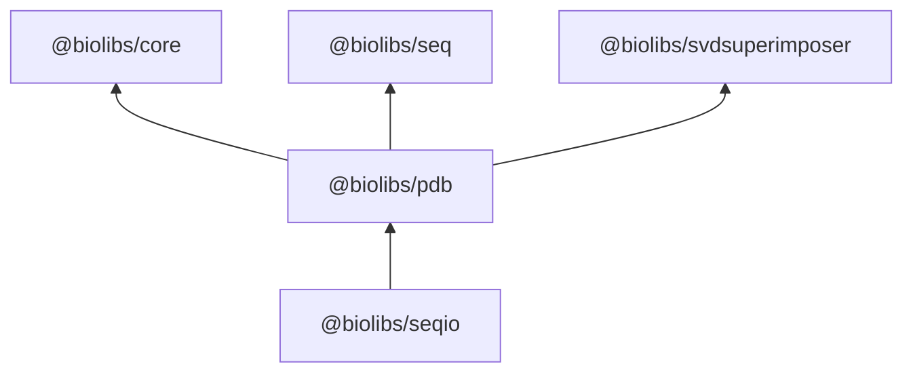

# @biolibs/pdb

Macromolecular structures, as Biopython's `Bio.PDB` has them: parse a PDB or mmCIF file into a
Structure/Model/Chain/Residue/Atom hierarchy, measure it, search it, superimpose it, and write it back.

- **The hierarchy** — `Structure`, `Model`, `Chain`, `Residue`, `Atom`, with disorder modelled as
  Biopython models it (`DisorderedAtom`, `DisorderedResidue`)
- **Parsers** — `PDBParser` (with PQR support), `MMCIFParser` and `FastMMCIFParser`, `MMCIF2Dict`, and
  `parsePdbHeader` for the metadata
- **Writers** — `PDBIO` and `MMCIFIO`, with `Select` subclasses to write part of a structure
- **Geometry** — `Vector`, the rotation matrices of `Bio.PDB.vectors`, `calcAngle`, `calcDihedral`
- **Analysis** — `PPBuilder`/`CaPPBuilder` for polypeptides, `Superimposer`, `NeighborSearch` over a
  `KDTree`, `ShrakeRupley` for solvent-accessible surface area, `unfoldEntities` for selection
- **Internal coordinates** — a chain as bond lengths, angles and dihedrals, back again, and recovered
  from a distance plot alone
- No file system: parsers take the file's text

## What is verified

A generator drives real Biopython and records what it does — the return value, the exception type *and*
message, the warnings, and the state of the structure afterwards. The tests replay those recordings.

| Upstream module | Items | | Upstream module | Items |
|---|---|---|---|---|
| `Bio.PDB.Atom` | **68 / 68** | | `Bio.PDB.vectors` | **36 / 36** |
| `Bio.PDB.Residue` | **62 / 62** | | `Bio.PDB.Polypeptide` | **16 / 16** |
| `Bio.PDB.Entity` | **54 / 54** | | `Bio.PDB.StructureBuilder` | **14 / 14** |
| `Bio.PDB.Structure` | **35 / 35** | | `Bio.PDB.PDBIO` | **11 / 11** |
| `Bio.PDB.Chain` | **34 / 34** | | `Bio.PDB.kdtrees` | **8 / 8** |
| `Bio.PDB.Model` | **34 / 34** | | `Bio.PDB.internal_coords` | **103 / 103** |
| the other six modules | **27 / 27** | | | |

Every module is complete.

**502 of 502 applicable items**, verified by **18,674 recorded cases** across ten golden files (58 MB).
The full breakdown is in [docs/parity/](../../docs/parity/README.md).

Where the claim stops — which is now about modules the port leaves out, not items within them:

- **Internal coordinates are complete**, on 1,316 recorded cases of their own — `AtomKey`, the edra with
  their angles and lengths, `IC_Residue`'s keys and accessors, and `IC_Chain` three ways: from the atoms,
  back to them, and from a distance plot alone. `ic_rebuild` with its PIC file format (`read_PIC`,
  `write_PIC`, `structure_rebuild_test`) is a separate module and not ported.
- **`index_db`-style extras are out of scope**: `DSSP` and `NACCESS` run external programs,
  and `alphafold_db` downloads from the internet. `PDBList`, which also downloads, is its own package:
  [`@biolibs/pdblist`](../pdblist).
- **Not ported**: `HSExposure`, `ResidueDepth`, `FragmentMapper`, `StructureAlignment`/`cealign`,
  `PDBMLParser`, `PICIO`, `SCADIO`, `binary_cif`/MMTF.
- **`PDBIO.save` returns the text** rather than writing to a handle — `save(select?, writeEnd?,
  preserveAtomNumbering?)`, with no file argument, because there is no file system here.
- **Coordinates are 32-bit floats**, as Biopython's NumPy arrays are. `atom.coord[0]` for an input of
  `3.700` reads `3.700000047683716` in both libraries.

## Install

```bash
npm install @biolibs/pdb
```

- ESM only, Node 20 or later, TypeScript declarations included



`@biolibs/seqio` depends on this package for its `pdb-atom`, `cif-atom` and `cif-seqres` formats, which
read a structure's sequence out of a parsed structure.

## API

### Parsing

`getStructure(id, text)` takes the file's *contents*, not a name.

```ts
import { PDBParser } from "@biolibs/pdb";

const parser = new PDBParser({ quiet: true });
const structure = parser.getStructure("1abc", pdbText);

console.log(structure.id, structure.level);          // "1abc" "S"
console.log([...structure].length);                   // 1   — one model
console.log([...structure.getResidues()].length);     // 3
console.log([...structure.getAtoms()].length);        // 15
```

Walking down the hierarchy — each level is iterable and indexable by id:

```ts
const model = [...structure][0]!;
const chain = [...model][0]!;
const residue = [...chain][1]!;
const atom = residue.get("CA")!;

console.log(model.id, chain.id);                      // 0 "A"
console.log([...chain].map((r) => r.resname));        // ["GLY", "ALA", "SER"]
console.log(residue.resname, JSON.stringify(residue.id));   // "ALA" [" ", 2, " "]
console.log([...residue].map((a) => a.name));         // ["N", "CA", "C", "O", "CB"]
```

An atom carries everything the ATOM record held:

```ts
console.log(atom.name, atom.fullname, atom.element);       // "CA" " CA " "C"
console.log(atom.bfactor, atom.occupancy, atom.serialNumber);   // 25 1 6
console.log([...atom.coord]);           // [3.700000047683716, 1.2999999523162842, 0]
console.log(atom.getParent()!.resname);  // "ALA"
console.log(atom.minus(residue.get("N")!));   // 1.4317820072174072  — the distance between them
```

`repr()` on each level is Biopython's:

```ts
console.log(atom.repr());       // "<Atom CA>"
console.log(residue.repr());    // "<Residue ALA het=  resseq=2 icode= >"
console.log(chain.repr());      // "<Chain id=A>"
console.log(structure.repr());  // "<Structure id=1abc>"
```

The header is a plain object with Biopython's keys:

```ts
import { PDBParser, parsePdbHeader } from "@biolibs/pdb";

const parser = new PDBParser({ quiet: true });
parser.getStructure("1abc", pdbText);
const header = parser.getHeader()!;

console.log(header.name);              // "a small test structure"
console.log(header.head);              // "hydrolase"
console.log(header.idcode);            // "1ABC"
console.log(header.deposition_date);   // "2000-01-01"

// Or without parsing the structure at all:
console.log(parsePdbHeader(pdbText).head);   // "hydrolase"
```

Construction problems are `PDBConstructionWarning`s in permissive mode (the default) and
`PDBConstructionException`s otherwise; `{ quiet: true }` silences the warnings, as in Biopython.
`{ isPqr: true }` reads PQR files, where the B-factor and occupancy columns hold charge and radius.

### mmCIF

```ts
import { MMCIF2Dict, MMCIFParser } from "@biolibs/pdb";

const structure = new MMCIFParser({ quiet: true }).getStructure("1abc", cifText);

// Or the raw dictionary, as Biopython's MMCIF2Dict gives it:
const dict = new MMCIF2Dict(cifText);
console.log(dict.get("_atom_site.Cartn_x")!.length);
```

`FastMMCIFParser` skips the header for speed, as Biopython's does.

### Writing

```ts
import { Atom, PDBIO, PDBParser, Select } from "@biolibs/pdb";

const structure = new PDBParser({ quiet: true }).getStructure("1abc", pdbText);
const io = new PDBIO();
io.setStructure(structure);

const text = io.save();     // the text, not a file
console.log(text.split("\n")[0]);
// ATOM      1  N   GLY A   1      -1.204   1.296   0.000  1.00 20.00           N
console.log(text.split("\n").filter((l) => l.startsWith("ATOM")).length);   // 15
```

A `Select` subclass writes part of a structure — override whichever of the four levels you need:

```ts
class CarbonAlphaOnly extends Select {
  override acceptAtom(atom: Atom): unknown { return atom.name === "CA"; }
}

console.log(io.save(new CarbonAlphaOnly()).split("\n").filter((l) => l.startsWith("ATOM")).length);
// 3
```

`MMCIFIO` writes mmCIF the same way, and takes a `MMCIF2Dict` as well as a structure.

### Polypeptides

```ts
import { CaPPBuilder, PDBParser, PPBuilder } from "@biolibs/pdb";

const structure = new PDBParser({ quiet: true }).getStructure("1abc", pdbText);
const peptides = new PPBuilder().buildPeptides(structure);

console.log(peptides.length);                        // 1
console.log(peptides[0]!.getSequence().toString());  // "GAS"
console.log(peptides[0]!.repr());                    // "<Polypeptide start=1 end=3>"
console.log(peptides[0]!.getCaList().length);        // 3

// Chains broken by a missing backbone atom are found by C-alpha distance instead:
console.log(new CaPPBuilder().buildPeptides(structure)[0]!.getSequence().toString());   // "GAS"
```

`getPhiPsiList()` gives each residue's backbone torsions, `null` where there is no neighbour to measure
against:

```ts
console.log(peptides[0]!.getPhiPsiList().map(([phi, psi]) =>
  [phi === null ? null : Number(phi.toFixed(4)), psi === null ? null : Number(psi.toFixed(4))]));
// [[null, -3.1416], [-3.1416, -3.1416], [-3.1416, null]]
```

### `NeighborSearch`

A KD-tree over a list of atoms: everything within a radius of a point, or every pair closer than a
radius.

```ts
import { NeighborSearch, PDBParser } from "@biolibs/pdb";

const structure = new PDBParser({ quiet: true }).getStructure("1abc", pdbText);
const search = new NeighborSearch([...structure.getAtoms()]);

console.log(search.search([3.7, 1.3, 0], 2.0).length);   // 4   — atoms within 2 Å of that point
console.log(search.searchAll(2.0).length);                // 14  — pairs within 2 Å of each other
```

`searchAll` takes a level — `"A"`, `"R"`, `"C"`, `"M"` or `"S"` — to get pairs of residues or chains
instead of atoms.

### `ShrakeRupley`

Solvent-accessible surface area. `level` says where to record the result.

```ts
import { PDBParser, ShrakeRupley } from "@biolibs/pdb";

const structure = new PDBParser({ quiet: true }).getStructure("1abc", pdbText);

new ShrakeRupley().compute(structure, "S");
console.log(Number(structure.sasa!.toFixed(2)));    // 395.65

const perAtom = new PDBParser({ quiet: true }).getStructure("1abc", pdbText);
new ShrakeRupley().compute(perAtom, "A");
console.log(Number([...perAtom.getAtoms()][0]!.sasa!.toFixed(2)));   // 51.4
console.log(perAtom.sasa);                             // undefined — "A" records on the atoms only
```

### `Superimposer`

```ts
import { PDBParser, Superimposer } from "@biolibs/pdb";

const parser = new PDBParser({ quiet: true });
const fixed = [...parser.getStructure("a", pdbText).getAtoms()].slice(0, 5);
const moving = [...parser.getStructure("b", pdbText).getAtoms()].slice(0, 5);

const sup = new Superimposer();
sup.setAtoms(fixed, moving);

console.log(sup.rms);             // 2.9373740229761033e-16 — the same atoms, so nothing to move
console.log(sup.rotran !== null);  // true — the rotation and translation it found
sup.apply(moving);                // moves them in place
```

### Vectors and rotations

```ts
import { Vector, calcAngle, calcDihedral, m2rotaxis, rotaxis2m } from "@biolibs/pdb";

const v = new Vector(1, 0, 0);

console.log(v.repr());                      // "<Vector 1.00, 0.00, 0.00>"
console.log(v.getArray());                  // [1, 0, 0]
console.log(v.norm(), v.normsq());          // 1 1
console.log(v.add(new Vector(0, 1, 0)).repr());    // "<Vector 1.00, 1.00, 0.00>"
console.log(v.dot(new Vector(1, 1, 0)));           // 1
console.log(v.cross(new Vector(0, 1, 0)).repr());  // "<Vector 0.00, -0.00, 1.00>"
console.log(v.angle(new Vector(0, 1, 0)));         // 1.5707963267948966

// A rotation of 90° about z, applied to the vector:
console.log(v.leftMultiply(rotaxis2m(Math.PI / 2, new Vector(0, 0, 1))).repr());
// "<Vector 0.00, 1.00, 0.00>"

console.log(calcAngle(new Vector(1, 0, 0), new Vector(0, 0, 0), new Vector(0, 1, 0)));
// 1.5707963267948966
console.log(calcDihedral(new Vector(1, 0, 0), new Vector(0, 0, 0),
                         new Vector(0, 1, 0), new Vector(0, 1, 1)));
// -1.5707963267948966
```

Also `rotmat`, `refmat`, `m2rotaxis` and `vectorToAxis`, plus the homogeneous 4×4 matrices of
`homog.ts`.

### `unfoldEntities`

Every entity of a given level under another, deduplicated and in order.

```ts
import { PDBParser, unfoldEntities } from "@biolibs/pdb";

const structure = new PDBParser({ quiet: true }).getStructure("1abc", pdbText);

console.log(unfoldEntities(structure, "A").length);   // 15  — atoms
console.log(unfoldEntities(structure, "R").length);   // 3   — residues
console.log(unfoldEntities(structure, "C").length);   // 1   — chains

unfoldEntities(structure, "Z");
// PDBException: Z: Not an entity level.
```

### Internal coordinates

A chain described by bond lengths, bond angles and dihedral angles instead of coordinates — and back.

```ts
import { PDBParser } from "@biolibs/pdb";

const structure = new PDBParser({ quiet: true }).getStructure("1abc", pdbText);
const chain = [...[...structure][0]!][0]!;

chain.atomToInternalCoordinates();
const ic = chain.internalCoord!;

console.log(ic.hedra.size, ic.dihedra.size);    // 15 12

const hedron = [...ic.hedra.values()][0]!;
console.log(Number(hedron.angle.toFixed(4)));   // 120.0418   — degrees
console.log(Number(hedron.len12.toFixed(4)));   // 1.4433     — ångströms

console.log([...ic.dihedra.keys()][0]!.toString());   // "1_G_N:1_G_CA:1_G_C:2_A_N"
```

And the other direction — `internalToAtomCoordinates` rebuilds every atom from the angles:

```ts
const before = [...chain.getAtoms()].map((a) => [...a.coord]);
chain.internalToAtomCoordinates();
const after = [...chain.getAtoms()].map((a) => [...a.coord]);

// The rebuilt atoms land exactly where they were.
console.log(before.length, after.length);   // 15 15
```

The per-angle accessors (`get_angle("psi")` and friends) are not ported; read the values off the hedra
and dihedra, whose keys are `AtomKey` tuples.

## Testing

```bash
npm test                 # the whole workspace
npx vitest run packages/pdb/test
```

Ten golden files, 58 MB, 18,674 cases. Each test file is a single `it` that replays one of them:

| File | Cases | What it checks |
|---|---|---|
| `test/vectors.test.ts` | 5,298 | `Vector`, the rotation matrices, the angle functions |
| `test/pdbio.test.ts` | 3,101 | the PDB, PQR and mmCIF writers, column by column |
| `test/golden.test.ts` | 1,804 | `PDBParser` and the hierarchy it builds |
| `test/polypeptide.test.ts` | 1,718 | `PPBuilder`, `CaPPBuilder`, the torsion lists |
| `test/nsearch.test.ts` | 1,713 | `NeighborSearch` and the `KDTree` under it |
| `test/mmcif.test.ts` | 1,430 | `MMCIF2Dict`, `MMCIFParser`, `FastMMCIFParser` |
| `test/pdbops.test.ts` | 1,401 | entity operations: add, detach, copy, compare, disorder |
| `test/ickey.test.ts` | 1,316 | internal coordinates: `AtomKey`, the edra, measuring and assembling |
| `test/sasa.test.ts` | 505 | `ShrakeRupley` at every level |
| `test/superimposer.test.ts` | 388 | `Superimposer` and the SVD under it |
| `test/readme.test.ts` | — | every code block in this file |

Coverage from this package's own tests — `npx vitest run --coverage packages/pdb/test`:

| | |
|---|---|
| Statements | **97.59%** (5,475 / 5,610) |
| Functions | **93.44%** (470 / 503) |
| Branches | **92.83%** (2,265 / 2,440) |

The largest gaps are in the uncounted part: `internal-coords/ic-residue.ts` at 85% and
`internal-coords/ic-assemble.ts` at 88%, where the golden cases cover the paths a well-formed chain
takes and not every way a residue can be missing an atom.

## Things to know

- **`PDBIO.save` returns a string.** Biopython's writes to a file; there is no file system here, so the
  signature is `save(select?, writeEnd?, preserveAtomNumbering?)` and the text comes back.
- **A residue id is a three-part tuple** — `[hetfield, resseq, icode]`, as in Biopython, which is why
  `chain.get([" ", 2, " "])` is how you reach residue 2 by id rather than by position.
- **Coordinates are `Float32Array`.** `3.700` reads back as `3.700000047683716`; compare with a
  tolerance, as you would against Biopython.
- **`atom.minus(other)` is Biopython's `atom - other`**: the distance, not a vector.
- **Angles are radians from `calcAngle` and `calcDihedral`, and degrees in the internal-coordinate
  hedra.** Both match Biopython, which is inconsistent here.
- **Disorder is a wrapper, not a flag.** A `DisorderedAtom` delegates to its selected child, so
  `atom.coord` gives the selected altloc's coordinates; `disorderedGetList()` reaches the rest.
- **The parsers are permissive by default**, like Biopython's: a malformed record warns and the parse
  continues. Pass `{ permissive: false }` to make it throw instead.

## License

MIT — see [LICENSE](LICENSE).
