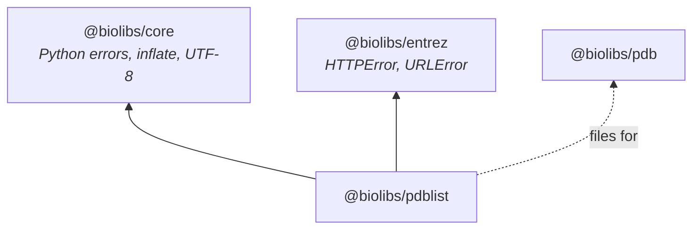

# @biolibs/pdblist

Downloads from the Protein Data Bank — structure files, biological assemblies, and the archive's lists of
entries — asking for what Biopython's `Bio.PDB.PDBList` asks for. It brings back files, already
unpacked, for [`@biolibs/pdb`](../pdb) to parse.

- **Structures in five formats** — mmCIF, PDB, PDBML/XML, MMTF and the PDB bundle for large entries,
  from the same addresses Biopython builds
- **Biological assemblies** — as mmCIF or PDB
- **The archive's lists** — every entry, every withdrawn entry, this week's changes, every assembly
- **Unpacked for you** — gzip is read the way Python's `gzip` reads it, with the same errors for a
  file that is cut short or damaged
- **Runs in a browser** — through a mirror that allows it; see [In a browser](#in-a-browser)
- **One replaceable function touches the network**
- **Two dependencies**, `@biolibs/core` and `@biolibs/entrez` (for the network errors they share)

Biopython's class keeps a copy of the archive in a directory, and returns paths. There is no directory
here: the two methods that fetch a file return its **name and contents**, and the methods whose whole
purpose is the copy on disk are left out.

## What is verified

A generator drives the real Biopython in a temporary directory with its network calls replaced, and
records the address each method asks for, what it prints to stdout and stderr, the name and contents of
the file it leaves, the lists it parses, and the exception type *and* message where it raises. The tests
replay those recordings.

| Upstream module | Items at parity | Checklist |
|---|---|---|
| `Bio.PDB.PDBList` | **9 / 9** | [Bio.PDB.PDBList.md](../../docs/parity/Bio.PDB.PDBList.md) |

**394 of 395 recorded cases** against Biopython 1.88:

| Cases | What they record |
|---|---|
| 179 | `retrieve_pdb_file`: eleven codes × ten formats, obsolete entries, another server, quiet and verbose, four kinds of failed download, and what is inside the archive — including nine files that are not good gzip |
| 148 | `retrieve_assembly_file`: assembly numbers as text, numbers and booleans, formats in any case, failed downloads, bad gzip |
| 13 | `get_status_list` |
| 4 | `get_recent_changes` |
| 12 | `get_all_entries` |
| 10 | `get_all_obsolete` |
| 23 | `get_all_assemblies`, once and twice, for the cached list |
| 6 | `get_seqres_file` |

Where the claim stops:

- **Five methods are not applicable, and not ported**: `update_pdb`, `download_pdb_files`,
  `download_all_assemblies`, `download_entire_pdb` and `download_obsolete_entries` keep a copy of the
  archive on disk. So are the `pdir`, `overwrite`, `pdb` and `obsolete_pdb` arguments, which say where
  on disk. To fetch many files, call `retrievePdbFile` for each.
- **One recorded case is not replayed.** An empty code with the `mmtf` format makes Biopython try to
  download onto its own directory, which fails as a directory would. The test names it and skips it.
- **The network itself is not recorded.** `fetchBytes`, the default way of sending a request, is tested
  against a stand-in for `fetch`, not against Biopython. Everything up to the moment of sending, and
  everything done with the reply, is.
- **A reply that is not JSON** raises `JSONDecodeError`, as in Python, but with the JavaScript engine's
  description of what is wrong with it.
- **`viaMirror` is not Biopython's.** It is here so that a web page can use the package at all.

Oddities that are Biopython's and are kept:

- A structure that cannot be downloaded is **not an error**: a line is printed — even when `verbose` is
  off — and `null` comes back. An assembly that cannot be downloaded prints a line and still returns
  the name the file would have had, with `data: null`.
- `fileFormat` for a structure must be spelled exactly — `"mmCif"`, not `"mmcif"` — while for an
  assembly any letter case will do.
- Asking for no format gets mmCIF, and a warning on stderr every time.
- The `mmtf` format asks `mmtf.rcsb.org`, whatever `server` is. That service has been retired, so the
  answer today is a failed download.
- `getAllAssemblies` keeps its list only if it is not empty.
- A list file with a line that is not a four-character code raises a bare `AssertionError`.

## Install

```bash
npm install @biolibs/pdblist
```

- ESM only, Node 20 or later, TypeScript declarations included
- Uses the platform's `fetch`: every current browser, and Node 20 or later



## Fetching a structure

```ts
import { PDBList } from "@biolibs/pdblist";
import { MMCIFParser } from "@biolibs/pdb";

const pdbl = new PDBList({ verbose: false });
const file = await pdbl.retrievePdbFile("4HHB", { fileFormat: "mmCif" });

if (file !== null) {
  file.name;                                            // "4hhb.cif"
  const text = new TextDecoder().decode(file.data);     // the mmCIF file
  const structure = new MMCIFParser({ quiet: true }).getStructure("4hhb", text);
}
```

The formats, and what comes back:

| `fileFormat` | Name | From |
|---|---|---|
| `"mmCif"` (default) | `4hhb.cif` | `/pub/pdb/data/structures/divided/mmCIF/hh/4hhb.cif.gz` |
| `"pdb"` | `pdb4hhb.ent` | `/pub/pdb/data/structures/divided/pdb/hh/pdb4hhb.ent.gz` |
| `"xml"` | `4hhb.xml` | `/pub/pdb/data/structures/divided/XML/hh/4hhb.xml.gz` |
| `"bundle"` | `4hhb-pdb-bundle.tar` | `/pub/pdb/compatible/pdb_bundle/hh/4hhb/4hhb-pdb-bundle.tar.gz` |
| `"mmtf"` | `4hhb.mmtf` | `http://mmtf.rcsb.org/v1.0/full/4hhb` |

Pass `obsolete: true` to look among the withdrawn entries instead (`/structures/obsolete/`).

```ts
import { structureTarget } from "@biolibs/pdblist";

structureTarget("https://files.wwpdb.org", "4HHB", false, "pdb");
// { url: "https://files.wwpdb.org/pub/pdb/data/structures/divided/pdb/hh/pdb4hhb.ent.gz", name: "pdb4hhb.ent" }
```

## Fetching an assembly

The biological assembly is the molecule as it works: often several copies of what the entry holds.

```ts
import { PDBList } from "@biolibs/pdblist";

const pdbl = new PDBList({ verbose: false });
const assembly = await pdbl.retrieveAssemblyFile("4HHB", 1, { fileFormat: "pdb" });

assembly.name;   // "4hhb.pdb1"
assembly.data;   // the unpacked file, or null if it could not be downloaded
```

The assembly number goes through Python's `int()`, so `1`, `"1"` and `" 01 "` are the same assembly and
`"one"` is a `ValueError`.

## What it prints

Biopython reports to stdout and stderr. Here each line goes to a function you can replace; the defaults
are `console.log` and `console.error`.

```ts
import { PDBList } from "@biolibs/pdblist";

const lines: string[] = [];
const pdbl = new PDBList({ stdout: (line) => lines.push(line), stderr: (line) => lines.push(line) });
await pdbl.retrievePdbFile("4HHB");

lines;
// [ "WARNING: The default download format has changed from PDB to PDBx/mmCif",
//   "Downloading PDB structure '4hhb'..." ]
```

## The lists

```ts
import { PDBList } from "@biolibs/pdblist";

const pdbl = new PDBList({ verbose: false });

const [added, modified, obsolete] = await pdbl.getRecentChanges();   // this week's codes, three lists
const entries = await pdbl.getAllEntries();        // every code in the archive: ["100D", "101D", ...]
const withdrawn = await pdbl.getAllObsolete();     // every code ever withdrawn: ["116L", "125D", ...]
const assemblies = await pdbl.getAllAssemblies();  // [["100d", "1"], ["101d", "1"], ...]
const seqres = await pdbl.getSeqresFile();         // { name: "pdb_seqres.txt", data } — over 110 MB of FASTA
```

`getAllEntries` reads an index of about 27 MB, and `getAllAssemblies` asks RCSB's search service for
several hundred thousand pairs; the second call returns the list already held.

## In a browser

`files.wwpdb.org`, the server Biopython uses, does not send `Access-Control-Allow-Origin`, so a page on
another site may not read from it. PDBe, the wwPDB's European partner, serves the same archive and
does. `viaMirror` sends each request there instead:

```ts
import { PDBList, viaMirror } from "@biolibs/pdblist";

const pdbl = new PDBList({ fetcher: viaMirror(), verbose: false });
await pdbl.retrievePdbFile("4HHB", { fileFormat: "pdb" });
// asks https://ftp.ebi.ac.uk/pub/databases/pdb/data/structures/divided/pdb/hh/pdb4hhb.ent.gz
```

RCSB's search service, which `getAllAssemblies` asks, allows a page to read it as it is. Under Node
none of this matters, and the default works.

## Replacing the network

Everything is sent through the `fetcher` a `PDBList` is given. Replace it to add a cache, go through
your own server, or run with no connection at all. It is given the request and returns the body, or
throws `HTTPError` or `URLError`.

```ts
import { type Fetcher, HTTPError, PDBList } from "@biolibs/pdblist";

const missing: Fetcher = async (request) => {
  throw new HTTPError(request.url, 404, "Not Found");
};
const lines: string[] = [];
const pdbl = new PDBList({ fetcher: missing, verbose: false, stdout: (line) => lines.push(line) });

await pdbl.retrievePdbFile("9ZZZ", { fileFormat: "pdb" });   // null
lines;   // [ "Desired structure not found or download failed. '9zzz': HTTP Error 404: Not Found" ]
```

## Reading gzip

`gunzip` is exported, since it is useful on its own: it is Python's `gzip.decompress`, with Python's
errors.

```ts
import { BadGzipFile, gunzip } from "@biolibs/pdblist";

const gz = Uint8Array.of(0x1f, 0x8b, 8, 0, 0, 0, 0, 0, 0, 0x13, 0x4b, 0x04, 0x00, 0x43, 0xbe, 0xb7, 0xe8, 1, 0, 0, 0);
new TextDecoder().decode(gunzip(gz));   // "a"

try {
  gunzip(new TextEncoder().encode("<!DOCTYPE html>"));
} catch (error) {
  error instanceof BadGzipFile;   // true
  (error as Error).message;       // "Not a gzipped file (b'<!')"
}
```

## From Python

| Python | TypeScript | Notes |
|---|---|---|
| `PDBList(server=..., verbose=...)` | `new PDBList({ server, verbose, fetcher, stdout, stderr })` | `pdb` and `obsolete_pdb` name directories: not applicable |
| `pl.retrieve_pdb_file(code, obsolete, pdir, file_format, overwrite)` | `await pl.retrievePdbFile(code, { obsolete, fileFormat })` | returns `{ name, data }` or `null`, not a path |
| `pl.retrieve_assembly_file(code, num, pdir, file_format, overwrite)` | `await pl.retrieveAssemblyFile(code, num, { fileFormat })` | returns `{ name, data }`, `data` being `null` on failure |
| `PDBList.get_status_list(url)` | `await PDBList.getStatusList(url, fetcher?)` | |
| `pl.get_recent_changes()` | `await pl.getRecentChanges()` | |
| `pl.get_all_entries()` | `await pl.getAllEntries()` | |
| `pl.get_all_obsolete()` | `await pl.getAllObsolete()` | |
| `pl.get_all_assemblies()` | `await pl.getAllAssemblies()` | pairs are two-element arrays |
| `pl.get_seqres_file(savefile)` | `await pl.getSeqresFile(savefile?)` | returns `{ name, data }` instead of writing |
| `pl.pdb_server`, `pl.assemblies` | `pl.pdbServer`, `pl.assemblies` | |
| `update_pdb`, `download_pdb_files`, `download_all_assemblies`, `download_entire_pdb`, `download_obsolete_entries` | not applicable | they maintain a directory |

## Testing

```bash
npm test                 # the whole workspace
npx vitest run packages/pdblist/test
```

| File | What it checks |
|---|---|
| `test/pdblist.test.ts` | the recorded cases from Biopython 1.88 |
| `test/fetcher.test.ts` | `fetchBytes` and `viaMirror` against a stand-in for `fetch`; `gunzip` against Node's zlib |
| `test/readme.test.ts` | every code block in this file |

No test touches the network.

## Things to know

- **A missing file is reported by the server as it likes.** `files.wwpdb.org` answers 403, not 404, for
  a structure that does not exist, and over HTTP/2 there is no reason phrase, so the line printed is
  `HTTP Error 403: ` where Python, filling in the phrase itself, prints `HTTP Error 403: Forbidden`.
- **Files are held in memory, whole.** That is fine for a structure; `getSeqresFile` and the XML of a
  large entry are hundreds of megabytes.
- **Codes are lower-cased** before anything is built from them, as in Biopython, so `"4HHB"` and
  `"4hhb"` are the same request.
- **A `KeyError`'s message is the key**, without the quotes Python's `str()` adds.

## License

MIT — see [LICENSE](LICENSE).
