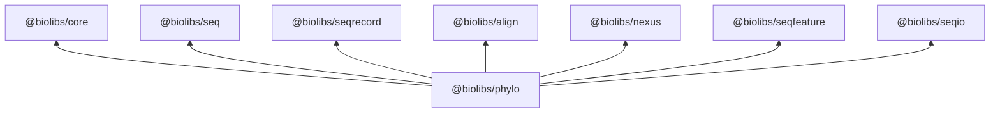

# @biolibs/phylo

Phylogenetic trees, as Biopython's `Bio.Phylo` has them: read them, search them, re-root them, build them
from an alignment, and reduce a forest to a consensus.

- **`Tree` and `Clade`** — the whole `BaseTree` surface: `findClades`, `getPath`, `commonAncestor`,
  `distance`, `depths`, `collapse`, `prune`, `split`, `ladderize`, `rootAtMidpoint`, `rootWithOutgroup`
- **Newick, NEXUS and phyloXML** — `parse`, `read`, `write`, `convert`, with the format options Biopython
  takes
- **phyloXML in full** — every element class, taxonomies, sequences, events, dates, properties, and
  conversion to and from `SeqRecord`s and alignments
- **Consensus** — strict, majority-rule and Adam consensus, and branch support from a forest
- **Tree construction** — distance matrices in 31 substitution models, UPGMA, neighbour joining, and
  parsimony with NNI search
- **dN/dS distance matrices** — `Bio.Align.analysis.calculate_dn_ds_matrix`, which lives here because it
  returns distance matrices

## What is verified

A generator drives real Biopython and records what it does — the return value, the exception type *and*
message, the warnings, and **the whole tree after every call**, which is what catches an edit that moves a
clade it should not have touched.

| Upstream module | Items at parity | Checklist |
|---|---|---|
| `Bio.Phylo.PhyloXML` | **177 / 177** | [Bio.Phylo.PhyloXML.md](../../docs/parity/Bio.Phylo.PhyloXML.md) |
| `Bio.Phylo.BaseTree` | **95 / 95** | [Bio.Phylo.BaseTree.md](../../docs/parity/Bio.Phylo.BaseTree.md) |
| `Bio.Phylo.PhyloXMLIO` | **89 / 89** | [Bio.Phylo.PhyloXMLIO.md](../../docs/parity/Bio.Phylo.PhyloXMLIO.md) |
| `Bio.Phylo.Newick` | **61 / 61** | [Bio.Phylo.Newick.md](../../docs/parity/Bio.Phylo.Newick.md) |
| `Bio.Phylo.TreeConstruction` | **43 / 43** | [Bio.Phylo.TreeConstruction.md](../../docs/parity/Bio.Phylo.TreeConstruction.md) |
| `Bio.Phylo.NewickIO` | **14 / 14** | [Bio.Phylo.NewickIO.md](../../docs/parity/Bio.Phylo.NewickIO.md) |
| `Bio.Phylo.Consensus` | **4 / 4** | [Bio.Phylo.Consensus.md](../../docs/parity/Bio.Phylo.Consensus.md) |
| `Bio.Phylo._io` | **4 / 4** | [Bio.Phylo._io.md](../../docs/parity/Bio.Phylo._io.md) |
| `Bio.Phylo.NexusIO` | **2 / 2** | [Bio.Phylo.NexusIO.md](../../docs/parity/Bio.Phylo.NexusIO.md) |

**3,329 recorded cases** against Biopython 1.88 — 806 tree cases driving some 3,000 method calls, 1,130
phyloXML cases, 956 consensus cases, 418 tree-construction cases and 19 dN/dS matrices.

Where the claim stops:

- **NeXML and CDAO are not ported.** Both are RDF-shaped formats with their own dependencies, and neither
  appears in the checklists.
- **Drawing is not ported.** `Bio.Phylo.draw` and `draw_ascii` need matplotlib; `toString()` gives the
  indented text summary Biopython's `str(tree)` gives.
- **What uses Python's random is not ported**: `Tree.randomized`, `bootstrap`, `bootstrap_trees` and
  `bootstrap_consensus`. (`@biolibs/core` does have Python's Mersenne Twister, so this is a gap rather
  than an impossibility.)
- **Adam consensus can order a clade's children differently.** Biopython's algorithm iterates Python sets
  of clade objects, which hash by memory address, so the order varies between Biopython runs too. Only
  the order moves, never the topology; the golden cases record and compare those trees with every clade's
  children sorted.
- **A whole-numbered float is indistinguishable from an integer** in JavaScript, so `PyFloat` is used
  where the difference shows in output — see *Confidences are two different things* below.

## Install

```bash
npm install @biolibs/phylo
```

- ESM only, Node 20 or later, TypeScript declarations included



`@biolibs/align` is needed because `DistanceCalculator` works on alignments and phyloXML converts to them;
`@biolibs/nexus` parses the NEXUS format.

### Naming: Python to TypeScript

| Python | TypeScript |
|---|---|
| `clade.branch_length` | `clade.branchLength` |
| `tree.find_clades(target, terminal, order, **kw)` | `tree.findClades(target, { terminal, order, ...patterns })` |
| `len(clade)`, `clade[i]`, `for c in clade` | `clade.length`, `clade.get(i)`, `for (const c of clade)` |
| `str(tree)`, `repr(tree)` | `tree.toString()`, `tree.repr()` |
| `Clade(0.5, "x")` | `new Clade({ branchLength: 0.5, name: "x" })` |
| `clade._get_confidence()` | `clade.confidence` |

**The constructors take an options object**, unlike `@biolibs/seq`'s, because `Clade` and the phyloXML
elements have a dozen optional fields each and Python's callers use keywords for all of them.

## API

### `read`, `parse`, `write`, `convert`

```ts
import { read } from "@biolibs/phylo";

const tree = read("((A:0.1,B:0.2)90:0.3,(C:0.4,D:0.5):0.6);", "newick");

console.log(tree.getTerminals().map((c) => c.name));   // ["A", "B", "C", "D"]
console.log(tree.countTerminals());                     // 4
console.log(tree.totalBranchLength());                  // 2.1
console.log(tree.rooted);                               // false  — Newick says nothing, so not rooted
console.log(tree.isBifurcating());                      // true
```

`write` goes to anything with `write(text)` and returns the number of trees:

```ts
import { read, write } from "@biolibs/phylo";

let out = "";
const target = { write: (s: string) => { out += s; return s.length; } };
const tree = read("((A:0.1,B:0.2)90:0.3,(C:0.4,D:0.5):0.6);", "newick");

console.log(write(tree, target, "newick"));   // 1
console.log(out);
// ((A:0.1,B:0.2)90.00:0.3,(C:0.4,D:0.5):0.6):0;
```

Note what came back: the confidence is written as `90.00` and the root gained `:0`. That is Biopython's
output for this tree, not a quirk of this port — the Newick writer formats confidences with `"%1.2f"` by
default and always writes a root branch length. `tree.format("newick")` gives the same string directly.

```ts
import { parse, read } from "@biolibs/phylo";

// parse yields each tree; read insists on exactly one.
console.log([...parse("((A,B),(C,D));\n((A,C),(B,D));\n", "newick")].length);   // 2

read("((A,B),(C,D));\n((A,C),(B,D));\n", "newick");
// ValueError: There are multiple trees in this file; use parse() instead.

read("((A,B),(C,D));", "nope");   // KeyError: nope
```

`convert` reads one format and writes another in one step:

```ts
import { convert } from "@biolibs/phylo";

let out = "";
const target = { write: (s: string) => { out += s; return s.length; } };

console.log(convert("((A,B),(C,D));", "newick", target, "nexus"));   // 1
console.log(out.split("\n").filter((l) => l.trim())[0]);             // "#NEXUS"
```

The three formats are `"newick"`, `"nexus"` and `"phyloxml"`. The reader and writer options are Biopython's
in camel case — `valuesAreConfidence`, `commentsAreConfidence`, `rooted` for the Newick reader;
`plain`, `confidenceAsBranchLength`, `branchLengthOnly`, `maxConfidence`, `formatConfidence`,
`formatBranchLength` and `ladderize` for the writer, where the two `format*` options are Python `%`
strings such as `"%1.2f"`.

### NEXUS

```ts
import { read, write } from "@biolibs/phylo";

let out = "";
const target = { write: (s: string) => { out += s; return s.length; } };
write(read("((A:0.1,B:0.2)90:0.3,(C:0.4,D:0.5):0.6);", "newick"), target, "nexus");

console.log(out.split("\n").filter((l) => l.trim()));
// #NEXUS
// Begin Taxa;
//  Dimensions NTax=4;
//  TaxLabels A B C D;
// End;
// Begin Trees;
//  Tree tree1=((A:0.1,B:0.2)90.00:0.3,(C:0.4,D:0.5):0.6):0;
// End;
```

### Searching

`findClades` is a generator; `findAny` returns the first match or `null`; `findElements` searches every
element, not just clades.

```ts
import { Clade, read } from "@biolibs/phylo";

const tree = read("((A:0.1,B:0.2)90:0.3,(C:0.4,D:0.5):0.6);", "newick");

console.log(tree.findAny("A")!.name);                           // "A"
console.log([...tree.findClades(Clade)].length);                 // 7   — every clade, inner ones too
console.log([...tree.findClades({ name: "A" })].map((c) => c.name));      // ["A"]
console.log([...tree.findClades({ name: "A|B" })].map((c) => c.name));    // ["A", "B"]
```

A target is a clade (matched by identity), a class (`instanceof`), a string (the name), an object of
attribute patterns, or a function. A string pattern is a whole-string regular expression, which is why
`"A|B"` matches two clades. A **float** pattern is a `TypeError`, as in Biopython:

```ts
tree.findElements({ branchLength: 0.1 });
// TypeError: invalid query type: <class 'float'>
```

### Paths and distances

```ts
import { read } from "@biolibs/phylo";

const tree = read("((A:0.1,B:0.2)90:0.3,(C:0.4,D:0.5):0.6);", "newick");

console.log(tree.getPath("A")!.map((c) => c.name ?? "(inner)"));   // ["(inner)", "A"]
console.log(tree.commonAncestor("A", "B")!.confidence);            // 90
console.log(tree.distance("A", "B"));                              // 0.30000000000000004
console.log(tree.trace("A", "D").map((c) => c.name ?? "(inner)"));
// ["(inner)", "(inner)", "(inner)", "D"]

const depths = tree.depths();
console.log([...depths].filter(([c]) => c.name === "A").map(([, d]) => d));   // [0.4]
```

`isMonophyletic` compares clade *objects*, not names — so pass the clades, as Biopython requires:

```ts
const tips = tree.getTerminals().filter((c) => c.name === "A" || c.name === "B");
console.log(tree.isMonophyletic(tips) !== null);    // true
console.log(tree.isMonophyletic("A", "B"));          // false — names are not clades
```

### Editing and re-rooting

Each of these mutates the tree, as Biopython's do.

```ts
import { read } from "@biolibs/phylo";

const nwk = "((A:0.1,B:0.2)90:0.3,(C:0.4,D:0.5):0.6);";

const collapsed = read(nwk, "newick");
collapsed.collapseAll();
console.log(collapsed.format("newick").trim());
// (A:0.4,B:0.5,C:1,D:1.1):0;      — inner clades gone, their lengths folded in

const pruned = read(nwk, "newick");
pruned.prune("A");
console.log(pruned.format("newick").trim());
// (B:0.5,(C:0.4,D:0.5):0.6):0;    — B absorbed its parent's branch

const midpoint = read(nwk, "newick");
midpoint.rootAtMidpoint();
console.log(midpoint.format("newick").trim());
// ((B:0.2,A:0.1)90.00:0.6,(D:0.5,C:0.4):0.3):0;

const outgroup = read(nwk, "newick");
outgroup.rootWithOutgroup("A");
console.log(outgroup.format("newick").trim());
// (((C:0.4,D:0.5):0.9,B:0.2)90.00:0.1,A:0):0;
```

### Clades

A clade is a container of its children: it has a `length`, it is iterable, and `get` indexes it.

```ts
import { Clade, Tree, read } from "@biolibs/phylo";

const tree = read("((A:0.1,B:0.2)90:0.3,(C:0.4,D:0.5):0.6);", "newick");

console.log(tree.root.length);               // 2
console.log([...tree.root].length);          // 2
console.log(tree.clade === tree.root);        // true  — `clade` is Biopython's alias for the root

// Built by hand, with the options object:
const built = new Tree({
  root: new Clade({
    name: "root",
    clades: [new Clade({ name: "A", branchLength: 0.1 }), new Clade({ name: "B", branchLength: 0.2 })],
  }),
});
console.log(built.format("newick").trim());   // "(A:0.1,B:0.2)root:0;"
console.log(new Clade({ branchLength: 0.5, name: "x" }).repr());
// "Clade(branch_length=0.5, name='x')"
```

A branch colour accepts a name, a hex string, an RGB triple or a `BranchColor`:

```ts
import { BranchColor, read } from "@biolibs/phylo";

const tree = read("((A,B),(C,D));", "newick");
tree.root.color = "red";

console.log(String(tree.root.color));              // "(255, 0, 0)"
console.log(tree.root.color!.red);                 // 255
console.log(new BranchColor(1, 2, 3).repr());      // "BranchColor(red=1, green=2, blue=3)"
```

### `Consensus`

```ts
import { Consensus, read } from "@biolibs/phylo";

const forest = [
  read("((A,B),(C,D));", "newick"),
  read("((A,C),(B,D));", "newick"),
  read("((A,B),(C,D));", "newick"),
];

console.log(Consensus.strictConsensus(forest).format("newick").trim());
// ((A:0,B:0):0,(C:0,D:0):0):0;

console.log(Consensus.majorityConsensus(forest).format("newick").trim());
// (C:0,D:0,(A:0,B:0)100.00:0):0;

console.log(Consensus.adamConsensus(forest).format("newick").trim());
// (D:0,C:0,B:0,A:0):0;
```

`getSupport` annotates a tree's clades with how often each appears in the forest:

```ts
import { Consensus, read } from "@biolibs/phylo";

const target = read("((A,B),(C,D));", "newick");
Consensus.getSupport(target, forest);

console.log(target.format("newick").trim());
// ((A:0,B:0)66.67:0,(C:0,D:0)66.67:0)100.00:0;
```

An empty forest raises, as Python's `next()` on an empty iterator does:

```ts
Consensus.strictConsensus([]);   // StopIteration
```

`Consensus.BitString` is Biopython's `_BitString`, and `Consensus.equalTopology` its `_equal_topology`.

### `TreeConstruction`

A distance matrix from an alignment, in any of 31 substitution models:

```ts
import { MultipleSeqAlignment } from "@biolibs/align";
import { Seq } from "@biolibs/seq";
import { SeqRecord } from "@biolibs/seqrecord";
import { TreeConstruction } from "@biolibs/phylo";

const msa = new MultipleSeqAlignment([
  new SeqRecord(new Seq("ACGTACGT"), "a"),
  new SeqRecord(new Seq("ACGTTCGT"), "b"),
  new SeqRecord(new Seq("ACGAACGA"), "c"),
  new SeqRecord(new Seq("TCGAACGA"), "d"),
]);

console.log(TreeConstruction.DistanceCalculator.models.length);   // 31

const calculator = new TreeConstruction.DistanceCalculator("identity");
const dm = calculator.getDistance(msa);

console.log(dm.names);         // ["a", "b", "c", "d"]
console.log(dm.get([1, 0]));   // 0.125
console.log(dm.toString().split("\n").slice(0, 3));
// ["a   0.000000", "b   0.125000    0.000000", "c   0.250000    0.375000    0.000000"]
```

Then a tree, by neighbour joining or UPGMA:

```ts
const nj = new TreeConstruction.DistanceTreeConstructor(calculator, "nj");
console.log(nj.buildTree(msa).format("newick").trim());
// ((a:0,b:0.125)Inner1:0.25,c:0,d:0.125)Inner2:0;

const upgma = new TreeConstruction.DistanceTreeConstructor(calculator, "upgma");
console.log(upgma.buildTree(msa).format("newick").trim());
// ((d:0.0625,c:0.0625)Inner1:0.125,(b:0.0625,a:0.0625)Inner2:0.125)Inner3:0;
```

Parsimony scores a tree against an alignment, and NNI search improves it:

```ts
import { TreeConstruction, read } from "@biolibs/phylo";

const scorer = new TreeConstruction.ParsimonyScorer();
const start = read("(S0:1.05,(S2:0.47,S1:1.03):0.72):0.57;", "newick");

console.log(scorer.getScore(start, threeRowMsa));   // 17

const searcher = new TreeConstruction.NNITreeSearcher(scorer);
const constructor = new TreeConstruction.ParsimonyTreeConstructor(searcher, start);
console.log(constructor.buildTree(threeRowMsa).format("newick").trim());
// (S0:1.77,(S1:1.03,S2:0.47):0.37):0.57;
```

`DistanceMatrix` also writes PHYLIP, and `calculateDnDsMatrix(alignment, method, codonTable)` gives the
pairwise dN and dS matrices.

### phyloXML

`PhyloXMLIO.read` gives the whole document; `read(text, "phyloxml")` gives its single tree.

```ts
import { PhyloXML, PhyloXMLIO, read } from "@biolibs/phylo";

const doc = PhyloXMLIO.read(xmlText);
console.log(doc.phylogenies.length, doc.phylogenies[0]!.name);   // 1 "t1"

const tree = read(xmlText, "phyloxml");
console.log(tree.name, tree.rooted);                              // "t1" true
console.log(tree.getTerminals().map((c) => c.name));              // ["A", "B"]

const a = tree.getTerminals()[0]!;
console.log(a.taxonomies[0]!.scientificName);                     // "Homo sapiens"
```

Writing takes a `Phyloxml` or an iterable — a single tree is an error, as in Biopython:

```ts
let out = "";
PhyloXMLIO.write([tree], { write: (s: string) => { out += s; return s.length; } });
console.log(out.split("\n")[1]);     // '  <phylogeny rooted="true">'

PhyloXMLIO.write(tree, target);
// TypeError: 'Phylogeny' object has no attribute 'to_phyloxml'
```

A Newick tree can be promoted to a phyloXML one, which is how you annotate a tree you just parsed:

```ts
import { PhyloXML, read } from "@biolibs/phylo";

const promoted = read("((A:0.1,B:0.2),C:0.3);", "newick").asPhyloxml();
console.log(promoted.constructor.name);        // "Phylogeny"
console.log(promoted.getTerminals().length);   // 3

console.log(new PhyloXML.Taxonomy({ scientificName: "Homo sapiens" }).scientificName);
// "Homo sapiens"
```

`PhyloXML` holds every element class under its Biopython name — `Phyloxml`, `Phylogeny`, `Clade`,
`Sequence`, `Taxonomy`, `Confidence`, `Events`, `Date`, `Point`, `Property`, `Annotation` and the rest.
`Sequence.fromSeqrecord`/`toSeqrecord`, `ProteinDomain.fromSeqfeature`/`toSeqfeature` and
`Phylogeny.toAlignment()` convert to and from `@biolibs/seqrecord` and `@biolibs/align` objects.

### Confidences are two different things

In Newick a confidence is a bare number. In phyloXML it is an element with a `type`, and a clade may carry
several — so `clade.confidence` is a number there only when there is exactly one, and raises when there
are more.

```ts
console.log(read(newickText, "newick").commonAncestor("A", "B")!.confidence);   // 90

const b = read(xmlText, "phyloxml").getTerminals()[1]!;
console.log(b.confidence);           // Confidence { value: 90, type: "bootstrap" }
console.log(b.confidences.length);   // 1

twoConfidences.root.confidence;
// TypeError: more than 1 confidence value available; use Clade.confidences
```

## Testing

```bash
npm test                 # the whole workspace
npx vitest run packages/phylo/test
```

**3,355 tests in 6 files.**

| File | What it checks |
|---|---|
| `test/phylo.test.ts` | 806 tree cases, each driving several method calls and comparing the whole tree afterwards |
| `test/phyloxml.test.ts` | 1,130 phyloXML cases: the reader, the writer, every element class, and Biopython's odder errors |
| `test/consensus.test.ts` | 956 consensus cases, with every clade's children sorted so Adam consensus can be compared at all |
| `test/treeconstruction.test.ts` | 418 cases: the matrices, the models, UPGMA, neighbour joining and parsimony |
| `test/dnds-matrix.test.ts` | 19 dN/dS matrices |
| `test/readme.test.ts` | every code block in this file |

Coverage from this package's own tests — `npx vitest run --coverage packages/phylo/test`:

| | |
|---|---|
| Statements | **98.70%** (2,513 / 2,546) |
| Functions | **97.89%** (417 / 426) |
| Branches | **93.62%** (1,878 / 2,006) |

The largest single gap is `base-tree/matchers.ts` at 88.6%: the target-matching rules have a branch for
every shape a pattern can take, and the golden cases do not use all of them against all of them.

## Things to know

- **The Newick writer reformats.** `read` then `write` is not a round trip: a confidence of `90` comes
  back as `90.00` and the root gains `:0`. Biopython does this too; pass `formatConfidence` or `plain`
  if you need something else.
- **`equalTopology` is laxer than it looks.** Biopython's `_equal_topology` reports `((A,B),(C,D))` and
  `((A,C),(B,D))` as equal, which is its own comparison rather than a topological identity. This port
  reproduces that.
- **Parsimony on a four-taxon tree crashes — in both libraries.** `ParsimonyScorer.getScore` roots an
  unrooted tree at its midpoint first, and Biopython raises `UnboundLocalError: cannot access local
  variable 'tip1' where it is not associated with a value` for some shapes. The port raises the same
  error with the same message rather than papering over it.
- **`ParsimonyScorer.getScore` sorts the alignment in place**, as Biopython's does.
- **Attribute searches test only the first key**, which is Biopython's behaviour: `{ name: "A", width: 2 }`
  checks the name and ignores the width.
- **A search whose pattern raises leaves Biopython's clade without its `clades`.** The port does not
  reproduce that corrupted state — it raises and leaves the tree alone.

## License

MIT — see [LICENSE](LICENSE).
