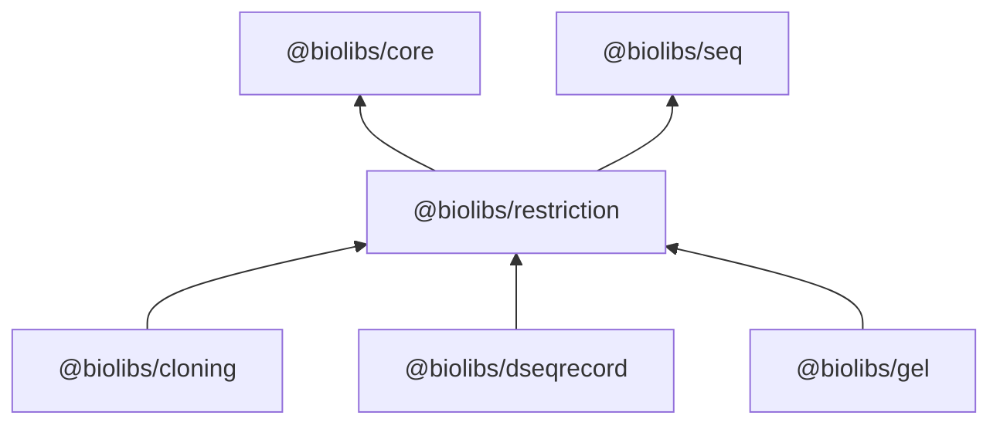

# @biolibs/restriction

All 1,088 restriction enzymes REBASE ships with Biopython, where each one cuts, and what you get when it
does.

- **1,088 enzymes** with their sites, cut positions, overhangs, suppliers and isoschizomers
- **`search`** — cut positions on a linear or circular sequence
- **`catalyse`** — the fragments, as `Seq` objects
- **`RestrictionBatch`** — several enzymes at once, with set arithmetic and selection by kind
- **`Analysis`** — eighteen selectors over a digest, and three text layouts including the map Biopython
  draws
- **No network and no files**: the REBASE data is generated into the package
- Depends on `@biolibs/core` and `@biolibs/seq`

## What is verified

A generator drives real Biopython and records what it does — the return value, the exception type *and*
message, the printed output. The tests replay those recordings.

| Upstream module | Items at parity | Checklist |
|---|---|---|
| `Bio.Restriction` | **491 / 491** | [Bio.Restriction.md](../../docs/parity/Bio.Restriction.md) |

**5,387 recorded cases** against Biopython 1.88, over 11 kinds:

| Cases | What they cover |
|---|---|
| 1,400 | digests: `search` and `catalyse`, linear and circular, over sequences chosen to put cuts at the ends and across the origin |
| 1,088 | **every enzyme**, each dumped whole: site, size, cut positions, overhang, kinds, suppliers, frequency |
| 900 | pairs of enzymes through every comparison: `ne`, `lt`, `rshift`, `mod`, `isoschizomers`, `compatibleEnd` |
| 500 each | the enzyme lists, batches, and `Analysis` |
| 300 | `FormattedSeq` |
| 120 | batches of batches |
| 60 | the three `PrintFormat` layouts, compared as text |
| 19 | the supplier tables and codes, captured off `console.log` |

The 94 items the checklist marks non-applicable are Python class machinery: `mro`, and the comparison and
hash members of the mixin classes that Biopython builds each enzyme from.

Where the port deliberately differs:

- **An enzyme is an object, not a class.** Biopython builds one *class* per enzyme out of mixins
  (`Palindromic`, `OneCut`, `Ov5`, `Defined`, …), so `issubclass(EcoRI, Blunt)` is how you ask what kind
  it is. Here each enzyme is a `RestrictionType` instance that knows its mixins:
  `EcoRI.isA("Blunt")`, and `EcoRI.kinds` lists them.
- **A batch iterates in insertion order.** Biopython's batches are Python `set`s, whose order is
  arbitrary — which only shows in the map layout, where enzymes cutting at the same position are listed in
  iteration order.
- **The operators are methods**: `EcoRI.div(seq)` for `/`, `floordiv` for `//`, `ne`, `rshift`, `mod`,
  `lt`, `add`. `a == b` is `a === b`, because each enzyme is a single object.
- **Wrong argument *types* throw `TypeError`** where Python raises `AttributeError`.

## Install

```bash
npm install @biolibs/restriction
```

- ESM only, Node 20 or later, TypeScript declarations included



## API

### An enzyme

Enzymes live in the `enzymes` record — `Restriction.EcoRI` in Python is `enzymes.EcoRI` here — and in
`AllEnzymes`, `CommOnly` (623 of them) and `NonComm` (465).

```ts
import { enzymes } from "@biolibs/restriction";

const { EcoRI } = enzymes;

console.log(EcoRI!.site);         // "GAATTC"
console.log(EcoRI!.size);         // 6
console.log(EcoRI!.fst5);         // 1    — the cut on the Watson strand, from the start of the site
console.log(EcoRI!.fst3);         // -1   — and on the Crick strand
console.log(EcoRI!.ovhgseq);      // "AATT"
console.log(EcoRI!.elucidate());  // "G^AATT_C"
console.log(EcoRI!.frequency());  // 4096  — one site every 4^6 bases, by chance
console.log(String(EcoRI));       // "EcoRI"
```

What kind of enzyme it is, which in Biopython is a question about its class:

```ts
console.log(EcoRI!.isA("Palindromic"));   // true
console.log(EcoRI!.isA("Blunt"));         // false
console.log(EcoRI!.is5overhang());        // true
console.log(EcoRI!.isBlunt());            // false
console.log(EcoRI!.cutOnce());            // true
console.log([...EcoRI!.kinds]);
// ["Palindromic", "OneCut", "Ov5", "Defined", "Meth_Dep", "Commercially_available",
//  "AbstractCut", "RestrictionType"]
```

### `search` and `catalyse`

Positions are **1-based**: the position of the base *after* the cut.

```ts
import { Seq } from "@biolibs/seq";
import { enzymes } from "@biolibs/restriction";

const { EcoRI, SmaI } = enzymes;
const dna = new Seq("GAATTCAAACCCGGGTTTGAATTC");

console.log(EcoRI!.search(dna));          // [2, 20]
console.log(SmaI!.search(dna));           // [13]

console.log(EcoRI!.catalyse(dna).map(String));
// ["G", "AATTCAAACCCGGGTTTG", "AATTC"]
console.log(SmaI!.catalyse(dna).map(String));
// ["GAATTCAAACCC", "GGGTTTGAATTC"]
```

The second argument is `linear`, and `false` makes the sequence circular — which joins the last fragment
to the first:

```ts
console.log(EcoRI!.catalyse(dna, false).map(String));
// ["AATTCG", "AATTCAAACCCGGGTTTG"]
```

`catalyze` is the same method under the American spelling, as in Biopython. `div` and `floordiv` are
Python's `/` and `//` on an enzyme — `search` and `catalyse` by another name:

```ts
console.log(EcoRI!.div(dna));                      // [2, 20]
console.log(EcoRI!.floordiv(dna).map(String));     // ["G", "AATTCAAACCCGGGTTTG", "AATTC"]
```

### Comparing enzymes

These are Biopython's operators, and they do not mean what the symbols suggest — which is why the port
keeps the names rather than hiding them:

```ts
const { EcoRI, SmaI } = enzymes;

console.log(EcoRI!.ne(SmaI!));      // true   — different cut characteristics
console.log(EcoRI!.lt(SmaI!));      // true   — orders by site length, then name
console.log(EcoRI!.rshift(SmaI!));  // false  — would EcoRI's ends ligate to SmaI's?
console.log(EcoRI!.mod(SmaI!));     // false  — same overhang?
```

**`ne` is not the negation of equality.** It compares how the two enzymes cut, so two different enzymes
that cut identically are `ne === false`; `isEquischizomer` is exactly `!ne`. Equality itself is object
identity, `a === b`.

```ts
console.log(EcoRI!.compatibleEnd().map(String).slice(0, 5));
// ["FspEI", "LpnPI", "MluCI", "MspJI", "SgeI"]
```

`isoschizomers()` and `equischizomers()` give the enzymes with the same site, and the same site *and*
cut, respectively. Both are empty for `EcoRI`, which has neither.

### `RestrictionBatch`

Several enzymes at once, by object or by name:

```ts
import { Seq } from "@biolibs/seq";
import { RestrictionBatch, enzymes } from "@biolibs/restriction";

const { EcoRI } = enzymes;
const dna = new Seq("GAATTCAAACCCGGGTTTGAATTC");
const batch = new RestrictionBatch([EcoRI!, "SmaI"]);

console.log(batch.size);                      // 2
console.log([...batch].map(String));          // ["EcoRI", "SmaI"]
console.log(batch.has(EcoRI!));               // true
console.log(batch.toString());                // "EcoRI+SmaI"

console.log([...batch.search(dna)].map(([e, at]) => [String(e), at]));
// [["EcoRI", [2, 20]], ["SmaI", [13]]]
```

An unknown name is refused rather than ignored:

```ts
new RestrictionBatch(["NoSuchEnzyme"]);
// ValueError: <class 'str'> is not a RestrictionType
// (Biopython names the *type*, not the name it could not find.)
```

`plus`, `iadd`, `remove` and `has` are the set operations; `addNocheck` puts in whatever it is given,
exactly as Biopython does, so a batch can end up holding a string.

### `Analysis`

A batch applied to a sequence, with eighteen ways to ask about the result.

```ts
import { Seq } from "@biolibs/seq";
import { Analysis, RestrictionBatch, enzymes } from "@biolibs/restriction";

const { EcoRI, SmaI, BamHI, AluI } = enzymes;
const dna = new Seq("GAATTCAAACCCGGGTTTGAATTC");
const a = new Analysis(new RestrictionBatch([EcoRI!, SmaI!, BamHI!, AluI!]), dna);
const names = (m: Map<unknown, unknown>): unknown[] => [...m].map(([e, v]) => [String(e), v]);

console.log(names(a.full()));
// [["EcoRI", [2, 20]], ["SmaI", [13]], ["BamHI", []], ["AluI", []]]
console.log(names(a.withSites()));         // [["EcoRI", [2, 20]], ["SmaI", [13]]]
console.log([...a.withoutSite()].map(([e]) => String(e)));   // ["BamHI", "AluI"]
console.log(names(a.withNSites(2)));       // [["EcoRI", [2, 20]]]
console.log(names(a.between(1, 12)));      // [["EcoRI", [2, 20]]]
console.log(names(a.onlyOutside(1, 12)));  // [["SmaI", [13]]]
console.log([...a.blunt()].map(([e]) => String(e)));        // ["SmaI", "AluI"]
console.log([...a.overhang5()].map(([e]) => String(e)));    // ["EcoRI", "BamHI"]
console.log([...a.doNotCut(1, 12)].map(([e]) => String(e))); // ["BamHI", "AluI", "SmaI"]
```

Also `withNumberList`, `withName`, `withSiteSize`, `onlyBetween`, `outside`, `overhang3`, `defined` and
`showOnlyBetween`.

### The three layouts

`formatOutput()` returns the text; `printThat()` prints it; `printAs(what)` chooses the layout for
whatever comes next.

```ts
const a = new Analysis(new RestrictionBatch([EcoRI!, SmaI!]), dna);

console.log(a.formatOutput());
// EcoRI      :  2, 20.
// SmaI       :  13.

a.printAs("number");
console.log(a.formatOutput());
// enzymes which cut 1 times :
//
// SmaI       :  13.
//
// enzymes which cut 2 times :
//
// EcoRI      :  2, 20.
```

And the map, which draws the cuts over the sequence:

```ts
const m = new Analysis(new RestrictionBatch([EcoRI!, SmaI!]), dna);
m.printAs("map");
console.log(m.formatOutput());
//  2 EcoRI
//  |
//  |          13 SmaI
//  |          |
//  |          |      20 EcoRI
//  |          |      |
// GAATTCAAACCCGGGTTTGAATTC
// ||||||||||||||||||||||||
// CTTAAGTTTGGGCCCAAACTTAAG
// 1                           24
```

### `FormattedSeq`

What the enzymes actually search: a sequence with its topology attached, so that a circular search can
wrap.

```ts
import { Seq } from "@biolibs/seq";
import { FormattedSeq } from "@biolibs/restriction";

const fs = new FormattedSeq(new Seq("GAATTCAAACCCGGGTTTGAATTC"));

console.log(fs.repr());                  // "FormattedSeq(Seq('GAATTCAAACCCGGGTTTGAATTC'), linear=True)"
console.log(fs.isLinear());              // true
console.log(fs.length);                  // 24
console.log(fs.toCircular().isLinear()); // false
```

It has `repr()` rather than a `toString()`, as Biopython has `__repr__` and no `__str__` here — so
`String(fs)` gives `[object Object]` and is not what you want.

A batch's `search` takes a `Seq` or a `FormattedSeq` and refuses a `MutableSeq` — with a message that
says "Seq or MutableSeq", which is Biopython's own inconsistency, reproduced:

```ts
batch.search(new MutableSeq("GAATTC"));
// TypeError: Expected Seq or MutableSeq instance, got <class 'Bio.Seq.MutableSeq'>
```

An enzyme's own `search` takes both.

## Testing

```bash
npm test                 # the whole workspace
npx vitest run packages/restriction/test
```

The whole package is one `it` replaying 5,387 recorded cases, plus a test that runs this README:

| File | What it checks |
|---|---|
| `test/restriction.test.ts` | the 5,387 cases, by kind |
| `test/readme.test.ts` | every code block in this file |

Coverage from this package's own tests — `npx vitest run --coverage packages/restriction/test`:

| | |
|---|---|
| Statements | **99.20%** (1,862 / 1,877) |
| Functions | **97.26%** (142 / 146) |
| Branches | **93.17%** (546 / 586) |

The four uncovered functions are the registry's late binding between enzymes and batches — `makeBatch`
and `emptyBatch`, which exist to break an import cycle and are reached only when a batch is built from
the other direction — and `RestrictionBatch.div`, Python's `/` on a batch.

## Things to know

- **Positions are 1-based**, and are the base *after* the cut. For a palindromic enzyme they are the
  Watson-strand cut; for a non-palindromic one, the sorted union of both strands.
- **An enzyme remembers its last search.** `dna`, `results` and `onMinus` are state on the enzyme object,
  which everyone using that enzyme shares — Biopython does this too, and it is why `search` before
  `catalyse` is the order that works.
- **`RestrictionBatch.split` returns an *empty* batch.** The selection goes into a private map instead,
  because that is what the Python code does; read it back through the batch's own accessors.
- **`compatibleEnd` ignores its batch argument** and always looks at every enzyme. An enzyme whose cut is
  undefined has no compatible ends at all.
- **`PrintFormat.linesize` stays 70** whatever `change({ NameWidth })` does, and `change` raises for
  `Cmodulo` and `PrefWidth`. Biopython's own.
- **`suppliers()`, `allSuppliers()` and `showCodes()` print**, rather than returning; the golden cases
  capture `console.log` and compare what came out.
- **A linear search drops cuts that fall off the end; a circular one wraps them.** This is the single
  most common source of an off-by-one against another tool.

## License

MIT — see [LICENSE](LICENSE).
