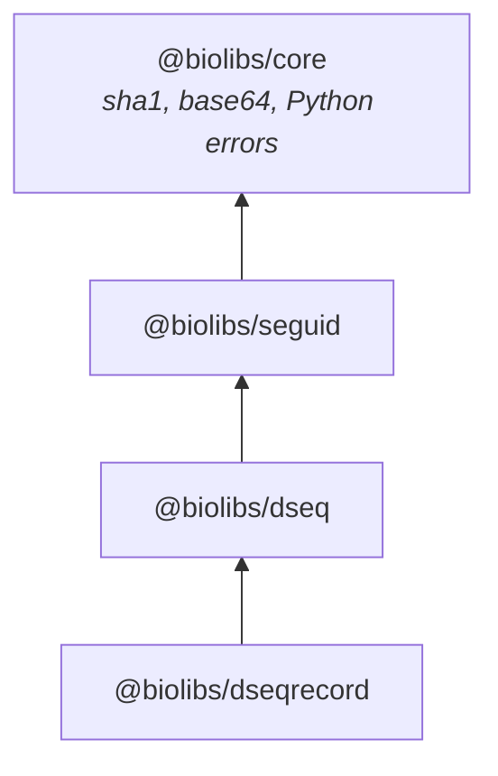

# @biolibs/seguid

SEGUID v2: checksums that identify a sequence rather than naming it. Two records of the same plasmid
written from different origins, by different tools, get the same answer. A port of the
[seguid](https://github.com/seguid/seguid-python) package, which `pydna` uses to identify a construct.

- **Five checksums** — `seguid`, `lsseguid`, `csseguid`, `ldseguid`, `cdseguid`: one strand or two,
  linear or circular
- **Origin-free for circles** — the sequence is read from wherever makes it lexicographically smallest,
  so rotating a plasmid does not change its checksum
- **Strand-order-free for duplexes** — the smaller strand leads, so which one you call watson does not
  matter either
- **Alphabets as pairing tables** — `"GC,AT"` is plain DNA; `{DNA}`, `{RNA}`, `{protein}` and the
  extended forms are named
- **The rotation machinery is exported** — `rotate`, `rotateToMin`, `minRotation` (Booth's algorithm)
- **One dependency**, `@biolibs/core`, for SHA-1 and base64

## What is verified

A generator drives the real `seguid` package and records every call — the checksum, and the exception
type *and* message where it raises. The tests replay those recordings.

| Upstream module | Items at parity | Checklist |
|---|---|---|
| `seguid` | **5 / 5** | [seguid.md](../../docs/parity-seguid/seguid.md) |
| `seguid._chksum` | **5 / 5** | [seguid._chksum.md](../../docs/parity-seguid/seguid._chksum.md) |
| `seguid._tables` | **7 / 7** | [seguid._tables.md](../../docs/parity-seguid/seguid._tables.md) |
| `seguid._manip` | **4 / 4** | [seguid._manip.md](../../docs/parity-seguid/seguid._manip.md) |
| `seguid._asserts` | **2 / 2** | [seguid._asserts.md](../../docs/parity-seguid/seguid._asserts.md) |

**279 tests over 279 recorded cases** against seguid 0.2.1 — 253 checksums (45 `seguid`, 51 `lsseguid`,
51 `csseguid`, 53 `ldseguid`, 53 `cdseguid`, of which 66 are refusals), 15 rotation cases and 11
alphabet tables.

Where the claim stops, and there is one place:

- **The unknown-symbol message lists the symbols in a Python `set`'s iteration order**, which depends on
  the interpreter's hash seed and is not reproducible from one run to the next. There is no order there
  to port, so this **sorts** them — `'a c g t'` — and every golden case that records the message sorts
  them the same way. The type and the rest of the wording are exact.

Everything else is exact, including the oddities: `minRotation("AA")` returns `-1`, and
`tableFactory("GC,ATT")` raises a bare `AssertionError` with no message while `tableFactory("ATT")`
raises a `ValueError` that names the entry.

## Install

```bash
npm install @biolibs/seguid
```

- ESM only, Node 20 or later, TypeScript declarations included



## The checksums

Each is the base64 of a SHA-1 over some rendering of the molecule, with the `=` padding dropped — 27
characters. What makes the five differ is only what goes into the hash.

```ts
import { cdseguid, csseguid, ldseguid, lsseguid, seguid } from "@biolibs/seguid";

seguid("GATTACA");                        // "seguid=tp2jzeCM2e3W4yxtrrx09CMKa/8"  — standard base64
lsseguid("GATTACA");                      // "lsseguid=tp2jzeCM2e3W4yxtrrx09CMKa_8"  — URL-safe, linear
csseguid("GATTACA");                      // "csseguid=mtrvbtuwr6_MoBxvtm4BEpv-jKQ"  — circular
ldseguid("GATTACA", "TGTAATC");           // "ldseguid=zDq4dp6G3AIsldhPDDL8S5A0BKk"  — linear duplex
cdseguid("GAATTCGG", "CCGAATTC");         // "cdseguid=ngaZNIVvW0vWnz91kMnoJrFcWiI"  — circular duplex
```

`seguid` is the original SEGUID, and the only one using the standard base64 alphabet — so its output can
contain `/` and `+`, which the other four replace with `_` and `-` to make the checksum safe in a URL or
a file name.

The second argument is the alphabet and the third the form:

```ts
lsseguid("GATTACA", "{DNA}", "short");    // "tp2jze"  — the first six characters, unprefixed
lsseguid("GATTACA", "{DNA}", "both");     // ["tp2jze", "lsseguid=tp2jzeCM2e3W4yxtrrx09CMKa_8"]
lsseguid("GAUUACA", "{RNA}");             // "lsseguid=NTXSpBPMp73fAKo85eV-5P1lO2k"
seguid("MKKLYS", "{protein}");            // "seguid=/CAYn4t4bBIoFA5oQ/4oYypGsTs"
```

`"both"` returns a **tuple**, so the return type is `string | [string, string]`; with a literal form
TypeScript still cannot narrow it, and a `as string` is the usual answer.

### What the circular variants buy you

The point is that the origin stops mattering. A plasmid cut and re-joined elsewhere is the same molecule,
and `csseguid` says so where `lsseguid` does not:

```ts
import { csseguid, lsseguid, rotate } from "@biolibs/seguid";

const origins = [0, 1, 2, 3, 4, 5, 6, 7].map((n) => csseguid(rotate("GAATTCGG", n)));
new Set(origins).size;                    // 1 — every origin gives the same checksum
origins[0];                               // "csseguid=Mav3XgQmACy3tBbLLGSH2fk3RpI"

lsseguid("GAATTCGG");                     // "lsseguid=OJMdfIfDLRdIZV5N1sxYn0ZtR-Y"
lsseguid(rotate("GAATTCGG", 3));          // "lsseguid=WuDFWTNb0m_IDRCMvM5UWusPj_g" — a different molecule
```

`cdseguid` is free of the origin *and* of which strand is named first:

```ts
import { cdseguid, rotate } from "@biolibs/seguid";

cdseguid("GAATTCGG", "CCGAATTC");                       // "cdseguid=ngaZNIVvW0vWnz91kMnoJrFcWiI"
cdseguid("CCGAATTC", "GAATTCGG");                       // the same — the smaller strand leads
cdseguid(rotate("GAATTCGG", 3), rotate("CCGAATTC", -3)); // the same — rotated in step
```

The crick strand runs in the opposite direction, so rotating a duplex means rotating one strand by `+n`
and the other by `-n`. Rotating them the same way makes a *different* molecule, and no error says so.

## Alphabets

An alphabet is a comma-separated list of entries. A two-letter entry is a pair, both ways round; a
one-letter entry is a symbol that pairs with nothing, which is what makes an alphabet single-stranded and
so unusable with `ldseguid` and `cdseguid`.

```ts
import { ALPHABETS, tableFactory } from "@biolibs/seguid";

Object.keys(ALPHABETS);
// ["{DNA}", "{RNA}", "{DNA-extended}", "{RNA-extended}", "{protein}", "{protein-extended}"]
ALPHABETS["{DNA}"];                       // "GC,AT"

[...tableFactory("GC,AT")];               // [["G", "C"], ["C", "G"], ["A", "T"], ["T", "A"]]
[...tableFactory("{protein}")].slice(0, 3);  // [["A", ""], ["C", ""], ["D", ""]] — pairs with nothing
```

The names are spelled out before the list is read, so they compose: `"{DNA-extended},AU"` is the extended
DNA pairs *and* A with U.

```ts
import { tableFactory } from "@biolibs/seguid";

[...tableFactory("{DNA-extended},AU")].length;   // 16
```

Two refusals, both as the Python has them:

```ts
import { tableFactory } from "@biolibs/seguid";

tableFactory("GC,ATT");   // AssertionError — entries of different lengths, and no message
tableFactory("ATT");      // ValueError: Unknown alphabet specification: ATT
```

## The checks

The two assertions the checksums use are exported, for checking a duplex before you build one.

```ts
import { assertComplementary, assertInAlphabet, tableFactory } from "@biolibs/seguid";

assertInAlphabet("GATTACA", tableFactory("{DNA}").keys());    // returns nothing
assertInAlphabet("gattaca", tableFactory("{DNA}").keys());
// ValueError: Detected symbols 'a c g t' not in the 'alphabet'

assertComplementary("GATTACA", "TGTAATC", "{DNA}");           // returns nothing
assertComplementary("GATTACA", "TGTAAT-", "{DNA}");           // a gap pairs with a gap
assertComplementary("GATTACA", "TGTAATG", "{DNA}");
// ValueError: Non-complementary basepair (G,G) detected at position 1
assertComplementary("GATTACA", "TGTAAT", "{DNA}");            // AssertionError — different lengths
assertComplementary("MKK", "KKM", "{protein}");
// AssertionError: Was a single-stranded alphabet used by mistake?
```

Positions are **1-based**, and the crick strand is read in reverse, so position 1 is the watson strand's
first base against the crick strand's last.

## Rotation

The circular checksums are built on these, and they are useful on their own for putting two records of
the same plasmid into the same frame.

```ts
import { minRotation, rotate, rotateToMin } from "@biolibs/seguid";

rotate("GATTACA", 3);         // "TACAGAT"
rotate("GATTACA", -1);        // "AGATTAC" — negative counts back from the end
rotate("GATTACA", 10);        // "TACAGAT" — the amount is taken modulo the length

minRotation("TAAA");          // 1
rotateToMin("TAAA");          // "AAAT"
rotateToMin("CCGAATTC");      // "AATTCCCG"
```

`minRotation` is Booth's algorithm in the form the reference implements it, including its answer for a
fully repeated sequence:

```ts
import { minRotation, rotate } from "@biolibs/seguid";

minRotation("AA");            // -1, not 0 — the repetition shortcut returns a negative offset
rotate("AA", -1);             // "AA" — which rotate takes modulo the length, so no checksum is affected
```

## Refusals

| What | Type | Message |
|---|---|---|
| An empty sequence | `AssertionError` | `A sequence must not be empty` |
| An empty watson strand | `AssertionError` | `Watson sequence must not be empty` |
| Strands of different lengths | `AssertionError` | *(none)* |
| A single-stranded alphabet for a duplex | `AssertionError` | `Was a single-stranded alphabet used by mistake?` |
| A symbol outside the alphabet | `ValueError` | `Detected symbols 'X' not in the 'alphabet'` |
| A pair that cannot exist | `ValueError` | `Non-complementary basepair (G,G) detected at position 1` |
| An unreadable alphabet entry | `ValueError` | `Unknown alphabet specification: ATT` |

```ts
import { AssertionError, ValueError } from "@biolibs/core";
import { ldseguid, seguid } from "@biolibs/seguid";

try { seguid(""); } catch (e) { (e as AssertionError).message; }    // "A sequence must not be empty"
try { seguid("GATTACA", "{RNA}"); } catch (e) {
  (e as ValueError).message;                                        // "Detected symbols 'T' not in the 'alphabet'"
}
try { ldseguid("", ""); } catch (e) {
  (e as AssertionError).message;                                    // "Watson sequence must not be empty"
}
```

Where the Python raises through an `assert` this throws `AssertionError`; where it raises a `ValueError`,
so does this. Both come from `@biolibs/core`.

## With pydna's sequences

[`@biolibs/dseq`](../dseq) is this package's user, and shows what the variants are for in practice:
`seguidOf` (pydna's `Dseq.seguid`) takes a circle's checksum with `cdseguid` and a linear molecule's with
`ldseguid`, writing the overhangs out as gaps so that a sticky end is part of what is identified.

```ts
import { Dseq, seguidOf } from "@biolibs/dseq";

seguidOf(new Dseq("GATTACA"));                    // "ldseguid=zDq4dp6G3AIsldhPDDL8S5A0BKk"
seguidOf(new Dseq("GAATTCGG").looped());          // "cdseguid=ngaZNIVvW0vWnz91kMnoJrFcWiI"
```

## Testing

```bash
npm test                 # the whole workspace
npx vitest run packages/seguid/test
```

| File | What it checks |
|---|---|
| `test/seguid.test.ts` | the 279 recorded cases from seguid 0.2.1 |
| `test/readme.test.ts` | every code block in this file |

Coverage from this package's own tests — `npx vitest run --coverage packages/seguid/test`:

| | |
|---|---|
| Statements | **98.58%** (139 / 141) |
| Functions | **100.00%** (14 / 14) |
| Branches | **95.12%** (78 / 82) |

## Things to know

- **`seguid` uses standard base64**, the other four use the URL-safe alphabet. Only the first can contain
  `/` or `+`.
- **A duplex rotates in opposite directions.** `rotate(watson, n)` goes with `rotate(crick, -n)`; getting
  that wrong makes a different molecule and raises nothing.
- **`"both"` returns a tuple**, so the return type is `string | [string, string]` whatever form you pass.
- **`minRotation("AA")` is `-1`.** It is the reference's behaviour, `rotate` absorbs it, and no checksum
  is affected.
- **A single-letter entry makes an alphabet single-stranded**, and `ldseguid`/`cdseguid` then refuse it —
  which is why `{protein}` cannot be used for a duplex.
- **Unknown symbols are listed sorted**, not in Python's unreproducible set order. It is the one place
  this port chooses the wording.

## License

MIT — see [LICENSE](LICENSE).
