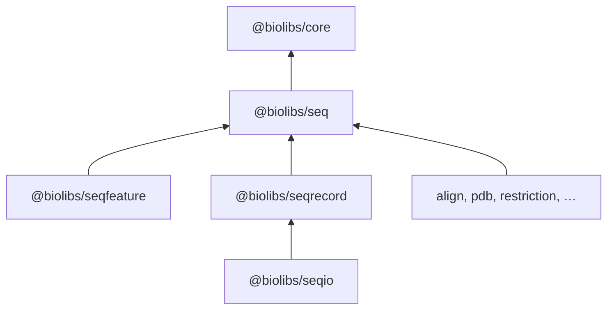
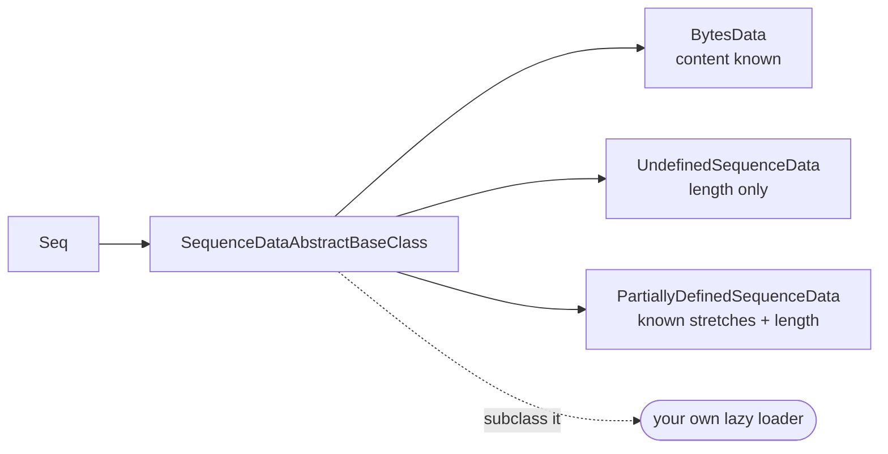

# @biolibs/seq

Biological sequences, as Biopython's `Bio.Seq` has them: the same methods, the same answers, the same
error messages.

- **`Seq` and `MutableSeq`** — immutable and mutable, sharing ~90 methods
- **Translation** — all 27 NCBI genetic codes, by id or by name, with CDS checking and ambiguity
  resolution
- **`complement`, `transcribe`, `reverseComplement`** and their RNA forms, as methods or module functions
- **Undefined and partially defined content** — a sequence of known length whose bases are not all known,
  as GenBank `CONTIG` records have, with the structure surviving slicing and concatenation
- **`CodonTable`** — every genetic code in six flavours, keyed by NCBI id and by name
- **`IUPACData`** — all 32 constants: alphabets, ambiguity codes, molecular weights
- **Pluggable content** — subclass `SequenceDataAbstractBaseClass` to load bases lazily
- One dependency: `@biolibs/core`

## What is verified

A generator drives real Biopython and records what it does — the return value, the exception type *and*
message, the warnings, and the object's state afterwards. The tests replay those recordings; a case passes
only if all of that matches.

| Upstream module | Items at parity | Checklist |
|---|---|---|
| `Bio.Seq` | **151 / 151** | [Bio.Seq.md](../../docs/parity/Bio.Seq.md) |
| `Bio.Data.CodonTable` | **36 / 36** | [Bio.Data.CodonTable.md](../../docs/parity/Bio.Data.CodonTable.md) |
| `Bio.Data.IUPACData` | **32 / 32** | [Bio.Data.IUPACData-constants.md](../../docs/parity/Bio.Data.IUPACData-constants.md) |

**23,556 recorded calls** against Biopython 1.88, over 94 methods and the module functions. 5,089 of them
record an *exception* and 506 record a warning, because a port that returns the right answer and the wrong
error is not a port. Every one of the 27 genetic codes is dumped whole in all six flavours and compared
entry by entry, with 865 further cases for the ambiguity functions.

Nothing in these three modules is unverified. Where the port deliberately differs:

- **`hashCode()` is stable but not CPython's number.** Python's `hash()` is salted per process, so the
  value is not reproducible anyway; what is checked is that equal sequences hash equally.
- **Wrong argument *types* throw `TypeError`** where Python sometimes raises `AttributeError`. A type
  error is a programming mistake, not a data problem, and the recorded cases say which is which.
- **`new Seq({0: 5}, n)` throws.** Python's `bytes(5)` quietly produces five NUL bytes; being handed an
  integer where content was meant is a bug worth reporting.
- **A missing registry entry is `undefined`.** The registries are JavaScript `Map`s, so
  `unambiguousDnaById.get(7)` — there is no table 7 — gives `undefined` rather than Python's `KeyError`.
  The table objects themselves raise `KeyError` for a missing *codon*, as Python does.

## Install

```bash
npm install @biolibs/seq
```

- ESM only, Node 20 or later, TypeScript declarations included



### Naming: Python to TypeScript

Method names are the camelCase of Biopython's, and arguments keep Python's positional order. Operators
become named methods:

| Python | TypeScript |
|---|---|
| `len(s)` | `s.length` |
| `s[i]` | `s.at(i)` — negative indices work |
| `s[a:b:c]` | `s.slice(a, b, c)`, or `s.get({ start, stop, step })` |
| `s[i] = "T"`, `del s[i]` | `s.set(i, "T")`, `s.delete(i)` |
| `a + b`, `"x" + a` | `a.add(b)`, `a.radd("x")` |
| `a * n`, `n * a`, `a *= n` | `a.mul(n)`, `a.rmul(n)`, `a.imul(n)` |
| `a == b`, `<`, `<=`, `>`, `>=` | `a.equals(b)`, `a.lt(b)`, `le`, `gt`, `ge` |
| `x in s` | `s.contains(x)` |
| `str(s)`, `bytes(s)`, `repr(s)` | `s.toString()`, `s.toBytes()`, `s.repr()` |
| `for c in s` | `for (const c of s)` |

## API

### `Seq`

Immutable, hashable, and backed by bytes rather than a string.

```ts
import { Seq } from "@biolibs/seq";

const s = new Seq("ATGGCCATTGTAATGGGCCGC");

console.log(s.length);                   // 21
console.log(s.toString());               // "ATGGCCATTGTAATGGGCCGC"
console.log(s.repr());                   // "Seq('ATGGCCATTGTAATGGGCCGC')"
console.log(String(s.at(0)));            // "A"
console.log(s.slice(0, 3).toString());   // "ATG"
console.log([...new Seq("ACG")]);        // ["A", "C", "G"]
```

Searching — `count`, `countOverlap`, `find`, `rfind`, `index`, `rindex`, `contains`, `startswith`,
`endswith`, and `search` for several subsequences at once:

```ts
const s = new Seq("ATGGCCATTGTAATGGGCCGC");

console.log(s.count("G"));          // 7
console.log(s.countOverlap("GG"));  // 3   — count("GG") gives 2: it does not overlap
console.log(s.find("ATT"));         // 6   — −1 when absent; index() throws instead
console.log(s.contains("GCC"));     // true

console.log([...new Seq("ACGTACGT").search(["ACG", "GT"])]);
// [[0, "ACG"], [2, "GT"], [4, "ACG"], [6, "GT"]]
```

Editing returns a new sequence — `strip`, `lstrip`, `rstrip`, `removeprefix`, `removesuffix`, `upper`,
`lower`, `replace`, `join`, `split`, `rsplit`:

```ts
console.log(new Seq("acgt").upper().toString());            // "ACGT"
console.log(new Seq(" AC ").strip().toString());            // "AC"
console.log(new Seq("AACGTT").replace("A", "T").toString()); // "TTCGTT"
console.log(new Seq("A-C-G").split("-").map(String));       // ["A", "C", "G"]
console.log(new Seq("-").join([new Seq("AC"), new Seq("GT")]).toString()); // "AC-GT"
```

Arithmetic and comparison, named because JavaScript cannot overload them:

```ts
console.log(new Seq("ATG").add(new Seq("TTT")).toString());  // "ATGTTT"
console.log(new Seq("AT").mul(3).toString());                // "ATATAT"
console.log(new Seq("AT").radd("GG").toString());            // "GGAT"
console.log(new Seq("ACGT").equals(new Seq("ACGT")));        // true
console.log(new Seq("ACGT").equals("ACGT"));                 // true  — a string compares equal
console.log(new Seq("A").lt(new Seq("C")));                  // true
```

### Biology

```ts
import { Seq } from "@biolibs/seq";

const s = new Seq("ATGGCCATTGTAATGGGCCGC");

console.log(s.complement().toString());         // "TACCGGTAACATTACCCGGCG"
console.log(s.reverseComplement().toString());  // "GCGGCCCATTACAATGGCCAT"
console.log(s.transcribe().toString());         // "AUGGCCAUUGUAAUGGGCCGC"
console.log(s.translate().toString());          // "MAIVMGR"
```

Also `complementRna`, `reverseComplementRna` and `backTranscribe`. Each of these, like the editing
methods, takes an `inplace` flag: on a `MutableSeq` it edits and returns the same object, and on a `Seq`
it throws `TypeError("Sequence is immutable")`.

### `translate`

```ts
import { Seq } from "@biolibs/seq";

const cds = new Seq("ATGGCCATTGTAATGGGCCGCTGAAAG");

console.log(cds.translate().toString());                        // "MAIVMGR*K"
console.log(cds.translate(2).toString());                       // "MAIVMGRWK"  — by NCBI id
console.log(cds.translate("Vertebrate Mitochondrial").toString()); // "MAIVMGRWK"  — or by name
console.log(cds.translate({ toStop: true }).toString());        // "MAIVMGR"
console.log(cds.translate({ stopSymbol: "@" }).toString());     // "MAIVMGR@K"
```

Positional arguments follow Python's order — `translate(table, stopSymbol, toStop, cds, gap)` — and a
single options object is accepted instead.

Ambiguous codons resolve to the most specific amino acid that covers every possibility, as Biopython's do:

```ts
console.log(new Seq("TTNCTNGARRAY").translate().toString());  // "XLEB"
console.log(new Seq("ATG---GCC").translate().toString());     // "M-A"   — a gap codon stays a gap
```

A trailing partial codon warns rather than failing, and `cds: true` turns the frame rules into errors:

```ts
import { captureWarnings } from "@biolibs/core";
import { Seq } from "@biolibs/seq";

const { result, warnings } = captureWarnings(() =>
  new Seq("ATGGCCATTGTAATGGGCCGCTGAAA").translate().toString());

console.log(result);                  // "MAIVMGR*"
console.log(warnings[0]!.message);
// Partial codon, len(sequence) not a multiple of three. Explicitly trim the sequence or add
// trailing N before translation. This may become an error in future.

new Seq("ATGGCCATTGT").translate({ cds: true });
// CodonTable.TranslationError: Sequence length 11 is not a multiple of three
```

### `MutableSeq`

Everything `Seq` has, plus in-place editing: `set`, `delete`, `append`, `insert`, `pop`, `remove`,
`reverse`, `extend`.

```ts
import { MutableSeq, Seq } from "@biolibs/seq";

const m = new MutableSeq("ACGT");
m.set(0, "T");          // ACGT -> TCGT
m.append("A");          // -> TCGTA
m.insert(0, "G");       // -> GTCGTA
m.reverse();            // -> ATGCTG

console.log(m.toString());   // "ATGCTG"
console.log(m.repr());       // "MutableSeq('ATGCTG')"

// A slice assignment, which is `m[0:4] = "TTTT"` in Python.
const n = new MutableSeq("ACGTACGT");
n.set({ start: 0, stop: 4 }, "TTTT");
console.log(n.toString());   // "TTTTACGT"

// remove() takes out the first occurrence; pop() returns and removes the last.
const q = new MutableSeq("ACGTACGT");
q.remove("A");
console.log(q.toString());         // "CGTACGT"
console.log(String(q.pop()));      // "T"
console.log(q.toString());         // "CGTACG"

// Either can be built from the other.
console.log(new Seq(new MutableSeq("ACGT")).toString());        // "ACGT"
console.log(new MutableSeq(new Seq("ACGT")).toString());        // "ACGT"
```

`imul` is Python's `*=`, which for a sequence returns a *new* object rather than mutating — Biopython does
the same, so it is reproduced:

```ts
const m = new MutableSeq("AC");
const r = m.imul(2);
console.log(m.toString(), r.toString(), r === m);  // "AC" "ACAC" false
```

### Undefined and partially defined content

A GenBank `CONTIG` record states a sequence's length without giving its bases. Biopython models that, and
so does this: the length is real, the content raises when you ask for it, and the structure survives
slicing, concatenation, complementing and `replace`.

```ts
import { Seq } from "@biolibs/seq";

const u = new Seq(null, 100);
console.log(u.length);                    // 100
console.log(u.defined);                   // false
console.log(u.definedRanges);             // []
u.toString();                             // UndefinedSequenceError: Sequence content is undefined

// Reverse-complementing an unknown sequence is still 100 unknown bases.
console.log(u.reverseComplement().length);  // 100

// Partly known content: a map from offset to bases, plus the total length.
const p = new Seq(new Map([[0, "ACGT"], [10, "TT"]]), 12);
console.log(p.length);                    // 12
console.log(p.definedRanges);             // [[0, 4], [10, 12]]
console.log(p.slice(0, 4).toString());    // "ACGT"   — a known stretch reads normally
console.log(p.slice(2, 12).repr());       // "Seq({0: 'GT', 8: 'TT'}, length=10)"
p.slice(4, 8).toString();                 // UndefinedSequenceError
```



### Module functions

`translate`, `transcribe`, `backTranscribe`, `complement`, `complementRna`, `reverseComplement`,
`reverseComplementRna`. A string in gives a string out; a `Seq` gives a `Seq`.

```ts
import { backTranscribe, complement, reverseComplement, transcribe, translate } from "@biolibs/seq";
import { Seq } from "@biolibs/seq";

console.log(transcribe("ACGT"));                        // "ACGU"
console.log(backTranscribe("ACGU"));                    // "ACGT"
console.log(complement("ACGT"));                        // "TGCA"
console.log(reverseComplement("ATGC"));                 // "GCAT"
console.log(reverseComplement(new Seq("ATGC")).toString()); // "GCAT"
console.log(translate("ATGGCC"));                       // "MA"

reverseComplement("ATGC", true);
// TypeError: strings are immutable
```

### `CodonTable`

A namespace holding all 27 NCBI genetic codes, each in six flavours, keyed both by id and by name
(45 names, counting the `SGC*` aliases).

| Registry | What the codons are |
|---|---|
| `unambiguousDnaById` / `ByName` | DNA |
| `unambiguousRnaById` / `ByName` | RNA |
| `genericById` / `ByName` | both T and U |
| `ambiguousDnaById` / `ByName` | DNA, resolving IUPAC ambiguity |
| `ambiguousRnaById` / `ByName` | RNA, resolving IUPAC ambiguity |
| `ambiguousGenericById` / `ByName` | what `translate` uses |

```ts
import { CodonTable, IUPACData } from "@biolibs/seq";

const t = CodonTable.unambiguousDnaByName.get("Standard")!;

console.log(t.id);                        // 1
console.log(t.names);                     // ["Standard", "SGC0"]
console.log(t.forwardTable.get("ATG"));   // "M"
console.log(t.startCodons);               // ["TTG", "CTG", "ATG"]
console.log(t.stopCodons);                // ["TAA", "TAG", "TGA"]
console.log(t.nucleotideAlphabet);        // "GATC"
console.log(t.proteinAlphabet);           // "ACDEFGHIKLMNPQRSTVWY"

// backTable maps each amino acid to one codon, with null for the default stop.
console.log(t.backTable.get("M"));        // "ATG"
console.log(t.backTable.get(null));       // "TAA"

// forwardTable is a Python mapping, so a missing codon raises rather than returning undefined.
t.forwardTable.getItem("TAA");            // KeyError: TAA

console.log(CodonTable.unambiguousDnaById.get(2)!.names);
// ["Vertebrate Mitochondrial", "SGC1"]
console.log(CodonTable.unambiguousDnaById.size);   // 27

// toString() is the 4×4×4 grid Biopython prints.
console.log(t.toString().split("\n")[0]);          // "Table 1 Standard, SGC0"
```

Ambiguity resolution is available on its own, and `registerNcbiTable` adds a code of your own:

```ts
import { CodonTable, IUPACData } from "@biolibs/seq";

const t = CodonTable.unambiguousDnaById.get(1)!;

console.log(CodonTable.listPossibleProteins("TTR", t.forwardTable, IUPACData.ambiguousDnaValues));
// ["L"]
console.log(CodonTable.listAmbiguousCodons(["TAA", "TAG"], IUPACData.ambiguousDnaValues));
// ["TAA", "TAG", "TAR"]
console.log(CodonTable.ambiguousDnaById.get(1)!.forwardTable.get("TTR"));   // "L"
```

Also `standardDnaTable`, `standardRnaTable`, `makeBackTable`, `AmbiguousForwardTable`,
`AmbiguousCodonTable`, and `TranslationError`.

### `IUPACData`

All 32 constants from `Bio.Data.IUPACData`, camelCased, generated from Biopython rather than typed by
hand.

```ts
import { IUPACData } from "@biolibs/seq";

console.log(IUPACData.unambiguousDnaLetters);        // "GATC"
console.log(IUPACData.ambiguousDnaLetters);          // "GATCRYWSMKHBVDN"
console.log(IUPACData.ambiguousDnaValues.R);         // "AG"
console.log(IUPACData.ambiguousDnaComplement.R);     // "Y"
console.log(IUPACData.proteinLetters1to3.A);         // "Ala"
console.log(IUPACData.monoisotopicProteinWeights.A); // 89.047678
```

Also the RNA and extended-protein alphabets, `proteinLetters3to1`, `atomWeights`, and the `*WeightRanges`
and average-weight tables.

### `SequenceDataAbstractBaseClass`

The content provider behind every sequence. Subclass it to load bases on demand — from a file handle, a
remote store, a database — by implementing `length`, `getItem(i)` and `getSlice(slice)`; every other
method derives from those three. `BytesData`, `UndefinedSequenceData` and `PartiallyDefinedSequenceData`
are the three built in.

## Testing

```bash
npm test                 # the whole workspace
npx vitest run packages/seq/test
```

**355 tests in 4 files**, replaying 24,400-odd recorded calls:

| File | What it checks |
|---|---|
| `test/golden.test.ts` | 23,556 recorded calls: 94 methods and the module functions, with results, exceptions, warnings and post-mutation state |
| `test/codon-table.golden.test.ts` | every genetic code dumped whole in six flavours, the 32 IUPAC constants, 865 ambiguity cases, 6 custom tables |
| `test/api.test.ts` | the TypeScript-only surface: the options-object form of `translate`, type narrowing, custom content providers |
| `test/readme.test.ts` | every code block in this file |

Coverage from this package's own tests — `npx vitest run --coverage packages/seq/test`:

| | |
|---|---|
| Statements | **99.64%** (4,652 / 4,669) |
| Functions | **99.22%** (253 / 255) |
| Branches | **96.74%** (1,038 / 1,073) |

The figure excludes the rest of the suite deliberately: whole-suite coverage is borrowed from callers and
disappears when they change. What is left uncovered here is almost all of that kind — the branches that
fire only when a `SeqRecord` is handed to a module function, which `@biolibs/seqrecord` exercises because
this package does not depend on it — plus the `NotImplemented` fallbacks for adding undefined content, and
the `?` a codon with no amino acid prints in a table grid.

## Things to know

- **A `Seq` holds bytes, not a string.** `new Seq("é")` throws `ValueError: 'ascii' codec can't encode
  character '\xe9' in position 0: ordinal not in range(128)` — Biopython's own message, for Biopython's
  own reason.
- **`at()` throws, `slice()` clamps.** `new Seq("ACGT").at(99)` raises `IndexError: index out of range`;
  slicing past the end gives a shorter sequence, as Python does.
- **`repr()` elides.** Over 60 bases it prints the first 54 and last 3, exactly where Biopython does.
- **`split` and `join` return `Seq` objects**, not strings, matching Biopython — so `.map(String)` is
  usually what you want for display.
- **`count` does not overlap; `countOverlap` does.** `"GG"` in `"GGG"` is 1 and 2 respectively.
- **The `inplace` flag is the Python API, not a performance hint.** On a `Seq` it always throws.
- **`Seq` is recognised by `SeqRecord` through a brand symbol**, not an import, so there is no cycle
  between the packages and no need to install `@biolibs/seqrecord` to use this one.

## License

MIT — see [LICENSE](LICENSE).
