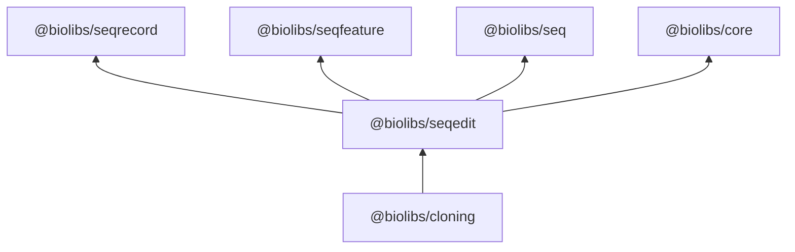

# @biolibs/seqedit

Edit a `SeqRecord` and keep its features true. Biopython can slice a record and add records together, but
both are lossy for an editor: `record[a:b]` keeps only the features wholly inside the slice and drops the
rest, and there is no operation at all for "replace these bases and move the annotations". This supplies
that.

- **`applyEdit`, `replaceBases`, `insertBases`, `deleteBases`, `applyEdits`** — change the bases, and
  every location moves, stretches or is clipped to match
- **Clip or drop** — a feature the edit cuts through survives as the part that remains (`"clip"`, the
  default), or is removed as Biopython's slicing removes it (`"drop"`)
- **`extractRegion`** — cut a piece out, **across a circular origin** if you like, which Biopython's
  slicing cannot express at all
- **`rotateCircular`, `reverseComplementRecord`** — move a plasmid's origin, or turn a record over
- **Fuzziness survives** — a boundary the edit only shifted keeps its class, so a `BeforePosition` stays
  one; only a boundary the edit *created* becomes exact
- **Nothing is edited in place**, and positions are 0-based half-open spans, as in `SimpleLocation`
- **The location arithmetic is exported on its own** — `editLocation`, `clipLocation`, `shiftLocation`,
  `mapPosition`, `touches`

## What is verified

This is not a port of anything, so there is no parity checklist. What there is instead:

- **62 recorded cases against Biopython 1.88** (`packages/seqedit/test/golden/seqedit.json`, built by
  `reference/golden/gen_seqedit_cases.py`) at the three places the behaviour overlaps:

  | Biopython | this package | Cases |
  |---|---|---|
  | `location + offset` | `shiftLocation(location, offset)` | 32 |
  | `record[a:b]` | `extractRegion(record, a, b, { edgeFeatures: "drop" })` | 26 |
  | `record.reverse_complement(...)` | `reverseComplementRecord(record)` | 4 |

- **90 unit tests** over the behaviour Biopython has no counterpart for — clipping, multiple edits,
  wrapping a circular origin, per-letter annotations, every refusal.
- **One deliberate divergence, recorded in the golden file and asserted**: a feature with **no location**
  makes Biopython raise `AttributeError` (it reads `location.ref` while slicing and `location.flip` while
  reverse-complementing); here it survives untouched, there being nothing in it to move. The test checks
  that Biopython raised *and* that this port did not, so the divergence cannot quietly vanish — and the
  golden test also fails if any *other* case starts diverging, so it cannot quietly spread.

Where the claim stops:

- **Clipping has nothing to be measured against.** Biopython drops the feature instead, so there is no
  Biopython answer to compare `"clip"` with. It is checked against this package's own stated rules, which
  the next section spells out, not against an authority.
- **A boundary the edit cut through becomes an `ExactPosition`.** That is a choice, not a measured
  agreement: the edit created the boundary, so it is known exactly. Biopython never produces such a
  boundary because it discards the feature first.

## Install

```bash
npm install @biolibs/seqedit
```

- ESM only, Node 20 or later, TypeScript declarations included



## How a location moves

An edit replaces `[start, end)` with new text, so every base boundary maps to a new boundary.
`mapPosition` *is* that mapping, and everything else is built on it.

```ts
import { cutsThrough, lengthChange, mapPosition, touches } from "@biolibs/seqedit";

const edit = { start: 10, end: 20, insert: "AAA" };   // ten bases out, three in

mapPosition(5, edit, "start");    // 5  — before the edit, unmoved
mapPosition(30, edit, "start");   // 23 — after it, moved by the change in length
mapPosition(15, edit, "start");   // 10 — inside it, collapsed to the start
mapPosition(15, edit, "end");     // 13 — inside it, collapsed to the end
lengthChange(edit);               // -7
```

The three rules that follow from it:

- A boundary **before** the edit does not move; one **after** it moves by the change in length.
- A boundary **inside** the removed stretch has no exact answer, so it collapses to one end of the
  replacement. A feature's own start collapses to the start and its end to the end — the `bias` argument —
  so a feature the edit cuts through survives as the part of it that remains.
- A **pure insertion at a boundary leaves the feature alone**: a left edge moves past the new bases, a
  right edge stays before them, so bases inserted where a feature merely abuts fall outside it.

```ts
import { touches } from "@biolibs/seqedit";

// An insertion exactly at a span's edge does not touch it; one strictly inside does.
touches({ start: 10, end: 10, insert: "A" }, 10, 20);   // false
touches({ start: 15, end: 15, insert: "A" }, 10, 20);   // true
// A replacement touches a span wherever the two overlap.
touches({ start: 10, end: 20, insert: "AAA" }, 20, 30); // false — half-open, so they abut
touches({ start: 10, end: 20, insert: "AAA" }, 5, 11);  // true
```

`cutsThrough(position, edit)` is the test for a boundary strictly inside the removed stretch — the one
case where a position is rebuilt rather than shifted.

## Editing a record

```ts
import { Seq } from "@biolibs/seq";
import { SeqFeature, SimpleLocation } from "@biolibs/seqfeature";
import { SeqRecord } from "@biolibs/seqrecord";
import { deleteBases, insertBases, replaceBases } from "@biolibs/seqedit";

const record = new SeqRecord(new Seq("ATGCGTACGTTAGCCATGGCTAGCTAGGCATCGATCGGATCCAAATTTGGGCCCTTTAAAG"), "pTest");
record.features.push(new SeqFeature(new SimpleLocation(5, 25, 1), "gene"));

// A deletion inside the gene shortens it.
String(deleteBases(record, 10, 20).features[0]!.location);     // "[5:15](+)"

// An insertion at the gene's far edge leaves it alone...
String(insertBases(record, 25, "GAATTC").features[0]!.location);  // "[5:25](+)"
// ...and one strictly inside it stretches it.
String(insertBases(record, 15, "GAATTC").features[0]!.location);  // "[5:31](+)"

// A replacement does both: five bases out, two in.
String(replaceBases(record, 5, 10, "AA").features[0]!.location);  // "[5:22](+)"
```

All three are `applyEdit` with the edit spelled out, and nothing is changed in place:

```ts
import { applyEdit } from "@biolibs/seqedit";

const edited = applyEdit(record, { start: 10, end: 20, insert: "GGGG" });
edited.seq!.length;     // 55 — six shorter
record.seq!.length;     // 61 — the original is untouched
```

### Clip or drop

`cutFeatures` chooses what happens to a feature the edit cuts through. `"clip"` keeps the surviving part;
`"drop"` removes the feature, which is what Biopython's slicing does.

```ts
import { deleteBases } from "@biolibs/seqedit";

deleteBases(record, 10, 20).features.length;                          // 1 — clipped to [5:15]
deleteBases(record, 10, 20, { cutFeatures: "drop" }).features.length; // 0 — gone
```

The comparison under `"drop"` is of the bases a location **actually covers**, not its outermost extent,
so a join that loses part of one exon is dropped too.

### Several edits at once

`applyEdits` takes the edits in the coordinates of the **original** record, which is what a caller with a
list of changes to make actually has. They are applied back to front so each one's coordinates are still
valid when its turn comes.

```ts
import { applyEdits } from "@biolibs/seqedit";

const patched = applyEdits(record, [
  { start: 10, end: 20, insert: "" },
  { start: 50, end: 50, insert: "GAATTC" },
]);
String(patched.features[0]!.location);   // "[5:15](+)"
```

Overlapping edits are a `ValueError` rather than a guess, and so are two insertions at the same point:

```ts
import { applyEdits } from "@biolibs/seqedit";

applyEdits(record, [{ start: 10, end: 20, insert: "" }, { start: 15, end: 25, insert: "" }]);
// ValueError: the edits 10..20 and 15..25 overlap
```

## Regions, rotation and reverse complement

`extractRegion` cuts a piece out as a new **linear** record, named after the region unless you give it an
`id`:

```ts
import { extractRegion } from "@biolibs/seqedit";

const region = extractRegion(record, 10, 35);
region.id;                              // "pTest:10-35"
region.annotations.get("topology");     // "linear" — a piece of a circle is a line
String(region.features[0]!.location);   // "[0:15](+)" — the part of the gene inside, re-based
```

`edgeFeatures` is `extractRegion`'s version of `cutFeatures`, and `"drop"` is exactly what the 26 golden
slice cases compare with `record[a:b]`:

```ts
import { extractRegion } from "@biolibs/seqedit";

extractRegion(record, 10, 35, { edgeFeatures: "drop" }).features.length;   // 0
```

### Across a circular origin

A record counts as circular when its `topology` annotation is `"circular"`, which is where GenBank and
EMBL put it and what `@biolibs/seqio` writes. Pass an `end` past the length and the region runs across
the origin — something Biopython's slicing cannot express at all.

```ts
import { Seq } from "@biolibs/seq";
import { SeqRecord } from "@biolibs/seqrecord";
import { extractRegion, isCircular, rotateCircular } from "@biolibs/seqedit";

const plasmid = new SeqRecord(new Seq("ATGCGTACGTTAGCCATGGCTAGCTAGGCATCGATCGGATCCAAATTTGGGCCCTTTAAAG"), "pTest");
plasmid.annotations.set("topology", "circular");
isCircular(plasmid);                                   // true

extractRegion(plasmid, 50, 70).seq!.toString();        // "GCCCTTTAAAGATGCGTACG" — the last 11 bases, then the first 9

const rotated = rotateCircular(plasmid, 50);           // base 50 becomes base 0
rotated.seq!.toString().slice(0, 12);                  // "GCCCTTTAAAGA"
rotated.annotations.get("topology");                   // "circular" — still a circle
rotated.id;                                            // "pTest" — a rotation is the same molecule
```

A feature that ends up spanning the new origin becomes a **two-part join**, which is how GenBank writes
one; the parts come out in the order the new record reads them, so the piece from before the cut comes
first. Two pieces that meet exactly are joined back into one stretch rather than left as a spurious join.

`rotateCircular` refuses a linear record, and `extractRegion` refuses a region that runs off the end of
one:

```ts
import { Seq } from "@biolibs/seq";
import { SeqRecord } from "@biolibs/seqrecord";
import { extractRegion, rotateCircular } from "@biolibs/seqedit";

const linear = new SeqRecord(new Seq("ACGT"), "lin");
rotateCircular(linear, 2);
// ValueError: only a circular record can be rotated; set its topology annotation to 'circular'
extractRegion(linear, 2, 9);
// ValueError: the region 2..9 runs past the end of a linear sequence of 4 bases
```

### Reverse complement

`reverseComplementRecord` is Biopython's `SeqRecord.reverse_complement` — reused, not reimplemented. The
only differences are the two an editor wants: the metadata and the `topology` annotation are kept by
default, where Biopython's own default drops them.

```ts
import { reverseComplementRecord } from "@biolibs/seqedit";

const flipped = reverseComplementRecord(record);
flipped.id;                                    // "pTest"
String(flipped.features[0]!.location);         // "[36:56](-)" — mirrored, strand flipped
reverseComplementRecord(record, false).id;     // "<unknown id>" — Biopython's own defaults
```

Features come back in the new coordinates' order, not the old one.

## Locations on their own

The location arithmetic is exported, so a caller can move a location without having a record.

```ts
import { CompoundLocation, SimpleLocation } from "@biolibs/seqfeature";
import { clipLocation, editLocation, locationExtent, locationLength, shiftLocation, spanOf }
  from "@biolibs/seqedit";

const gene = new SimpleLocation(100, 200, 1);

String(editLocation(gene, { start: 0, end: 50, insert: "" }));      // "[50:150](+)" — shifted
String(editLocation(gene, { start: 150, end: 250, insert: "" }));   // "[100:150](+)" — the half that survives
editLocation(gene, { start: 0, end: 300, insert: "" });             // null — nothing left

String(shiftLocation(gene, 100));                                   // "[200:300](+)" — Biopython's location + 100
String(clipLocation(new SimpleLocation(90, 150, 1), 100, 200));     // "[0:50](+)" — clipped and re-based
spanOf(gene);                                                       // { start: 100, end: 200 }

const join = new CompoundLocation([new SimpleLocation(0, 10), new SimpleLocation(20, 30)]);
locationExtent(join);     // { start: 0, end: 30 } — the outermost bounds, gaps included
locationLength(join);     // 20 — the bases actually covered
```

A `CompoundLocation` carries each part through and keeps its operator; one left with a single part
collapses to a `SimpleLocation`, as Biopython's own location arithmetic does.

### Fuzziness

A boundary the edit only **shifted** keeps its position class and its range — this is what the 32 golden
`shiftLocation` cases measure against `location + offset`. A boundary the edit **cut through** becomes an
`ExactPosition`, because the edit created it.

```ts
import { BeforePosition, SimpleLocation } from "@biolibs/seqfeature";
import { editLocation } from "@biolibs/seqedit";

const fuzzy = new SimpleLocation(new BeforePosition(10), new BeforePosition(50), 1);
String(fuzzy);                                                    // "[<10:<50](+)"
String(editLocation(fuzzy, { start: 0, end: 5, insert: "" }));    // "[<5:<45](+)" — still fuzzy
String(editLocation(fuzzy, { start: 30, end: 60, insert: "" }));  // "[<10:30](+)" — the end is now exact
```

## Metadata and per-letter annotations

The id, name, description, dbxrefs and annotations are carried over as they are: the caller knows whether
an edit invalidates them, and silently dropping an accession would lose more than it saved.

Per-letter annotations cannot simply be carried over, since they are as long as the sequence, so they are
edited in step with it: the stretch covering the removed bases goes, and the inserted bases get `fill` —
a space for a string, `null` for a list, since nothing is known about them.

```ts
import { Seq } from "@biolibs/seq";
import { SeqRecord } from "@biolibs/seqrecord";
import { applyEdit } from "@biolibs/seqedit";

const q = new SeqRecord(new Seq("ACGTACGT"), "q");
q.letterAnnotations.set("phred_quality", [40, 40, 40, 40, 30, 30, 30, 30]);
applyEdit(q, { start: 2, end: 4, insert: "TT" }).letterAnnotations.get("phred_quality");
// [40, 40, null, null, 30, 30, 30, 30]

const s = new SeqRecord(new Seq("ACGTACGT"), "s");
s.letterAnnotations.set("secondary_structure", "HHHHCCCC");
applyEdit(s, { start: 2, end: 4, insert: "TT" }).letterAnnotations.get("secondary_structure");
// "HH  CCCC"
applyEdit(s, { start: 2, end: 4, insert: "TT" }, { fill: "X" }).letterAnnotations.get("secondary_structure");
// "HHXXCCCC"
```

`extractRegion` is the exception to carrying metadata over: it sets `topology` to `"linear"` and names
the record after the region.

## Typed input

`cleanBases` tidies bases as a person pastes them — upper case, with whitespace and position numbers
dropped. Anything that is not a letter, digit or space is **left in**, so a caller can report it rather
than have it silently swallowed.

```ts
import { cleanBases } from "@biolibs/seqedit";

cleanBases("  1 acgt acgt \n 9 acgt");   // "ACGTACGTACGT"
```

`checkEdit` is the validation `applyEdit` runs, available before you commit to an edit:

```ts
import { checkEdit } from "@biolibs/seqedit";

checkEdit({ start: 10, end: 5, insert: "" }, 100);
// ValueError: edit end 5 is before its start 10
checkEdit({ start: 0, end: 200, insert: "" }, 100);
// ValueError: the edit 0..200 is outside a sequence of 100 bases
checkEdit({ start: 0, end: 1, insert: "AC-T" }, 100);
// ValueError: the inserted bases may only be letters, got 'AC-T'
```

`residuesOf(record)` is the sequence as a plain string, `""` for a record without one, and a `ValueError`
for a record whose sequence is undefined (a `SeqIO.index` placeholder, say).

## Testing

```bash
npm test                 # the whole workspace
npx vitest run packages/seqedit/test
```

| File | What it checks |
|---|---|
| `test/golden.test.ts` | the 62 recorded Biopython cases, and that the one divergence is real |
| `test/api.test.ts` | the 90 behaviour tests, including everything Biopython has no answer for |
| `test/readme.test.ts` | every code block in this file |

Coverage from this package's own tests — `npx vitest run --coverage packages/seqedit/test`:

| | |
|---|---|
| Statements | **98.48%** (259 / 263) |
| Functions | **100.00%** (32 / 32) |
| Branches | **95.05%** (173 / 182) |

## Things to know

- **An insertion at a feature's edge does not stretch it.** This is the behaviour most likely to surprise,
  and it is deliberate: `insertBases(record, 25, ...)` next to a feature ending at 25 leaves it at 25.
- **`"clip"` is the default, not Biopython's `"drop"`.** If you want `record[a:b]`'s answer, ask for it.
- **Multiple edits are in the original coordinates**, not applied one after another, so a list of changes
  works without the caller doing the arithmetic. Overlaps raise.
- **A cut boundary loses its fuzziness** and becomes exact; a shifted one keeps it.
- **`extractRegion` always returns a linear record**, even from a circle, and renames it.
- **Circularity lives in the `topology` annotation.** There is no flag to set; `seqedit`, `cloning` and
  `features` all read it from the same place.
- **A feature with no location survives every operation here.** Biopython raises on one instead, and that
  is this package's single measured divergence.

## License

MIT — see [LICENSE](LICENSE).
