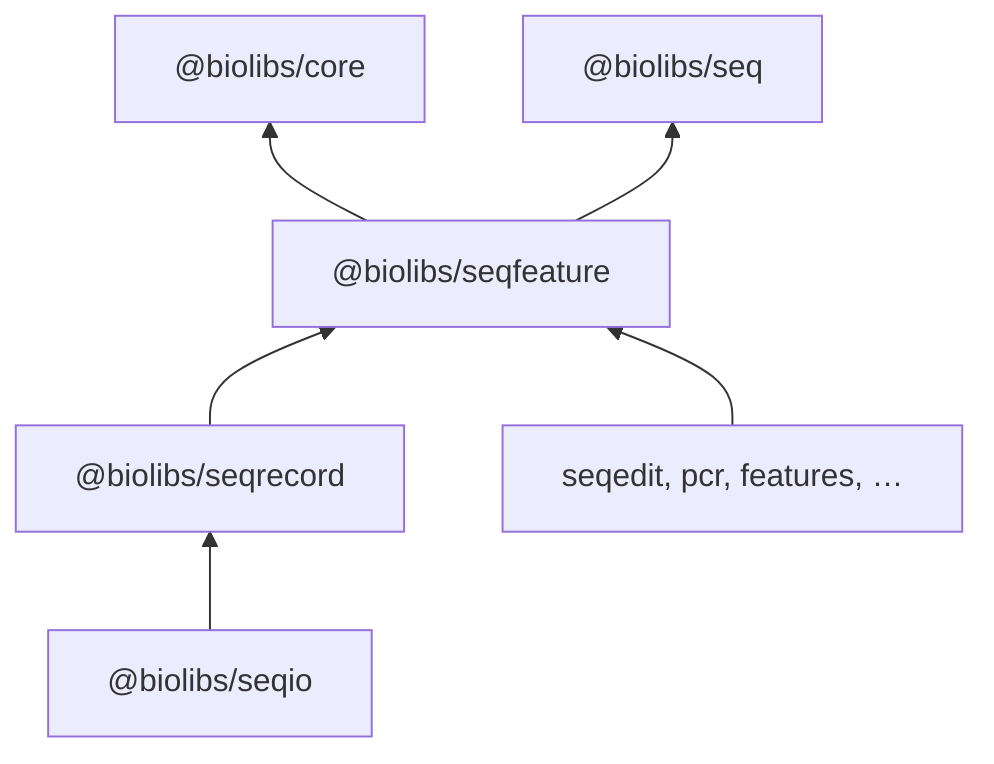

# @biolibs/seqfeature

Where a feature is on a sequence, as Biopython's `Bio.SeqFeature` says it — fuzzy ends, split locations,
strands and all.

- **`SimpleLocation`** — one range, with a strand and an optional reference to another record
- **`CompoundLocation`** — a `join`, `order` or `bond` of several ranges, as a spliced gene needs
- **Eight kinds of position** — exact, uncertain, before, after, within, between, one-of, unknown: the
  fuzziness GenBank files actually contain
- **`Location.fromstring`** — the GenBank/EMBL location grammar, including origin-spanning features on a
  circular sequence
- **The INSDC writers** — the other direction, back to `complement(join(6..10,21..25))`
- **`SeqFeature`** — a location with a type, an id and qualifiers; `extract` and `translate` a parent
  sequence through it
- **`Reference`** — the literature citation of a record
- Coordinates are **zero-based and end-exclusive**, like a JavaScript `slice`; the text form is one-based
  and inclusive, and the parser converts

## What is verified

A generator drives real Biopython and records what it does — the return value, the exception type *and*
message, the warnings, and the object's state afterwards. The tests replay those recordings.

| Upstream module | Items at parity | Checklist |
|---|---|---|
| `Bio.SeqFeature` | **163 / 163** | [Bio.SeqFeature.md](../../docs/parity/Bio.SeqFeature.md) |

**6,060 recorded calls** against Biopython 1.88. **1,291 of them record an exception** and 54 a warning —
a fifth of this package's behaviour *is* its refusals, because a location string from a real file is as
often malformed as not, and a port that fails differently is no use to a parser.

The checklist marks 82 items non-applicable. Every one is `int` boilerplate — `bit_length`, `to_bytes`,
`as_integer_ratio`, `conjugate` — inherited because Biopython's positions subclass Python's `int`. See
*Positions are not numbers* below for what is provided instead.

Nothing else in the module is unverified. Where the port deliberately differs:

- **A position is not a `number`.** It has `valueOf()`, so `<`, `>=`, `Math.min` and `Number(pos)` work,
  but `===` compares object identity — use `pos.equals(other)`, which compares by integer value as Python
  does.
- **`bool(location)` has no equivalent.** In Python a zero-length `SimpleLocation` is falsy; check
  `length` instead. Neither is `hash()`, which Python salts per process anyway.
- **A whole-numbered Python `float` is indistinguishable from an `int`** in JavaScript, so `5.0` and `5`
  cannot be told apart where Biopython would.
- **Wrong argument *types* throw `TypeError`** where Python sometimes raises `AttributeError`. The
  recorded cases say which is which.

## Install

```bash
npm install @biolibs/seqfeature
```

- ESM only, Node 20 or later, TypeScript declarations included



### Naming: Python to TypeScript

| Python | TypeScript |
|---|---|
| `len(loc)`, `len(feature)` | `loc.length`, `feature.length` |
| `value in loc` | `loc.contains(value)` |
| `for i in loc` | `for (const i of loc)` |
| `a + b`, `loc + 3`, `3 + loc`, `loc - 3` | `a.add(b)`, `loc.add(3)`, `loc.radd(3)`, `loc.sub(3)` |
| `a == b` | `a.equals(b)` |
| `str(x)`, `repr(x)` | `x.toString()`, `x.repr()` |
| `int(position)` | `Number(position)` |
| `loc.ref_db` | `loc.refDb` |
| `loc._shift(n)`, `loc._flip(len)` | `loc.shift(n)`, `loc.flip(len)` |
| `feature.qualifiers` (a dict) | `feature.qualifiers` (a `Map`) |

## API

### `SimpleLocation`

`new SimpleLocation(start, end, strand?, ref?, refDb?)`. `start` and `end` are numbers or positions;
`strand` is `1`, `-1`, `0` or `null`.

```ts
import { Seq } from "@biolibs/seq";
import { SimpleLocation } from "@biolibs/seqfeature";

const loc = new SimpleLocation(5, 10, 1);

console.log(loc.toString());    // "[5:10](+)"
console.log(loc.repr());        // "SimpleLocation(ExactPosition(5), ExactPosition(10), strand=1)"
console.log(loc.length);        // 5
console.log(Number(loc.start), Number(loc.end), loc.strand);   // 5 10 1
console.log(loc.parts.length);  // 1   — so a caller can treat any location as a list of parts
console.log(loc.contains(7), loc.contains(10));                // true false  (end-exclusive)
console.log([...loc]);          // [5, 6, 7, 8, 9]
```

`extract` takes the sub-sequence, reverse-complementing it when the strand is `-1`:

```ts
const parent = new Seq("ACGTACGTACGTACGT");

console.log(new SimpleLocation(5, 10, 1).extract(parent).toString());   // "CGTAC"
console.log(new SimpleLocation(5, 10, -1).extract(parent).toString());  // "GTACG"
```

`shift` moves a location along the sequence; `flip` mirrors it onto the other strand of a sequence of the
given length. Adding two locations gives a `CompoundLocation`; adding a number shifts:

```ts
const loc = new SimpleLocation(5, 10, 1);

console.log(loc.shift(3).toString());    // "[8:13](+)"
console.log(loc.flip(20).toString());    // "[10:15](-)"
console.log(loc.add(new SimpleLocation(12, 15, 1)).toString());
// "join{[5:10](+), [12:15](+)}"
console.log(loc.add(3).toString());      // "[8:13](+)"
console.log(loc.equals(new SimpleLocation(5, 10, 1)));   // true
console.log(loc.equals(new SimpleLocation(5, 10, -1)));  // false  — the strand is part of it
```

A `ref` points at another record, and `extract` then needs to be given it:

```ts
const far = new SimpleLocation(5, 10, 1, "AL123456.1");
console.log(far.toString());   // "AL123456.1[5:10](+)"
console.log(far.ref);          // "AL123456.1"

far.extract(new Seq("ACGT"));
// ValueError: Feature references another sequence (AL123456.1), references mandatory
```

`FeatureLocation` is the older name for the same class.

### `CompoundLocation`

`new CompoundLocation(parts, operator = "join")` — two or more simple locations, as a spliced CDS has.
`order` and `bond` are the other two operators.

```ts
import { Seq } from "@biolibs/seq";
import { CompoundLocation, SimpleLocation } from "@biolibs/seqfeature";

const c = new CompoundLocation([
  new SimpleLocation(5, 10, 1),
  new SimpleLocation(20, 25, 1),
]);

console.log(c.toString());    // "join{[5:10](+), [20:25](+)}"
console.log(c.length);        // 10   — the bases it covers, not the span
console.log(Number(c.start), Number(c.end));   // 5 25   — lowest start, highest end
console.log(c.operator, c.parts.length, c.strand);   // "join" 2 1

// The parts are joined in order, each one extracted on its own strand.
const parent = new Seq("A".repeat(10) + "C".repeat(10) + "G".repeat(10));
console.log(c.extract(parent).toString());     // "AAAAAGGGGG"

// Flipping reverses the order as well as the strands, as the gene would read.
console.log(c.flip(30).toString());            // "join{[20:25](-), [5:10](-)}"
```

`strand` is the common strand of every part, or `null` when they differ; assigning to it sets all of them.

### Positions

Eight classes, mirroring what a GenBank location string can say. All of them carry an integer value;
`UnknownPosition` is the exception, and has none.

| Class | What it means | Parsed from |
|---|---|---|
| `ExactPosition(5)` | exactly here | `6` |
| `UncertainPosition(5)` | roughly here | `?6` |
| `BeforePosition(5)` | at or before | `<6` |
| `AfterPosition(5)` | at or after | `>6` |
| `WithinPosition(5, 3, 5)` | somewhere in a range | `(4.6)` |
| `BetweenPosition(5, 5, 6)` | between two bases | — see below |
| `OneOfPosition(5, choices)` | one of these | `one-of(6,8)` |
| `UnknownPosition()` | not stated at all | `?` |

```ts
import { AfterPosition, BeforePosition, BetweenPosition, ExactPosition, OneOfPosition,
  UncertainPosition, UnknownPosition, WithinPosition } from "@biolibs/seqfeature";

console.log(String(new ExactPosition(5)));        // "5"
console.log(String(new BeforePosition(5)));       // "<5"
console.log(String(new AfterPosition(5)));        // ">5"
console.log(String(new UncertainPosition(5)));    // "5"   — the ? is not re-printed, as in Biopython
console.log(String(new WithinPosition(5, 5, 8))); // "(5.8)"
console.log(String(new BetweenPosition(5, 5, 8)));// "(5^8)"
console.log(String(new UnknownPosition()));       // "UnknownPosition()"
console.log(String(new OneOfPosition(5, [new ExactPosition(5), new ExactPosition(8)])));
// "one-of(5,8)"

console.log(new BeforePosition(5).repr());        // "BeforePosition(5)"
console.log(Number(new BeforePosition(5)));       // 5     — the fuzziness does not change the number
console.log(Number(new UnknownPosition()));       // NaN   — it has no value at all

// Arithmetic keeps the kind.
console.log(String(new BeforePosition(5).add(3)));  // "<8"
console.log(Number(new ExactPosition(5).add(3)));   // 8
```

`BetweenPosition` is the one kind the position parser never produces. A `6^7` in a location string is a
*site between two bases*, which Biopython turns into a zero-length `SimpleLocation` instead, so
`Position.fromstring("6^7")` raises — and so does this port, with the same message.

`Position.fromstring(text, offset)` parses one — `offset` is `-1` for a start position, going from
one-based text to zero-based code, and `0` for an end:

```ts
import { Position } from "@biolibs/seqfeature";

console.log(String(Position.fromstring("<5")));     // "<5"
console.log(String(Position.fromstring("(5.8)")));  // "(5.8)"
console.log(String(Position.fromstring("?5")));     // "5"
```

### `Location.fromstring`

The GenBank/EMBL location grammar. Coordinates come out zero-based and end-exclusive.

```ts
import { Location } from "@biolibs/seqfeature";

console.log(String(Location.fromstring("5..10")));               // "[4:10](+)"
console.log(String(Location.fromstring("complement(5..10)")));   // "[4:10](-)"
console.log(String(Location.fromstring("join(5..10,20..25)")));
// "join{[4:10](+), [19:25](+)}"
console.log(String(Location.fromstring("complement(join(1..10,20..30))")));
// "join{[19:30](-), [0:10](-)}"   — reversed, as the gene reads

console.log(String(Location.fromstring("<5..>10")));       // "[<4:>10](+)"
console.log(String(Location.fromstring("(5.8)..10")));     // "[(4.7):10](+)"
console.log(String(Location.fromstring("one-of(5,8)..10"))); // "[one-of(4,7):10](+)"
console.log(String(Location.fromstring("5^6")));           // "[5:5](+)"  — a site between bases
console.log(String(Location.fromstring("NC_1.1:5..10")));  // "NC_1.1[4:10](+)"
console.log(String(Location.fromstring("order(1..10,20..30)")));
// "order{[0:10](+), [19:30](+)}"

Location.fromstring("nonsense");
// LocationParserError: Could not parse feature location 'nonsense'
```

A feature that runs off the end and back round the origin is repaired when the sequence is known to be
circular, and is an error when the topology is not stated — the same two outcomes Biopython gives:

```ts
import { captureWarnings } from "@biolibs/core";
import { Location } from "@biolibs/seqfeature";

const { result, warnings } = captureWarnings(() =>
  String(Location.fromstring("1000..10", 1010, true)));

console.log(result);                   // "join{[999:1010](+), [0:10](+)}"
console.log(warnings[0]!.category);    // "BiopythonParserWarning"

Location.fromstring("1000..10", 1010);
// LocationParserError: it appears that '1000..10' is a feature that spans the origin,
// but the sequence topology is undefined
```

### The INSDC writers

Back from a location to GenBank text: one-based, inclusive, with the operators and `complement()`
rebuilt. These are what a GenBank or EMBL writer needs.

```ts
import { CompoundLocation, SimpleLocation, insdcLocationString } from "@biolibs/seqfeature";

console.log(insdcLocationString(new SimpleLocation(5, 10, 1), 100));   // "6..10"
console.log(insdcLocationString(new SimpleLocation(5, 10, -1), 100));  // "complement(6..10)"
console.log(insdcLocationString(new CompoundLocation([
  new SimpleLocation(5, 10, 1),
  new SimpleLocation(20, 25, 1),
]), 100));                                                             // "join(6..10,21..25)"
```

Also `insdcFeaturePositionString` for one position and
`insdcLocationStringIgnoringStrandAndSubfeatures` for the bare `start..end`. The round trip is not
lossless, and that is Biopython's behaviour rather than a shortcut: an `UncertainPosition` writes without
its `?`, and an `UnknownPosition` end becomes a `>` bound.

### `SeqFeature`

`new SeqFeature(location, type = "", id = "<unknown id>", qualifiers?)`. `qualifiers` is a `Map`; the
constructor also accepts a plain object or an iterable of pairs.

```ts
import { Seq } from "@biolibs/seq";
import { SeqFeature, SimpleLocation } from "@biolibs/seqfeature";

const f = new SeqFeature(new SimpleLocation(5, 10, 1), "CDS", "gene1",
                         { gene: ["abc"], note: ["hello"] });

console.log(f.type, f.id, f.length);        // "CDS" "gene1" 5
console.log(f.qualifiers.get("gene"));      // ["abc"]
console.log(f.contains(7));                 // true
console.log(f.extract(new Seq("ACGTACGTACGTACGT")).toString());   // "CGTAC"
console.log(String(f.shift(5).location));   // "[10:15](+)"
console.log(String(f.flip(20).location));   // "[10:15](-)"
console.log(f.toString());
// type: CDS
// location: [5:10](+)
// id: gene1
// qualifiers:
//     Key: gene, Value: ['abc']
//     Key: note, Value: ['hello']
```

`translate` reads the feature's own `codon_start` and `transl_table` qualifiers, and applies the CDS rules
automatically when the type is `"CDS"`:

```ts
import { Seq } from "@biolibs/seq";
import { SeqFeature, SimpleLocation } from "@biolibs/seqfeature";

const cds = new SeqFeature(new SimpleLocation(0, 12, 1), "CDS");
console.log(cds.translate(new Seq("ATGGCCATTTGA")).toString());   // "MAI"

// codon_start is one-based, so "2" starts at offset 1.
const shifted = new SeqFeature(new SimpleLocation(0, 12, 1), "CDS", undefined,
                               { codon_start: ["2"] });
console.log(shifted.translate(new Seq("AATGGCCTGA"), { cds: false }).toString());  // "MA*"
```

A feature with no location refuses to extract, with Biopython's advice attached:

```ts
new SeqFeature().extract(new Seq("ACGT"));
// ValueError: The feature's .location is None. Check the sequence file for a valid location.
```

### `Reference`

A record's literature citation: `location`, `authors`, `consrtm`, `title`, `journal`, `medlineId`,
`pubmedId`, `comment`.

```ts
import { Reference } from "@biolibs/seqfeature";

const r = new Reference();
r.authors = "Smith J";
r.title = "A paper";
r.journal = "Nature";

console.log(r.repr());                     // "Reference(title='A paper', ...)"
console.log(r.toString().split("\n")[0]);  // "authors: Smith J"
```

## Testing

```bash
npm test                 # the whole workspace
npx vitest run packages/seqfeature/test
```

**68 tests in 2 files.**

| File | What it checks |
|---|---|
| `test/golden.test.ts` | 6,060 recorded calls, grouped by operation: every position and location class, the parser, the INSDC writers, `SeqFeature` and `Reference` |
| `test/readme.test.ts` | every code block in this file |

Coverage from this package's own tests — `npx vitest run --coverage packages/seqfeature/test`:

| | |
|---|---|
| Statements | **100.00%** (700 / 700) |
| Functions | **100.00%** (109 / 109) |
| Branches | **97.82%** (449 / 459) |

The ten uncovered branches are alternative input shapes with the same meaning — qualifiers given as an
iterable rather than a `Map`, a `references` object rather than a `Map`, a `MutableSeq` parent rather than
a `Seq` — plus the `pyInt` path for a position built from a string.

## Things to know

- **Use `equals`, not `===`.** Two positions with the same value are equal in Python and not identical in
  JavaScript. `ExactPosition(5)`, `BeforePosition(5)` and `5` all compare equal.
- **`length` is the bases covered, not the span.** For a `CompoundLocation` of two 5-base parts 15 apart,
  `length` is 10.
- **`flip` reverses the parts as well as the strands.** A spliced gene read backwards visits its exons in
  the opposite order, so this is what you want; it is also what Biopython does.
- **`qualifiers` is a `Map`.** `f.qualifiers.get("gene")`, not `f.qualifiers.gene` — GenBank keys are
  arbitrary strings, and a `Map` cannot collide with `toString` or `constructor`.
- **Parsing shifts the coordinates.** `"5..10"` becomes `[4:10]`: one-based inclusive text to zero-based
  half-open code. The INSDC writers shift back.
- **`shift` and `flip` are Biopython's `_shift` and `_flip`**, named without the underscore. They are
  part of the public surface here because `@biolibs/seqedit` is built on them.

## License

MIT — see [LICENSE](LICENSE).
