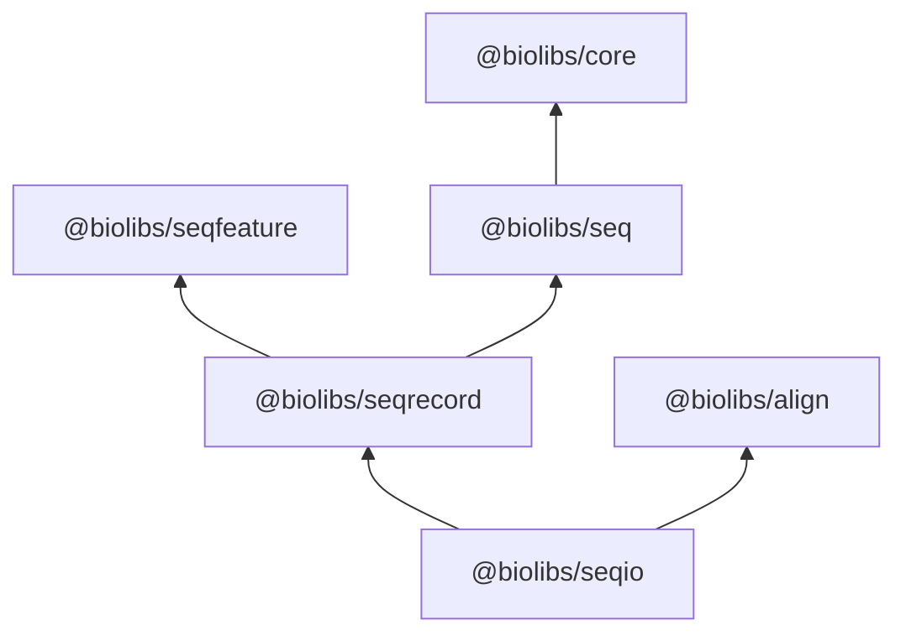

# @biolibs/seqio

Read and write sequence files — **49 formats in, 26 out** — as Biopython's `Bio.SeqIO` does, with no file
system and no native code.

- **`parse`, `read`, `write`, `convert`, `toDict`, `index`** — the whole `Bio.SeqIO` surface
- **Text formats**: FASTA and its four dialects, FASTQ in three quality scales, QUAL, GenBank, EMBL, IMGT,
  Swiss-Prot, PIR, IG, PHD, ACE, tab
- **Binary formats**: SFF, ABI, 2bit, nib, GCK, XDNA, SnapGene — bytes in, bytes out
- **XML**: SeqXML and UniProt XML, with a SAX parser written for the job
- **Alignment formats through `Bio.AlignIO`'s bridge**: Clustal, Stockholm, PHYLIP and its two variants,
  NEXUS, MSF, MAF, Mauve, EMBOSS, FASTA-m10
- **Structure files for their sequences**: PDB and mmCIF, from `SEQRES` or from the atoms
- **`index`** — dictionary-like access that parses a record only when asked
- **Works in the browser.** Input is a file's *contents*, not a path; output is anything with
  `write(text)`

## What is verified

A generator drives real Biopython over each format and records what it does — the records parsed, the text
written, the exception type *and* message, the warnings. The tests replay those recordings.

| Upstream module | Items at parity | Checklist |
|---|---|---|
| `Bio.SeqIO` | **81 / 81** | [Bio.SeqIO.md](../../docs/parity/Bio.SeqIO.md) |

**37,552 recorded cases** against Biopython 1.88 — 35,067 over 38 format files, 1,964 for `index`, and
521 malformed-XML cases. The golden files come to 48 MB, which is most of this repository's test data. Each format is driven over valid files, truncated files, files with the wrong
format's content, and the specific malformations its parser has rules for.

One item is marked non-applicable:

- **`index_db` is not ported.** It keeps its index in an SQLite file, and this package does no file-system
  access at all. `index` — the in-memory equivalent — is ported and verified over **1,964 cases**.

Where the port deliberately differs:

- **A string is the file's *contents*, not its name.** Biopython's `parse("x.fasta", "fasta")` opens a
  file; here the same call parses the four characters `x.fa`… as FASTA. There is no file system to reach,
  which is what lets the package run in a browser. Read the file yourself and hand over the text.
- **Binary formats take `Uint8Array`, text formats take `string`**, and mixing them raises
  `StreamModeError` with Biopython's own wording — the same distinction Python draws between a file opened
  `"rb"` and one opened `"r"`.
- **Writing goes to any object with `write(text)`.** `StringHandle` and `BytesHandle` are provided.
- **Where Python raises `AttributeError` for a wrong argument type, this throws `TypeError`.**

## Install

```bash
npm install @biolibs/seqio
```

- ESM only, Node 20 or later, TypeScript declarations included
- Importing it registers every format, and also fills in `SeqRecord.format()` for the 26 writable ones



The graph above is the spine; `@biolibs/align`, `@biolibs/nexus` and `@biolibs/pdb` are dependencies too,
because the alignment formats build `MultipleSeqAlignment` objects, NEXUS parsing is that package's job,
and `pdb-atom`/`cif-atom` read their sequences out of a parsed structure.

## API

### `parse`

An iterator over the records. A malformed record surfaces while iterating rather than up front, so a bad
record 900 lines in does not stop you reading the first 899 — but a file whose *opening* is wrong is
rejected by the call itself, which is also where Biopython rejects it.

```ts
import { parse } from "@biolibs/seqio";

const text = ">a desc one\nACGTACGT\n>b\nGGTT\n";

for (const record of parse(text, "fasta")) {
  console.log(record.id, record.description, record.seq!.toString());
}
// a   "a desc one"   "ACGTACGT"
// b   "b"            "GGTT"
```

FASTQ brings its quality scores along, decoded into the scale the format name asks for:

```ts
import { parse } from "@biolibs/seqio";

const fastq = "@r1\nACGT\n+\nIIII\n@r2\nGGTT\n+\n!!!!\n";
const [first, second] = [...parse(fastq, "fastq")];

console.log(first!.letterAnnotations.get("phred_quality"));   // [40, 40, 40, 40]
console.log(second!.letterAnnotations.get("phred_quality"));  // [0, 0, 0, 0]
```

A GenBank file arrives with its annotations and features in place:

```ts
import { read } from "@biolibs/seqio";

const rec = read(genbankText, "genbank");

console.log(rec.id, rec.name);                       // "U49845.1" "SCU49845"
console.log(rec.description);                        // "Saccharomyces cerevisiae TCP1-beta gene"
console.log(rec.annotations.get("molecule_type"));   // "DNA"
console.log(rec.annotations.get("source"));          // "Saccharomyces cerevisiae (baker's yeast)"
console.log(rec.features.map((f) => [f.type, String(f.location)]));
// [["source", "[0:20](+)"], ["CDS", "[0:9](+)"]]
console.log(rec.features[1]!.qualifiers.get("gene"));   // ["TCP1"]
```

Format names are lower case, and an unknown one is refused rather than guessed at:

```ts
parse(text, "nope");    // ValueError: Unknown format 'nope'
parse(text, "FASTA");   // ValueError: Format string 'FASTA' should be lower case
parse("x", "sff");      // StreamModeError: SFF files must be opened in binary mode.
```

### `read`

For a file that holds exactly one record. Anything else is an error, which is the point — it is how you
say "this should be a single record" and have it checked.

```ts
import { read } from "@biolibs/seqio";

console.log(read(">only\nACGT\n", "fasta").id);   // "only"

read(">a\nAC\n>b\nGG\n", "fasta");   // ValueError: More than one record found in handle
read("", "fasta");                    // ValueError: No records found in handle
```

### `write`

```ts
import { StringHandle, parse, write } from "@biolibs/seqio";

const out = new StringHandle();
const count = write([...parse(">a desc one\nACGTACGT\n>b\nGGTT\n", "fasta")], out, "fasta");

console.log(count);            // 2   — the number of records written
console.log(out.getvalue());   // ">a desc one\nACGTACGT\n>b\nGGTT\n"
```

A format that can be read but not written says so, and swapping the arguments is caught rather than
producing nonsense:

```ts
write(records, new StringHandle(), "ace");
// ValueError: Reading format 'ace' is supported, but not writing

write(new StringHandle(), records, "fasta");
// TypeError: Check arguments, handle should NOT be a list
```

A binary format needs a byte target, and round-trips:

```ts
import { BytesHandle, read, write } from "@biolibs/seqio";
import { Seq } from "@biolibs/seq";
import { SeqRecord } from "@biolibs/seqrecord";

const out = new BytesHandle();
write([new SeqRecord(new Seq("ACGTACGT"), "n")], out, "nib");

console.log(out.getvalue().length);                  // 12
console.log(read(out.getvalue(), "nib").seq!.toString());   // "ACGTACGT"
```

### `convert`

Parse and write in one step. It is not merely the two calls back to back: `convert` takes the same direct
shortcuts Biopython takes, registered per format pair — every FASTQ flavour to every other, and GenBank or
EMBL to FASTA — which rewrite the text without building records at all.

```ts
import { StringHandle, convert } from "@biolibs/seqio";

const fastq = "@r1\nACGT\n+\nIIII\n@r2\nGGTT\n+\n!!!!\n";

const fasta = new StringHandle();
console.log(convert(fastq, "fastq", fasta, "fasta"));   // 2
console.log(fasta.getvalue());    // ">r1\nACGT\n>r2\nGGTT\n"

// Re-scaling the qualities: Sanger's I (40) becomes Illumina's h.
const illumina = new StringHandle();
convert(fastq, "fastq", illumina, "fastq-illumina");
console.log(illumina.getvalue());   // "@r1\nACGT\n+\nhhhh\n@r2\nGGTT\n+\n@@@@\n"
```

`convert` takes a `moleculeType` when the output format needs one the input did not state — writing
GenBank from FASTA, say, where `LOCUS` has to say DNA or protein.

### `toDict`

Every record in memory, keyed by id or by a function of your choosing. A duplicate key is an error, not a
silent overwrite.

```ts
import { parse, toDict } from "@biolibs/seqio";

const text = ">a desc one\nACGTACGT\n>b\nGGTT\n";

const byId = toDict(parse(text, "fasta"));
console.log([...byId.keys()]);                  // ["a", "b"]
console.log(byId.get("b")!.seq!.toString());    // "GGTT"

toDict(parse(">a\nAC\n>a\nGG\n", "fasta"));
// ValueError: Duplicate key 'a'
```

### `index`

The same lookup without holding the records: it scans once for the offsets, then parses a record only when
asked for it.

```ts
import { index } from "@biolibs/seqio";

const records = index(">a desc one\nACGTACGT\n>b\nGGTT\n", "fasta");

console.log([...records.keys()]);                  // ["a", "b"]
console.log(records.size);                          // 2
console.log(records.get("b")!.seq!.toString());     // "GGTT"
console.log(new TextDecoder().decode(records.getRaw("b")));   // ">b\nGGTT\n"

// Keys can be rewritten on the way in.
const upper = index(">a desc\nAC\n>b x\nGG\n", "fasta", { keyFunction: (k) => k.toUpperCase() });
console.log([...upper.keys()]);                     // ["A", "B"]
```

`getRaw` hands back the record's own bytes, untouched — which is how you copy a record from one file to
another without a parse-and-write round trip changing its formatting.

Interleaved formats cannot be indexed, because a record is not a contiguous run of bytes in them:

```ts
index(alignmentText, "clustal");
// ValueError: Unsupported format 'clustal'
```

### Reading part of a large file

Everything above is handed the whole file. A genome does not fit, so `TwoBitWindow` reads a twoBit
file through a `ByteSource`, which is asked for the bytes between two positions and answers when it has
them. Three are provided: `blobSource` for a `File` or `Blob`, `urlSource` for a file on a server that
supports HTTP range requests, and `bytesSource` for bytes already in memory.

```ts
import { TwoBitWindow, blobSource, countingSource } from "@biolibs/seqio";

// `file` is a File from an <input> or a drop: 250,085 bytes, two sequences. Nothing is read yet.
const source = countingSource(blobSource(file));
const genome = await TwoBitWindow.open(source);    // the header and the list of sequences

genome.names;                                      // ["chrA", "chrB"]
await genome.lengthOf("chrA");                     // 1000000
await genome.fetch("chrA", 500_000, 500_012);      // "ACGTACGTACGT"
await genome.fetch("chrB", 0, 10);                 // "ACGTNNgtac" — unknown bases as N, soft-masked in lower case
await genome.blocksOf("chrB");                     // { nBlocks: [[4, 6]], maskBlocks: [[6, 10]] }

source.bytesRead;                                  // 4150 of the file's 250085
```

Opening reads the first 4 kB. A sequence's block tables are read the first time it is used and kept;
after that a window costs one read of a byte for every four bases, wherever in the file it is.
`countingSource` wraps any source to count what was read, which is how the figure above is measured.

This has no counterpart in Biopython, so it is not on the parity checklist. It is tested by comparing
every answer with `TwoBitIterator`, the ported reader, on the same bytes; see
[Things to know](#things-to-know).

### `LineStream` and the handles

`LineStream` is a Python text file over a string: iterating and `readline()` share one position, so a
parser can read a header and then hand the rest to a loop.

```ts
import { LineStream } from "@biolibs/seqio";

const s = new LineStream(">a\nACGT\n");
console.log(s.readline());   // ">a\n"   — line endings are kept, as Python keeps them
console.log([...s]);         // ["ACGT\n"]
```

`StringHandle` and `BytesHandle` collect writes; `getvalue()` returns the result. Anything with
`write(text)` will do, so piping to a Node stream or an HTTP response needs no adapter.

### The format registries

`FORMAT_TO_ITERATOR` and `FORMAT_TO_WRITER` are the live registries, and `registerIterator`,
`registerWriter` and `registerConverter` add your own format.

```ts
import { FORMAT_TO_ITERATOR, FORMAT_TO_WRITER } from "@biolibs/seqio";

console.log(FORMAT_TO_ITERATOR.size);   // 49
console.log(FORMAT_TO_WRITER.size);     // 26
```

A registered writer also becomes available to `SeqRecord.format(name)`, which is how
`record.format("fasta")` works once this package is imported.

## Testing

```bash
npm test                 # the whole workspace
npx vitest run packages/seqio/test
```

| File | What it checks |
|---|---|
| `test/golden.test.ts` | 35,067 recorded cases over 38 formats: parse, read, write and convert, with the records, the output text, the exceptions and the warnings |
| `test/index.test.ts` | 1,964 `index` cases: every key, its raw bytes, its parsed record, and the probes for a missing key |
| `test/api.test.ts` | the TypeScript-only surface: the handles, the registries, custom readers and writers, the struct helpers |
| `test/xml-errors.test.ts` | 521 malformed-XML cases, comparing `SAXParseException` messages |
| `test/twobit-window.test.ts` | `TwoBitWindow` against `TwoBitIterator` on the same bytes, over the golden twoBit files and a 310,000-base file in both byte orders; and a count of the bytes it reads |
| `test/readme.test.ts` | every code block in this file |

Coverage from this package's own tests — `npx vitest run --coverage packages/seqio/test`:

| | |
|---|---|
| Statements | **96.83%** (9,340 / 9,646) |
| Functions | **96.53%** (919 / 952) |
| Branches | **92.42%** (5,351 / 5,790) |

This is the lowest in the repository, and honestly so: these are parsers, and a parser's uncovered lines
are its complaints about files nobody has handed it yet. The largest remaining gaps are
`insdc/genbank-scanner.ts` (81%) and `sff/header.ts` (80%) — malformed-header paths, and the Roche XML
manifest that only instrument-produced SFF files carry.

## Things to know

- **`parse` raises in two different places.** A file that does not begin the way the format requires fails
  at the `parse()` call; a record that goes wrong later fails from the iterator. Both match Biopython,
  whose reader classes also read the header in their constructor — so wrap whichever you can reach.
- **`qual` gives records with no sequence content.** A QUAL file has qualities and no bases, so the record
  carries a sequence of the right *length* whose content is undefined — `seq.defined` is `false`, and
  asking for the letters raises.
- **`fasta-2line` refuses wrapped sequences** by design: it is the strict two-lines-per-record dialect, and
  a wrapped file gets `Perhaps this file is using FASTA line wrapping?` rather than silently parsing.
- **`index` keeps the whole file in memory**, since there is nothing to seek on. It saves the *parsing*,
  not the bytes.
- **The alignment formats come back as records**, one per row. `@biolibs/align`'s own `parse` gives you the
  alignment object instead; this package's bridge is the `Bio.SeqIO`-shaped view of the same file.
- **SnapGene, GCK and 2bit are read-only here**, as they are in Biopython. `xdna` and `nib` write.
- **`TwoBitWindow` is stricter than `TwoBitIterator` about truncated files.** Biopython reads a number
  that is missing from the end of a file as zero and carries on; the windowed reader says where the
  file ended. On a file that is whole, the two give the same bases for every window, including a file
  whose block tables are out of order, where both stop at the first block beyond the window.

## License

MIT — see [LICENSE](LICENSE).
