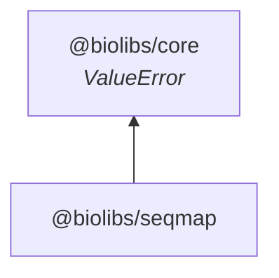

# @biolibs/seqmap

The geometry behind a plasmid or linear sequence map: pure numbers and SVG path strings, with **no DOM
and no drawing**. Biopython's nearest counterpart is `Bio.Graphics.GenomeDiagram`, which renders through
ReportLab and cannot be ported — so this supplies the measurements and leaves the drawing to you, which
means the same figures serve SVG, canvas and React.

- **`angleAt`, `polar`, `fractionAt`** — a sequence position on a circle or along a line
- **`ringPath`, `blockPath`, `tickPath`** — SVG paths for feature arcs, blocks and tick marks, with
  arrowheads for strand
- **`tickStep`, `tickPositions`, `tickLabel`** — a round scale, the rule chart axes use
- **`packLanes`, `splitAtOrigin`** — stack overlapping features into lanes, and split a feature that
  crosses the origin
- **`spreadApart`, `spreadAround`** — move crowded labels the least total distance that separates them,
  by isotonic regression
- **One dependency**, `@biolibs/core`, for the error class

## What is verified

This is not a port of anything, and there is nothing to be a port *of*. What there is instead:

- **80 unit tests** against the geometry's own properties, which is what can honestly be checked without
  a reference renderer: that a path starts where it should and closes, that an arrowhead's tip lands
  exactly on the feature's own end angle, that the arcs sweep clockwise outward and back inward, that
  lanes never overlap, that `spreadApart` preserves order and separates everything by the gap, and that
  `spreadAround`'s results all sit in `[0, TAU)` with every circular gap satisfied.
- **The fixed points are checked exactly**: `angleAt(0)` is 0 and `angleAt(length)` is a full turn,
  `polar` at angle 0 is straight up, `normalizeAngle(TAU)` is 0.

Where the claim stops:

- **Nothing is rendered or measured on screen.** There is no text metrics, no font, no viewport. A label
  gap is a number you choose, in your units.
- **The paths are not validated against an SVG renderer.** They are built from `M`, `L`, `A` and `Z`
  only, and the tests check their structure and their key coordinates, not that a browser draws them as
  intended.
- **Coordinates are rounded to three decimals.** Well under a device pixel at any sensible size, but the
  strings are not exact.
- **`packLanes` is a greedy pass**, not a minimum-lane packing. It is the standard first-fit used by
  every map viewer, and it can use more lanes than an optimal arrangement would.
- **`spreadApart` minimises total squared movement**, which is a real optimum but of that objective; it
  is not a model of what looks best.

## Install

```bash
npm install @biolibs/seqmap
```

- ESM only, Node 20 or later, TypeScript declarations included



## Coordinates

Positions are **0-based base boundaries**: position 0 lies before the first base and `length` after the
last, so a feature covering bases `[start, end)` spans the angles of `start` and `end`. A circular map
puts position 0 at the top and runs clockwise, as every plasmid map does. Angles are radians from 12
o'clock, growing clockwise, and `polar` returns points with **`y` growing downwards**, as in SVG and
canvas.

```ts
import { TAU, angleAt, fractionAt, polar, positionAt } from "@biolibs/seqmap";

angleAt(0, 1000);        // 0 — the top
angleAt(250, 1000);      // Math.PI / 2 — three o'clock
angleAt(1000, 1000);     // TAU — all the way round

polar(0, 0, 10, 0);                 // { x: 0, y: -10 } — straight up
polar(150, 150, 100, 0);            // { x: 150, y: 50 } — the top of a ring centred at (150, 150)
positionAt(Math.PI, 1000);          // 500 — the inverse of angleAt

fractionAt(500, 1000);   // 0.5 — along a linear map instead, 0 at the left edge and 1 at the right
```

`angleAt` **does not wrap** a position past the end — it simply gives an angle beyond one turn, which is
what a feature crossing the origin needs:

```ts
import { TAU, angleAt, normalizeAngle } from "@biolibs/seqmap";

angleAt(1200, 1000) > TAU;            // true — not wrapped
normalizeAngle(angleAt(1200, 1000));  // the same direction, inside one turn
normalizeAngle(TAU);                  // 0
```

## Feature shapes

`ringPath` is the annular band a circular feature occupies; `blockPath` is the rectangle a linear one
occupies. Each can be drawn as an arrow to show its strand.

```ts
import { blockPath, ringPath } from "@biolibs/seqmap";

ringPath(0, 0, 90, 100, 0, Math.PI / 2);
// "M0,-100 A100,100 0 0 1 100,0 L90,0 A90,90 0 0 0 0,-90 Z"

blockPath(10, 110, 20, 40);
// "M10,20 L110,20 L110,40 L10,40 Z"
blockPath(10, 110, 20, 40, "end");
// "M10,20 L104,20 L110,30 L104,40 L10,40 Z"   — the point is at x = 110
blockPath(10, 110, 20, 40, "start");
// "M16,20 L110,20 L110,40 L16,40 L10,30 Z"    — the point is at x = 10
```

**An arrowhead is taken out of the feature's own span, never added beyond it**, so the shape always stays
within the bounds you gave. That is the single most useful property here: you can lay out features from
their coordinates and nothing will stick out.

```ts
import { blockPath, ringPath } from "@biolibs/seqmap";

// The tip sits exactly at x = 110, the right edge asked for.
blockPath(10, 110, 20, 40, "end").includes("L110,30");       // true

// A feature shorter than the arrowhead becomes a plain triangle, not an overflowing arrow.
ringPath(0, 0, 90, 100, 0, 0.02, "end");
// "M0,-100 L1.9,-94.981 L0,-90 Z"
blockPath(10, 14, 20, 40, "end");
// "M10,20 L14,30 L10,40 Z"
```

A feature covering the **whole circle** — a GenBank `source` feature, most often — is a closed annulus.
An SVG arc cannot turn a full circle in one command, so each edge takes two, and an arrowhead has no end
to point at:

```ts
import { TAU, ringPath } from "@biolibs/seqmap";

ringPath(0, 0, 90, 100, 0, TAU);
// "M0,-100 A100,100 0 0 1 0,100 A100,100 0 0 1 0,-100
//  M0,-90 A90,90 0 0 0 0,90 A90,90 0 0 0 0,-90 Z"

// More than a full turn is still the whole circle, not the remainder.
ringPath(0, 0, 90, 100, 0, TAU * 1.2) === ringPath(0, 0, 90, 100, 0, TAU);   // true
ringPath(0, 0, 90, 100, 0, TAU, "end") === ringPath(0, 0, 90, 100, 0, TAU);  // true
```

Bad geometry is refused rather than drawn wrongly:

```ts
import { ringPath } from "@biolibs/seqmap";

ringPath(0, 0, 100, 90, 0, 1);   // ValueError: inner radius 100 is outside outer radius 90
ringPath(0, 0, 90, 100, 2, 1);   // ValueError: end angle 1 is before start angle 2
```

## The scale

`tickStep` picks a round interval from 1, 2 and 5 times a power of ten — the rule chart axes use —
rounding to the **nearest** on the log scale, so the tick count lands near the target rather than always
below it.

```ts
import { tickStep } from "@biolibs/seqmap";

tickStep(2686);       // 200   — 13 ticks across pUC19
tickStep(2686, 5);    // 500   — ask for 5, get 5
tickStep(1000);       // 100
tickStep(45000);      // 5000
tickStep(150000);     // 20000
tickStep(5);          // 1     — never less than one base
```

```ts
import { tickLabel, tickPositions, tickStep } from "@biolibs/seqmap";

// A circle leaves the far end off, where it would sit on top of position 0. A line keeps both ends.
tickPositions(1000, 250, true);    // [0, 250, 500, 750]
tickPositions(1000, 250, false);   // [0, 250, 500, 750, 1000]

// On a line the last tick is the end, even when a step did not land there.
tickPositions(1000, 300, false);   // [0, 300, 600, 900, 1000]

// Labels switch to kb once the ticks are 1000 bases apart.
tickLabel(1200, 200);    // "1,200"
tickLabel(1200, 1000);   // "1.2 kb"
tickLabel(2000, 1000);   // "2 kb"   — no pointless decimal
tickLabel(0, 1000);      // "0 kb"
```

## Lanes

A sequence usually annotates overlapping features — a gene, its promoter, the CDS inside it — and drawing
them on one line hides all but the topmost. `packLanes` gives each the lowest lane where it does not
overlap something already there.

```ts
import { laneCount, packLanes } from "@biolibs/seqmap";

packLanes([{ start: 0, end: 100 }, { start: 50, end: 150 }, { start: 200, end: 300 }]);
// [0, 1, 0] — the third fits back into the first lane

// Spans are half-open, so a feature ending where another begins shares its lane.
packLanes([{ start: 0, end: 100 }, { start: 100, end: 200 }]);   // [0, 0]
// Unless you ask for room between them.
packLanes([{ start: 0, end: 100 }, { start: 100, end: 200 }], 10);   // [0, 1]

laneCount([{ start: 0, end: 100 }, { start: 50, end: 150 }]);    // 2
```

Within a starting position the **longest feature goes first**, so a long feature takes the inner lane and
the short ones inside it stack outwards — the arrangement a reader expects:

```ts
import { packLanes } from "@biolibs/seqmap";

// The long one is listed second but still takes lane 0.
packLanes([{ start: 0, end: 100 }, { start: 0, end: 1000 }]);   // [1, 0]

// Two short features inside one long one share the lane above it.
packLanes([{ start: 0, end: 1000 }, { start: 100, end: 200 }, { start: 300, end: 400 }]);
// [0, 1, 1]
```

### Crossing the origin

`splitAtOrigin` turns a feature that runs past the end of a circular sequence into the one or two pieces
a map can draw:

```ts
import { angleAt, ringPath, splitAtOrigin } from "@biolibs/seqmap";

splitAtOrigin({ start: 2600, end: 2800 }, 2686);
// [{ start: 2600, end: 2686 }, { start: 0, end: 114 }]
splitAtOrigin({ start: 100, end: 200 }, 2686);
// [{ start: 100, end: 200 }] — unchanged, as one piece

// So a crossing feature becomes two arcs.
splitAtOrigin({ start: 2600, end: 2800 }, 2686)
  .map((p) => ringPath(150, 150, 100, 110, angleAt(p.start, 2686), angleAt(p.end, 2686))).length;   // 2

splitAtOrigin({ start: 0, end: 3000 }, 2686);
// ValueError: span of 3000 bases is longer than the 2686-base sequence
```

## Labels that would collide

`spreadApart` moves crowded labels the **least total distance** that separates them by a gap, by isotonic
regression (pool-adjacent-violators) on the positions less `rank * gap`. Order is always preserved.

```ts
import { spreadApart } from "@biolibs/seqmap";

spreadApart([10, 11, 12], 5, 0, 100);   // [6, 11, 16]
```

That result is the point of the method: the cluster spread **symmetrically about its centre** — the
middle label did not move at all, and the outer two moved 4 each. A naive pass that pushed each label
down from the one before would have given `[10, 15, 20]`, dragging the whole group one way.

```ts
import { spreadApart } from "@biolibs/seqmap";

spreadApart([50, 50, 50], 10, 0, 100);   // [40, 50, 60] — centred on 50
spreadApart([10, 30, 50], 5, 0, 100);    // [10, 30, 50] — already apart, nothing moves
spreadApart([12, 10, 11], 5, 0, 100);    // [16, 6, 11] — input order out, order along the line kept

// A run that would overhang slides back inside, keeping every gap.
spreadApart([99, 100], 5, 0, 100);       // [95, 100]

// When the bounds cannot hold them all, they are spread evenly instead.
spreadApart([10, 11, 12], 50, 0, 100);   // [0, 50, 100]
```

`spreadAround` is the circular version. A circle has no ends to push against, so it uses the **widest
existing gap as the seam** — the unavoidable movement then happens where there is most room:

```ts
import { TAU, spreadAround } from "@biolibs/seqmap";

// Three labels bunched at the top, and one at 4 radians: the big empty stretch absorbs the spreading.
const spread = spreadAround([1, 1.05, 1.1, 4], 0.3);
spread.map((a) => Number(a.toFixed(4)));   // [0.75, 1.05, 1.35, 4]

// Already spacious: nothing moves.
spreadAround([0, 2, 4], 0.2);              // [0, 2, 4]

// Too crowded for the gap asked: spaced evenly right round.
spreadAround([0, 0, 0, 0], 2).map((a) => Number(a.toFixed(4)));
// [0, 1.5708, 3.1416, 4.7124] — a quarter turn apart
```

Every angle comes back in `[0, TAU)`, in input order.

## A whole pUC19 map

```ts
import { angleAt, packLanes, ringPath, spreadAround, tickLabel, tickPositions, tickStep }
  from "@biolibs/seqmap";

const length = 2686;    // pUC19
const features = [
  { start: 145, end: 1006 },    // AmpR, say
  { start: 1625, end: 2486 },
  { start: 400, end: 500 },     // something inside the first
];

const lanes = packLanes(features);          // [0, 0, 1]
const paths = features.map((f, i) => ringPath(
  150, 150,
  100 - lanes[i]! * 12, 110 - lanes[i]! * 12,
  angleAt(f.start, length), angleAt(f.end, length),
  "end",
));
paths[0]!.startsWith("M186.599,46.267");    // true

const step = tickStep(length);                          // 200
const ticks = tickPositions(length, step, true);        // [0, 200, ..., 2600]
const labels = ticks.map((t) => tickLabel(t, step));    // ["0", "200", ..., "2,600"]
const labelAngles = spreadAround(ticks.map((t) => angleAt(t, length)), 0.12);

ticks.length;          // 14
labelAngles.length;    // 14

// These ticks are already 0.468 radians apart, so nothing needed moving.
const moved = labelAngles.map((a, i) => Math.abs(a - angleAt(ticks[i]!, length)));
Math.max(...moved) < 1e-9;   // true
```

Those ticks are already more than 0.12 radians apart, so `spreadAround` leaves them where they are —
which is the behaviour you want from a pass that runs on every frame. "Where they are" is to within
floating-point rounding rather than bit-for-bit: the method subtracts `rank * gap` from each position and
adds it back, which does not round-trip exactly.

## Testing

```bash
npm test                 # the whole workspace
npx vitest run packages/seqmap/test
```

| File | What it checks |
|---|---|
| `test/seqmap.test.ts` | the 80 behaviour tests, including the geometry's own properties |
| `test/readme.test.ts` | every code block in this file |

Coverage from this package's own tests — `npx vitest run --coverage packages/seqmap/test`:

| | |
|---|---|
| Statements | **100.00%** (270 / 270) |
| Functions | **100.00%** (23 / 23) |
| Branches | **95.48%** (190 / 199) |

## Things to know

- **`y` grows downwards.** `polar` returns SVG and canvas coordinates, so angle 0 gives a *negative* y.
- **`angleAt` does not wrap.** That is deliberate: a feature crossing the origin needs angles past a full
  turn. Use `normalizeAngle` to compare directions, and `splitAtOrigin` to draw.
- **An arrowhead comes out of the feature's span**, so a shape never exceeds the bounds you gave, and a
  very short feature becomes a triangle rather than an overflowing arrow.
- **A full turn is a closed ring**, drawn with two arcs per edge because SVG cannot express a 360° arc,
  with any arrow left off.
- **A circular scale leaves off the far end**, a linear one keeps it — and on a line the last tick is the
  sequence end even when a step did not land there, so the final pair can be closer than the step.
- **Lanes are first-fit, longest-first within a start.** Good enough, and the same rule every map viewer
  uses; not a minimum-lane packing.
- **`spreadApart` spreads a cluster symmetrically**, which is what makes it look right; a naive push
  drags the whole group one way.
- **`spreadAround` chooses its seam from your data** — the widest existing gap — so adding one label can
  move the seam and shift others.

## License

MIT — see [LICENSE](LICENSE).
