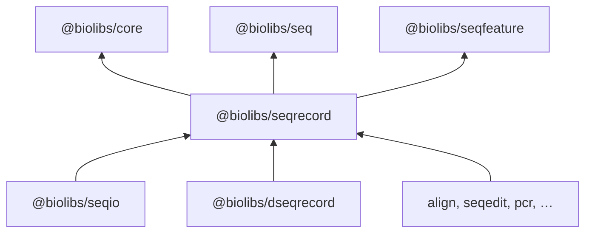

# @biolibs/seqrecord

A sequence with everything a file knows about it — id, name, description, features, annotations, and a
value per base — as Biopython's `Bio.SeqRecord` has it.

- **Slicing that carries the annotation with it** — per-letter values sliced alongside the bases, features
  kept when they fall inside, dropped when they do not
- **Concatenation that merges metadata honestly** — a field survives `a + b` only if both records agree
- **`reverseComplement` and `translate`** — with Biopython's polymorphic options: `true` copies a field,
  `false` drops it, a value replaces it
- **`letterAnnotations`** — a length-checked map, so a quality string can never silently drift out of step
  with its sequence
- **`format(name)`** — 26 file formats once `@biolibs/seqio` is imported
- **Comparison deliberately refuses**, exactly as Biopython's does
- Depends on `@biolibs/core`, `@biolibs/seq` and `@biolibs/seqfeature`

## What is verified

A generator drives real Biopython and records what it does — the return value, the exception type *and*
message, the warnings, and **the whole state of the record afterwards**, which is what catches the side
effects: the lazy creation of `letterAnnotations`, an annotation dict shared rather than copied, a feature
list mutated in place.

| Upstream module | Items at parity | Checklist |
|---|---|---|
| `Bio.SeqRecord` | **25 / 25** | [Bio.SeqRecord.md](../../docs/parity/Bio.SeqRecord.md) |

**6,773 recorded calls** against Biopython 1.88 — 1,857 of them a refusal and 693 a warning. 3,150 are
slices alone: every combination of start, stop and step from before the beginning to past the end, over
records with features, fuzzy features, features pointing at other records, per-letter annotations,
undefined content and no sequence at all. Nothing in the checklist is marked non-applicable; the 25 items
are the whole class.

Where the port deliberately differs:

- **A record has no truthiness.** `bool(rec)` is always `true` in Biopython, so nothing is lost; check
  `length` if that is what you meant.
- **`annotations` and `letterAnnotations` are `Map`s**, not plain objects. GenBank keys are arbitrary
  strings, and a `Map` cannot collide with `toString`.
- **A list and a tuple are both arrays**, so an annotation value cannot tell them apart.
- **Concatenation re-raises without the printout.** When per-letter annotations cannot be joined,
  Biopython prints `Failed while try to concatenate letter annotations` to stdout and then re-raises the
  `TypeError`; this raises the same error without printing.
- **Wrong argument *types* throw `TypeError`** where Python sometimes raises `AttributeError`.

## Install

```bash
npm install @biolibs/seqrecord
```

- ESM only, Node 20 or later, TypeScript declarations included



### Naming: Python to TypeScript

| Python | TypeScript |
|---|---|
| `rec[i]` | `rec.at(i)` |
| `rec[a:b:c]` | `rec.slice(a, b, c)` |
| `len(rec)` | `rec.length` |
| `for c in rec` | `for (const c of rec)` |
| `x in rec` | `rec.contains(x)` |
| `rec + other`, `other + rec` | `rec.add(other)`, `rec.radd(other)` |
| `str(rec)`, `bytes(rec)`, `repr(rec)` | `rec.toString()`, `rec.toBytes()`, `rec.repr()` |
| `rec.letter_annotations` | `rec.letterAnnotations` (a `Map`) |

## API

### `SeqRecord`

`new SeqRecord(seq, id?, name?, description?, dbxrefs?, features?, annotations?, letterAnnotations?)` —
Python's argument order throughout.

```ts
import { Seq } from "@biolibs/seq";
import { SeqFeature, SimpleLocation } from "@biolibs/seqfeature";
import { SeqRecord } from "@biolibs/seqrecord";

const rec = new SeqRecord(
  new Seq("ATGAAATAGCCC"), "id1", "name1", "desc1", null,
  [new SeqFeature(new SimpleLocation(0, 9, 1), "CDS")],
  { molecule_type: "DNA" },
  { q: "abcdefghijkl" },
);

console.log(rec.id, rec.name, rec.description);   // "id1" "name1" "desc1"
console.log(rec.length, rec.features.length);     // 12 1
console.log(rec.seq!.toString());                 // "ATGAAATAGCCC"
console.log(rec.annotations.get("molecule_type"));         // "DNA"
console.log(rec.letterAnnotations.get("q"));               // "abcdefghijkl"
console.log(rec.repr());
// SeqRecord(seq=Seq('ATGAAATAGCCC'), id='id1', name='name1', description='desc1', dbxrefs=[])
```

The defaults are Biopython's placeholder strings, not empty ones — so a record written out without an id
says so rather than producing a blank field:

```ts
const bare = new SeqRecord(new Seq("ACGT"));
console.log(bare.id);           // "<unknown id>"
console.log(bare.name);         // "<unknown name>"
console.log(bare.description);  // "<unknown description>"
```

`toString()` is the human summary Biopython prints:

```ts
console.log(rec.toString());
// ID: id1
// Name: name1
// Description: desc1
// Number of features: 1
// /molecule_type=DNA
// Per letter annotation for: q
// Seq('ATGAAATAGCCC')
```

### Slicing

A slice takes the bases, slices every per-letter annotation to match, and keeps the features that lie
*entirely* inside it, shifted to the new coordinates. `id`, `name` and `description` come along;
annotations other than `molecule_type` do not, because a slice of a record is not the record.

```ts
console.log(rec.slice(2, 6).seq!.toString());            // "GAAA"
console.log(rec.slice(3).letterAnnotations.get("q"));    // "defghijkl"
console.log(rec.slice(2, 6).features.length);            // 0   — the CDS at [0:9] is not inside
console.log(rec.slice(0, 9).features.length);            // 1   — this one is
console.log(rec.slice(2, 6).id);                         // "id1"

console.log(rec.at(0));          // "A"
console.log(rec.contains("ATG")); // true
console.log([...rec].slice(0, 3).join(""));   // "ATG"
```

A feature that points at *another* record cannot be re-based onto a slice, so it is dropped with
Biopython's warning rather than silently kept:

```ts
import { captureWarnings } from "@biolibs/core";

const { result, warnings } = captureWarnings(() => {
  const r = new SeqRecord(new Seq("ACGTACGT"), "r", "n", "d", null,
    [new SeqFeature(new SimpleLocation(0, 3, 1, "OTHER"), "misc")]);
  return r.slice(0, 4).features.length;
});

console.log(result);                 // 0
console.log(warnings[0]!.message);
// When slicing SeqRecord objects, any SeqFeature referencing other sequences
// (e.g. from segmented GenBank records) are ignored.
```

### Concatenation

Adding a sequence appends or prepends it and keeps the record's metadata, shifting features when the
addition goes on the left:

```ts
import { Seq } from "@biolibs/seq";

console.log(rec.add(new Seq("GGG")).seq!.toString());    // "ATGAAATAGCCCGGG"
console.log(rec.radd(new Seq("GGG")).seq!.toString());   // "GGGATGAAATAGCCC"
console.log(String(rec.radd(new Seq("GGG")).features[0]!.location));   // "[3:12](+)"
```

Adding two records merges them, and a metadata field survives only where both agree:

```ts
const both = rec.add(rec);
console.log(both.seq!.toString());     // "ATGAAATAGCCCATGAAATAGCCC"
console.log(both.features.length);     // 2   — the right record's features shifted right
console.log(both.id);                  // "id1"  — the same in both, so it survives
console.log(both.annotations.get("molecule_type"));   // "DNA"
```

Per-letter annotations are concatenated only where the key is in both records, and only when the two
values can be joined — a string with a string, a list with a list. A string meeting a list raises
`TypeError`, as Python's `+` does.

### `reverseComplement`

```ts
console.log(rec.reverseComplement().seq!.toString());    // "GGGCTATTTCAT"
console.log(String(rec.reverseComplement().features[0]!.location));   // "[3:12](-)"
console.log(rec.reverseComplement().letterAnnotations.get("q"));      // "lkjihgfedcba"
console.log(rec.reverseComplement().id);                 // "<unknown id>"  — dropped by default
```

Features are flipped and re-sorted by start; per-letter annotations are reversed. Everything else is
dropped unless asked for. Each metadata option is **polymorphic**, as in Biopython: `true` copies the
field, `false` drops it, and any other value is used as is.

```ts
console.log(rec.reverseComplement({ id: true, description: "reverse strand" }).id);
// "id1"
console.log(rec.reverseComplement({ id: true, description: "reverse strand" }).description);
// "reverse strand"
console.log(rec.reverseComplement("new-id").id);   // "new-id"  — positional, Python's order
```

It uses the RNA complement when `molecule_type` mentions RNA, and refuses a protein record.

### `translate`

```ts
console.log(rec.translate().seq!.toString());                  // "MK*P"
console.log(rec.translate({ toStop: true }).seq!.toString());   // "MK"
console.log(rec.translate({ id: true }).id);                    // "id1"
console.log(rec.translate().annotations.get("molecule_type"));  // "protein"
```

The same polymorphic options, plus `table`, `stopSymbol`, `toStop`, `cds` and `gap`. Features and
per-letter annotations cannot be carried across — three bases become one residue, so there is nothing
truthful to carry — and asking refuses rather than guessing:

```ts
rec.translate({ features: true });
// TypeError: Unexpected features argument True
```

### `letterAnnotations`

A `RestrictedDict`: a `Map` that accepts only strings and arrays of exactly the sequence's length. That
check is the point of the class — a quality string one base short of its sequence is a bug that would
otherwise surface much later.

```ts
const r = new SeqRecord(new Seq("ACGT"));

r.letterAnnotations = { q: "abc" };
// ValueError: The per-letter-annotations have the same length as the sequence, but found:
//  q=abc

r.letterAnnotations = { q: "abcd" };     // fine
console.log(r.letterAnnotations.get("q"));   // "abcd"
```

Because of that invariant, replacing the sequence with one of a different length while per-letter
annotations exist is refused — empty them first, as Biopython's message says:

```ts
const r2 = new SeqRecord(new Seq("ACGT"), "i", "n", "d", null, [], {}, { q: "abcd" });
r2.seq = new Seq("AC");
// ValueError: You must empty the letter annotations first!
```

### `count`, `upper`, `lower`, `isupper`, `islower`

```ts
console.log(rec.count("A"));                   // 5
console.log(rec.lower().seq!.toString());      // "atgaaatagccc"
console.log(rec.isupper(), rec.islower());     // true false
```

### `format`

`format(name)` renders the record through a writer registered in `SeqRecord.writers`. Importing
`@biolibs/seqio` registers 26 of them; the empty format is the `toString()` summary and always works.

```ts
import { Seq } from "@biolibs/seq";
import { SeqRecord } from "@biolibs/seqrecord";
import "@biolibs/seqio";       // registers the writers

const r = new SeqRecord(new Seq("ATGAAATAGCCC"), "id1", "name1", "desc1", null, [],
                        { molecule_type: "DNA" });

console.log(r.format("fasta"));            // ">id1 desc1\nATGAAATAGCCC\n"
console.log(r.format("genbank").split("\n")[1]);   // "DEFINITION  desc1."
```

Without `@biolibs/seqio` imported, an unknown format raises `KeyError`, as Biopython raises for a format
it does not know.

### Comparison refuses

```ts
rec.equals(rec);
// NotImplementedError: SeqRecord comparison is deliberately not implemented.
// Explicitly compare the attributes of interest.
```

`equals`, `ne`, `lt`, `le`, `gt` and `ge` all do this. It is Biopython's decision, not a gap: two records
can agree on their sequence and differ in every annotation, and there is no answer that is right for
every caller.

## Testing

```bash
npm test                 # the whole workspace
npx vitest run packages/seqrecord/test
```

**69 tests in 3 files**, replaying 6,773 recorded calls:

| File | What it checks |
|---|---|
| `test/golden.test.ts` | 6,773 recorded calls, grouped by operation, comparing the record's whole state afterwards and not just the result |
| `test/api.test.ts` | the TypeScript-only surface: the options-object forms, `RestrictedDict` directly, the writer registry |
| `test/readme.test.ts` | every code block in this file |

Coverage from this package's own tests — `npx vitest run --coverage packages/seqrecord/test`:

| | |
|---|---|
| Statements | **98.16%** (426 / 434) |
| Functions | **98.21%** (55 / 56) |
| Branches | **97.99%** (342 / 349) |

What is left is two things, both named rather than rounded away: `setSeqUnchecked`, a `protected` hook
that exists for `@biolibs/dseqrecord` to set a sequence without the length check (its tests call it 4,016
times), and one unreachable `TypeError` in the per-letter concatenation for a value that is neither a
string nor an array — which `RestrictedDict` will not accept in the first place.

## Things to know

- **`seq` can be `null`.** A record read from a file that gives only a length has no sequence, so `seq` is
  nullable throughout — hence `rec.seq!` in these examples.
- **An `annotations` `Map` you pass in is shared, not copied**, matching Python's dict semantics. Mutating
  it afterwards changes the record.
- **A slice keeps `molecule_type` and nothing else** from `annotations`. Biopython's reasoning: the
  molecule is still DNA, but the organism's taxonomy is not a property of 40 bases of it.
- **`reverseComplement` sorts the flipped features**, and raises `TypeError` if one of them has an
  unknown end — flipping makes that an unknown *start*, and Python cannot order `None` against an `int`.
  An unknown *start* flips to a known end and sorts fine; the two are not symmetrical.
- **The polymorphic options are easy to get wrong.** `{ id: false }` drops the id; `{ id: "" }` sets it to
  the empty string. Both are deliberate, and both are Biopython's.

## License

MIT — see [LICENSE](LICENSE).
