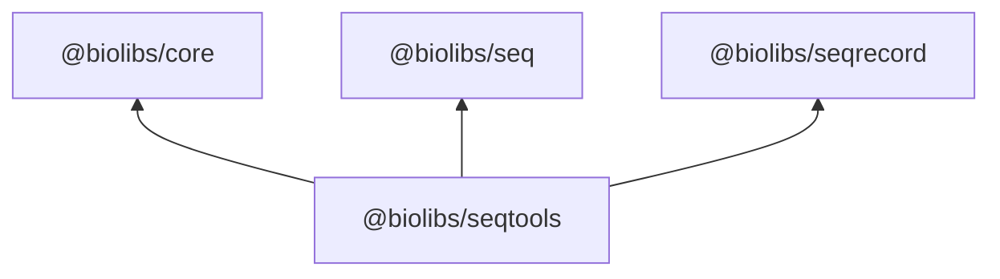

# @biolibs/seqtools

The sequence arithmetic of Biopython's `Bio.SeqUtils`: GC content, molecular weight, melting
temperatures, checksums, protein properties and the codon adaptation index.

- **GC** — `gcFraction` with three ways to handle ambiguity, `gc123` by codon position, `gcSkew` by window
- **Weight and composition** — `molecularWeight` for DNA, RNA or protein, single- or double-stranded,
  linear or circular, average or monoisotopic
- **Melting temperature** — Wallace, GC-based, and nearest-neighbour with salt and chemical corrections
- **Checksums** — `crc32`, `crc64`, `gcg`, `seguid`
- **Protein analysis** — `ProteinAnalysis` and `IsoelectricPoint`: weight, aromaticity, instability,
  flexibility, GRAVY, 28 hydropathy scales, charge at a pH
- **Codon adaptation index** — built from a reference set, then applied or used to optimise
- **Names and views** — `seq1`/`seq3`, `ntSearch` with IUPAC ambiguity, `sixFrameTranslations`
- Depends on `@biolibs/core`, `@biolibs/seq` and `@biolibs/seqrecord`

Every function takes plain text, a `Seq` or a `MutableSeq`.

## What is verified

A generator drives real Biopython and records what it does — the return value, the exception type *and*
message, the text written to standard error. The tests replay those recordings.

| Upstream module | Items at parity | Checklist |
|---|---|---|
| `Bio.SeqUtils` | **12 / 12** | [Bio.SeqUtils.md](../../docs/parity/Bio.SeqUtils.md) |
| `Bio.SeqUtils.ProtParam` | **12 / 12** | [Bio.SeqUtils.ProtParam.md](../../docs/parity/Bio.SeqUtils.ProtParam.md) |
| `Bio.SeqUtils.MeltingTemp` | **6 / 6** | [Bio.SeqUtils.MeltingTemp.md](../../docs/parity/Bio.SeqUtils.MeltingTemp.md) |
| `Bio.SeqUtils.CheckSum` | **4 / 4** | [Bio.SeqUtils.CheckSum.md](../../docs/parity/Bio.SeqUtils.CheckSum.md) |
| `Bio.SeqUtils.IsoelectricPoint` | **3 / 3** | [Bio.SeqUtils.IsoelectricPoint.md](../../docs/parity/Bio.SeqUtils.IsoelectricPoint.md) |
| `Bio.SeqUtils.lcc` | **2 / 2** | [Bio.SeqUtils.lcc.md](../../docs/parity/Bio.SeqUtils.lcc.md) |

**4,984 recorded calls** against Biopython 1.88, the largest shares being 724 for `gcFraction`, 599 for
`molecularWeight`, 439 for `gcSkew`, 392 for `lccMult` and 266 for `Tm_Wallace`.

Where the claim stops — and for this package it is mostly about floating point:

- **Anything built on `log`, `exp` or `pow` can differ in the last bit.** `lccSimp`, `lccMult`,
  `CodonAdaptationIndex.calculate`, `tmGC`, `tmNN`, `saltCorrection` and
  `IsoelectricPoint.chargeAtPH` all go through them, and V8 rounds them differently from the C library.
  Those cases are compared to a relative 1e-12.
- **Sums are compensated**, as Python 3.12's are, through `@biolibs/core`'s `pySum` — so
  `molecularWeight` and weighted `gcFraction` agree to the last digit rather than nearly.
- **One error message is a platform's.** `chargeAtPH` overflow reports `(34, 'Result too large')`, the
  macOS C library's wording, which is what the recorded cases came from; Linux says
  `Numerical result out of range`.
- **`ntSearch` with an empty pattern** loops forever in Python. Here it raises `RuntimeError`.
- **`xGC_skew` is not ported** — it opens a Tkinter window. `gcSkew` gives the data it would plot.

## Install

```bash
npm install @biolibs/seqtools
```

- ESM only, Node 20 or later, TypeScript declarations included



## API

### GC content

```ts
import { gc123, gcFraction, gcSkew } from "@biolibs/seqtools";

console.log(gcFraction("ACTGN"));               // 0.5   — N left out of the denominator
console.log(gcFraction("ACTGN", "ignore"));     // 0.4   — N counted in it
console.log(gcFraction("ACTGN", "weighted"));   // 0.5   — N counted as half G/C

gcFraction("ACGT", "nope");
// ValueError: ambiguous value 'nope' not recognized
```

The three modes are the whole point of the function: an N is a base you could not read, and whether it
belongs in the denominator depends on what you are asking.

```ts
console.log(gc123("ACGTACGTAC").map((x) => Number(x.toFixed(4))));
// [50, 50, 33.3333, 66.6667]   — overall, then by codon position, as percentages

console.log(gcSkew("ACGTACGTACGT", 4));   // [0, 0, 0]   — one value per window
```

### Molecular weight

```ts
import { molecularWeight } from "@biolibs/seqtools";

console.log(Number(molecularWeight("ACGT", "DNA").toFixed(4)));           // 1253.8027
console.log(Number(molecularWeight("ACGT", "DNA", true).toFixed(4)));     // 2507.6054
console.log(Number(molecularWeight("MKVL", "protein").toFixed(4)));       // 489.6722
```

The flags are positional in Python's order — `seqType`, `doubleStranded`, `circular`, `monoisotopic` —
and a `SeqRecord` is accepted as well as a sequence.

### Melting temperature

```ts
import { saltCorrection, tmGC, tmNN, tmWallace } from "@biolibs/seqtools";

console.log(tmWallace("ACGTTGCAATGCCGTA"));                        // 48
console.log(Number(tmGC("ACGTTGCAATGCCGTA").toFixed(6)));          // 42.902902
console.log(Number(tmNN("CGTTCCAAAGATGTGGGCATGAGCTTAC").toFixed(6)));   // 60.320919
```

`tmWallace` is the 2-4 rule, `tmGC` an empirical formula, `tmNN` the nearest-neighbour thermodynamics —
the one to use, and the one with the options. `saltCorrection` is the adjustment for the buffer:

```ts
console.log(Number(saltCorrection(50).toFixed(6)));                     // -21.597098
console.log(Number(saltCorrection(50, 0, 0, 0, 0, 3).toFixed(6)));      // -16.262875
```

The arguments are `Na`, `K`, `Tris`, `Mg`, `dNTPs`, `method`, `seq`, in Python's keyword order. **Methods
1 to 6 raise for a total ion concentration of zero**, so `saltCorrection()` with no arguments is an
error, not a no-op. Methods 5, 6 and 7 need the sequence.

`MeltingTempData` holds the twelve generated nearest-neighbour tables (`dnaNn1`…`dnaNn4`, `rnaNn1`…,
`dnaImm1`, `dnaTmm1`, `dnaDe1`, `rnaDe1`), and `makeTable` builds one of your own.

### Checksums

```ts
import { crc32, crc64, gcg, seguid } from "@biolibs/seqtools";

console.log(crc32("ACGT"));    // 2735644658
console.log(crc64("ACGT"));    // "CRC-71A87EBDB0000000"
console.log(gcg("ACGT"));      // 748
console.log(seguid("ACGT"));   // "IQiZThf2zKn/I1KtqStlEdsHYDQ"
```

SHA-1 and base64 come from `@biolibs/core` rather than `node:crypto`, so these run in a browser bundle
too.

### Complexity

```ts
import { lccMult, lccSimp } from "@biolibs/seqtools";

console.log(Number(lccSimp("ACGTACGTAC").toFixed(6)));   // 0.985475
console.log(lccMult("ACGTACGTACGTACGT", 8));             // [1, 1, 1, 1, 1, 1, 1, 1, 1]
```

Local composition complexity: 1 for a window using every letter evenly, less as it repeats.

### Protein analysis

```ts
import { ProteinAnalysis, ProtParamData } from "@biolibs/seqtools";

const p = new ProteinAnalysis("MKVLAAGIVG");

console.log(Number(p.molecularWeight().toFixed(4)));   // 958.2192
console.log(p.aromaticity());                          // 0
console.log(p.instabilityIndex());                     // -24.96
console.log(p.gravy());                                // 1.75
console.log(Number(p.isoelectricPoint().toFixed(6)));  // 8.500108
console.log([...p.countAminoAcids()].slice(0, 4));
// [["A", 2], ["C", 0], ["D", 0], ["E", 0]]
console.log(p.secondaryStructureFraction());           // [0.5, 0.2, 0.4]
console.log(p.molarExtinctionCoefficient());           // [0, 0]
console.log(Number(p.flexibility()[0]!.toFixed(6)));   // 0.976738
```

`instabilityIndex` below 40 means a stable protein; `gravy` above zero means hydrophobic;
`secondaryStructureFraction` is the helix, turn and sheet fractions. `molarExtinctionCoefficient` is
`[0, 0]` here because the peptide has no tryptophan, tyrosine or cysteine to absorb at 280 nm.

`proteinScale` slides any of the 28 hydropathy scales along the sequence:

```ts
console.log(p.proteinScale(ProtParamData.kd, 5, 1.0)[0]);   // 1.56
```

`ProtParamData` holds those scales plus `flex` and `diwv`, all generated from Biopython.

A letter no scale knows is a warning on standard error, not an error — Biopython's wording, and
`setStderrWriter` is how you catch it:

```ts
import { ProteinAnalysis, ProtParamData, setStderrWriter } from "@biolibs/seqtools";

const warnings: string[] = [];
const previous = setStderrWriter((text) => { warnings.push(text); });

const scale = new ProteinAnalysis("MKVLXAAGIVG").proteinScale(ProtParamData.kd, 5, 1.0);

setStderrWriter(previous);
console.log(warnings[2]);   // "warning: X is not a standard amino acid.\n"
console.log(scale.slice(0, 3).map((x) => Number(x.toFixed(4))));   // [0.82, 0.34, 2.32]
```

Note that the window naming both letters warns about the pair: `M or X is not a standard amino acid.`
That is Biopython's message, reproduced as it comes.

### `IsoelectricPoint`

```ts
import { IsoelectricPoint } from "@biolibs/seqtools";

const ip = new IsoelectricPoint("MKVLAAGIVG");

console.log(Number(ip.pi().toFixed(6)));            // 8.500108
console.log(Number(ip.chargeAtPH(7).toFixed(6)));   // 0.499356
```

### `CodonAdaptationIndex`

Built from a reference set of highly expressed genes, then applied to a sequence.

```ts
import { Seq } from "@biolibs/seq";
import { CodonAdaptationIndex } from "@biolibs/seqtools";

const cai = new CodonAdaptationIndex(["ATGAAAGTT", "ATGAAGGTC"].map((s) => new Seq(s)));

console.log(cai.size);                                  // 64   — it extends Map
console.log(cai.calculate(new Seq("ATGAAAGTT")));       // 1
```

It is a `Map` from codon to relative adaptiveness, so `cai.get("ATG")` works; `optimize` rewrites a
sequence into the most adapted synonymous codons, and `toString` prints the table.

### Names and views

```ts
import { ntSearch, seq1, seq3, sixFrameTranslations } from "@biolibs/seqtools";

console.log(seq3("MAIV*"));              // "MetAlaIleValTer"
console.log(seq1("MetAlaIleValTer"));    // "MAIV*"

// IUPAC-aware and overlapping: the pattern becomes a regular expression, then the positions.
console.log(ntSearch("ACGTGGAGAGATGAT", "GRG"));   // ["G[AG]G", 5, 7]

console.log(String(sixFrameTranslations("ACGTACGTACGTACGT")).split("\n").length);   // 15
```

`sixFrameTranslations` returns the printable block Biopython returns — and, given a `Seq`, a `Seq`
holding that text, which is Biopython's behaviour rather than a choice made here.

## Testing

```bash
npm test                 # the whole workspace
npx vitest run packages/seqtools/test
```

| File | What it checks |
|---|---|
| `test/golden.test.ts` | 4,984 recorded calls, one `it` per function |
| `test/api.test.ts` | the TypeScript-only surface: the `Seq` and `SeqRecord` argument forms, `setStderrWriter` |
| `test/readme.test.ts` | every code block in this file |

Coverage from this package's own tests — `npx vitest run --coverage packages/seqtools/test`:

| | |
|---|---|
| Statements | **99.88%** (4,132 / 4,137) |
| Functions | **98.88%** (88 / 89) |
| Branches | **96.47%** (629 / 652) |

The highest in the repository, which the shape of the package explains: 39 items, almost all of them
pure functions over a sequence, and 4,984 recorded calls across them.

## Things to know

- **`gcFraction`'s default drops ambiguity from the denominator.** `"ACTGN"` is 0.5, not 0.4. Pass
  `"ignore"` for the naive reading or `"weighted"` to count an N as half a G.
- **`proteinScale` writes to standard error** — `warning: X is not a standard amino acid.` — exactly as
  Biopython does. `setStderrWriter(fn)` redirects it.
- **`saltCorrection` with no arguments raises.** Methods 1 to 6 refuse a total ion concentration of
  zero, and methods 5 to 7 also need the sequence.
- **`ntSearch` takes text, not a `Seq`** — Python rejects a `Seq` there too — and an empty pattern
  raises `RuntimeError` here where Python loops forever.
- **`gc123` raises `ZeroDivisionError`** for a sequence with no A, C, G or T at all.
- **`CodonAdaptationIndex` extends `Map`**, so `size` is 64 and `get(codon)` works directly.
- **Comparisons want a tolerance.** The functions listed under *What is verified* agree with Biopython
  to about a relative 1e-12, not to the last bit, because `log` and `exp` are the platform's.

## License

MIT — see [LICENSE](LICENSE).
