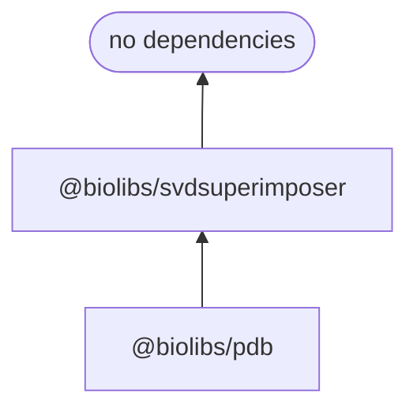

# @biolibs/svdsuperimposer

The rotation and translation that put one set of 3D points on another with the least squared distance —
the Kabsch algorithm, through a singular value decomposition. A port of Biopython's
`Bio.SVDSuperimposer`.

- **`SVDSuperimposer`** — `set`, `run`, then the rotation, the translation, the RMSD and the moved points
- **`svd3`** — the decomposition itself, one-sided Jacobi on a 3×3 matrix, usable on its own
- **Single or double precision**, decided by the array type you hand it, as NumPy's `'f'` arrays decide it
- **No dependencies**: it is arithmetic on arrays of three numbers
- The atom-level wrapper, `Superimposer`, lives in [`@biolibs/pdb`](../pdb)

## What is verified

A generator drives real Biopython and records what it does — the rotation, the translation, both RMSDs,
the transformed points, and the exception type *and* message where it raises. The tests replay those
recordings.

| Upstream module | Items at parity | Checklist |
|---|---|---|
| `Bio.SVDSuperimposer` | **7 / 7** | [Bio.SVDSuperimposer.md](../../docs/parity/Bio.SVDSuperimposer.md) |

**520 recorded cases** against Biopython 1.88: point sets from 1 to 50 points, in both precisions,
including the degenerate ones — a single point, collinear points, coincident points, and the empty set.

Where the claim stops, and it is all one thing:

- **NumPy calls LAPACK; this does not.** The port runs one-sided Jacobi rotations on the 3×3 covariance
  matrix, which agrees with LAPACK to about **1e-8 in double precision**. That is the comparison the
  cases make.
- **Rank-deficient input has no single right answer.** For one point, or three collinear ones, the
  singular vectors belonging to zero singular values are arbitrary in *any* implementation. A zero
  matrix gives identity factors, as LAPACK does, and the determinant correction still yields a proper
  rotation — but an exactly collinear set is not guaranteed to match Biopython's choice, and the cases
  say so rather than pretending otherwise.

## Install

```bash
npm install @biolibs/svdsuperimposer
```

- ESM only, Node 20 or later, TypeScript declarations included
- No dependencies at all



## API

### `SVDSuperimposer`

Points are arrays of rows. `set(reference, moving)` says which set moves; `run()` does the work; the rest
reads the answer.

```ts
import { SVDSuperimposer } from "@biolibs/svdsuperimposer";

// A unit square, and the same square turned 90° about z and shifted along y.
const reference = [[0, 0, 0], [1, 0, 0], [1, 1, 0], [0, 1, 0]];
const moving = [[5, 0, 0], [5, 1, 0], [4, 1, 0], [4, 0, 0]];

const sup = new SVDSuperimposer();
sup.set(reference, moving);
sup.run();

const [rot, tran] = sup.getRotran();
console.log(rot.map((row) => Array.from(row)));
// [[0, -1, 0], [1, 0, 0], [0, 0, 1]]   — exactly that 90° turn
console.log(Array.from(tran));         // [0, 5, 0]

console.log(sup.getRms());                               // 0
console.log(Number(sup.getInitRms().toFixed(6)));        // 4.123106
console.log(sup.getTransformed().map((row) => Array.from(row)));
// [[0, 0, 0], [1, 0, 0], [1, 1, 0], [0, 1, 0]]
```

**The rotation right-multiplies**, as Biopython's does: `moved = moving · rot + tran`. Getting that
round the wrong way is the one mistake this API invites, and it produces a plausible-looking wrong
answer rather than an error.

`getInitRms()` is the RMSD before anything moved, which is what tells you whether the superposition
achieved anything.

### Misuse

Biopython raises a bare `Exception` here rather than a specific class, so the port does too —
`PythonException`, whose `name` is `"Exception"`:

```ts
const s = new SVDSuperimposer();
s.set(reference, moving);
s.getRms();
// Exception: Nothing superimposed yet.

new SVDSuperimposer().run();
// Exception: No coordinates set.

new SVDSuperimposer().set(reference, [[0, 0, 0]]);
// Exception: Coordinate number/dimension mismatch.
```

An empty set divides by zero — in `run`, before any getter is reached, which is the error Python gives
there too:

```ts
const e = new SVDSuperimposer();
e.set([], []);
e.run();
// ZeroDivisionError: division by zero
```

### Precision

Rows that are `Float32Array`s make the whole computation and every result single precision, as NumPy's
`'f'` arrays do. Anything else is double.

```ts
const f32 = (rows: number[][]): Float32Array[] => rows.map((r) => Float32Array.from(r));

const single = new SVDSuperimposer();
single.set(f32(reference), f32(moving));
single.run();

console.log(single.getRotran()[0][0] instanceof Float32Array);   // true
```

### `svd3`

The decomposition on its own, for a 3×3 matrix. Singular values come back in descending order.

```ts
import { svd3 } from "@biolibs/svdsuperimposer";

const [u, s, v] = svd3([[1, 0, 0], [0, 2, 0], [0, 0, 3]]);
console.log(s);   // [3, 2, 1]
```

`det3`, `matMul` and `transpose` are exported alongside it.

## Testing

```bash
npm test                 # the whole workspace
npx vitest run packages/svdsuperimposer/test
```

| File | What it checks |
|---|---|
| `test/svd.test.ts` | the 520 recorded cases, compared to 1e-8 |
| `test/readme.test.ts` | every code block in this file |

Coverage from this package's own tests — `npx vitest run --coverage packages/svdsuperimposer/test`:

| | |
|---|---|
| Statements | **96.35%** (132 / 137) |
| Functions | **100.00%** (21 / 21) |
| Branches | **97.41%** (113 / 116) |

## Things to know

- **The rotation right-multiplies.** `moving · rot + tran`, not `rot · moving`.
- **`set` takes the reference first.** `set(reference, moving)` — the second argument is the one that
  moves, which is the opposite order to how most people say it aloud.
- **`run` must come before any getter**, and `set` before `run`; both raise a bare `Exception` otherwise.
- **The arrays decide the precision.** A `Float32Array` row makes the result single precision, down to
  the returned matrices' types.
- **Collinear input is not guaranteed to match Biopython**, because the answer is not unique. Everything
  else agrees to 1e-8.

## License

MIT — see [LICENSE](LICENSE).
